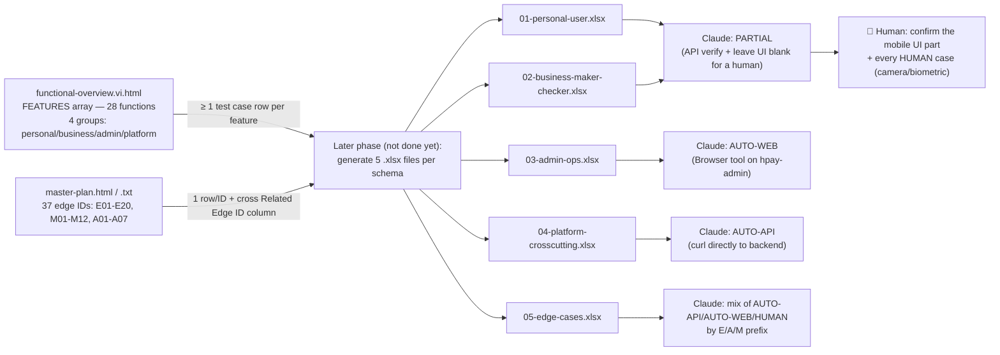
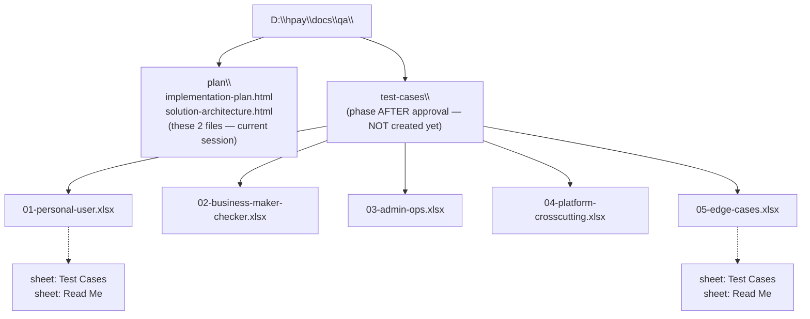
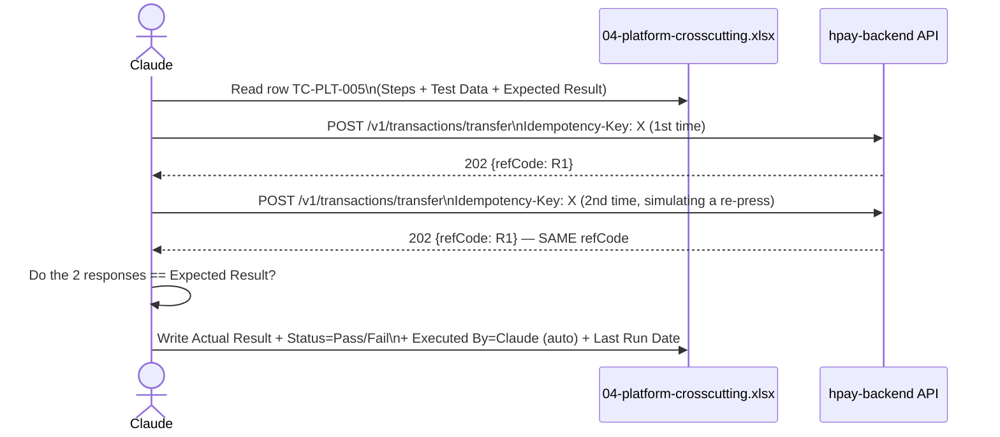
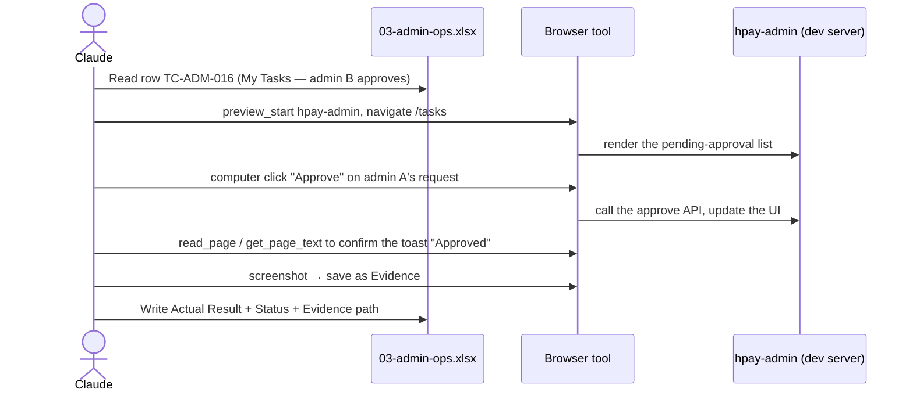
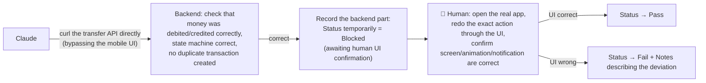
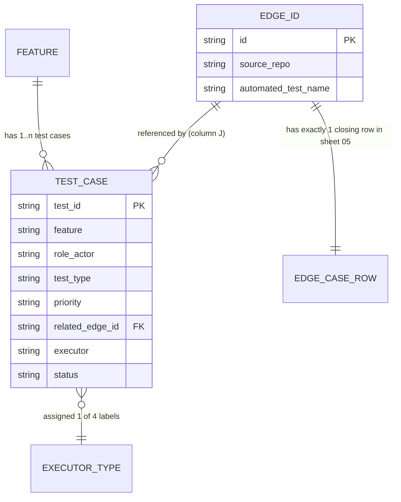

# Solution Architecture — Manual QA Excel Test-Case Suite

[← HPay Docs](../../README.md) · qa · plan · solution architecture

> Companion to [implementation-plan.md](./implementation-plan.md). The focus here: the data structure (directories/files/columns), the data flow from the sources (functional-overview + master-plan) into Excel, and the execution flow Claude will use in a later phase — **no code runs in this document**, it only describes the design.

## 1. Context — data sources → Excel set → human/Claude executors

## 2. Directory structure

## 3. Sample execution flow — AUTO-API (example sheet 04, idempotency)

## 4. Sample execution flow — AUTO-WEB (example sheet 03, admin approves My Tasks)

## 5. Sample execution flow — PARTIAL (example sheet 01, P2P transfer on mobile)

## 6. Data model — relationships between entities

## 7. Decisions & trade-offs

| Decision | Alternative | Why |
|---|---|---|
| Put the Excel set + plan in `hpay-docs`, not in 1 of the 3 code repos | Put it in `hpay-backend` (the "heaviest" repo) following the `docs/plans/<feature>/` mold used for every other feature | Test cases touch all 3 repos in the same scenario (e.g. signing approval: the checker's mobile UI + the backend API); stuffing it into 1 code repo would leave the other 2 repos "unaware" the test set exists. `hpay-docs` already plays the cross-repo index role. |
| 5 files, matching exactly the 4 role groups + 1 separate edge-case sheet | Merge everything into 1 multi-sheet file, or split by code repo (3 files: backend/mobile/admin) | Splitting by code repo would break cross-repo features (1 function usually touches ≥2 repos) — splitting by business role (like functional-overview) keeps the end user's viewpoint, easy to cross-reference back to the source documents. 5 separate files instead of 1 multi-sheet file so each role-owner (mobile QA, admin QA...) opens exactly the 1 file they need, not paging through many sheets. |
| A separate edge-case sheet 05, not relying only on the Related Edge ID column in sheets 01-04 | Use only column J, no separate sheet — look up by filter | Many edge cases (race condition, multi-actor, timing) need a longer scenario description than the usual 1-row "function case" mold allows, and need a "master checklist" to verify all 37/37 IDs — filters scattered across 4 files easily miss one. |
| 4 hard Executor labels (AUTO-API/AUTO-WEB/PARTIAL/HUMAN) assigned from design time, not "computed later" | Do not classify beforehand, Claude decides at run time for each case | Having no mobile simulator is a known hard limit — deciding beforehand prevents Claude from self-claiming "Pass" for a UI part it has never seen; PARTIAL always stops at Blocked awaiting a human, never inferring a correct UI from a correct API response. |
| Do not design an automated test framework in this artifact | Take the opportunity to write scripts that generate + run automated tests for the AUTO-* cases | Outside the assigned scope — another parallel effort already covers automation (`TestEdge_*` + `gen-api-test`); mixing the 2 would bloat the plan and make it hard to review in a single approval pass. |

## 8. Known limits (recorded, not bugs)

| Limit | Impact |
|---|---|
| No Expo/React Native simulator/device | Every mobile-UI case is at most PARTIAL — never AUTO for the display part |
| A-series (admin edge IDs) has no centralized official ID list | The A part of sheet 05 will be the source establishing the IDs for the first time in the file-creation phase — scattered content in `src/admin/docs/plans/*` must be cross-checked carefully so the meaning is not mis-assigned |
| The case count (124) is a floor estimate | May rise ~15-20% when written in detail — does not affect the structure/schema, only the effort of the later phase |

---

HPay Docs · plan for the manual QA checklist suite · repo hpay-docs · 2026-07-29
