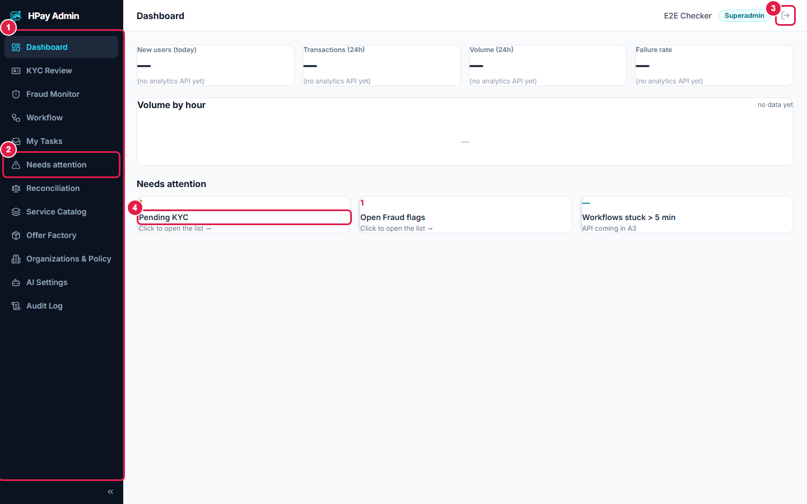
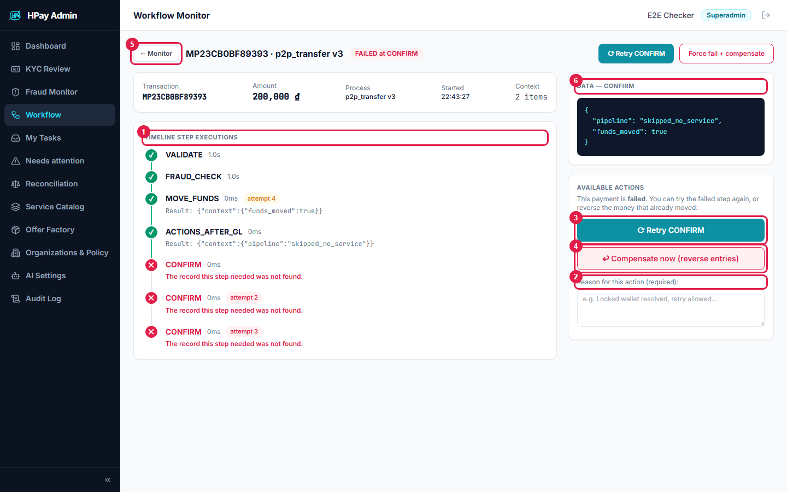
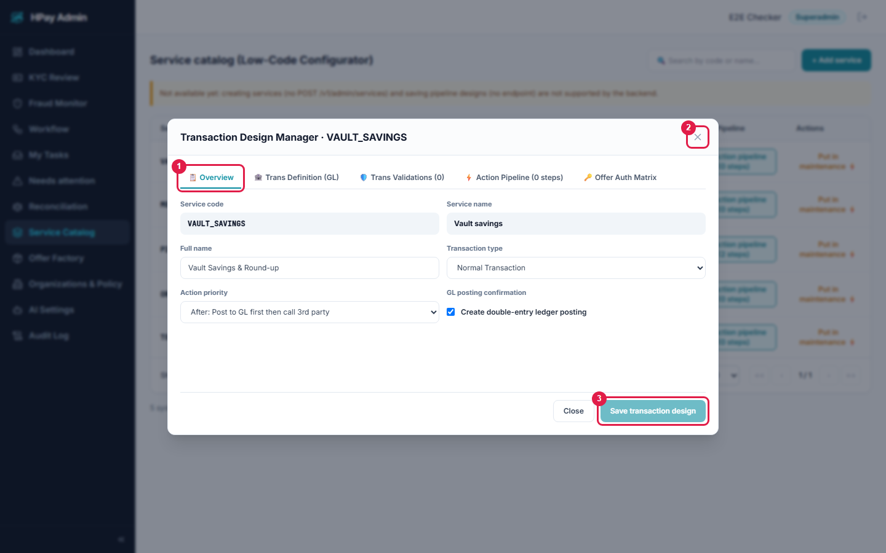

# HPay

A fintech e-wallet built end to end as one monorepo: a **Go backend** with a double-entry ledger, a **React admin console** for operations staff, and an **Expo (React Native) mobile app** for customers.

It started as a small P2P wallet and grew into the parts a real payment product needs: KYC review, configurable offers and limits, a workflow engine for multi-step payments, fraud flags, reconciliation, maker-checker approval, and a role-based back office.



> Demo project. All data in the screenshots is seeded demo data. The SMS and bank providers are simulated (Twilio is wired but has never been called with real keys), and the mobile app has not been run on a physical device yet.

## What is in it

| Area | What it does |
|------|--------------|
| **Wallet and ledger** | Double-entry ledger in integer minor units (no floats). A wallet balance always equals the sum of its ledger lines, and this is checked after every load test. |
| **Transfers** | Request, then confirm with a PIN, then a workflow runs the steps (validate, hold, post, notify) with compensation when a step fails. |
| **Offers and limits** | Plans per customer with per-transaction, daily and monthly limits, a minimum interval, and an amount-tier auth matrix (none, PIN, OTP, 2FA). |
| **KYC** | Document upload, review queue, approve or reject with a reason. |
| **Security** | Server-side PIN, PIN reset by code, TOTP second factor, rate limits, admin RBAC, audit trail. |
| **Back office** | Workflow monitor with retry and compensate, fraud flags, reconciliation runs, service catalog, offer factory, organisations with approval policies. |



## Engineering decisions worth reading

Every significant decision has a written record. These are the ones that matter most for a money system:

- **Money as `int64` minor units**, never floats ([ADR-0003](docs/adr/0003-money-as-int64-minor-units.md)).
- **Transactional outbox + Redis Streams**, so a database commit and its event cannot drift apart ([ADR-0004](docs/adr/0004-outbox-and-redis-streams.md)).
- **Idempotency keys scoped per user and bound to the request**, so a replay returns the first result and a key cannot be reused for a different payment ([ADR-0011](docs/adr/0011-idempotency-per-user-bound-to-request.md)).
- **Ledger postings guard**: wallets are locked in one ordered statement to avoid deadlocks ([ADR-0010](docs/adr/0010-ledger-postings-guard.md)).
- **Offer limits under concurrency**: a per-user advisory lock around the limit check, because a request waiting for its PIN does not count toward the quota and parallel confirms could exceed the daily limit (found as a bug, see [`docs/bugs/`](docs/bugs/INDEX.md)).
- **Reversal failures fail closed** and need manual handling ([ADR-0009](docs/adr/0009-reversal-failure-needs-manual-and-fail-closed-fraud.md), [ADR-0013](docs/adr/0013-reversal-uniqueness-and-needs-manual.md)).
- **PIN hashing with a server-side pepper** and a lighter argon2 cost, with key ids, rotation and rehash on verify ([ADR-0018](docs/adr/0018-pin-pepper-and-hash-cost.md), [runbook](docs/runbooks/pin-pepper.md)).
- **Explicit `APP_ENV`** with strong-secret checks outside dev and ci ([ADR-0012](docs/adr/0012-explicit-app-env.md)).

18 ADRs and 15 bug records (each with root cause and a regression test) are in [`docs/adr`](docs/adr) and [`docs/bugs`](docs/bugs).



## How it is checked

Numbers from runs on the development machine, not marketing figures:

- Backend: 23 Go packages pass with `go test ./... -race` (integration tests run against real Postgres and Redis). Backend CI runs the same on every push.
- Admin: lint, type check, 52 unit tests and 30 Playwright end-to-end tests (1 skipped) pass.
- Mobile: 255 Jest tests, type check and lint pass.
- Load test (200 users, 50 workers, 60 s, one laptop in Docker): 600 of 600 transfers completed and **0 wallets differ from their ledger sum**. Throughput is modest and the numbers are noisy, so treat them as a shape, not a benchmark. See [`docs/quality/performance`](docs/quality/performance/).

The work follows a documented process (spec, plan, red tests, implementation, verification, review, knowledge-base update). The skills that drive it live in [`.claude/skills`](.claude/skills).

## Tech stack

| Layer | Stack |
|-------|-------|
| Backend | Go, Gin, PostgreSQL 16 (pgx, sqlc), Redis Streams, argon2id, OpenAPI |
| Admin | React, Vite, TypeScript, TanStack Query and Router, Tailwind, Vitest, Playwright |
| Mobile | Expo, React Native, expo-router, TanStack Query, Jest |
| Delivery | Docker Compose, GitHub Actions (`backend-ci`, `admin-ci`) |

```
 Mobile app ─┐                         ┌─ Postgres (ledger, outbox)
             ├─► Go API (Gin) ────────►│
 Admin web ──┘        │                └─ Redis Streams ─► workflow workers
                      └─ outbox relay ──────────────────────┘
```

## Run it locally

Needs Docker, Go, Node 20+, `sqlc` 1.27 and `golang-migrate`. The full, checked steps are in [`docs/guides/setup-local-environment.md`](docs/guides/setup-local-environment.md).

```bash
# Backend: Postgres + Redis, migrations, demo data, API on :8080
cd src/backend
cp .env.example .env
docker compose up -d
sqlc generate && make migrate-up && make seed
go run ./cmd/server

# Admin console on :5173
cd src/admin && npm ci && npm run dev

# Mobile
cd src/mobile && npm ci && npx expo start
```

Demo admin login: `e2e-checker@HPay.dev` (superadmin) or `e2e-maker@HPay.dev` (operations), password `E2ETest@123`. Mobile demo user: `0900000001` / `Demo@123`. These exist only in the seed data.

On Windows machines that block Go-built executables, run the backend tests in Docker: `.\scripts\test-backend.ps1`.

## Documentation

- [Admin user guide](docs/guides/admin-user-guide.md), written for non-technical staff, with 36 screenshots (also as a single [HTML file](docs/guides/admin-user-guide.html)).
- [Knowledge base index](docs/README.md): domain rules, architecture, API and data reference, ADRs, bug ledger, quality reports.
- [Backlog](docs/planning/BACKLOG.md) and [open admin issues](docs/guides/admin/OPEN-ISSUES.md): what is known to be unfinished.

## Repository layout

```
src/backend   Go API, workflow engine, migrations, seed, tests
src/admin     React back office
src/mobile    Expo customer app
docs/         knowledge base (domain, architecture, ADRs, bugs, guides, QA workbooks)
scripts/      Docker-based backend test runner
.claude/      skills and subagents that drive the development workflow
.github/      CI workflows
```

Conventions: everything is written in English; docs are changed before code; never commit `.env`, `data/` or secrets.
