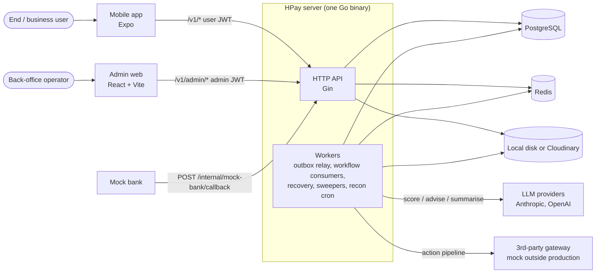

# System context and scope

## Actors

| Actor | Client | Auth | Notes |
|---|---|---|---|
| End user (personal wallet) | `src/mobile` | user JWT (aud `user`, 15 min) + refresh token (30 days) | `auth/jwt.go:11`, `auth/refresh.go:11` |
| Business user (org admin / maker / checker) | `src/mobile` (screens under `app/(main)/org`) | same user JWT; org role checked in service layer | `router.go:151` |
| Back-office operator | `src/admin` | admin JWT (aud `admin`), separate `admin_users` table | `router.go:166-188`, `auth/admin.go` |
| Mock bank / bank simulator | HTTP caller | shared secret header `X-Mock-Bank-Secret` | `api/mockbank_handler.go:31` |
| Scheduler | in-process goroutines | n/a | `cmd/server/main.go:146-151` |

## External systems

| System | Used for | How | Where |
|---|---|---|---|
| PostgreSQL 16 | all state | pgx pool | `platform/db`, compose `postgres:16-alpine` |
| Redis 7 | workflow streams, rate limiting | go-redis | `platform/redisclient`, `outbox/relay.go:66`, `api/middleware.go:39` |
| Cloudinary | KYC image and recon report storage when `STORAGE_PROVIDER=cloudinary` | REST via `storage/cloudinary.go` | `main.go:101`, `router.go:68` |
| Local disk | default KYC storage (`KYC_STORAGE_DIR`, default `./data/kyc`) | `storage.NewLocal` | `config.go:79` |
| LLM providers (Anthropic Claude, OpenAI) | KYC document scoring, fraud advisor, recon summary | keys and active provider are rows in DB (`ai_keys`, `ai_settings`), managed from the admin AI Settings page; `mock` provider available | `kyc/handlers.go:76-102`, `kyc/scorer_claude.go`, `kyc/scorer_openai.go`, `ai/advisor_claude.go`, `ai/advisor_openai.go` |
| Outbound action gateway (3rd-party HTTP) | per-service "actions" run by the `action_pipeline` step | real HTTP only when `APP_ENV == "production"`, otherwise `gateway.NewMock()` | `main.go:116-120` |
| Mock bank | simulated bank top-up notification and statements | `POST /internal/mock-bank/callback`; statements stored in `bank_statements` | `wallet/callback.go:61` |

There is no real bank integration, SMS/OTP provider, or push-notification service in the code. OTP codes are generated and verified internally (`auth/otp.go`); in `APP_ENV=dev` the approval challenge returns the code in the response as `otp_dev` (`api/approval_handler.go:48`).

## Context diagram

## In scope (implemented in code)

Registration/login with refresh rotation; wallets and double-entry ledger; P2P transfer; QR resolve; fee policies; offer packages (OfferGuard limits and auth matrix); money requests and split bill; vaults and round-up; KYC with AI scoring and manual review; business orgs with maker-checker multi-tier approval; admin reversal via admin approval; fraud rules and flags; mock-bank top-up callback and nightly reconciliation; admin back-office (KYC, fraud, workflows, services, offers, orgs, recon, AI settings, audit).

## Out of scope / not present

- Real bank or card rails, real SMS/email delivery, push notifications, multi-currency (wallet currency is `VND` everywhere in queries), card issuing.
- Server-side PIN: no PIN is stored or verified by the backend (audit BE-C2); see [crosscutting-concepts.md](crosscutting-concepts.md).
- Other products mentioned in old docs are reference material only and have no code in this repo.
- Kubernetes/infra-as-code, observability stack (metrics, tracing): none in repo. Only `/healthz` and structured access logs exist.
