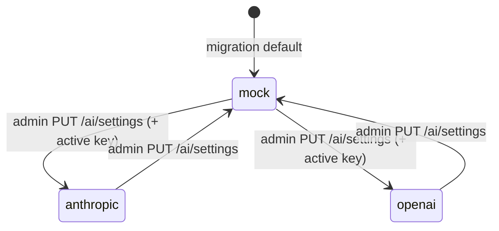
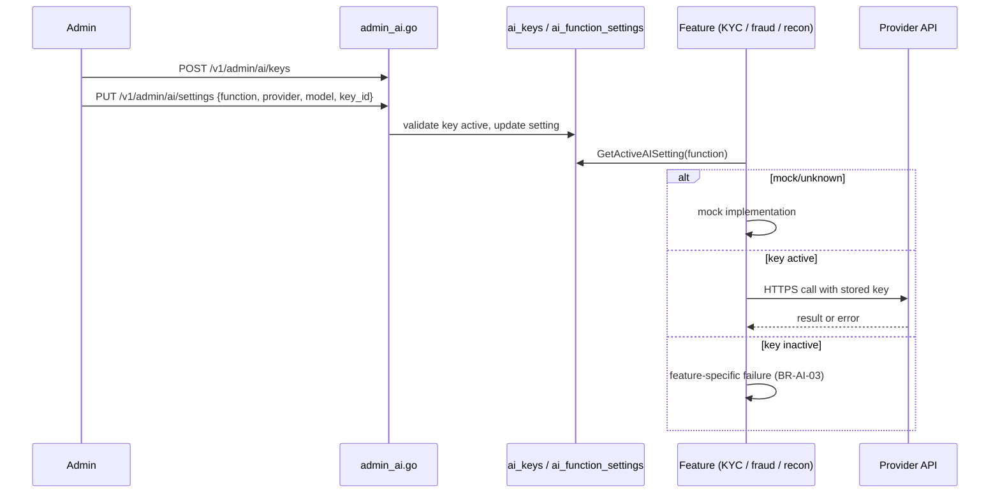

# AI Integration

## 1. Purpose
Owns the configuration (keys, per-function provider settings) and the provider adapters through which LLMs are called, and documents which features use them. LLMs are advisory only: they produce a KYC score, a fraud explanation, or a reconciliation summary. They never decide anything about money, and every call has a mock or no-op fallback. It does NOT own the thresholds that act on a KYC score (`kyc.md`) or the fraud decision (`fraud-and-recon.md`).

## 2. Key concepts
- **Function**: a named AI use. Exactly two are configurable: `kyc_scoring` and `fraud_advising` (CHECK in handler `oneof`, `api/admin_ai.go:104`). Reconciliation summaries reuse `fraud_advising`.
- **Provider**: `mock`, `anthropic`, `openai` for settings; keys accept `anthropic` or `openai` only.
- **Advisor** (`ai.Advisor`): text completion interface `Complete(ctx, system, user)`. **Scorer** (`kyc.Scorer`): vision interface `Score(ctx, idCard, selfie)`.
- **ai_keys**: stored API keys. **ai_function_settings**: function -> provider/model/key mapping.

## 3. Business rules

| ID | Rule | Enforced by | Test |
|----|------|-------------|------|
| BR-AI-01 | Default settings for both functions are provider `mock`, model `mock`, no key. | `000005:178-185` | `TestAIConfig_DefaultMock` |
| BR-AI-02 | Provider resolution (KYC scorer and fraud/recon advisors): `mock` or any unknown provider -> mock implementation; `anthropic` / `openai` need a joined key with `is_active = true`. | `kyc/handlers.go:76-102`, `fraud/handler.go:107-125`, `recon/recon.go:227-243`, `queries/ai.sql:GetActiveAISetting` | `TestAIConfig_OpenAIRoutingAndInactivation` |
| BR-AI-03 | Inactive/missing key behavior differs by feature: KYC scoring fails the SCORE step (error text contains `ERR_AI_PROVIDER_UNAVAILABLE`, terminal); fraud advisory is skipped silently; recon summary is empty. | same files as BR-AI-02 | `TestAIConfig_OpenAIRoutingAndInactivation` (KYC only) |
| BR-AI-04 | A failure to read the setting row: KYC step is retryable; fraud advisory is skipped; recon summary is empty. | `kyc/handlers.go:81-84`, `fraud/handler.go:101-105`, `recon/recon.go:222-225` | none |
| BR-AI-05 | Claude adapters call `https://api.anthropic.com/v1/messages` with a HARD-CODED model `claude-sonnet-5` (the `model_name` setting is ignored for provider `anthropic`), version header `2023-06-01`. Advisor: max_tokens 400, 15 s timeout; scorer: max_tokens 500, 25 s timeout. | `ai/advisor_claude.go:13-35`, `kyc/scorer_claude.go:20-37` | `TestClaudeScorerErrorClassification` |
| BR-AI-06 | OpenAI adapters call `https://api.openai.com/v1/chat/completions` with `model_name` from settings (empty or `mock` becomes `gpt-4o`). Advisor timeout 20 s; scorer 25 s, `response_format=json_object`, max_tokens 500. | `ai/advisor_openai.go:24-33`, `kyc/scorer_openai.go:27-36,60-65` | `TestAIConfig_OpenAIRoutingAndInactivation` |
| BR-AI-07 | Advisor errors are returned to callers who treat them as "no advice". Scorer errors are classified: network/429/5xx/unparsable reply retryable, other 4xx terminal. | `ai/advisor.go:14-16`, `kyc/scorer_claude.go:81-111` | `TestClaudeScorerErrorClassification` |
| BR-AI-08 | Mock advisor returns `[mock advisory] ` + first 160 bytes of the user prompt; mock scorer is deterministic from the image hash (40..99). | `ai/advisor.go:21-33`, `kyc/scorer.go:35-47` | `TestMockScorerDeterministic` |
| BR-AI-09 | Key create: body `name` (<=100), `provider` in {anthropic, openai}, `api_key` (<=255); stored active. Responses never include the key (queries return no `api_key` for list/insert/update). | `api/admin_ai.go:13-38`, `queries/ai.sql:ListAIKeys,InsertAIKey,UpdateAIKey` | none |
| BR-AI-10 | Key update requires `name`; empty `api_key` keeps the old key; `is_active` is taken from the body, so omitting it sets the key inactive. | `api/admin_ai.go:46-83` | none |
| BR-AI-11 | Setting update: `function_name` in {kyc_scoring, fraud_advising}, `provider` in {anthropic, openai, mock}, `model_name` required (<=100); optional `key_id` must exist (404 `ERR_KEY_NOT_FOUND`) and be active (400 `ERR_KEY_INACTIVE`); no `key_id` clears the key. Provider and the key's provider are NOT cross-checked. | `api/admin_ai.go:110-153`, `queries/ai.sql:UpdateAISetting` | `TestAIConfig_OpenAIRoutingAndInactivation` (via queries) |
| BR-AI-12 | The setting is read at each use (no cache), so a change takes effect on the next KYC step or advisory. | `queries/ai.sql:GetActiveAISetting` called per execution | `TestAIConfig_OpenAIRoutingAndInactivation` |

## 4. Lifecycle / state machine
No persistent lifecycle beyond `ai_keys.is_active` (true/false, toggled by key update) and the provider field in a setting.

Transitions are owned by `api/admin_ai.go:UpdateAISetting`. Deactivating a key does not change the setting; it makes the feature unavailable (BR-AI-03).

## 5. Main flows

Data sent to providers:
- KYC scoring: BOTH raw images (ID card and selfie, base64) plus a fixed prompt (`kyc/scorer_claude.go:41-47`, `scorer_openai.go`). Reply must be JSON `{score, reasons[]}`.
- Fraud advisory: reference code, score, and the signal list (code, points, evidence), Vietnamese prompt; only for flagged/blocked transactions (`fraud/handler.go:127-132`). No user identity fields are included.
- Recon summary: run date, counts, and the details of non-matched items (ref codes, amounts, wallet ids for drift) (`recon/recon.go:210-219`).

## 6. Invariants
- No LLM output feeds a money decision: KYC score goes through `Classify` thresholds; fraud decision is computed before the advisory; recon summary is a text column.
- API keys are never returned by the admin API.
- With default settings no network call is made.

## 7. Data
- `ai_keys` (000005:155): `provider`, `name`, `key_ciphertext` (unused), `api_key` (PLAINTEXT, the column read by code), `key_masked` (unused), `is_active`.
- `ai_function_settings` (000005:167): PK `function_name`, `provider`, `model` (unused), `model_name` (default `claude-3-5-sonnet-20241022`, seeds use `mock`), `key_id -> ai_keys`, `api_key VARCHAR(255)` (unused).
- Consumers also write `kyc_requests.ai_*`, `fraud_flags.reasons`, `reconciliation_runs.ai_summary`.
The audit mentions a migration for `ai_settings`; the table in code is `ai_function_settings` and it lives in migration 000005 (there is no separate AI migration).

## 8. Interfaces
Admin (all behind `RequireAdmin`, `router.go:208-212`): `GET/POST /v1/admin/ai/keys`, `PUT /v1/admin/ai/keys/:id`, `GET /v1/admin/ai/settings`, `PUT /v1/admin/ai/settings`. See `../reference/api.md`.
Environment: there is no `ANTHROPIC_API_KEY` / `OPENAI_API_KEY` env var read anywhere in code; keys come only from the DB. The text in `kyc/scorer.go:28,45` and `ai/advisor.go:35` (`ai.New`) mentions an env key but `ai.New` has no callers in production paths found (providers are built directly from settings).

## 9. Edge cases
- Key referenced by a setting is later deactivated: KYC submissions then stall at SCORE (`TestAIConfig_OpenAIRoutingAndInactivation` asserts `ai_score` stays unset).
- Provider timeout/5xx during KYC: workflow retry with exponential backoff.
- Setting names `anthropic` with an OpenAI key (or vice versa) is accepted and will fail at call time.

## 10. Known gaps (as-is vs intended)
- **Plaintext key storage** in `ai_keys.api_key`; `key_ciphertext` column is dead; no audit when keys or settings change (audit Medium).
- **No RBAC**: any admin can create keys and change settings (BE-H6).
- **`model_name` ignored for Anthropic** (hard-coded model) (audit Medium).
- `admin_ai.go:127` matches errors by string rather than `errors.Is(pgx.ErrNoRows)` (audit); other no-row errors become 500.
- Omitting `is_active` in a key update silently deactivates the key (audit; BR-AI-10).
- `ai.New("")` silently returns a mock (audit), but it is not used on the configured path.
- Fraud and recon share one setting (`fraud_advising`); there is no separate recon function.
- Sending ID-card images to a third-party LLM has unresolved legal considerations (audit).

## 11. Code map
| File | Responsibility |
|------|----------------|
| `internal/ai/advisor.go` | `Advisor` interface, `MockAdvisor`, `New` |
| `internal/ai/advisor_claude.go`, `advisor_openai.go` | Text adapters |
| `internal/kyc/scorer*.go` | Vision scorers |
| `internal/kyc/handlers.go:49` | KYC provider selection |
| `internal/fraud/handler.go:96` | Fraud advisory provider selection |
| `internal/recon/recon.go:206` | Recon summary |
| `internal/api/admin_ai.go` | Key and setting CRUD |
| `internal/store/queries/ai.sql` | Queries |

## 12. Open questions
- Key encryption at rest and a KMS: not decided.
- Whether recon should have its own AI function and whether model selection should be honored for Anthropic: undecided.
