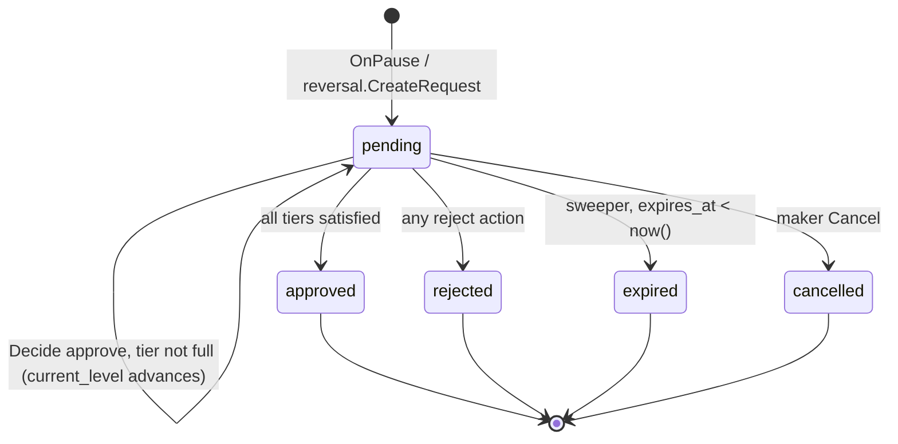
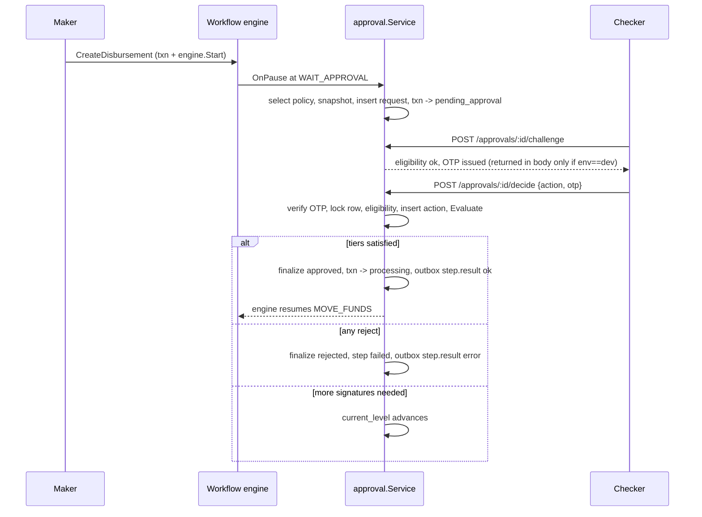
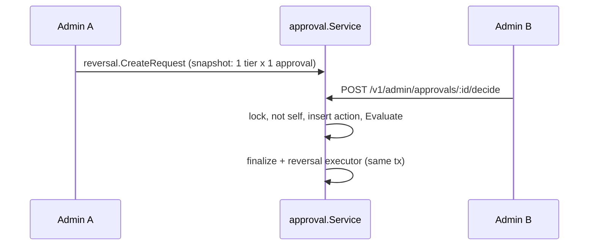

# Approval (maker-checker engine)

## 1. Purpose
A subject-agnostic engine that parks a business effect until the required human signatures are collected. Two subjects exist today: `org_transaction` (an org disbursement paused on the workflow step `WAIT_APPROVAL`) and `reversal` (an admin reversal of a completed transaction). The engine owns policy snapshots, tiered signatures, OTP-gated checker decisions, cancel, expiry and "finalize + run the subject executor in the same DB transaction". It does NOT own policy authoring or membership (see `organization.md`) nor the reversal ledger effect (see `reversal.md`).

## 2. Key concepts
- **Request** (`approval_requests`): one row per subject; `status` in `pending|approved|rejected|expired|needs_manual|cancelled` (000005:14 + 000011:6).
- **Policy snapshot**: JSON `{policy_id,name,version,tiers[]}` frozen into the request (`evaluate.go:23`, `service.go:117`).
- **Tier**: `{level, required_approvals}`; tiers are filled in ascending level order (`evaluate.go:54`).
- **current_level**: the tier now collecting signatures; only a checker whose `org_members.checker_level` equals it may sign.
- **Executor**: per-subject callback run inside the finalize transaction (`service.go:35`, `:66`).
- **Admin approvals**: reversal requests decided by admins (no OTP, no org) via `AdminDecide` (`admin.go:46`).

## 3. Business rules

| ID | Rule | Enforced by | Test |
|----|------|-------------|------|
| BR-APR-01 | When a workflow instance parks on a `human_approval` step, an approval request is created and the transaction moves `processing -> pending_approval` atomically with the engine's state change. | `service.go:OnPause` (86-141), `queries/transactions.sql:PendTransactionGuarded` | `TestOrgDisbursementTwoTierEndToEnd` |
| BR-APR-02 | OnPause only supports organization-owned sender wallets. | `service.go:98-100` | none |
| BR-APR-03 | The policy used is the active policy whose `[min_amount, max_amount]` contains the transaction amount; on overlap the highest `version` wins; no match fails with `ErrNoPolicy`. | `queries/approval.sql:GetActivePolicyForAmount` (14-22), `service.go:105-107` | `TestOrgDisbursementTwoTierEndToEnd` |
| BR-APR-04 | The policy tiers are validated again at request creation: at least one tier, `level >= 1`, `required_approvals >= 1`, no duplicate level. | `evaluate.go:ValidateTiers` (76-94), `service.go:114` | `TestValidateTiers` |
| BR-APR-05 | The policy is frozen in `policy_snapshot`; decisions read the snapshot, never the live policy. | `service.go:117-122`, `Decide` 453-458 | `TestEdge_E09_PolicySnapshotSurvivesPolicyChange` |
| BR-APR-06 | Default deadline is 24 hours; the step config key `expires_h` overrides it; a malformed or non-positive value falls back to 24. | `service.go:124-136` (the `human_approval` step in 000010:30 has `timeout_ms` 86400000 but only `config.expires_h` is read) | none |
| BR-APR-07 | A checker may sign only if: request status is `pending`, not past `expires_at`, the user is a member of the request's org, role is `checker`, `checker_level == current_level`, and has not acted before. Non-members get `ErrNotFound` (no existence leak). | `service.go:eligibility` (221-251) | `TestApprovalEligibility`, `TestQA_SecondCheckerAfterFinalizeGetsClearError` |
| BR-APR-08 | One action per checker per request. | DB constraint `one_action_per_checker UNIQUE(request_id, checker_id)` (000005:98); 23505 mapped to `ErrAlreadyActed` (`service.go:438-441`) | `TestEdge_E08_CheckerRaceSingleFinalize` |
| BR-APR-09 | Concurrent decisions serialize on the request row (`FOR UPDATE`). | `queries/approval.sql:GetApprovalRequestForUpdate` (77-83), `service.go:417` | `TestEdge_E08_CheckerRaceSingleFinalize` |
| BR-APR-10 | Signing requires an OTP bound to the request id (purpose `apr:<32 hex>`); `Challenge` runs the eligibility check BEFORE issuing the OTP; `Decide` verifies the OTP before opening the transaction. | `service.go:otpPurpose` (72), `Challenge` (152-167), `Decide` (406) | `TestApprovalEligibility` |
| BR-APR-11 | Evaluation: any `reject` action is final (-> rejected); otherwise tiers sorted by level must each reach `required_approvals`; the first unsatisfied tier becomes `current_level`; all satisfied -> approved. | `evaluate.go:Evaluate` (54-71) | `TestEvaluate` |
| BR-APR-12 | `pending -> approved/rejected/expired/cancelled` is a guarded UPDATE (`WHERE status='pending'`); the loser of a race gets `ErrAlreadyFinalized`. | `queries/approval.sql:FinalizeApprovalRequest` (143-149), `service.go:finalize` (496-503) | `TestEdge_E08_CheckerRaceSingleFinalize` |
| BR-APR-13 | Level advancement is guarded to pending requests only. | `queries/approval.sql:SetApprovalCurrentLevel` (138-141) | none |
| BR-APR-14 | The subject executor runs in the same DB transaction as the finalize; if it errors the whole finalize (and the action row) rolls back. | `service.go:finalize` (506-515), called from `Decide` 468-474 | none for the failure branch |
| BR-APR-15 | `org_transaction` executor: records a `step_executions` row (`completed` if approved, `failed` with reason otherwise); on approve moves the txn `pending_approval -> processing`; emits a `step.result` outbox event so the engine resumes like after any auto step. A duplicate step row (23505) is tolerated. | `service.go:resumeWorkflow` (521-571), `queries/transactions.sql:ResumeTransactionGuarded` | `TestOrgDisbursementTwoTierEndToEnd`, `TestOrgDisbursementRejectFailsClean` |
| BR-APR-19 | Admin read path for parked requests (G12): `GET /v1/admin/approvals?status=needs_manual` lists them oldest first with ref code, amount, `parked_at` (= `finalized_at`) and the audit reason; any status other than `pending`/`needs_manual` is a 400. `GET /v1/admin/attention/summary` counts them with `compensation_failed` workflows. Both need `workflow.action`, are read-only and exclude `org_transaction`. | `approval/admin.go:AdminNeedsManual`, `product/service.go:AttentionSummary`, `queries/approval.sql`, `queries/workflow.sql:CountAttentionItems` | `TestAttention_*` |
| BR-APR-18 | An executor may return `approval.NeedsManual` (ADR-0013). `AdminDecide` runs the executor inside a savepoint; on a `ManualError` it rolls the savepoint back, keeps the action row, sets `needs_manual` (guarded `WHERE status = 'pending'`) and writes the audit row the error names. Other executor errors still fail the whole decision. Only the admin path parks; the org path is unchanged. | `approval/admin.go:finalizeOrPark`, `approval/manual.go`, `queries/approval.sql:MarkApprovalNeedsManual` | `TestReversal_ReceiverWithoutFundsGoesToNeedsManual` |
| BR-APR-19 | `AdminDecide` refuses a request past `expires_at` with `ErrExpired`. | `approval/admin.go` | `TestAdminDecide_ExpiredRequestRejected` |
| BR-APR-16 | Only the maker (`created_by`) may cancel, and only while `pending`; non-owner gets `ErrNotFound`; Cancel does NOT use `eligibility()` and does not check expiry. Effect = same as reject (status `cancelled`, step failed with "cancelled by maker"). | `service.go:Cancel` (176-209) | `TestApprovalCancel_*` (4 tests) |
| BR-APR-17 | Expiry: a 30-second sweeper claims up to 50 overdue pending requests (`expires_at < now()`), each in its own transaction, finalizing as `expired` with `approved=false` and an audit row by `system`. | `sweeper.go:Run` (9, 22-39), `service.go:ExpireDue/expireOne` (585-622), `queries/approval.sql:ListDueApprovalIDs` | `TestEdge_E10_ExpiredApprovalFailsClean` |
| BR-APR-19 | Admin read path for parked requests (G12): `GET /v1/admin/approvals?status=needs_manual` lists them oldest first with ref code, amount, `parked_at` (= `finalized_at`) and the audit reason; any status other than `pending`/`needs_manual` is a 400. `GET /v1/admin/attention/summary` counts them with `compensation_failed` workflows. Both need `workflow.action`, are read-only and exclude `org_transaction`. | `approval/admin.go:AdminNeedsManual`, `product/service.go:AttentionSummary`, `queries/approval.sql`, `queries/workflow.sql:CountAttentionItems` | `TestAttention_*` |
| BR-APR-18 | The checker inbox lists only pending, unexpired requests of the user's orgs where `checker_level = current_level` and the user has not acted. | `queries/approval.sql:ListPendingApprovalsForChecker` (157-173) | `TestApprovalDetail_EligibleCheckerCanView` |
| BR-APR-19 | Detail is visible to the maker or any member of the owning org (any role); others get `ErrNotFound`. `signatures_required` = sum of `required_approvals` over the snapshot tiers. | `service.go:buildDetail` (351-395) | `TestApprovalDetail_*` |
| BR-APR-20 | Admin decision (`reversal` subject only): no OTP; refuses `org_transaction` subjects with `ErrNotFound`; requires `pending`; the admin must differ from `created_by` (`ErrSelfApproval`); same row lock, snapshot evaluation and in-tx executor. | `admin.go:AdminDecide` (46-132) | `TestReversalEndToEnd` (self-approval blocked), `TestReversalGuards` |
| BR-APR-21 | Admin inbox lists pending, unexpired, non-`org_transaction` requests. | `queries/approval.sql:ListPendingAdminApprovals` (44-60) | none |
| BR-APR-22 | A finalize for a subject without a registered executor only logs a warning and still finalizes. | `service.go:506-511` | none |
| BR-APR-23 | Every decision, cancel and expiry writes an audit row in the same transaction. | `service.go:201,481,614`, `admin.go:121` | none |

### Self-approval for org requests (implicit)
`eligibility` never compares the checker with `created_by`. Separation holds only indirectly: the maker must have org role `maker` (`org/service.go:363`), a checker must have role `checker` (`service.go:235`), and `org_members` has `UNIQUE(org_id,user_id)` (000005:36), so one user cannot hold both roles in the same org. See Known gaps.

## 4. Lifecycle / state machine

| Transition | Owner |
|---|---|
| `-> pending` | `service.go:OnPause:132`; `reversal.go:CreateRequest:97` |
| `pending -> pending` (level) | `Decide` 462 / `AdminDecide` 102 |
| `pending -> approved/rejected` | `Decide` 467-474, `AdminDecide` 107-114 via `finalize` |
| `pending -> expired` | `service.go:expireOne:611` |
| `pending -> cancelled` | `service.go:Cancel:198` |

All terminal states are final (no UPDATE other than the guarded `WHERE status='pending'` ones). Note the spelling: approval uses `cancelled` (000011:6) while money requests use `canceled`.

## 5. Main flows

### 5.1 Org disbursement approval

Failure branches: expired request -> `ErrExpired` (410); lost race -> `ErrAlreadyFinalized` (409); wrong level -> `ErrWrongLevel` (403) (`errmap.go:77-84`).

### 5.2 Admin reversal approval

## 6. Invariants
- A paused instance always has a request: both are written in the engine's advance transaction (`service.go:82-85`).
- A request leaves `pending` exactly once (guarded UPDATE, BR-APR-12).
- The decision commit and the workflow resume event commit together (outbox insert inside the finalize tx, `service.go:566`).
- A checker signs once (DB constraint) and only at the current level (`service.go:238`).
- Evaluation uses the frozen snapshot only.

## 7. Data
See `../reference/data-model.md`. Tables: `approval_requests` (subject_type, subject_id, org_id, instance_id, policy_id, policy_snapshot, status, current_level, created_by without FK, expires_at; 000005:65-85), `approval_actions` (request_id, checker_id without FK, level, action; 000005:87-99), `approval_policies` (000005:39-50), plus `approval_policy_tiers` (000005:52-63), which is not referenced by `queries/approval.sql` or `queries/org.sql`. Enums: `approval_subject = ('org_transaction','reversal')`, `approval_decision = ('approve','reject')`.

## 8. Interfaces
Org user JWT (`router.go:151-162`): `GET /v1/org/approvals`, `GET /v1/org/approvals/by-ref/:ref_code`, `GET /v1/org/approvals/:id`, `POST /v1/org/approvals/:id/challenge` (rate limit 10/min), `POST .../decide` (body `action` approve|reject, `otp` 6 chars), `POST .../cancel`. Admin (`router.go:193-195`): `POST /v1/admin/reversals`, `GET /v1/admin/approvals`, `POST /v1/admin/approvals/:id/decide` (`action`, `reason` max 255). Background: `approval.Sweeper` every 30 s. See `../reference/api.md`.

## 9. Edge cases
- E08 two checkers race: the row lock plus unique constraint produce a single finalize.
- E09 policy changed while request in flight: snapshot wins.
- E10 request expires: sweeper finalizes as expired, step failed, transaction fails with no ledger entries.
- `DetailByRefCode` returns `ErrNotFound` until the pause hook has created the request (`service.go:327-335`).

## 10. Known gaps (as-is vs intended)
- **Self-approval is not an explicit rule for org requests**: it relies on role exclusivity per org (BR above). The audit lists "explicit self-approval" as a next step (`AUDIT-REPORT.md:353`). For admin requests it is explicit (`admin.go:67`).
- **AdminDecide does not check `expires_at`** (`admin.go:64-69`; compare `service.go:225`). An overdue reversal can still be decided until the sweeper (30 s tick) finalizes it.
- **Executor failure leaves the request pending**: a reversal whose receiver lacks funds returns `ErrInsufficientBalance` from the executor; the whole finalize rolls back (BE-H4, see `reversal.md`).
- **Tier `level` has no upper bound** (`evaluate.go:82`) but `org_members.checker_level` is limited to 1..5 (000005:34); a tier above 5 could never be signed.
- **Policy ranges** may overlap or leave gaps; overlap resolved by highest version, gaps fail with `ErrNoPolicy` at creation.
- `account_lock` and `policy_change` are mentioned in comments (`service.go:64`, `admin.go:22`) but are not in the `approval_subject` enum (000005:13); no such executors exist.
- The old UNIQUE(subject_type, subject_id) on approval_requests that `reversal.go:106` mentions does not exist in migrations (BE-H3).
- OTP is returned in the response body when `ENV == dev` (`approval_handler.go:48`); production delivery out-of-band is not implemented in this package (BE-H7 covers weak default config).
- Existing orgs created before a policy exists cannot disburse (`ErrNoPolicy`, 400).

## 11. Code map
- `internal/approval/service.go`: OnPause 86, Challenge 152, Cancel 176, eligibility 221, Decide 405, finalize 496, resumeWorkflow 521, ExpireDue 585.
- `internal/approval/admin.go`: AdminInbox 24, AdminDecide 46.
- `internal/approval/evaluate.go`: Evaluate 54, ValidateTiers 76.
- `internal/approval/sweeper.go`: Run 22.
- `internal/api/approval_handler.go`, `internal/api/admin_ops_handler.go:148`.

## 12. Open questions
- Should org self-approval be an explicit check independent of roles? (owner: product, not decided)
- Should AdminDecide enforce expiry? (owner: backend, not decided)
