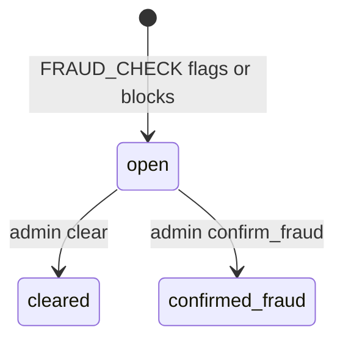
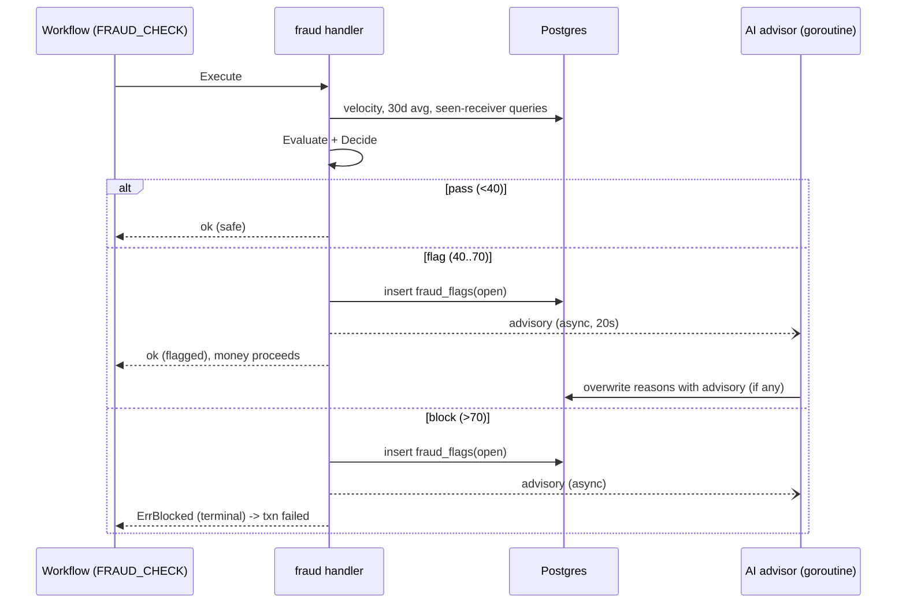

# Fraud and Reconciliation

## 1. Purpose
Fraud: deterministic scoring of a transaction inside the `FRAUD_CHECK` workflow step; it blocks, flags, or passes, and records flags that an admin resolves. An optional LLM adds an explanation after the decision. Reconciliation: a daily comparison of completed topups against mock-bank statements, plus a check that wallet balances equal the sum of ledger entries. Neither owns the ledger, the transfer workflow, or account locking (confirming a fraud flag does not lock anyone).

## 2. Key concepts
- **Signal**: a fired rule with points and evidence text (`fraud/rules.go:17`).
- **Score**: sum of signal points capped at 100.
- **fraud_flags**: row per flagged or blocked transaction, status `open` -> `cleared` | `confirmed_fraud` (`flag_status`, `000005:11`).
- **Recon run**: one row per calendar date (`reconciliation_runs.run_date UNIQUE`), with items classified `matched`, `amount_mismatch`, `missing_internal`, `missing_external` (`recon_result`, `000005:12`).
- **cutoff shift**: a statement matched by ref_code but dated on another day (E16); still `matched`.

## 3. Business rules

| ID | Rule | Enforced by | Test |
|----|------|-------------|------|
| BR-FRD-01 | `VELOCITY_5MIN` +30 when the sender has >= 4 p2p transactions created in the last 5 minutes (count includes the current one, any status). | `fraud/rules.go:39`, `queries/fraud.sql:CountSenderTxnsSince` | `TestEvaluateAndDecide` |
| BR-FRD-02 | `AMOUNT_SPIKE` +35 when 30-day average of the sender's COMPLETED p2p amounts is > 0 and amount >= 5x that average; no history means no signal. | `fraud/rules.go:47`, `queries/fraud.sql:AvgSenderAmount30d` | `TestAmountSpikeNeedsHistory` |
| BR-FRD-03 | `ODD_HOURS` +20 when server local hour is 0..4. | `fraud/rules.go:56`, `fraud/handler.go:65` | `TestEvaluateAndDecide` |
| BR-FRD-04 | `NEW_RECEIVER` +20 when the sender never completed a p2p to this receiver wallet. | `fraud/rules.go:64`, `queries/fraud.sql:HasSentToReceiver` | `TestEvaluateAndDecide` |
| BR-FRD-05 | Score = sum of points, capped at 100. Decision: score > 70 block; 40..70 flag; < 40 pass. | `fraud/rules.go:10-14,Evaluate,Decide` | `TestDecideBoundaries` |
| BR-FRD-06 | Pass: no flag, context `fraud_verdict=safe`. Flag: insert `fraud_flags` row, money proceeds, context `fraud_verdict=flagged`. Block: insert flag, then terminal `ErrBlocked`; the step's `on_failure: fail` fails the transaction (error surfaces as `ERR_FRAUD_BLOCKED`). | `fraud/handler.go:69-92`, `000003:88,98`, `transfer/service.go:199` | `TestFraudBlocksHighRisk`, `TestFraudFlagsGreyZone` |
| BR-FRD-07 | Flag `rule_code` is the signal with the most points (first on ties), or `MULTI` if none. | `fraud/handler.go:topRuleCode` | none |
| BR-FRD-08 | The LLM advisory runs only for flagged/blocked transactions, in a detached goroutine with a 20 s timeout. It never affects the decision and the step never waits for it: with a failing, empty, timing-out or hanging advisor, a flagged transaction still passes, a blocked one is still blocked, and the flag keeps its rule evidence. Any failure (no setting, inactive key, API error, empty text) is dropped with a debug/warn log. The decision itself is fail-closed: an error reading the rule inputs is retryable, never a silent pass. | `fraud/handler.go:enqueueAdvisory` | `TestAdvisoryOutage_NeverChangesTheDecision`, `TestAdvisoryOutage_BlockedStaysBlocked`, `TestAdvisoryOutage_StepDoesNotWaitForAdvisor`, `TestRuleSideFailureIsRetryableNotAPass`, `TestFraudFlagsGreyZone` (mock path) |
| BR-FRD-09 | A successful advisory overwrites `fraud_flags.reasons` with `{signals, advisory}`. | `queries/fraud.sql:AppendFraudFlagReasons` | `TestFraudFlagsGreyZone` |
| BR-FRD-10 | Compensating executions of FRAUD_CHECK are no-ops. | `fraud/handler.go:36` | none |
| BR-FRD-11 | Resolve: only `open` flags move to `cleared` (action `clear`) or `confirmed_fraud` (action `confirm_fraud`); the second resolver gets 409 `ERR_ALREADY_RESOLVED`; unknown id 404; audit `fraud.clear` / `fraud.confirm` in the same tx. Confirming does not lock the account. | `fraud/admin.go:Resolve`, `queries/fraud.sql:ResolveFraudFlagGuarded`, `api/admin_ops_handler.go:72-93` | none |
| BR-FRD-12 | Flag list filters: status `open` (default) / `cleared` / `confirmed_fraud` / `all`, ref_code search, date range, sort. | `fraud/admin.go:List,parseFlagStatus` | none |
| BR-FRD-13 | A redelivered FRAUD_CHECK step reuses the existing flag of the transaction (advisory lock + lookup) and starts no second advisory (BUG-0019). | `fraud/handler.go:insertFlagOnce` | `TestHandlerRedelivery_RunningTwiceAddsNoSideEffects/fraud` |
| BR-REC-01 | Scope of the bank comparison: transactions with `type='topup' AND status='completed'` whose `completed_at` falls on the run day (database session timezone). | `queries/recon.sql:ListCompletedTopupsByDate` | `TestReconFourCategoriesAndIdempotent` |
| BR-REC-02 | Matching is by `ref_code` across ALL statement dates. No statement -> `missing_external`; amount differs -> `amount_mismatch`; else `matched`. First statement (by id) is used; extra statements add `duplicate_statements` to detail. | `recon/recon.go:classify`, `queries/recon.sql:ListStatementsByRefCodes` | `TestReconFourCategoriesAndIdempotent` |
| BR-REC-03 | A matched statement on a different day sets detail `cutoff_shift=true` and stays `matched`. | `recon/recon.go:161-164` | `TestEdge_E16_ReconCutoffNoFalseMismatch` |
| BR-REC-04 | Statements dated on the run day whose ref_code has no completed internal topup that day become `missing_internal`. | `recon/recon.go:182-191`, `queries/recon.sql:ListStatementsByDate` | `TestReconFourCategoriesAndIdempotent` |
| BR-REC-05 | Internal invariant check: every wallet where `balance <> SUM(ledger credit - debit)` adds an `amount_mismatch` item with `internal_drift=true` (wallet-wide, not per day). | `recon/recon.go:75-86`, `queries/recon.sql:ListWalletLedgerMismatches` | none |
| BR-REC-06 | `matched` counts items with result `matched`; every other item counts as `mismatched`; `total` is the item count. | `recon/recon.go:countResults` | `TestReconFourCategoriesAndIdempotent` |
| BR-REC-07 | One run per date: `run_date UNIQUE`; a second run returns 409 `ERR_RECON_ALREADY_RAN`. The run row and items are inserted in one tx. | `reconciliation_runs.run_date` (000005:137), `recon/recon.go:107-111` | `TestReconFourCategoriesAndIdempotent` |
| BR-REC-08 | Nightly cron fires at 00:15 server-local time and reconciles yesterday (`now - 1 day`); a duplicate/missed tick is harmless; errors are only logged. Runs in the worker process. | `recon/cron.go:Run,nextRunAt`, `cmd/server/main.go:144,151` | none |
| BR-REC-09 | Manual run: `POST /v1/admin/recon/run {date: YYYY-MM-DD}` -> 201 `{run_id,date}`; read via `GET /v1/admin/recon/runs/:date` (items plus a 5-minute signed report URL). | `api/admin_ops_handler.go:173-216`, `recon/recon.go:SignReportURL` | none |
| BR-REC-10 | xlsx report: sheet `Reconciliation`, columns Result, Transaction, Statement, Detail (JSON); stored at key `recon/YYYY-MM-DD.xlsx` via the storage provider; failure to build or store leaves `report_url` empty and does not fail the run. | `recon/xlsx.go:buildReport` | none |
| BR-REC-11 | When there is at least one non-matched item, an LLM summary (Vietnamese, summary only) is requested using the `fraud_advising` AI setting; any failure yields an empty summary. | `recon/recon.go:summarize` (:206-251) | none |

## 4. Lifecycle / state machine



| Transition | Owner |
|-----------|-------|
| create `open` | `fraud/handler.go:Execute` (`InsertFraudFlag`) |
| open -> cleared / confirmed_fraud | `fraud/admin.go:Resolve` (guarded update) |

Recon run has no state: a row exists or not for a date.

## 5. Main flows



```mermaid
sequenceDiagram
    participant C as Cron 00:15 / Admin
    participant R as recon.Service
    participant DB as Postgres
    participant S as Storage
    C->>R: RunForDate(day)
    R->>DB: completed topups of day; statements by ref; statements of day; ledger drift
    R->>R: classify
    R->>R: summarize (LLM, optional)
    R->>S: Put recon/day.xlsx
    R->>DB: tx insert run + items (UNIQUE run_date)
    alt date already ran
        R-->>C: ErrAlreadyRan (409)
    end
```

## 6. Invariants
- The fraud decision is pure integer rules; the LLM can never change it.
- A blocked transaction moves no money (`TestFraudBlocksHighRisk`).
- At most one reconciliation run per date; at most one resolution per flag.
- The recon ledger check encodes `wallets.balance = SUM(ledger_entries)`.

## 7. Data
- `fraud_flags` (000005:115): `transaction_id`, `rule_code VARCHAR(40)`, `score NUMERIC(5,2)`, `reasons JSONB`, `status`, `reviewer_id`, `reviewed_at`.
- `bank_statements` (000005:127): `ref_code`, `amount`, `stmt_date`, `raw`; inserted by the mock-bank callback (`queries/recon.sql:InsertBankStatement`; duplicates are kept so recon can flag them).
- `reconciliation_runs`, `reconciliation_items` (000005:135-153); items link optional transaction and statement.
See `../reference/data-model.md`.

## 8. Interfaces
- Admin: `GET /v1/admin/fraud-flags`, `POST /v1/admin/fraud-flags/:id/resolve` body `{action: clear|confirm_fraud, reason<=255}`, `POST /v1/admin/recon/run`, `GET /v1/admin/recon/runs/:date` (`router.go:191-197`).
- Background: fraud handler registered in worker (`cmd/server/main.go:112`); recon cron (`main.go:144-151`).
See `../reference/api.md`.

## 9. Edge cases
- E15 duplicate bank callback: duplicate statement rows are kept and surface as `duplicate_statements` in the item detail (`recon/recon.go:165`).
- E16 cutoff shift: not a mismatch (BR-REC-03).
- Two reviewers on one flag: loser gets 409.
- New user with no history: AMOUNT_SPIKE cannot fire; NEW_RECEIVER usually does (+20 only, below flag threshold).

## 10. Known gaps (as-is vs intended)
- **No RBAC on fraud/recon admin routes** (BE-H6): any admin can resolve flags or run recon; `risk_officer`/`ops` roles are unused.
- Only p2p transactions feed velocity/average/new-receiver; fraud rules are not evaluated on other types because the `fraud` step exists only in `p2p_transfer` and `org_disbursement` definitions (`000003:88,98`; also `000009`/`000010` seeds reference the step).
- `HourOfDay` uses server local time, not user local time (`fraud/handler.go:65`).
- The advisory goroutine overwrites `reasons` wholesale (audit Medium: possible data loss); there is no retry.
- Recon: `buildReport` and the LLM call happen before the uniqueness check, so a duplicate-date run still does that work (`recon/recon.go:89-90` before `:99`); `day` is not normalized to a timezone; only topups are reconciled (not p2p, disbursement or reversal); the nightly cron has no lease, so multiple worker replicas would all attempt it (the UNIQUE constraint makes the loser fail) (audit: infrastructure section).
- `ErrBalanceDrift` is declared (`recon/recon.go:28`) but unused; drift only produces items.
- Decided and tested: the rules decide, the LLM failure only means no extra note (BR-FRD-08, ADR-0009). Not covered: the real Claude and OpenAI advisors are not exercised against a live provider.
- Flag confirmation has no downstream effect (no lock, no reversal trigger).

## 11. Code map
| File | Responsibility |
|------|----------------|
| `internal/fraud/rules.go` | Signals, thresholds, `Evaluate`, `Decide` |
| `internal/fraud/handler.go` | Workflow step `fraud`, flag insert, advisory goroutine |
| `internal/fraud/admin.go` | List, Resolve |
| `internal/recon/recon.go` | `RunForDate`, `classify`, summary, `GetRun` |
| `internal/recon/cron.go` | 00:15 scheduler |
| `internal/recon/xlsx.go` | xlsx report |
| `internal/api/admin_ops_handler.go` | Admin endpoints (:49, :77, :173, :192) |

## 12. Open questions
- Should a block score or a confirmed flag lock the account? Not decided in code.
- Should recon cover other transaction types and use a configured timezone? Undecided.
