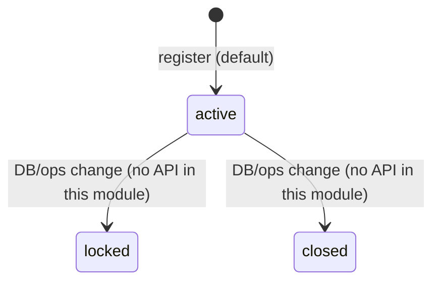
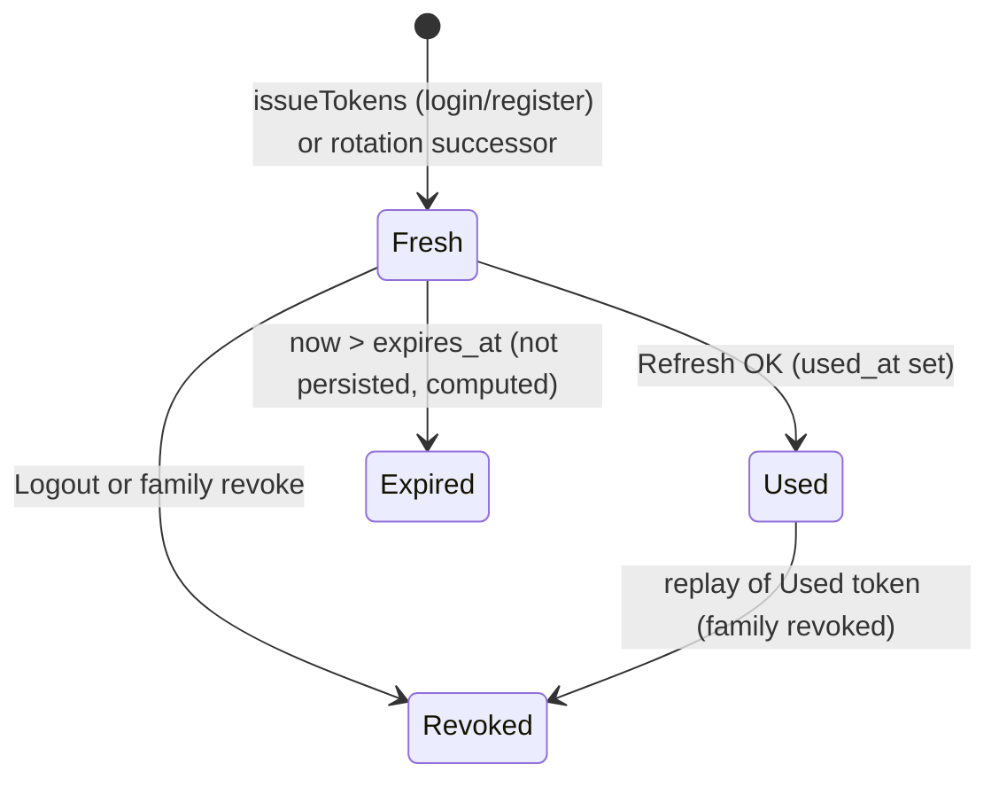
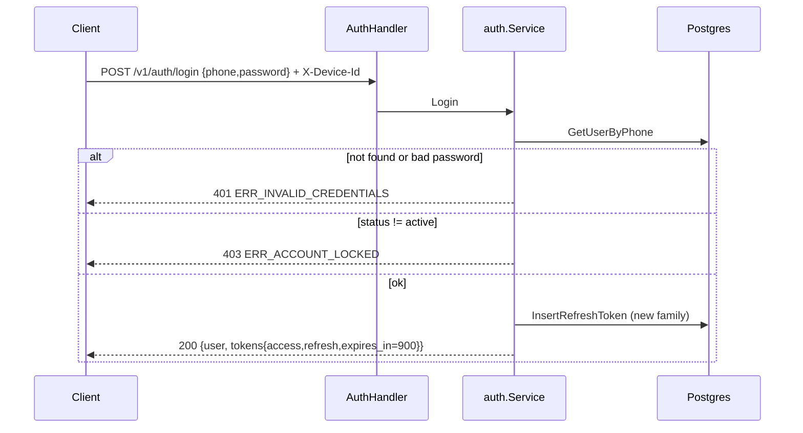
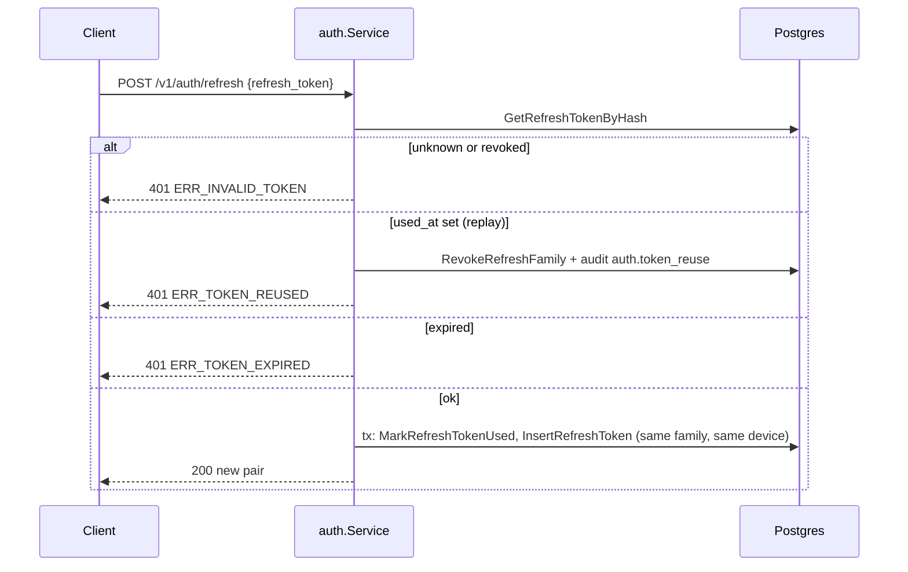

# Identity and Auth

## 1. Purpose
Owns end-user and admin identity: registration, password login, access JWTs, rotating refresh tokens with reuse detection, one-time passwords (OTP) used as a signing step for approvals, admin login, masked user lookup, and request rate limiting. It does NOT own KYC (see `kyc.md`), authorization inside an organization (org roles, checker levels live in the org/approval modules), or any transaction PIN: a server-side PIN does not exist (see 3 and 10).

## 2. Key concepts
- **User access token**: HS256 JWT, audience `user`, TTL 15 min (`auth/jwt.go:11`).
- **Admin access token**: same code path, audience `admin`, signed with the same `JWT_SECRET` (`api/router.go:61,166`). No refresh token exists for admins.
- **Refresh token family**: all refresh tokens descended from one login share a `family_id`; rotation marks the old row `used_at` and inserts a successor in the same family.
- **OTP challenge**: row in `otp_challenges` bound to `(user_id, purpose)`. Only consumer today: approval signing (`approval/service.go:166,406`).
- **device id**: client-supplied `X-Device-Id` header, default `"unknown"` (`api/auth_handler.go:110`). Stored on refresh tokens and echoed in the JWT claim `dev`; it is not verified or bound to anything.

## 3. Business rules

| ID | Rule | Enforced by | Test |
|----|------|-------------|------|
| BR-AUTH-01 | Phone must match `^0\d{9}$` on register (login does not validate format). | `api/auth_handler.go:14,36` | none |
| BR-AUTH-02 | Register password length 8..72, full name 2..120; no complexity rule; login has no length cap. | `api/auth_handler.go:26-27` | none |
| BR-AUTH-03 | Phone is unique; a duplicate returns 409 `ERR_PHONE_TAKEN` (reveals existence). | `users.phone UNIQUE` (000001:13), `auth/service.go:Register` (pg code 23505), `api/errmap.go:37` | none |
| BR-AUTH-04 | Passwords are stored as argon2id (t=3, m=64 MiB, p=2, 32-byte key, 16-byte random salt), verified in constant time. | `auth/password.go:15-21,HashPassword,VerifyPassword` | `TestPasswordRoundtrip`, `TestPasswordSaltUnique` |
| BR-AUTH-05 | Login with an unknown phone or wrong password returns the same 401 `ERR_INVALID_CREDENTIALS`. | `auth/service.go:Login` | none |
| BR-AUTH-06 | Only `status = 'active'` users can log in; `locked`/`closed` get 403 `ERR_ACCOUNT_LOCKED`, checked AFTER the password verifies. | `auth/service.go:84`, enum `account_status` (000001:7) | none |
| BR-AUTH-07 | Access JWT claims: `sub` (user id), `aud`, `iat`, `exp` (iat+15 min), `dev`. No `iss`, no `jti`. Parse enforces HS256 only, signature, expiry and audience. | `auth/jwt.go:Issue,Parse` | `TestJWTRoundtrip`, `TestJWTExpired`, `TestJWTWrongAudience` |
| BR-AUTH-08 | Refresh token is 32 random bytes (base64url); only its SHA-256 hex is stored; TTL 30 days. | `auth/refresh.go:11-27`, `refresh_tokens.token_hash UNIQUE` (000001:28) | none |
| BR-AUTH-09 | Rotation decision order: revoked -> invalid; used -> reuse; expired -> expired; else OK. | `auth/refresh.go:DecideRotation` | `TestDecideRotation` |
| BR-AUTH-10 | Replaying an already-used refresh token revokes the whole family, writes audit `auth.token_reuse`, returns 401 `ERR_TOKEN_REUSED`. | `auth/service.go:110-121`, query `RevokeRefreshFamily` | `TestDecideRotation` (decision only) |
| BR-AUTH-11 | Concurrent refresh with the same token: only one wins (`UPDATE ... WHERE used_at IS NULL`); the loser gets `ERR_INVALID_TOKEN` (no family revoke). | `queries/auth.sql:MarkRefreshTokenUsed`, `auth/service.go:132-136` | none |
| BR-AUTH-12 | Logout revokes the whole family of the presented refresh token; unknown token is a silent success. Access tokens stay valid until expiry. | `auth/service.go:Logout` | none |
| BR-AUTH-13 | OTP is 6 digits from `crypto/rand`, TTL 120 s, max 3 attempts, 30 s cooldown between requests for the same `(user, purpose)`. | `auth/otp.go:14-18,GenerateOTPCode`; `auth/service.go:RequestOTPCode` | `TestOTPHappyPath`, `TestOTPExpired` |
| BR-AUTH-14 | OTP is stored as SHA-256 of `userID:purpose:code`; compared in constant time. | `auth/otp.go:HashOTP,CheckOTP`; `service.go:192` | `TestOTPHashBoundToChallenge` |
| BR-AUTH-15 | Each verify attempt is counted first; the 3rd wrong attempt exhausts the challenge and a later correct code does not pass. A correct code consumes the challenge. | `auth/service.go:VerifyOTP`, `auth/otp.go:CheckOTP`, `queries/auth.sql:IncrementOTPAttempts,ConsumeOTP` | `TestEdge_E11_OTPBruteForce` |
| BR-AUTH-16 | The plaintext OTP is returned to the HTTP caller only when `ENV=dev` (`otp_dev` field of `/approvals/:id/challenge`) and logged at debug only in dev. There is no SMS/e-mail delivery code. | `api/approval_handler.go:47-50`, `auth/service.go:199-201` | none |
| BR-AUTH-17 | `RequireAuth` requires `Authorization: Bearer <jwt>`, validates it, and sets `user_id` and `device_id` in the Gin context. It does NOT look up the user, check `users.status`, check KYC, or support revocation. | `api/middleware.go:16-34` | none |
| BR-AUTH-18 | `RequireAdmin` validates a Bearer JWT with audience `admin` and sets `admin_id`. It does NOT load the admin row, check `admin_users.status`, or check `admin_users.role`. Every admin may call every admin endpoint. | `api/admin_handler.go:25-42` | none |
| BR-AUTH-19 | Admin login: lookup by e-mail, argon2id verify, require `status = active`, issue a 15-min `admin`-audience token with device `admin-console`. No refresh, no role in the token. | `auth/admin.go:Login` | none |
| BR-AUTH-20 | Rate limits (Redis fixed window, per client IP + route; fail-open on Redis errors): register 5/min, login 5/min, refresh 30/min, admin login 5/min, approval challenge 10/min. Logout and `/v1/files` have none. | `api/middleware.go:RateLimit`, `api/router.go:99-102,160,187` | none |
| BR-AUTH-21 | User lookup by phone is per-user rate limited (20/min), returns only a masked name, and answers an identical 404 for unknown phone, non-active user, and self. | `api/router.go:109`, `api/middleware.go:RateLimitUser`, `api/user_handler.go:30-52` | `TestLookup_MaskedAndUniform404` |
| BR-AUTH-22 | Masking: phone keeps first 3 and last 3 digits (shorter than 7 runes fully masked); name keeps the first word, later words reduced to first rune plus `*`. | `user/mask.go:MaskPhone,MaskName` | `mask_test.go` |
| BR-AUTH-23 | `APP_ENV` is mandatory and must be `dev`, `ci`, `demo` or `production`; `JWT_SECRET` is mandatory and, outside `dev` and `ci`, at least 32 bytes and not the `.env.example` placeholder. OTP codes appear in a response only when `APP_ENV=dev`. | `platform/config/config.go` (`Load`, `IsDev`, `IsProduction`), `api/env_guards.go` (`challengeBody`) | `TestLoad_*`, `TestOTPExposedOnlyInDev` |
| BR-AUTH-25 | A transaction PIN is exactly 6 digits, not all the same digit and not an ascending or descending run (`ErrWeakPIN`). | `auth/pin.go:ValidatePIN` | `TestValidatePINFormat` |
| BR-AUTH-26 | The PIN is stored only as an argon2id hash in `users.pin_hash`; it is never returned or logged, and audit rows contain no PIN or hash. | `auth/pin.go` | `TestPin_SetAndChange`, `TestPin_FailuresAreAuditedWithoutTheSecret` |
| BR-AUTH-27 | The first PIN needs the account password (`PUT /v1/me/pin`); changing it needs the current PIN (`PATCH /v1/me/pin`), which uses the same counter and lockout. | `api/pin_handler.go`; `auth/pin.go:SetPIN,ChangePIN` | `TestPin_SetAndChange` |
| BR-AUTH-28 | Five consecutive wrong PINs lock PIN use for 15 minutes (per user, atomic SQL counter); a correct PIN is refused during the lock; success resets the counter; failures and locks are audited (`pin.failed`, `pin.locked`). | `queries/auth.sql:RecordPINFailure`; `auth/pin.go:VerifyPIN`; migration 000018 | `TestPin_LockoutAfterFiveFailures` |
| BR-AUTH-29 | `RequireAdmin` loads the admin from `admin_users` on every request: unknown id gives 401, a status other than `active` gives 401 `ERR_ACCOUNT_LOCKED`, and the role comes from the row, never from the token. | `api/admin_handler.go:RequireAdmin`; `queries/auth.sql:GetAdminByID` | `TestAdminRBAC_LockedAdminRefusedImmediately`, `TestAdminRBAC_RoleChangeTakesEffect`, `TestAdminRBAC_DeletedAdminRefused` |
| BR-AUTH-30 | Every `/v1/admin` route carries `RequirePermission` (table in `product/roles-and-permissions.md`); a viewer holds no permission and is refused everywhere; a denial is 403 `ERR_FORBIDDEN_PERMISSION` and does not name a permission. A new admin route without a permission entry fails the build. | `api/router.go`; `auth/rbac.go` | `TestAdminRBAC_ViewerIsDeniedEverywhere`, `TestAdminRBAC_RoleMatrix`, `TestEveryAdminRouteHasAPermission` |
| BR-AUTH-31 | The Go role table equals the admin app role table; a drift fails `TestRolePermissionsMatchFrontend`. | `auth/rbac.go` | `TestRolePermissionsMatchFrontend` |
| BR-AUTH-32 | AI key create/update and AI setting update write audit rows (actor, client IP, non-secret attributes); the API key never appears in a response or an audit row. | `api/admin_ai.go:auditAdmin` | `TestAdminAI_WritesAreAudited` |
| BR-AUTH-24 | After a successful register or login the main wallet is ensured (self-heal). A failure there fails the whole request with an error even though tokens were already issued. | `api/auth_handler.go:45-50,70-75`, `router.go:87` | none |

## 4. Lifecycle / state machine

Account status (`account_status`, 000001:7) and refresh token states.

| Transition | Owner |
|-----------|-------|
| Fresh -> Used + successor | `auth/service.go:Refresh` (tx at 125-150) |
| any -> Revoked (family) | `queries/auth.sql:RevokeRefreshFamily`, called from Refresh (reuse) and Logout |
| account active -> locked/closed | no code in this module; no admin endpoint was found that changes `users.status` |

## 5. Main flows

OTP (approval signing): `Challenge` -> `RequestOTPCode` (cooldown check, insert hash) -> `Decide` -> `VerifyOTP` (increment, check, consume).

## 6. Invariants
- Only hashes of refresh tokens and OTPs are persisted (`refresh_tokens.token_hash`, `otp_challenges.code_hash`).
- A refresh token can be rotated at most once (`WHERE used_at IS NULL`).
- Admin and user tokens are not interchangeable at the API boundary because the audience is checked in `Parse` (but they share one secret, see 10).
- Another user's raw name/phone is never returned by the lookup endpoint (masking happens server-side).

## 7. Data
Migration `000001_users_admin_auth.up.sql`:
- `users`: `phone UNIQUE`, `email UNIQUE` (unused by code), `password_hash`, `pin_hash` (nullable, never read or written by any query or handler), `kyc_status`, `status`.
- `refresh_tokens`: `token_hash UNIQUE`, `family_id`, `device_id VARCHAR(80)`, `used_at`, `revoked_at`, `expires_at`; indexes on user and family.
- `otp_challenges`: `purpose VARCHAR(40)`, `attempts`, `max_attempts` (column default 5, but code always inserts 3 at `auth/service.go:195`), `consumed_at`. No cleanup job.
- `admin_users`: `email UNIQUE`, `role admin_role` (`viewer`, `kyc_reviewer`, `risk_officer`, `ops`, `superadmin`; default `viewer`), `status`. A dev superadmin `admin@HPay.dev` is seeded by the migration itself (000001:78-82).
- `audit_logs`: written by auth only for `auth.token_reuse`.
See `../reference/data-model.md`.

## 8. Interfaces
- Public: `POST /v1/auth/register|login|refresh|logout`; `GET /v1/users/lookup` and `GET /v1/users/me` behind `RequireAuth` (`router.go:98-109`). `/users/me` returns the profile, `txn_limit` (the per-transaction limit of the user's offer for P2P_TRANSFER, 0 when the user has no usable offer) and an `offer` block with its code and per-transaction, daily and monthly limits (`user_handler.go`, `offerguard.Limits`).
- Admin: `POST /v1/admin/auth/login`; every other `/v1/admin/*` route behind `RequireAdmin` (`router.go:186-188`).
- Org routes `/v1/org/*` use the user token (`router.go:151`).
- No endpoint exists to request or verify a login OTP or to change a password; the PIN endpoints exist (`/v1/me/pin`). See `../reference/api.md`.

## 9. Edge cases
- E11 OTP brute force: third wrong attempt exhausts the challenge (BR-AUTH-15).
- Reused refresh token: family revoked; the legitimate holder must log in again.
- After a family is revoked, a further replay is classified `Revoked` first, so it returns `ERR_INVALID_TOKEN`, not `ERR_TOKEN_REUSED` (order in `DecideRotation`).
- An expired but unconsumed OTP stays selected by `GetActiveOTP`; verify then returns `ERR_OTP_EXPIRED`, while a new request is only blocked by the 30 s cooldown measured from its `created_at`.

## 10. Known gaps (as-is vs intended)
- **Server-side PIN exists since 2026-11-21** (uncommitted; BUG-0012, ADR-0014). Not implemented: PIN reset for a forgotten PIN, admin unlock, a 2FA provider. Lockout is per user, so an attacker holding a victim's session can lock their PIN for 15 minutes.
- **Access token not revocable and status not rechecked** (BE-H6): a locked user keeps a valid access token for up to 15 minutes, and `Refresh` does not check `users.status` either (`auth/service.go:96-157`).
- **Admin has no RBAC** (BE-H6): `admin_role` is stored and returned on login but never enforced; admins have no refresh and share `JWT_SECRET` with users.
- **Weak defaults** (BE-H7): fixed in the working tree (ADR-0012, uncommitted): `APP_ENV` has no default; the HS256 secret is still accepted at any length in `dev` and `ci` by design.
- **Brute-force protection** (BE-H8): only per-IP route limits, fail-open, no per-account lockout; unknown-phone login returns before hashing (timing difference); `ErrPhoneTaken` allows phone enumeration; logout and admin routes beyond login are unlimited.
- **OTP**: hash is bound to `userID:purpose`, not to the challenge id (audit says so too); no per-user total cap; no cleanup job.
- `X-Device-Id` is trusted client input.
- Refresh audit insert errors are swallowed (`_ =` at `auth/service.go:114`).

## 11. Code map
| Package | Responsibility |
|---------|----------------|
| `internal/auth/service.go` | Register, Login, Refresh, Logout, OTP request/verify |
| `internal/auth/jwt.go` | Claims, issue, parse |
| `internal/auth/refresh.go` | Token generation and `DecideRotation` |
| `internal/auth/otp.go` | OTP constants, hashing, `CheckOTP` |
| `internal/auth/password.go` | argon2id |
| `internal/auth/admin.go` | `AdminService.Login` |
| `internal/user/mask.go` | Masking |
| `internal/api/middleware.go` | `RequireAuth` (:16), `RateLimit` (:39), `RateLimitUser` (:60), `RequireIdempotencyKey` (:83) |
| `internal/api/admin_handler.go` | `RequireAdmin` (:25), admin login (:75) |
| `internal/api/errmap.go` | Error code mapping (auth codes at :37-46) |

## 12. Open questions
- Should login require phone verification by OTP? (Not decided; no owner recorded.)
- PIN reset for a forgotten PIN: which factor proves identity (owner: product/security)?
- Which actor locks/closes accounts? No code path found.
