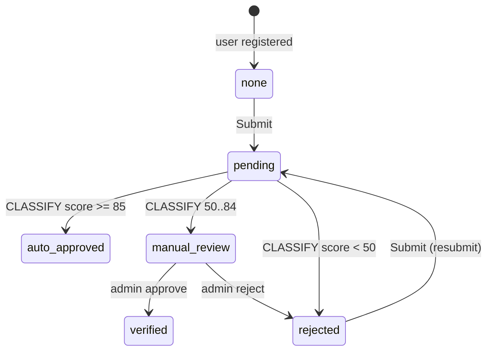
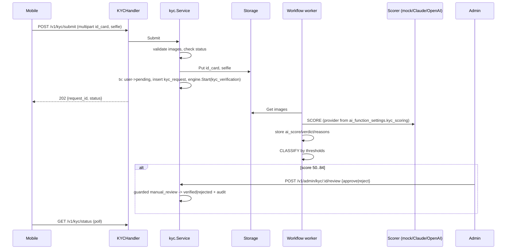

# KYC

## 1. Purpose
Owns identity verification of end users: receiving an ID-card and selfie image, storing them, getting an AI score, classifying the score into auto-approve / manual review / reject by fixed thresholds, letting an admin decide the manual band, and exposing the resulting `kyc_status`. It moves the user's offer when the status changes (BR-KYC-15) but does NOT own the limits themselves (they live in the offer model, see `product/kyc-tiers-and-limits.md`), and does not decide anything by LLM: the model only produces a 0..100 score.

## 2. Key concepts
- **kyc_status** enum: `none`, `pending`, `manual_review`, `auto_approved`, `verified`, `rejected` (`000001:8`). Lives on `users.kyc_status` and `kyc_requests.status`.
- **kyc_requests**: one row per submission (`000005:101-113`). `ai_score` is NULL until scored (queries coalesce to -1 = "not scored").
- **kyc_verification workflow**: two auto steps `SCORE` (`kyc_scorer`, retry 2, timeout 30000 ms) then `CLASSIFY` (`kyc_classifier`, retry 2, timeout 5000 ms), both `on_failure: fail` (`000003:92-95`).
- **Signed URL**: HMAC link `/v1/files/{key}?exp=&sig=` valid 5 minutes.

## 3. Business rules

| ID | Rule | Enforced by | Test |
|----|------|-------------|------|
| BR-KYC-01 | Each image must decode as a real JPEG or PNG (format checked by name, not by leading bytes): at most 5 MiB, 200 to 8000 px per side, at most 40 megapixels (checked from the header before decoding), and a full decode up to 12 megapixels to refuse truncated or corrupt files. The whole request body is capped at 12 MiB before multipart parsing (413 `ERR_PAYLOAD_TOO_LARGE`). | `kyc/image.go:InspectImage`, `api/file_guards.go:limitKYCBody` | `TestInspectImage_*`, `TestKYCSubmitBodyIsCappedBeforeParsing`, `TestKYCUpload_*` |
| BR-KYC-02 | HTTP layer reads at most 6 MiB per multipart part (`id_card`, `selfie`) before the service limit applies. | `api/kyc_handler.go:46-63` | none |
| BR-KYC-03 | Submit is refused with 409 `ERR_KYC_ALREADY_PENDING` when status is `pending` or `manual_review`, and 409 `ERR_KYC_ALREADY_VERIFIED` when `auto_approved` or `verified`. `none` and `rejected` may submit (re-submission allowed). | `kyc/service.go:76-81`, `queries/kyc.sql:MarkUserKycPending` | `TestKYCSubmitGuards`, `TestKYCRejectBranchAllowsResubmit` |
| BR-KYC-04 | Submit is race-safe: the guarded `UPDATE users ... WHERE kyc_status IN ('none','rejected')` must affect 1 row or the call returns `ErrAlreadyPending`. | `queries/kyc.sql:MarkUserKycPending`, `kyc/service.go:100-106` | `TestKYCSubmitGuards` |
| BR-KYC-05 | Images are written to storage first, then one tx marks the user pending, inserts `kyc_requests` and starts the workflow. Orphan files on tx failure are tolerated. | `kyc/service.go:Submit` (:61-124) | none |
| BR-KYC-06 | Score thresholds: >=85 -> `auto_approved` (verdict `auto_approve`); 50..84 -> `manual_review`; <50 -> `rejected` (`auto_reject`). | `kyc/classify.go:Classify` | `TestClassifyThresholds` |
| BR-KYC-07 | The scorer step is replay-safe: if `ai_score` is already set it re-emits the stored score and makes no new LLM call. | `kyc/handlers.go:63-65` | none |
| BR-KYC-08 | Provider is chosen per run from `ai_function_settings` row `kyc_scoring`: `mock`, `anthropic`, `openai`; unknown -> mock. An `anthropic`/`openai` setting whose key is inactive or missing fails the step with an `ERR_AI_PROVIDER_UNAVAILABLE` error text (not retryable). | `kyc/handlers.go:76-102` | `TestAIConfig_OpenAIRoutingAndInactivation` |
| BR-KYC-09 | Scorer errors: network, 429, 5xx, unparsable reply -> retryable (workflow backoff 2, 4, 8 s... capped 60 s, up to step retry); other 4xx -> terminal. Score is clamped to 0..100. | `kyc/scorer_claude.go:56-113,128-145`, `kyc/scorer_openai.go`, `workflow/engine.go:429-442` | `TestParseScoreJSON`, `TestClaudeScorerErrorClassification` |
| BR-KYC-10 | Mock scorer is deterministic: `40 + (first 2 bytes of sha256(idCard+selfie)) % 60`, i.e. 40..99. | `kyc/scorer.go:35-47` | `TestMockScorerDeterministic` |
| BR-KYC-11 | The classify step is a guarded no-op unless the request is still `pending`; it moves `kyc_requests` and `users` (from `pending`) together in one tx. | `kyc/handlers.go:131-171`, `queries/kyc.sql:ClassifyKYCGuarded,SetUserKycFromPending` | `TestKYCAutoApproveBranch` |
| BR-KYC-12 | Admin review applies only to `manual_review` requests and yields `verified` (approve) or `rejected` (reject); the guarded UPDATE makes the second concurrent reviewer get 409 `ERR_ALREADY_REVIEWED`; unknown id is 404. | `kyc/admin.go:Review`, `queries/kyc.sql:ReviewKYCGuarded,SetUserKycFromManualReview` | `TestKYCManualThenAdminApprove`, `TestKYCReviewRace` |
| BR-KYC-13 | A review writes audit `kyc.approve` / `kyc.reject` with the admin id and optional reason (<=255 chars) in the same tx. | `kyc/admin.go:146-152`, `api/admin_handler.go:117-120` | none |
| BR-KYC-14 | Admin queue tabs: `manual` (default, `manual_review`), `auto` (`auto_approved`), `rejected`; any other tab is a 400. Image links are signed with TTL 5 min. | `kyc/admin.go:Queue`, `signedURLTTL` | none |
| BR-KYC-15 | The KYC outcome selects the user's offer in the same transaction as the status change (`kyc/offer.go:applyOfferForStatus`): `verified` or `auto_approved` moves `OFFER_CUST_L0` to `OFFER_CUST_L1` (L1, L2 and merchant offers are kept); `rejected` moves any customer offer to `OFFER_CUST_L0`; `pending` and `manual_review` change nothing. Limits come from the offer (see `product/kyc-tiers-and-limits.md`). | `kyc/offer.go`, `kyc/handlers.go` (classify), `kyc/admin.go` (review), `offer_guard.sql:AssignKycApprovedOffer,AssignKycRejectedOffer` | `TestOfferLimits_KYCOutcomeSelectsOffer`, `TestOfferLimits_ApprovalKeepsL2AndNeverTouchesMerchant`, `TestOfferLimits_AdminReviewSelectsOffer` |
| BR-KYC-16 | Storage keys are `{uuid}/id_card{ext}` and `{uuid}/selfie{ext}`; the extension (`.jpg` or `.png`) follows the real content (`KeyFor`); the uuid is not the DB row id. | `kyc/image.go:KeyFor`, `kyc/service.go` | `TestKeysMatchContent` |
| BR-KYC-17 | Local storage rejects keys that are empty, contain `..`, or start with `/` or `\`, and anything resolving outside the root. | `storage/storage.go:Local.safePath` | `TestLocalPutGetAndTraversalGuard` |
| BR-KYC-18 | Signed URL: HMAC-SHA256 over `key\nexp` using `JWT_SECRET`; verify checks signature first, then expiry. The `/v1/files/*key` route has no auth beyond the signature. | `storage/storage.go:Signer`, `api/admin_handler.go:ServeFile` (`writeStoredFile`), `api/router.go:76,216` | `TestSignerRoundTripExpiryAndTamper` |
| BR-KYC-19 | Storage provider is `local` (default, `KYC_STORAGE_DIR`, default `./data/kyc`) or `cloudinary` (needs cloud name, key, secret else startup error). | `platform/config/config.go:79-102`, `api/router.go:66-75` | `TestCloudinarySignature`, `TestCloudinaryPutAndGet` |

## 4. Lifecycle / state machine

| Transition | Owner |
|-----------|-------|
| none/rejected -> pending | `kyc/service.go:Submit` via `MarkUserKycPending` |
| pending -> auto_approved / manual_review / rejected | `kyc/handlers.go:classifierHandler` via `ClassifyKYCGuarded` + `SetUserKycFromPending` |
| manual_review -> verified / rejected | `kyc/admin.go:Review` via `ReviewKYCGuarded` + `SetUserKycFromManualReview` |

`auto_approved` and `verified` carry the same limits (BR-KYC-15) and both block resubmission (BR-KYC-03). No code moves a user out of `auto_approved` or `verified`.

## 5. Main flows

Failure branch: if SCORE fails terminally (inactive key, 4xx, unreadable image), the workflow instance fails (`on_failure: fail`); `ai_score` stays NULL.

## 6. Invariants
- `users.kyc_status` and `kyc_requests.status` move together inside one tx (classify, review) and only along the guarded edges above.
- A request is classified at most once and reviewed at most once (guarded UPDATEs).
- A DB row never references a missing file (files are written before the row), but orphan files are possible.
- Score is an integer 0..100 end to end (`kyc_requests.ai_score` is `NUMERIC(5,2)` in the schema but written via `::int`).

## 7. Data
- `kyc_requests` (`000005:101`): `user_id`, `id_card_url` and `selfie_url` (storage KEYS despite the name), `ai_score`, `ai_verdict VARCHAR(20)`, `ai_reasons JSONB`, `status kyc_status DEFAULT 'pending'`, `reviewer_id -> admin_users`, `reviewed_at`.
- `users.kyc_status`.
- `workflow_definitions` seed `kyc_verification` (`000003:92`).
- `ai_function_settings` row `kyc_scoring` (default mock, `000005:183`).
- `offers.primary_pocket_max` seeds: `OFFER_CUST_L1` 50,000,000; `OFFER_CUST_L2` 200,000,000 (`000004:78-79`). These are not driven by KYC (see 10).
See `../reference/data-model.md`.

## 8. Interfaces
- User: `POST /v1/kyc/submit` (202), `GET /v1/kyc/status` (`router.go:139-140`).
- Admin: `GET /v1/admin/kyc?tab=`, `POST /v1/admin/kyc/:id/review` body `{action: approve|reject, reason}` (`router.go:189-190`).
- File: `GET /v1/files/*key?exp&sig` (`router.go:216-217`).
- Worker handlers `kyc_scorer`, `kyc_classifier` registered in `cmd/server/main.go:109`.
See `../reference/api.md`.

## 9. Edge cases
- Double submit while pending/manual_review: 409 (BR-KYC-03).
- Resubmit after reject: allowed, new `kyc_requests` row.
- Two admins deciding the same request: second gets 409 (A01 groundwork, `queries/kyc.sql`).
- At-least-once redelivery of SCORE/CLASSIFY: no second LLM call, no double transition (BR-KYC-07, BR-KYC-11).

## 10. Known gaps (as-is vs intended)
- **Upload hardening** (BE-H9, upload part fixed, see [BUG-0015](../bugs/BUG-0015-kyc-upload-accepts-any-file-with-an-image-signature.md)): decode-based validation, body cap, key extension follows content, `ServeFile` sets `nosniff`, extension-derived type, sanitized `Content-Disposition`, `Cache-Control: private, no-store`. **Still open:** Cloudinary uses the default public-by-URL delivery type; the signed URL uses `JWT_SECRET` itself, is not tied to an admin and issuing a link is not audited; EXIF is not stripped; orphaned files are not cleaned up.
- **KYC reviewer role not enforced** (BE-H6): any admin may review; reject reason is optional.
- **Offer follows KYC: done** (BR-KYC-15). Not done: nothing assigns `OFFER_CUST_L2` (an operator does it), registration creates no `user_offers` row (the L0 default applies), and a KYC re-submission by a user who was approved does not exist.
- **`pending` / `manual_review` users have a 5,000,000 limit while `none` has 2,000,000** (BR-KYC-15): submitting documents raises the limit before any approval.
- Error text for a failed scorer is not persisted on `kyc_requests`; a terminally failed SCORE leaves the user `pending` (see 12).
- Limits differ across docs (audit report, section on doc/code drift); code values are the ones above.
- Sending ID-card images to a third-party LLM is a legal question noted in the audit.

## 11. Code map
| File | Responsibility |
|------|----------------|
| `internal/kyc/service.go` | Submit, Status, ValidateImage |
| `internal/kyc/handlers.go` | Workflow steps (scorer, classifier), provider selection |
| `internal/kyc/classify.go` | Thresholds |
| `internal/kyc/scorer*.go` | Mock, Claude, OpenAI scorers |
| `internal/kyc/admin.go` | Queue, Review |
| `internal/storage/storage.go`, `cloudinary.go` | Store interface, Local, Signer, Cloudinary |
| `internal/api/kyc_handler.go` | Multipart handling |
| `internal/store/queries/kyc.sql` | Guarded transitions |

## 12. Open questions
- What should happen to a user stuck in `pending` after a terminal scorer failure? No code path resets `users.kyc_status` or retries; resubmission is blocked by BR-KYC-03. (Inferred from reading; not exercised by a test. Owner: product, undecided.)
- Difference in meaning between `auto_approved` and `verified` is nil in code (same limit); intent undecided.
- Downgrading KYC or expiring approval is not implemented.
