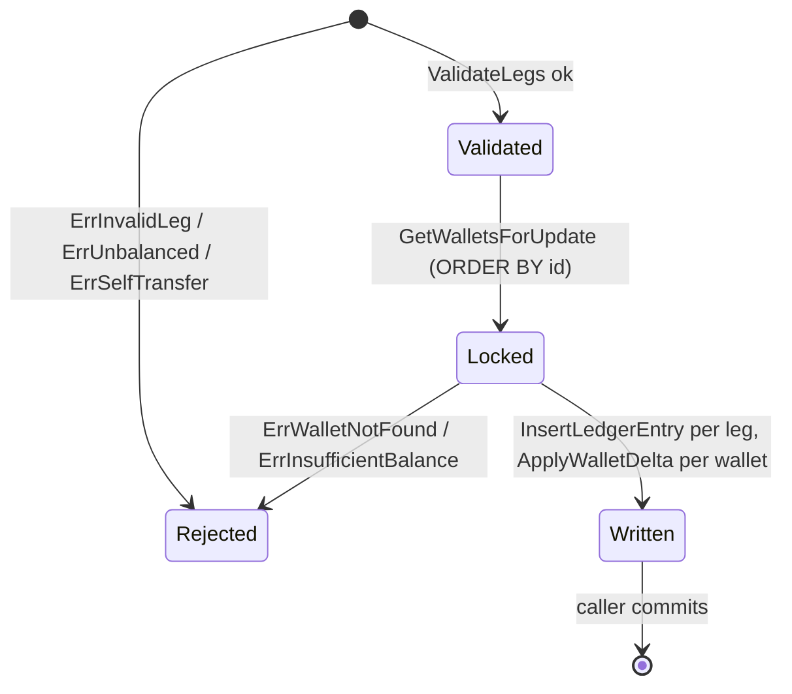
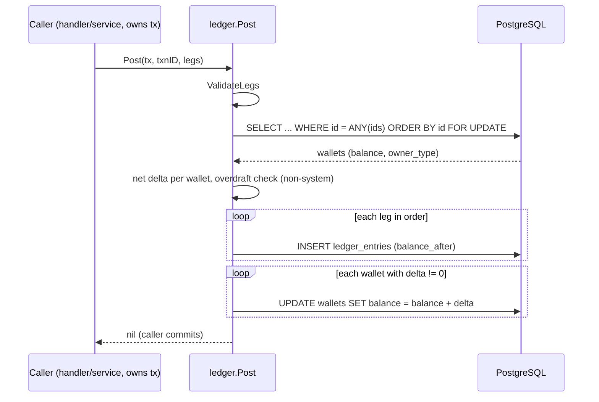

# Double-entry ledger

## 1. Purpose
The ledger owns the only code path that changes a wallet balance: `ledger.Post`. It validates a set of legs, locks the wallets, rejects overdrafts on customer wallets, writes append-only `ledger_entries` rows with a running `balance_after`, and updates `wallets.balance`. It does NOT own transaction rows, statuses, fees (it just posts the legs it is handed), idempotency or replay protection (see 6 and 10).

## 2. Key concepts
- **Wallet**: the row in `wallets` that holds a `balance` (BIGINT, minor units: US cents). Customer wallets, org wallets, vaults and system pools are all wallets (`owner_type` enum `user|organization|system`, 000002:13).
- **Leg**: `ledger.Leg{WalletID, Direction, Amount}` (`ledger.go:27`). Amount is always positive; `debit` subtracts, `credit` adds (`ledger.go:104-108`).
- **Entry**: one `ledger_entries` row per leg.
- **System wallets**: three seeded rows with fixed UUIDs and `system_code` `SYSTEM_CASH_IN` (...0001), `SYSTEM_FEE` (...0002), `SYSTEM_SUSPENSE` (...0003) (000002:98-100). Opening balance is 0. They may go negative (cash-in does by design, 000002:94-97).
- **Ledger account** (`ledger_accounts`, 000002:38): seeded with codes `SYS_CASH`, `SYS_FEE`, `SYS_SUSPENSE` pointing at the system wallets (000002:105-107). The Go code never reads or writes this table and never sets `ledger_entries.account_id` (grep of `src/backend` excluding generated code finds no Go use). Treat it as unused schema.

## 3. Business rules

| ID | Rule | Enforced by (code or DB) | Test |
|----|------|--------------------------|------|
| BR-LED-01 | A posting needs at least 2 legs. | `ledger.go:ValidateLegs` (36-38) | `TestValidateLegs` ("single leg") |
| BR-LED-02 | Every leg amount must be > 0 and the wallet id non-nil. | `ledger.go:ValidateLegs` (42-47); DB `ledger_entries.amount CHECK (amount > 0)` (000002:74) | `TestValidateLegs` ("zero amount", "negative amount") |
| BR-LED-03 | Sum of debit legs must equal sum of credit legs. | `ledger.go:ValidateLegs` (58-60) | `TestValidateLegs` ("unbalanced") |
| BR-LED-04 | A posting must involve at least 2 distinct wallets (no self-transfer). | `ledger.go:ValidateLegs` (61-63) | `TestEdge_E14_SelfTransferRejected` |
| BR-LED-05 | A leg direction other than debit/credit is invalid. | `ledger.go:ValidateLegs` (53-54); enum `entry_direction` (000002:12) | none |
| BR-LED-06 | All wallets of a posting are locked in ONE query ordered by id (`FOR UPDATE`), so concurrent postings cannot deadlock. | `queries/wallets.sql:GetWalletsForUpdate` (`ORDER BY id FOR UPDATE`); `ledger.go:uniqueSortedIDs` (144-155), `PostWithQueries` (82-85) | `TestEdge_E03_CrossTransferNoDeadlock` |
| BR-LED-07 | If any referenced wallet does not exist, posting fails with `ErrWalletNotFound` and nothing is written. | `ledger.go:PostWithQueries` (87-89) | none |
| BR-LED-08 | The net result of the posting must not leave a non-system wallet below zero (`ErrInsufficientBalance`). The check is on the final per-wallet balance, not leg by leg. | `ledger.go:PostWithQueries` (101-114); DB `wallet_balance_non_negative CHECK (balance >= 0 OR owner_type = 'system')` (000002:35, re-created 000006:78) | `TestEdge_E02_ConcurrentOverdraw` |
| BR-LED-09 | System wallets (`owner_type='system'`) are exempt from the non-negative rule. | `ledger.go:98,111`; constraint above | none |
| BR-LED-10 | Each leg writes one entry with `balance_after` = running balance of that wallet after the leg, in leg order. | `ledger.go:PostWithQueries` (117-130); `queries/ledger.sql:InsertLedgerEntry` | `TestEdge_E02_ConcurrentOverdraw` (balance == ledger sum) |
| BR-LED-11 | `wallets.balance` changes only through `ApplyWalletDelta`, once per wallet with the net delta, bumping `version` and `updated_at`. Zero-delta wallets are skipped. | `ledger.go:PostWithQueries` (133-140); `queries/wallets.sql:ApplyWalletDelta` | `TestEdge_E01_IdempotentTopup` (balance == ledger sum) |
| BR-LED-12 | `ledger_entries` rows can never be UPDATEd or DELETEd; corrections are new reversing postings. | triggers `trg_ledger_entries_no_update`, `trg_ledger_entries_no_delete` (000007:17-24) | none |
| BR-LED-13 | Intended invariant: `wallets.balance = SUM(credit) - SUM(debit)` of its entries, for every wallet including system pools. | `ledger.go` posts both in the same caller tx; system pools realigned and opening balance set to 0 (000002:98-100, 000006:81-88); checked by `queries/ledger.sql:SumLedgerByWallet` and `queries/recon.sql` (internal reconciliation) | `testutil.LedgerSum` assertions in `TestEdge_E02_ConcurrentOverdraw`, `TestEdge_E01_IdempotentTopup`, `TestVault_DepositMovesMoneyAndBalances` |
| BR-LED-14 | `Post` runs inside the caller's transaction and never commits or rolls back itself. | `ledger.go:Post`, `PostWithQueries` | none |
| BR-LED-15 | A posting is identified by `(transaction, kind)` with kind in `forward`, `compensate`, `round_up`. It can be applied at most once: a second call with the same total returns `ErrAlreadyPosted` and changes nothing; with a different total it returns `ErrPostingConflict` and changes nothing. The guard row is claimed after the ordered wallet locks and before any entry, inside the caller's transaction, so it rolls back with a failed posting. | `ledger.go:PostWithQueries`; table `ledger_postings` PRIMARY KEY (transaction_id, kind) (migration 000014); `queries/ledger.sql:InsertLedgerPosting` | `TestPost_SecondCallSameKindIsRejected`, `TestPost_SameKindDifferentAmountIsAConflict`, `TestPost_ConcurrentSameKindOnce`, `TestPost_CompensateIndependentAndOnce`, `TestPost_RoundUpAfterForwardOnce`, `TestPost_FailedPostingLeavesNoGuard`, `TestBEC1_SecondPostOfSameTransactionMovesMoneyTwice`, `TestEdge_E06_DuplicateStepNoDoublePost` |
| BR-LED-16 | Every transaction that had ledger entries before migration 000014 has a `forward` guard row (back-filled; earlier compensation or round-up entries are folded into it). | migration 000014 back-fill | `TestMigration_BackfillCoversEveryPostedTransaction` |

## 4. Lifecycle / state machine
The ledger itself has no states. A single posting is atomic inside the caller's transaction:

Transitions are owned by `ledger.PostWithQueries` (`ledger.go:77`). "Rejected" returns an error and leaves the caller to roll back; nothing in `Post` undoes earlier statements of the caller.

## 5. Main flows

Callers of `Post`/`PostWithQueries` (all in `src/backend`): `wallet/service.go:132` (sync topup, legacy), `wallet/callback.go:80` (bank callback), `workflow/handlers/handlers.go:112` (MOVE_FUNDS forward and compensate), `workflow/handlers/round_up.go:115`, `org/service.go:320`, `reversal/reversal.go:164` (via `PostWithQueries` in the approval finalize tx), `cmd/seed/main.go`.

Standard fee posting built by MOVE_FUNDS (`handlers.go:124-141`): debit sender `amount+fee`, credit receiver `amount`, and if `fee > 0` credit `SYSTEM_FEE` `fee`. Compensation is the exact mirror with directions swapped.

## 6. Invariants
- Debit total = credit total for every `Post` call (BR-LED-03). This holds per call; the `(transaction, kind)` guard (BR-LED-15) now ties repeated calls for the same transaction together, but a DB constraint that debits equal credits per transaction still does not exist.
- No customer, org or vault wallet is ever negative: Go check (BR-LED-08) plus DB CHECK as last line.
- Lock order is global by UUID byte order (`bytes.Compare`), `ledger.go:153`, matching `ORDER BY id` in SQL.
- Entries are immutable (BR-LED-12). The trigger is per row and raises on UPDATE/DELETE; it does not stop `TRUNCATE` or DROP, and a DB superuser can drop the trigger.
- What `Post` guarantees since ADR-0010: the same `(transaction, kind)` is applied at most once (BR-LED-15), including under concurrency. What it still does NOT do: check that `txnID` exists or is in a valid state beyond the foreign key on the guard row, or check wallet `status` or owner status.

## 7. Data
Link: `../reference/data-model.md`.

| Table | Purpose | Key constraints |
|-------|---------|-----------------|
| `wallets` | Balance holders (customer, org, vault, system). Detailed in `wallet.md`. | `wallet_balance_non_negative`, `wallet_owner_unique` (000002:29, replaced in 000008) |
| `ledger_entries` | Append-only journal. Columns: `id` identity, `transaction_id` NOT NULL FK, `wallet_id` FK (nullable), `account_id` FK (nullable, never written), `direction`, `amount > 0`, `balance_after`, `created_at`. | triggers 000007; indexes `idx_ledger_wallet`, `idx_ledger_txn` (not UNIQUE, 000002:83) |
| `ledger_accounts` | Seeded `SYS_CASH`, `SYS_FEE`, `SYS_SUSPENSE`; not used by Go. | `code UNIQUE` |
| `transactions` | Business record the entries hang off (owned by transfer/workflow). | `amount > 0`, `fee >= 0`, `idempotency_key UNIQUE` |

`balance_after` has no CHECK: the old `ledger_entries_balance_after_check` was dropped in 000006:75 because system pools run negative.

## 8. Interfaces
No HTTP endpoints. Go API: `ledger.ValidateLegs`, `ledger.Post(ctx, tx, txnID, legs)`, `ledger.PostWithQueries(ctx, q, txnID, legs)`. Errors exposed: `ErrUnbalanced`, `ErrInvalidLeg`, `ErrSelfTransfer`, `ErrWalletNotFound`, `ErrInsufficientBalance` (`ledger.go:18-24`). API error mapping: `ErrInsufficientBalance` -> `ERR_INSUFFICIENT_BALANCE` 400, `ErrSelfTransfer` -> `ERR_SELF_TRANSFER` 400 (`api/errmap.go:65-66`). Query helpers: `SumLedgerByWallet` (`queries/ledger.sql:6`), recon query `queries/recon.sql:59`.

## 9. Edge cases
- E02 concurrent overdraw: two postings of 70k against a 100k wallet; exactly one gets `ErrInsufficientBalance`, because the second blocks on `FOR UPDATE` and re-reads the balance (`TestEdge_E02_ConcurrentOverdraw`).
- E03 cross transfer A->B and B->A concurrently: no deadlock thanks to ordered single-query locking (`TestEdge_E03_CrossTransferNoDeadlock`).
- E14 self transfer: rejected by `ValidateLegs` (`TestEdge_E14_SelfTransferRejected`). Note the rule is "fewer than 2 distinct wallets", so three legs on 2 wallets are legal.
- Duplicate wallet ids in legs are legal if at least two distinct wallets remain; their effects are netted before the overdraft check (`ledger.go:101-114`).

## 10. Known gaps (as-is vs intended)
- BE-C1 (double posting) is FIXED in the working tree (2026-11-21, not yet committed): see BR-LED-15 and bug record BUG-0001. Still open in the same area: MOVE_FUNDS still commits its money movement in a different transaction from the step record, so a crash can still leave the step unrecorded; it is now harmless (the replay is rejected by the guard and treated as success) but it is a second layer worth closing later (ADR-0010 option C).
- BE-H4: `ErrInsufficientBalance` while reversing/compensating after the receiver spent the money is terminal (`handlers.go:113-115`); no debt/hold account exists. Not fixed.
- BE-H3: double-reversal uniqueness is not enforced by a verified constraint (the query comment in `queries/transactions.sql:66` mentions `one_reversal_per_txn`; the audit found no such migration). Owned by reversal docs.
- `ledger_accounts` and `ledger_entries.account_id` are unused.
- Per-wallet `status` (`active|locked|closed`) is ignored by `Post` (see wallet.md).
- The append-only trigger has no automated test.
- Old design docs describe the ledger as the only mutator of balances: true for Go code; seed/test SQL could still UPDATE `wallets` directly (not verified in this pass).

## 11. Code map
| Path | Responsibility |
|------|----------------|
| `internal/ledger/ledger.go:35` | `ValidateLegs` pure checks |
| `internal/ledger/ledger.go` (`Post`, `PostWithQueries`, `Kind`, `ErrAlreadyPosted`, `ErrPostingConflict`) | posting with the (transaction, kind) guard |
| `internal/ledger/ledger.go:144` | `uniqueSortedIDs` lock order |
| `internal/store/queries/wallets.sql:5,32` | `GetWalletsForUpdate`, `ApplyWalletDelta` |
| `internal/store/queries/ledger.sql` | `InsertLedgerEntry`, `SumLedgerByWallet`, `InsertLedgerPosting`, `GetLedgerPosting` |
| `db/migrations/000002...up.sql`, `000006...up.sql`, `000007...up.sql`, `000014_ledger_postings_guard.up.sql` | schema, system pools, append-only trigger, postings guard |
| `test/integration/money/ledger_test.go`, `test/integration/money/ledger_replay_test.go`, `internal/ledger/ledger_test.go`, `internal/ledger/posting_guard_test.go` | tests |

## 12. Open questions
- Should `ledger_accounts` be removed or wired in (owner: ledger/finance, undecided)?
- Add a constraint trigger that checks debits equal credits per transaction (owner: backend, not scheduled).
