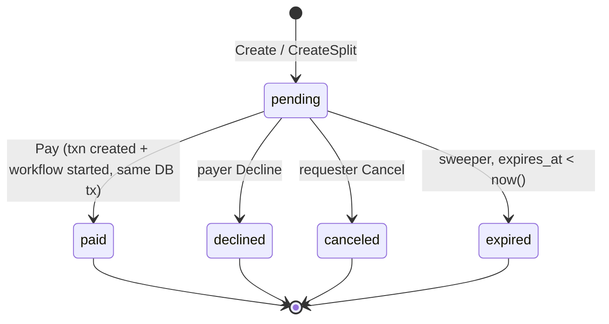
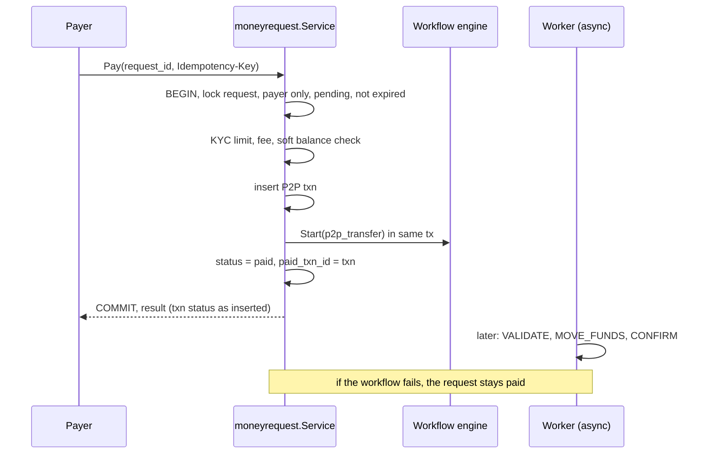

# Money requests and QR

## 1. Purpose
Request money from another user ("request", or "split bill" fanning out one request per payer) and pay it. Paying creates a normal P2P transaction through the workflow `p2p_transfer`; this package only adds the pre-payment state. The QR module lets a user publish a signed, expiring payload that others resolve into a short-lived receiver token for transfers. It does not own the transfer itself.

## 2. Key concepts
- **Money request** (`money_requests`): requester, payer, amount, optional note, optional `split_group_id`, `status`, `paid_txn_id`, `last_reminded_at`, `expires_at` (000004:59-72).
- **Split group**: requests created together share one `split_group_id` (`service.go:136`).
- **QR payload / receiver token**: HMAC-signed, base64url JSON (see 3.2).

## 3. Business rules

### 3.1 Money requests

| ID | Rule | Enforced by | Test |
|----|------|-------------|------|
| BR-MRQ-01 | Amount must be > 0 (DB CHECK too). | `service.go:Create` 54, `CreateSplit` 92; CHECK `amount > 0` (000004:63) | `TestMoneyRequestPayEndToEnd` |
| BR-MRQ-02 | Payer is found by phone; unknown -> `ErrPayerNotFound`; payer equal to requester -> `ErrSelfRequest`. | `service.go:57-66`; CHECK `no_self_request` (000004:71) | `TestMoneyRequestCancelAndActorGuards` |
| BR-MRQ-03 | Time to live is 72 hours from creation. | `service.go:requestTTL` 22, 70, 137 | `TestEdge_E19_ExpiryRacePay` |
| BR-MRQ-04 | Even split: `base = total/n`, remainder `r = total%n` distributed as +1 to the first `r` payers in order (largest-remainder, integer math); `total < n` -> `ErrBadSplit`. | `split.go:SplitEven` 16-35 | `TestSplitEven`, `TestSplitEvenRejectsTooManyShares` |
| BR-MRQ-05 | Custom split: `amounts` length must equal payer count, each amount > 0, and sum must equal `total_amount`. | `service.go:105-111`, `split.go:ValidateCustomSplit` 39-54 | `TestValidateCustomSplit`, `TestSplitBillThreeWay` |
| BR-MRQ-06 | Split requests are created in one DB transaction, all with the same `expires_at` and `split_group_id`; any payer failure (unknown phone, self) aborts before insert. The requester must not be among the payers; duplicates in `payer_phones` are not rejected. | `service.go:114-153` | `TestSplitBillThreeWay` |
| BR-MRQ-07 | Pay: only the request's payer; status must be `pending`; `expires_at` must be in the future; the request row is locked `FOR UPDATE`. | `service.go:Pay` 179-194, `money_request.sql:GetMoneyRequestForUpdate` | `TestEdge_E19_ExpiryRacePay`, `TestMoneyRequestCancelAndActorGuards` |
| BR-MRQ-08 | Pay applies the payer's KYC per-transaction limit (verified/auto_approved 100,000,000; manual_review/pending 5,000,000; none/rejected 2,000,000), the P2P fee for that KYC, and a soft balance check `balance >= amount + fee`. | `service.go:208-223`, `wallet/service.go:TxnLimit` 33-42 | none |
| BR-MRQ-09 | Pay creates a P2P transaction (payer wallet to requester wallet), starts the `p2p_transfer` workflow, and sets the request `paid` with `paid_txn_id`, all in ONE DB transaction. `paid` is guarded by `status='pending' AND expires_at > now()`; 0 rows -> `ErrExpired`. | `service.go:225-262`, `money_request.sql:FinalizeMoneyRequestPaid` (22-25) | `TestMoneyRequestPayEndToEnd` |
| BR-MRQ-10 | Pay with a repeated idempotency key returns the original transaction (`duplicate`). The key is global (BE-H1). | `service.go:232-242`, `idempotency_key UNIQUE` (000002:57) | none |
| BR-MRQ-11 | Decline: only the payer, only from `pending` (guarded UPDATE). Cancel: only the requester, only from `pending`. Failure reasons are distinguished: not found, wrong actor `ErrForbidden`, wrong state `ErrNotPayable`. | `money_request.sql:DeclineMoneyRequest/CancelMoneyRequest`, `service.go:265-306` | `TestMoneyRequestCancelAndActorGuards` |
| BR-MRQ-12 | Expiry: a 30-second sweeper expires up to 50 overdue pending requests (`expires_at < now()`) with a guarded UPDATE. | `sweeper.go:9,44-60`, `money_request.sql:ListDueMoneyRequestIDs/ExpireMoneyRequest` | `TestEdge_E19_ExpiryRacePay` |
| BR-MRQ-13 | Remind: only the requester, only while `pending`, at most once per 24 hours (`last_reminded_at` NULL or older than 24 h); otherwise `ErrRemindTooSoon` (429). Remind does not check `expires_at`, and no notification is sent by this package; it only updates the timestamp. | `money_request.sql:RemindMoneyRequestGuarded` (72-79), `service.go:Remind` 350-379 | `TestMoneyRequestRemind` |
| BR-MRQ-14 | Visibility: detail only for requester or payer (others get 404); detail includes siblings of the split group; payer inbox shows pending and unexpired only; sent list is the requester's last 50. | `service.go:DetailFor` 327-347, `money_request.sql:ListInboxPending`, `ListSentByRequester` | `TestSplitBillThreeWay` |

### 3.2 QR

| ID | Rule | Enforced by | Test |
|----|------|-------------|------|
| BR-QR-01 | A user's QR payload is base64url (no padding) JSON `{user_id,name_masked,phone_masked,exp}`; name and phone are masked by the handler before minting. | `qr/qr.go:Mint` 60-84, `api/qr_handler.go:34-35` | `TestQR_Flow` |
| BR-QR-02 | Payload TTL is 15 minutes. | `qr.go:61` | `TestQR_Expired` |
| BR-QR-03 | Signature is HMAC-SHA256 over `"<msg>\n<exp>"` with the server secret, base64url; message prefix is `qr-payload:` (payload) or `qr-receiver:` (token), compared with `hmac.Equal`. | `storage/storage.go:Signer.SignMsg/VerifyMsg` 104-113, `qr.go:77,123` | `TestQR_InvalidSignature` |
| BR-QR-04 | Resolve verifies the signature FIRST (forged -> `ErrQRInvalid`, no expiry leak), then expiry (`now > exp` -> `ErrQRExpired`). | `qr.go:Resolve` 86-105 | `TestQR_InvalidSignature`, `TestQR_Expired` |
| BR-QR-05 | Resolve returns masked name/phone and a receiver token `<base64url(json{user_id,exp,purpose:"qr-receiver"})>.<sig>` valid 10 minutes. | `qr.go:107-132` | `TestQR_Flow` |
| BR-QR-06 | Token verification: two dot-separated parts, signature, `purpose == "qr-receiver"`, then expiry (`ErrTokenInvalid` / `ErrTokenExpired`); returns the receiver user id. Used by the transfer handler. | `qr.go:VerifyReceiverToken` 135-170, `api/transfer_handler.go:51` | `TestQR_TokenInvalidAndExpired`, `TestQR_MintResolveTransferEndToEnd` |
| BR-QR-07 | Resolve is rate limited to 30 per minute per user. | `router.go:108` | none |

## 4. Lifecycle / state machine
Enum `money_request_status = pending|paid|declined|expired|canceled` (000004:9).

| Transition | Owner |
|---|---|
| `-> pending` | `service.go:Create` 67, `CreateSplit` 140 |
| `pending -> paid` | `service.go:Pay` 247 (`FinalizeMoneyRequestPaid`) |
| `pending -> declined` | `service.go:Decline` 265 |
| `pending -> canceled` | `service.go:Cancel` 277 |
| `pending -> expired` | `sweeper.go:ExpireDue` 44 |

No transition leaves a terminal state. There is no `paying` state, and nothing moves `paid` back to `pending`/`failed`.

## 5. Main flows

Failure branches: not the payer `ErrForbidden` 403; not pending `ErrNotPayable` 409; expired `ErrExpired` 410; limit; `ErrInsufficientBalance`.

## 6. Invariants
- A request is paid at most once: row lock plus guarded UPDATE (`service.go:179`, `money_request.sql:24-25`).
- A `paid` request always has a `paid_txn_id` written in the same DB transaction as the transaction row (`service.go:247`).
- Split shares are positive and sum exactly to the total (`split.go`).
- No float math on money.

## 7. Data
`money_requests` (000004:59-72), index `idx_money_req_payer (payer_id,status)`, FK `paid_txn_id -> transactions`. See `../reference/data-model.md`.

## 8. Interfaces
User JWT (`router.go:107-108,128-135`): `POST /v1/money-requests` (`payer_phone, amount, note`), `POST /v1/money-requests/split` (`payer_phones, total_amount, note, amounts?`), `GET /inbox`, `GET /sent`, `GET /:id`, `POST /:id/decline`, `POST /:id/cancel`, `POST /:id/remind`; `GET /v1/users/me/qr`, `POST /v1/qr/resolve`. The handler for pay is not mounted in the router section read (`router.go:128-135`) and no `.Pay(` call exists outside tests: `Service.Pay` is only exercised by integration tests. Sweeper started in `cmd/server/main.go:140`. See `../reference/api.md`.

## 9. Edge cases
- E19 pay vs expiry race: row lock + `expires_at > now()` guard; the loser gets `ErrExpired`.
- E01 idempotent pay replay returns the original transaction.
- Split where `total < n` is rejected; remainder spread +1 over the first payers.

## 10. Known gaps (as-is vs intended)
- **`paid` is set too early (BE-H5)**: it is set in the transaction that inserts the txn and starts the engine (`service.go:244-256`), before MOVE_FUNDS runs. A failed workflow leaves a `paid` request and no money moved. No code re-opens it.
- **No HTTP route for Pay** (see Interfaces); the app-facing payment path for a request, if any, goes through the generic transfer engine, which does not reference `money_requests` (grep of `internal/transfer` finds no such use). Treat Pay as service-level only.
- `/money-requests` and `/money-requests/split` do not use `RequireIdempotencyKey` (`router.go:128-129`); creation is not idempotent (BE-H1 note, unverified there, confirmed here).
- Duplicate payer phones in one split are accepted (two requests to the same payer).
- Split has no upper bound on payer count and no per-share limit checks at creation; limits are applied only at Pay.
- Remind only updates a timestamp; there is no notification delivery in this package.
- `canceled` (money request) vs `cancelled` (approval) spelling differs.
- QR: the signing secret is the shared storage `Signer` secret; tokens are not single-use and not bound to the caller (anyone holding a token within 10 min can use it as receiver).

## 11. Code map
- `moneyrequest/service.go`: Create 53, CreateSplit 91, Pay 171, Decline 265, Cancel 277, DetailFor 327, Remind 350.
- `moneyrequest/split.go`: SplitEven 16, ValidateCustomSplit 39.
- `moneyrequest/sweeper.go`: Run 23, ExpireDue 44.
- `qr/qr.go`: Mint 60, Resolve 86, VerifyReceiverToken 135.
- `api/request_handler.go`, `api/qr_handler.go`.

## 12. Open questions
- Which API should the app call to pay a request (no route found)? (owner: backend, not decided)
- Should `paid` wait for transaction `completed` (BE-H5 proposes `paying`)? (not decided)
