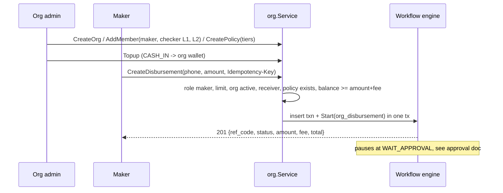

# Organization

## 1. Purpose
Business wallets: an organization has one VND wallet, members with roles (`admin`, `maker`, `checker`), versioned approval policies, topup, and the maker side of disbursements (org wallet to a user wallet). The approval of a disbursement lives in `approval-maker-checker.md`; the money movement is the workflow engine plus `ledger.Post`. This context does not own the ledger or the workflow.

## 2. Key concepts
- **Role** `org_role` enum `admin|maker|checker` (000005:10). One role per user per org (`member_unique`, 000005:36).
- **checker_level**: SMALLINT 1..5 or NULL (000005:34); only meaningful for checkers.
- **Policy**: name + amount range + tiers JSON + version + `is_active` (000005:39-50).
- **Org wallet**: created in `CreateOrg` via `CreateOrgWallet` (owner_type `organization`).

## 3. Business rules

| ID | Rule | Enforced by | Test |
|----|------|-------------|------|
| BR-ORG-01 | Creating an org creates the org, its VND wallet and the creator's `admin` membership, plus an audit row, in one transaction. Name is trimmed, 2-200 chars. | `org/service.go:CreateOrg` (71-107) | `TestIntegration_ListUserOrgs` |
| BR-ORG-02 | Only an org `admin` can add members; roles are `admin|maker|checker`; a checker needs `checker_level >= 1` (the DB also caps at 5). The user is looked up by phone. | `service.go:AddMember` (143-185), CHECK on `org_members.checker_level` (000005:34) | none |
| BR-ORG-03 | A user can be a member of an org only once (hence has exactly one role there). Duplicate -> `ErrMemberExists`. | `member_unique` (000005:36), `service.go:175` | none |
| BR-ORG-04 | Role checks demand an EXACT role match: `requireRole(want)` fails with `ErrForbiddenRole` otherwise; non-members get `ErrNotMember`. | `service.go:requireRole` (449-461) | `TestOrgDisbursementHTTP_ForbiddenRole` |
| BR-ORG-05 | Only an org `admin` can create a policy (user path); a platform admin can create one without membership through `CreatePolicyAsAdmin`, which only requires the org to exist and be `active`. | `service.go:CreatePolicy` 196, `CreatePolicyAsAdmin` 209, `requireActiveOrg` 463; route `admin_ops_handler.go:361` | `TestOrgAdminPolicy_CreatePolicyAsAdmin_NoOrgMembershipRequired` |
| BR-ORG-06 | Policy validation: name 1-100 chars, tiers valid (see BR-APR-04), `min_amount >= 0`, `max_amount > min_amount` when present. | `service.go:createPolicy` (217-226), `approval.ValidateTiers` | `TestValidateTiers` |
| BR-ORG-07 | Policies are versioned per `(org_id,name)`: a save computes `MAX(version)+1`, deactivates all active rows of that name and inserts the new one active. History is kept. | `service.go:239-253`, `queries/approval.sql:GetNextPolicyVersion`, `DeactivateOrgPoliciesByName` | `TestEdge_E09_PolicySnapshotSurvivesPolicyChange` |
| BR-ORG-08 | Concurrent saves of the same name collide on `UNIQUE(org_id,name,version)` and map to `ErrPolicyVersionConflict` (409). The next-version read is NOT locked. | constraint `approval_policies_org_name_version_key` (000013:8-9), `service.go:256` | `TestOrgAdminPolicy_ConcurrentInsertsRaceToOneWinner`, `TestOrgAdminPolicy_VersionConflictMapsToSentinelError` |
| BR-ORG-09 | `approval_policies.created_by` has no FK so platform-admin ids can be recorded. | migration 000012 | `TestOrgAdminPolicy_CreatePolicyAsAdmin_NoOrgMembershipRequired` |
| BR-ORG-10 | Policy change is audited (`org.policy_change`, actor type `user` or `admin`). | `service.go:261-267` | none |
| BR-ORG-11 | Per-transaction cap for org topup and disbursement is a fixed 1,000,000,000 VND; above it -> `wallet.ErrLimitExceeded`; amount `<= 0` -> `ErrAmountInvalid`. No KYC tiers for orgs. | `service.go:orgTxnLimit` (46), checks 282-287, 366-371 | none |
| BR-ORG-12 | Topup is admin-only, requires an active org, moves SYSTEM_CASH_IN -> org wallet through `ledger.Post` and completes synchronously. Duplicate idempotency key returns the original transaction. | `service.go:Topup` (278-334, `duplicateTopup` 336) | none |
| BR-ORG-13 | Disbursement is maker-only (an org admin cannot disburse), requires an active org, an existing receiver user (by phone) with a main VND wallet. | `service.go:CreateDisbursement` (362-390) | `TestOrgDisbursementHTTP_ForbiddenRole`, `TestOrgDisbursementHTTP_Success` |
| BR-ORG-14 | Fail-fast: a disbursement is refused with `ErrNoPolicy` if no active policy matches the amount, and with `ErrInsufficientBalance` if `org balance < amount + fee`. The balance check is soft; MOVE_FUNDS is the hard check. | `service.go:392-409` | none |
| BR-ORG-15 | Fee comes from `fees.For(TxnTypeOrgDisbursement, KycStatusNone, amount)`. | `service.go:403` | none |
| BR-ORG-16 | The transaction row and `engine.Start("org_disbursement", ...)` are created in one DB transaction. Workflow v2 steps: VALIDATE, FRAUD_CHECK, ACTIONS_BEFORE_GL, WAIT_APPROVAL, MOVE_FUNDS (compensatable), CONFIRM. | `service.go:411-440`, migration 000010:24-35 | `TestOrgDisbursementTwoTierEndToEnd` |
| BR-ORG-17 | Disbursement requires an `Idempotency-Key` header on the route; the same key returns the original transaction with HTTP 200 (`duplicate`). The key is scoped to the acting user and bound to the request (ADR-0011): the same key with the same maker, org, receiver, amount and note replays; any other payload returns 409 `ERR_IDEMPOTENCY_KEY_REUSED`; a missing key is refused. Topup follows the same rule (org, amount). | `router.go`, `org_handler.go`, `org/service.go:Topup,CreateDisbursement`, `wallet/idempotency.go`, constraint `UNIQUE (initiated_by, idempotency_key)` (000015) | `TestOrgDisbursementHTTP_MissingIdempotencyKey`, `TestOrgDisbursementHTTP_IdempotentReplay`, `TestOrgDisbursement_SameKeyDifferentRequestRefused`, `TestOrgDisbursement_KeyIsPerUser`, `TestOrgDisbursement_ConcurrentSameKeyCreatesOne`, `TestOrgTopup_ReplayAndReuse` |
| BR-ORG-18 | The user's org list returns only orgs with `status='active'` where the user is a member, with role, checker_level, wallet id and balance. | `queries/org.sql:ListUserOrganizations` (17-22) | `TestIntegration_ListUserOrgs` |
| BR-ORG-19 | Admin overview lists ALL orgs with member count, active policy count and pending approval count; not scoped to a member. | `queries/org.sql:ListOrganizationsAdmin` (24-38) | `TestOrgAdminOverview_ListsAllOrgsWithCounts`, `TestOrgAdminOverview_NotScopedToAnySingleCaller` |

## 4. Lifecycle / state machine
Organizations carry `account_status` (default `active`; 000005:24). The only status check in `org` is "must be active" (`service.go:471`). No code in `internal/org` changes the org status (not verified elsewhere; see Open questions). Disbursement transaction states are owned by the workflow/transfer contexts; the approval-related part is `processing -> pending_approval -> processing -> completed|failed` (see `approval-maker-checker.md` BR-APR-01/15).

## 5. Main flows

Failure branches: `ErrNotMember` 403, `ErrForbiddenRole` 403, `ErrOrgInactive` 403, `ErrReceiverNotFound` 404, `ErrNoPolicy` 400, `ErrInsufficientBalance` (`errmap.go:68-78`).

## 6. Invariants
- Org, org wallet and creator membership exist together or not at all (`CreateOrg` tx).
- Money moves only through `ledger.Post` (topup: `service.go:320`; disbursement: MOVE_FUNDS).
- A user has at most one role per org (`member_unique`).
- `(org_id,name,version)` is unique (000013).

## 7. Data
`organizations` (code auto `ORG_<12 hex>`, name, status, created_by FK users), `org_members`, `approval_policies`, `approval_policy_tiers` (not used by org code). See `../reference/data-model.md`.

## 8. Interfaces
User JWT (`router.go:151-156`): `GET /v1/org`, `POST /v1/org`, `POST /v1/org/:id/members` (`phone, role, checker_level`), `POST /v1/org/:id/policies` (`name, min_amount, max_amount, tiers`), `POST /v1/org/:id/transactions` (disburse; `phone, amount, note`). Admin JWT: policy creation via `admin_ops_handler.go:349-361`. There is no HTTP route for org topup in the router section read (`router.go:151-162`): `Topup` exists in the service only.

## 9. Edge cases
- E01 idempotent replay of disbursement returns the original with 200.
- E09 policy change does not affect in-flight requests (snapshot).
- Receiver without a main wallet is reported as `ErrReceiverNotFound`.

## 10. Known gaps (as-is vs intended)
- The org creator becomes `admin` and cannot disburse or approve; a second member with role maker/checker is needed (BR-ORG-04/13).
- The next policy version is computed without a lock; the race is caught only by the 000013 constraint (BR-ORG-08).
- No rule prevents overlapping amount ranges or gaps between policies (BR-APR-03 resolves overlap by version).
- No way in code to change or remove a member's role, or to remove a member (only `AddMember` exists in `service.go`).
- Idempotency key is global, not per user (BE-H1, `AUDIT-REPORT.md:73`).
- Disbursement limit is a constant, not configurable per org (`service.go:46`).
- `Topup` is not reachable over HTTP in `router.go` as read.

## 11. Code map
`internal/org/service.go`: CreateOrg 71, AddMember 143, CreatePolicy 196, CreatePolicyAsAdmin 209, createPolicy 216, Topup 278, CreateDisbursement 362, requireRole 449. Handlers `internal/api/org_handler.go`. Queries `store/queries/org.sql`, `approval.sql`.

## 12. Open questions
- Is there an admin flow to suspend an org (status not `active`)? Not found in `internal/org`.
- Should a maker be allowed to see the org wallet balance? Not decided.
