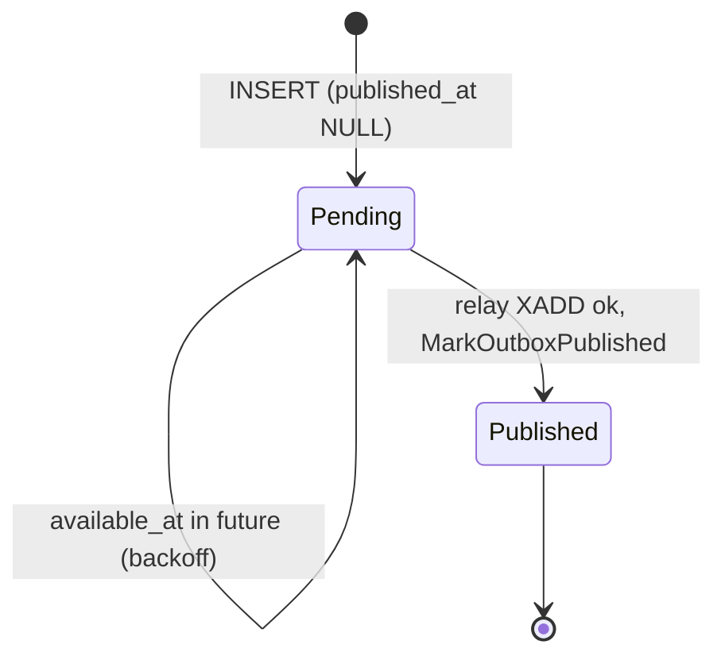

# Outbox and Events

## 1. Purpose
Guarantees that an event is published if and only if the business transaction that produced it committed (transactional outbox), and moves those events to Redis Streams where workflow workers and the engine consume them. It also documents every background goroutine the server starts and how they behave when several replicas run. It does NOT define what the events mean for the workflow state machine (see `workflow-engine.md`). Only workflow events use the outbox today.

## 2. Key concepts
- **Outbox row**: `outbox(id identity, aggregate, event_type, payload jsonb, available_at, published_at, created_at)`.
- **Relay** (`outbox.Relay`): the only production writer to Redis Streams (`relay.go:1-3`).
- **Event types** (`workflow/types.go:125-128`): `workflow.step.start`, `workflow.step.result`. Aggregates used: `workflow` (engine, worker) and `approval` (approval finalize).
- **Streams**: `wf:steps:<handler>` (consumer group `workers`), `wf:events` (group `engine`) (`consumer.go:20-27`).

## 3. Business rules

| ID | Rule | Enforced by (code or DB) | Test |
|----|------|--------------------------|------|
| BR-OB-01 | Business code writes outbox rows in its own DB transaction; nothing publishes before commit. | `workflow/engine.go:dispatchStepAfter` (417-427) called with caller `tx` from `Engine.Start`; `approval/service.go:566`; `consumer.go:206` | `TestEdge_E05_OutboxSurvivesBrokerOutage` |
| BR-OB-02 | Only rows with `published_at IS NULL AND available_at <= now()` are claimed, in `id` order, `FOR UPDATE SKIP LOCKED`, so concurrent relays do not publish the same row. | `queries/outbox.sql:ClaimOutboxBatch` (6-11) | none (no multi-relay test) |
| BR-OB-03 | Relay publishes each claimed row with XADD and marks only the successfully published ones in the same tx; on the first XADD error it stops, marks the already-added rows and commits (or rolls back if none). | `relay.go:RelayOnce` (47-84) | `TestEdge_E05_...` |
| BR-OB-04 | `step.start` events go to `wf:steps:<payload.handler>`; every other event type (and a start event without handler) goes to `wf:events`. | `relay.go:destinationStream` (88-98) | none |
| BR-OB-05 | Delay/backoff is expressed only by `available_at`; the relay does no sleeping. | `engine.go:dispatchStepAfter` (424), `outbox.sql:9` | `TestWorkflowRetryThenSuccessWithBackoff` |
| BR-OB-06 | A stream message is ACKed only after successful processing; failed processing leaves it pending for XAUTOCLAIM (>= 60s idle). Malformed payloads are ACKed (dropped). | `consumer.go:handleMessage` (88-98), `processStepMessage` (103-107), `processResultMessage` (238-242), `recovery.go:56-78` | none |
| BR-OB-07 | A start message is executed at most once per `(instance, step, attempt)`; replays re-emit the stored result. | `consumer.go:processStepMessage` (111-116), unique index `idx_step_exec` | `TestEdge_E04_RedeliveryNoDoubleSideEffect` |
| BR-OB-08 | Result events are idempotent at the engine: stale or duplicate events no-op by status/current_step. | `engine.go:OnResult` (97-139) | `TestEdge_E06_DuplicateResultEventIdempotent` |
| BR-OB-09 | Consumer groups are created at id `0` with MKSTREAM on worker start (BUSYGROUP ignored). | `consumer.go:ensureGroup` (56-61) | none |

## 4. Lifecycle / state machine
An outbox row has no status column; its state is derived.


| Transition | Owner |
|-----------|-------|
| insert | `store/queries/outbox.sql:InsertOutbox` via engine, worker, approval |
| Pending -> Published | `relay.go:RelayOnce` or `consumer.go:PumpLocal` (`MarkOutboxPublished`) |
Rows are never deleted or archived by code (no purge job found), so the table grows unbounded.

## 5. Main flows
```mermaid
sequenceDiagram
    participant B as Business tx
    participant DB as outbox table
    participant R as Relay (200ms)
    participant RS as Redis
    participant W as Worker loop
    B->>DB: INSERT event, COMMIT
    R->>DB: BEGIN; SELECT ... FOR UPDATE SKIP LOCKED (batch 100)
    R->>RS: XADD stream {type, payload}
    alt XADD fails (Redis down)
        R->>R: stop batch; mark only published ones; retry next tick
    else ok
        R->>DB: UPDATE published_at=now(); COMMIT
    end
    W->>RS: XREADGROUP count 10 block 2s
    W->>W: process
    alt processing error
        W->>W: no XACK, stays pending
    else ok
        W->>RS: XACK
    end
    Note over R,W: crash after XADD but before COMMIT => row re-published (duplicate message)
```

### Delivery guarantee
At-least-once end to end. Duplicates can arise from (a) relay crash/rollback after XADD, (b) worker crash before XACK, (c) XAUTOCLAIM of a slow message. Idempotency by component:

| Component | Idempotent? | How |
|---|---|---|
| Relay publish | No (may publish a row twice) | not de-duplicated; downstream must cope |
| Step start processing | Recording only | unique `(instance, step, attempt)`; handler side effect itself is not atomic with the record (audit BE-C1) |
| Result processing (engine) | Yes | status/current_step guard, row lock |
| Recorded-result replay | Adds a duplicate result event | engine drops it |
| Approval finalize insert | Yes | 23505 ignored (`approval/service.go:544-550`) |

## 6. Invariants
- An event row exists iff its producing transaction committed (BR-OB-01).
- A row is marked published only after its XADD returned OK in the same relay transaction (`relay.go:66-80`).
- A row held by one relay (row lock) is skipped by others (BR-OB-02).
- Backoff delays never block a relay (BR-OB-05).

## 7. Data
`outbox` (migration 000003 lines 69-78): `id BIGINT identity PK`, `aggregate VARCHAR(50) default 'system'`, `event_type VARCHAR(50)`, `payload JSONB`, `available_at TIMESTAMPTZ default now()`, `published_at`, `created_at`. Partial index `idx_outbox_pending (available_at) WHERE published_at IS NULL` (the claim query orders by `id`, so the index only helps the filter). See `../reference/data-model.md`.

Redis keys: `wf:events`, `wf:steps:validator|wallet|confirmer|action_pipeline|round_up|fraud|kyc_scorer|kyc_classifier` (one per registered handler name, `consumer.go:46-50`). Streams are never trimmed by code (no XTRIM found).

## 8. Interfaces
No HTTP endpoint exposes the outbox or streams. Internal interface: `outbox.NewRelay`, `Relay.Run`, `Relay.RelayOnce(ctx, batch)` (exported for tests), `Worker.PumpLocal`.

### PumpLocal
`Worker.PumpLocal` (`consumer.go:266-317`) claims due outbox rows, marks them published BEFORE processing, commits, then runs the events in-process, bypassing Redis. It skips `step.start` events whose handler is not in its registry (left unpublished). It is a test/dev harness; it is not wired in `main.go` (the only non-test reference is its own definition). Because it marks published before processing, an error loses the event (audit Medium "Outbox"). Nothing technically blocks its use in production.

### Background goroutines (cmd/server/main.go)
All six start only when the role runs workers (`worker` or `all`; `config.go:35`), at `main.go:146-151`, using one `workerCtx` cancelled on shutdown (`defer stopWorkers()`, line 92). The HTTP server is a separate goroutine (`main.go:82`) for api/admin/all roles.

| Goroutine | Interval | Work | Multi-replica behavior |
|---|---|---|---|
| `outbox.Relay.Run` (`relay.go:30`) | ticker 200 ms, batch 100 | claim and XADD | Safe: `FOR UPDATE SKIP LOCKED` row locks. Events from different relays may interleave, so cross-row ordering is not guaranteed |
| `workflow.Worker.Run` (`consumer.go:45`) | blocking XREADGROUP (count 10, block 2s); one loop per handler stream + one for `wf:events` | execute steps / apply results | Safe by Redis consumer group (each message to one consumer), BUT all replicas use consumer name `c1` (`consumer.go:24`); pending-entry ownership is therefore shared and XAUTOCLAIM can hand a message to any replica |
| `workflow.Recovery.Run` (`recovery.go:40`) | ticker 30 s | `XAUTOCLAIM` (idle >= 60 s, count 20, per stream) then `SweepStuck` (running, idle > 2 min, batch 20) | Sweep: safe (UPDATE lease + SKIP LOCKED, test E20). XAUTOCLAIM: duplicates execution risk bounded by `idx_step_exec` |
| `approval.Sweeper.Run` (`approval/sweeper.go:22`) | ticker 30 s | expire overdue pending approval requests, up to 50 per tick (`ListDueApprovalIDs` limit 50) | Safe: guarded `FinalizeApprovalRequest` claim per request in its own tx; loser gets `ErrAlreadyFinalized` and continues (`approval/service.go:496-505,593-594`) |
| `moneyrequest.Sweeper.Run` (`moneyrequest/sweeper.go:23`) | ticker 30 s | expire pending requests past `expires_at`, 50 per tick | Safe: guarded `UPDATE ... WHERE status='pending'` returns rows affected (`money_request.sql:67-70`) |
| `recon.Cron.Run` (`recon/cron.go:22`) | sleeps until the next 00:15 local server time, then daily; reconciles the previous day | `RunForDate(now-1d)` | Every replica runs it. Safe by `reconciliation_runs.run_date UNIQUE` (000005:137): the loser gets `ErrAlreadyRan` (23505) and logs at debug. Work (statement queries, report build, AI summary) is duplicated before the insert. A run missed while the process is down is not back-filled |

There is no leader election, advisory lock or Redis lock anywhere in these loops. HTTP-only roles (`api`, `admin`) start none of them.

## 9. Edge cases
- E05 broker outage: events remain in `outbox`; relay resumes (`TestEdge_E05_...`).
- E17 Redis down: relay logs and continues; consumer sleeps 1 s between failures.
- E04 redelivery, E06 duplicate result, E20 lost start event (sweeper re-emits): see `workflow-engine.md`.
- Poison event: a row whose XADD keeps failing blocks everything behind it in `id` order for that relay pass (`relay.go:69-74` breaks the batch).

## 10. Known gaps (as-is vs intended)
- Audit Medium "Outbox": at-least-once, no dead-letter, no attempts counter, poison event blocks the head of the queue; index ordered by `available_at` vs query `ORDER BY id`; `PumpLocal` marks published before processing.
- BE-C1: duplicate delivery can re-run `wallet` handler's ledger post.
- Audit Medium "Workflow": `consumer.go:77` uses `time.Sleep(1s)` instead of selecting on `ctx.Done()`.
- BE-H7: `main.go:117` compares `Env != "production"` while config documents `dev|ci|demo` (affects which outbound gateway runs, not the outbox).
- Not in audit: no outbox purge, no stream trim, fixed consumer name `c1`, recon cron does not catch up missed days, no leader election.
- The old design docs describe asynq and golang-migrate; neither is used. Scheduling is the goroutines above.

## 11. Code map
| File | Responsibility |
|---|---|
| `outbox/relay.go:30,47,88` | Run, RelayOnce, destinationStream |
| `workflow/consumer.go:45,102,164,266` | Worker.Run, processStepMessage, recordAndEmit, PumpLocal |
| `workflow/recovery.go:40,56,82` | Run, autoClaim, SweepStuck |
| `store/queries/outbox.sql` | InsertOutbox, ClaimOutboxBatch, MarkOutboxPublished |
| `cmd/server/main.go:90-153` | worker wiring and goroutine start |

## 12. Open questions
- Should outbox rows be purged and streams trimmed (retention policy)? (no owner/date)
- Should the consumer name be per replica (hostname) as the comment in `consumer.go:24` suggests? (no owner/date)
