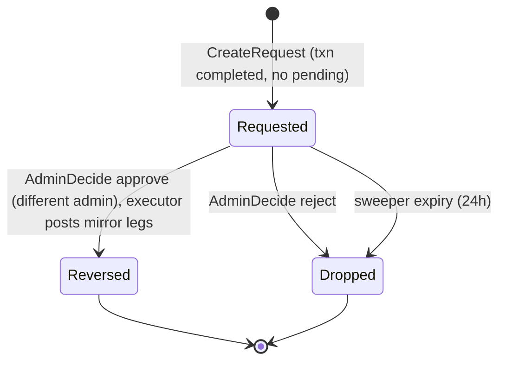
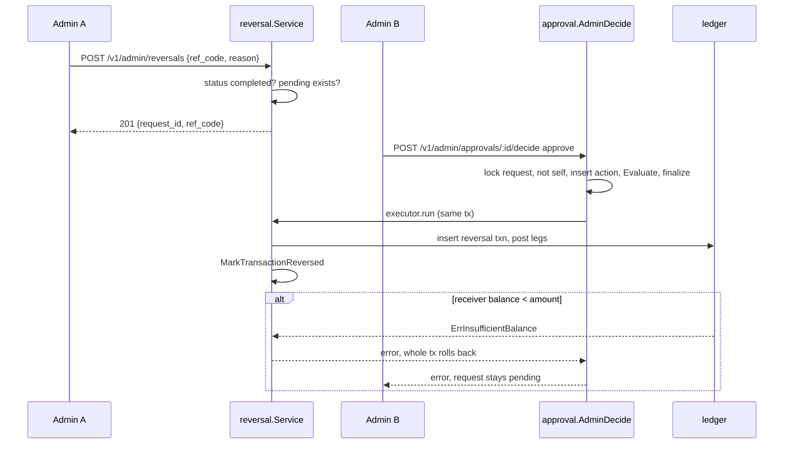

# Reversal

## 1. Purpose
Lets platform admins undo a completed transaction using maker-checker: admin A files a request, a different admin B approves, and an executor (run inside the approval finalize transaction) posts the mirror ledger entries and marks the original `reversed`. It is a passive posting: it does not go through the workflow engine (`reversal.go:1-5`, `transactions.sql:63-66`). It does NOT cover workflow compensation (MOVE_FUNDS compensating legs, `handlers.go:82-141`).

## 2. Key concepts
- **Reversal request**: an `approval_requests` row with `subject_type='reversal'`, `subject_id` = original transaction id, no org, no workflow instance, no policy (`reversal.go:97-102`).
- **Reversal transaction**: a new `transactions` row, `type='reversal'`, born `completed`, `reversal_of` = original id, sender/receiver swapped (`transactions.sql:InsertReversalTransaction`).
- Snapshot is synthetic: `{name:"admin_reversal", version:1, tiers:[{level:1, required_approvals:1}]}` (`reversal.go:82-85`).

## 3. Business rules

| ID | Rule | Enforced by | Test |
|----|------|-------------|------|
| BR-REV-01 | The original is found by `ref_code`; unknown -> `ErrTxnNotFound` (404). | `reversal.go:CreateRequest` 58-64 | `TestReversalGuards` |
| BR-REV-02 | Only a transaction with status `completed` may be reversed; `reversed` -> `ErrAlreadyReversed` (409); any other status -> `ErrNotReversible` (409). | `reversal.go:65-72` | `TestReversalGuards`, `TestReversalEndToEnd` |
| BR-REV-03 | At most one pending reversal request per transaction, enforced by a partial unique index `one_pending_approval_per_subject` on `approval_requests (subject_type, subject_id) WHERE status = 'pending'` (migration 000017) plus the application check; a concurrent second request gets `ErrReversalPending`. | migration 000017; `reversal.go:CreateRequest` | `TestReversal_ConcurrentRequestsOnlyOne`, `TestReversalEndToEnd` |
| BR-REV-04 | Request deadline is 24 h; the sweeper expires it, in which case the executor does nothing; `AdminDecide` also refuses a request past its deadline with `ErrExpired` (same rule as the org path). | `reversal.go:26,101`, `reversal.go:127-129`, `approval/service.go:ExpireDue` | none |
| BR-REV-05 | The deciding admin must differ from the requesting admin. | `approval/admin.go:67-69` | `TestReversalEndToEnd` |
| BR-REV-06 | One approval completes it (single tier). A reject leaves the original `completed` and posts nothing. | `reversal.go:82-85`, `reversal.go:127-129` | `TestReversalGuards` |
| BR-REV-07 | On approve, a reversal transaction is inserted with `amount` and `fee` equal to the original, note `reversal of <ref_code>`, `initiated_by` = original's initiator, `idempotency_key = "rev-<orig id>"`. | `reversal.go:139-145` | `TestReversalEndToEnd` |
| BR-REV-08 | Ledger legs (balanced): credit original sender `amount+fee`; debit original receiver `amount`; if fee > 0, debit `SYSTEM_FEE` wallet `fee`. Posted with `ledger.PostWithQueries` on the finalize transaction. | `reversal.go:153-166`, `ledger.go:PostWithQueries` | `TestReversalEndToEnd` |
| BR-REV-09 | The ledger refuses unbalanced legs and any final balance < 0 on non-system wallets (`ErrInsufficientBalance`). | `ledger.go:59,101-112` | `TestEdge_E07_CompensationReversesMovedFunds` (forward ledger) |
| BR-REV-10 | After posting, the original is moved `completed -> reversed` with a guarded UPDATE; original ledger entries are never edited (ledger is append-only). | `transactions.sql:MarkTransactionReversed` (72-77), migration 000007 | `TestReversalEndToEnd` |
| BR-REV-12 | At most one reversal transaction per original, enforced by the unique index `one_reversal_per_txn` on `transactions (reversal_of) WHERE reversal_of IS NOT NULL` (migration 000017). | migration 000017 | `TestReversal_SecondReversalRowRejectedByDB` |
| BR-REV-13 | A transaction of type `reversal` cannot be reversed (`ErrNotReversible`). | `reversal.go:CreateRequest` | `TestReversal_ReversalOfReversalRejected` |
| BR-REV-14 | The executor locks the original (`GetTransactionForUpdate`) and requires `completed`; a changed state fails the finalize with `ErrNotReversible` and changes nothing; the row count of `MarkTransactionReversed` must be 1. | `reversal.go:executor.run` | `TestReversal_ExecutorRequiresCompletedOriginal` |
| BR-REV-15 | If the receiver cannot cover the reversal (`ErrInsufficientBalance`), the executor returns `approval.NeedsManual`; the approval service rolls back the executor's work to a savepoint, keeps the approver's action row, sets the request to `needs_manual` and writes an audit row `reversal.needs_manual`. No reversal transaction, no ledger entry, no balance change; the original stays `completed`. `needs_manual` is terminal for the decision flow (ADR-0013). | `approval/admin.go:finalizeOrPark`, `approval/manual.go`, migration 000016 | `TestReversal_ReceiverWithoutFundsGoesToNeedsManual` |
| BR-REV-11 | Request, decision and audit rows: `reversal.request` (actor `admin`), then `approval.approve/reject` (actor `admin`). | `reversal.go:110-116`, `admin.go:121` | none |

## 4. Lifecycle / state machine

Original transaction: `completed -> reversed` only (`transactions.sql:76`). A dropped request leaves the original `completed`, so a new request can be filed.

| Transition | Owner |
|---|---|
| request created | `reversal.go:CreateRequest:97` |
| approve/reject | `approval/admin.go:AdminDecide` -> `finalize` -> `reversal.go:executor.run:126` |
| expire | `approval/service.go:expireOne` |

## 5. Main flows

## 6. Invariants
- The ledger stays balanced: debits = credits in the posted legs (`ledger.go:59`).
- The original ledger rows are untouched; the reversal is a new transaction with its own entries.
- Approval finalize, reversal transaction, ledger entries and status flip commit atomically (one tx, `approval/service.go:496-516`, `admin.go:46-131`).
- Non-system wallets cannot go negative (`ledger.go:101-112`, constraint `wallet_balance_non_negative` 000002:35 as amended in 000006:78).

## 7. Data
`approval_requests` (subject_type `reversal`), `approval_actions`, `transactions.reversal_of` (FK, 000002:60), `idempotency_key VARCHAR(80) UNIQUE` (000002:57), `ledger_entries`. See `../reference/data-model.md`.

## 8. Interfaces
`POST /v1/admin/reversals` (`router.go:193`, `admin_ops_handler.go:102`; body `ref_code`, `reason` max 255), `GET /v1/admin/approvals`, `POST /v1/admin/approvals/:id/decide`. Executor registered at `router.go:170`. Error codes `errmap.go:107-110`. See `../reference/api.md`.

## 9. Edge cases
- Receiver already spent the funds: the request is parked as `needs_manual` (BR-REV-15); nothing is posted.
- Reversal of a transaction with fee 0: no SYSTEM_FEE leg.
- Reversal of an org disbursement: sender is the org wallet, which is credited back (`reversal.go:154`).

## 10. Known gaps (as-is vs intended)
- BE-H3 (double reversal) and BE-H4 (receiver without funds) are FIXED in the working tree (2026-11-21, not yet committed): see BR-REV-03, 12 to 15, ADR-0013 and the bug records. Remaining in this area:
- **Resolution of `needs_manual`** is manual and undefined: nothing in the system retries, writes off, or opens a debt record (ADR-0009 follow-up). Since G12 the admin app shows parked requests: `GET /v1/admin/approvals?status=needs_manual` and the "Needs attention" page (read-only; see `specs/g12-needs-attention-queue/spec.md`).
- Any transaction type with status `completed` is reversible (topup, vault_move, p2p, org_disbursement); there is no type restriction or age limit.
- `GET /v1/admin/approvals` shows reversals only while `expires_at > now()` (`approval.sql:56`).
- No wallet-owner status check (locked/inactive owner) in the executor.
- The unique key space for `idempotency_key` is still shared with the `rev-` keys until the per-user idempotency slice lands.
## 11. Code map
- `internal/reversal/reversal.go`: `RegisterExecutor` 46, `CreateRequest` 57, `executor.run` 126.
- `internal/approval/admin.go`: `AdminDecide` 46.
- `internal/ledger/ledger.go`: `PostWithQueries` 77.
- `internal/api/admin_ops_handler.go`: `CreateReversal` 102, `AdminDecide` 148.

## 12. Open questions
- Which terminal state should a reversal take when the receiver cannot cover it (owner: product/finance, not decided)?
- Should reversal of reversal transactions and old transactions be blocked? (not decided)
