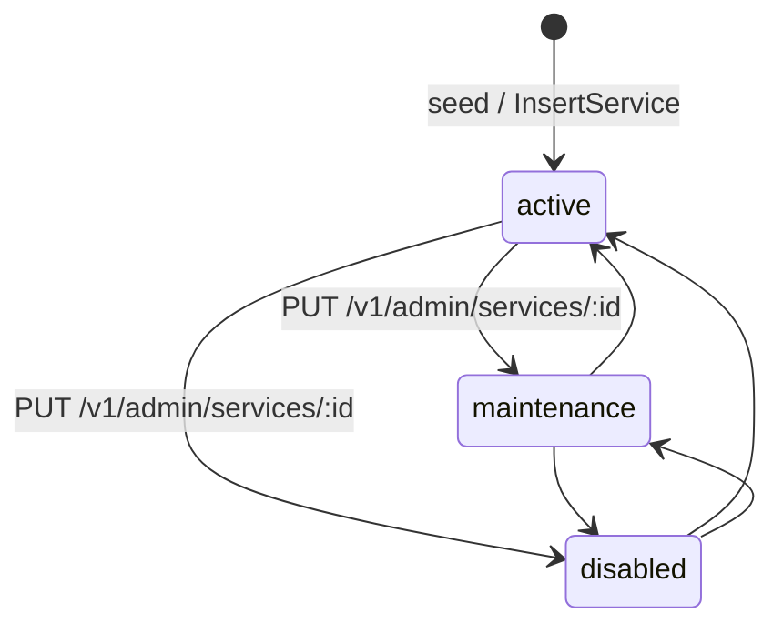
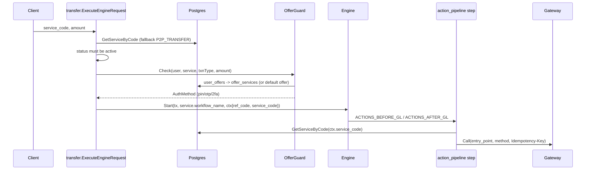

# Service Catalog and Offers

## 1. Purpose
Describes the configuration data that decides what a user may do and how it is executed: `services` (what can be transacted, which workflow definition and ledger type it maps to, which outbound actions it declares), `offers` (packages), `offer_services` (per-package limits per service), `offer_auth_matrix` (auth method per amount tier) and `user_offers` (package assigned to a user). It also covers the action pipeline step that calls partner URLs stored in the service row. It does NOT own the workflow runtime (see `workflow-engine.md`) or fee policy.

## 2. Key concepts
- **Service**: row in `services`, unique `code` (e.g. `P2P_TRANSFER`). Carries dispatch metadata `workflow_name`, `ledger_txn_type`, `wallet_strategy` (000006:15-17).
- **Offer**: package with role (`offer_role` enum: customer, agent, merchant, biller, operator), level, pocket max, max bank accounts.
- **Offer service**: link offer x service with limits (min, per-txn, daily, monthly, interval seconds) and `is_enabled`.
- **Auth matrix**: ordered amount tiers per offer_service giving `none | pin | otp | 2fa`.
- **Action**: JSON entry in `services.actions` (`code, name, type, entry_point, method, required`); type `GL Posting` or `Directional Integration`.
- **action_priority**: `before_gl` or `after_gl` on the service (default `before_gl`); decides which pipeline slot fires.

## 3. Business rules

| ID | Rule | Enforced by (code or DB) | Test |
|----|------|--------------------------|------|
| BR-SC-01 | Service `code` is unique; status is the enum `active | maintenance | disabled`. | `000003:11-18` (`code UNIQUE`, `service_status`) | none |
| BR-SC-02 | A money request for a service code that does not exist silently falls back to `P2P_TRANSFER`; an empty code means `P2P_TRANSFER`. | `transfer/service.go:283-294` | none |
| BR-SC-03 | A service whose status is not `active` rejects the request. | `transfer/service.go:296-298` | none |
| BR-SC-04 | With dynamic dispatch on (default; off only if env `ENGINE_DYNAMIC_DISPATCH=false`) ledger txn type, workflow name and wallet strategy come from the service row; off falls back to p2p / constructor definition / `user_to_user`. | `transfer/service.go:49,300-309` | transfer integration tests |
| BR-SC-05 | OfferGuard resolves the offer through `user_offers` (offer must be `is_active`); with no assignment it uses the default offer `OFFER_CUST_L0` (env `DEFAULT_OFFER_CODE`); a user who has an offer is never sent to the default one: a missing service row is refused and an inactive offer is refused with `ERR_OFFER_INACTIVE` (fail closed). | `offerguard.go:Check` (64-78), `offer_guard.sql:GetOfferServiceForUser`, `GetOfferServiceByOfferCode` | `TestOfferGuard_UnknownServiceRefused` |
| BR-SC-06 | Refused when `is_enabled` is false, `amount < min_amount`, or `max_amount_per_txn > 0 && amount > max_amount_per_txn`. | `offerguard.go:82-90` | `TestOfferGuard_ServiceDisabled`, `_BelowMinimum`, `_LimitPerTxn` |
| BR-SC-07 | Daily and monthly limits sum `amount + fee` of the user's transactions of the same ledger type since local-server midnight / 1st of month, excluding status `failed` and `reversed`; a limit of 0 disables the check. | `offerguard.go:92-112`, `offer_guard.sql:SumUserTxnAmountSince` (22-29) | none |
| BR-SC-08 | `interval_seconds > 0` rejects a request made sooner than that after the user's last transaction of the same type. | `offerguard.go:113-121`, `offer_guard.sql:LastUserTxnAt` | none |
| BR-SC-09 | Required auth method is the first matrix row (ordered by `min_amount`) whose range `[min, max)` contains the amount (`max NULL` = unbounded); above all ceilings use the last row; no rows or a query error returns `pin`. | `offerguard.go:authFor` (136-152), `offer_service.sql:ListAuthMatrix` (91-94) | `TestAuthMatrix_FromDB` |
| BR-SC-10 | OfferGuard can be disabled with env `OFFERGUARD_ENABLED=false`; then required auth is `pin` and no limits apply. | `config.go` (refused outside dev and ci), `transfer/service.go:SetOfferGuardEnabled` | `TestConfig_OfferGuardFlagByEnv`, `TestOfferGuardSwitch_OffDisablesLimitsOnDefaultKeepsThem` |
| BR-SC-11 | `(offer_id, service_id)` is unique in `offer_services`; deleting an offer or service cascades to offer_services and the matrix. | `000004:27-28,35,40` | none |
| BR-SC-12 | The action pipeline step only acts if the service's `action_priority` (trimmed, case-insensitive) equals the step's phase: step name containing `AFTER_GL` (case-insensitive) is `after_gl`, any other name is `before_gl`. | `action_pipeline.go:phaseOf` (52-57), 76-79 | `TestActionPipeline_SkipsMismatchedPhase` |
| BR-SC-13 | `GL Posting` actions are never executed by the pipeline (the `wallet` step owns the ledger); they are recorded as `<code>:gl_delegated`. | `action_pipeline.go:97-99` | none |
| BR-SC-14 | A `Directional Integration` action is called only if `entry_point` starts with `http`; otherwise `skipped_no_url`. The call then goes through the outbound guard (BR-SC-19): only `https` to a public host is allowed. | `action_pipeline.go`; `gateway/guard.go` | `TestActionPipeline_CallsGatewayBeforeGL`, `TestGuard_RejectsBadURLs` |
| BR-SC-15 | A failed `required` action returns a RetryableError (engine retry/backoff, then the step `on_failure`); a failed optional action is recorded `optional_failed(<status>)` and the pipeline continues. A destination refused by the outbound guard (`ErrBlockedURL`) is NOT retryable: terminal for a required action, `<code>:blocked` for an optional one. | `action_pipeline.go` | `TestActionPipeline_RequiredFailureIsRetryable`, `_OptionalFailureContinues`, `TestActionPipeline_BlockedDestinationIsTerminalNotRetryable`, `_BlockedOptionalActionIsSkippedWithMarker` |
| BR-SC-16 | Malformed `actions` JSON is a terminal error; empty list gives `no_actions`; no `service_code` in context gives `skipped_no_service`. | `action_pipeline.go:65-90` | none |
| BR-SC-17 | Compensation of the pipeline is a no-op. | `action_pipeline.go:60-63` | `TestActionPipeline_CompensationIsNoop` |
| BR-SC-19 | Outbound guard (constitution C-10, BUG-0014): https only; no credentials in the URL; a real host; every address the host resolves to must be public and the check is made on the address actually dialed (DNS rebinding); loopback, RFC 1918, carrier-grade NAT, link-local (including the metadata address), unique-local and multicast ranges are blocked; redirects are not followed; only POST and PUT; environment proxies are ignored; optional `OUTBOUND_ALLOWED_HOSTS` allowlist (exact or `*.suffix`). Errors and logs name the host only. | `gateway/guard.go`, `gateway/gateway.go` | `TestGuard_*`, `TestIsBlockedIPTable`, `TestHTTP_*` |
| BR-SC-18 | Each outbound call carries `Idempotency-Key: <ref_code>:<action code>`, JSON body `{ref_code, service_code, action}`, and the HTTP gateway treats status >= 400 as an error. | `action_pipeline.go:106-115`, `gateway.go:63-66,76-78` | none (mock only) |

## 4. Lifecycle / state machine
Only `services.status` and `offers.is_active` have lifecycle. Any status can be set to any other (no ordering is enforced).

| Transition | Owner |
|---|---|
| any -> any | `product/service.go:UpdateServiceStatus` (88-93), `offer_service.sql:UpdateServiceStatus`; request body `status` validated `oneof=active maintenance disabled` (`admin_ops_handler.go:254`) |
`UpdateServiceStatus` writes no audit row (`RecordAudit` exists but this handler does not call it, `admin_ops_handler.go:257-274`).

## 5. Main flows

### 5.1 Request through catalog, guard and pipeline

### 5.2 Seeded catalog (migrations 000003, 000006)
| Service | workflow | ledger_txn_type | wallet_strategy | action_priority |
|---|---|---|---|---|
| P2P_TRANSFER | p2p_transfer | p2p | user_to_user | before_gl (2 actions: GL Posting, bank_gateway_notify optional, `https://api.bankpartner.vn/v1/p2p-notify`) |
| MONEY_REQUEST | p2p_transfer | p2p | user_to_user | before_gl |
| TOPUP_BANK | p2p_transfer | topup | syscash_to_user | before_gl |
| ORG_DISBURSEMENT | org_disbursement | org_disbursement | org_to_user | before_gl |
| VAULT_SAVINGS | p2p_transfer | vault_move | user_to_vault | after_gl |

Seeded offers: OFFER_CUST_L1, OFFER_CUST_L2, OFFER_BIZ_STARTER, OFFER_BIZ_ENT (000004:76-82) and OFFER_CUST_L0 (000023). Limits of the three customer offers come from migration 000023 (see `product/kyc-tiers-and-limits.md`); BIZ_STARTER keeps the 000006 placeholders (min 0, per-txn 100,000,000, daily 500,000,000, monthly 2,000,000,000, interval 0). The L2 x P2P row has interval 3 s (`000004:87`). Default matrix tiers: pin `[0, 2,000,000)`, otp `[2,000,000, 50,000,000)`, 2fa `[50,000,000, inf)` (`000006:116-124`, copied for L0 by 000023). BIZ_ENT has no offer_services row. Existing users were backfilled to L2 by 000006; 000023 remapped the system-assigned ones by KYC status, and the four org seed phones stay on BIZ_STARTER.

Workflow definitions active today: p2p_transfer v3, org_disbursement v2, kyc_verification v1 (see `workflow-engine.md`). Pipeline phases in definitions: step `ACTIONS_BEFORE_GL` before `MOVE_FUNDS`, `ACTIONS_AFTER_GL` after it (`000010:13,15,29`). VAULT_SAVINGS is the only seeded service with `after_gl`.

## 6. Invariants
- Every transaction request is checked against a real package: no assignment falls to the default offer, never to "unlimited" (BR-SC-05), unless `OFFERGUARD_ENABLED=false`.
- The pipeline never moves money (BR-SC-13).
- Outbound partner calls carry a deterministic idempotency reference per `(ref_code, action)`; the engine is at-least-once, so the partner must dedupe.
- `offer_auth_matrix` rows are removed with their offer_service (cascade).

## 7. Data
See `../reference/data-model.md`.
- `services(id, code UNIQUE, name, full_name, service_note, category, status, transaction_type, action_priority varchar(20), confirmation bool, service_target, channels jsonb, amount_formula jsonb, actions jsonb, input_fields jsonb, workflow_name varchar(60), ledger_txn_type txn_type, wallet_strategy varchar(30), created_at)`. No CHECK on `action_priority`, `wallet_strategy` or `workflow_name` (comment in 000006:18 lists the allowed strategies but it is not enforced), and `workflow_name` has no FK to `workflow_definitions`.
- `offers(id, code UNIQUE, name, role, level, is_active, primary_pocket_max, max_bank_accounts, updated_by, updated_at, created_at)`.
- `offer_services`, `offer_auth_matrix(offer_service_id FK, min_amount, max_amount NULL, auth_method)` with no constraint preventing overlapping or gapped tiers.
- `user_offers(user_id PK FK users, offer_id FK offers, assigned_by, assigned_at)`.
- `workflow_definitions` is documented in `workflow-engine.md`.

## 8. Interfaces
Admin routes (all behind `RequireAdmin`, `api/router.go:186-204`; admin has no per-route RBAC, audit BE-H6):

| Method and path | Handler | Effect |
|---|---|---|
| GET `/v1/admin/services` | `ListServices` (`admin_ops_handler.go:220`) | paged list with name search |
| GET `/v1/admin/services/:id` | `GetService` (239) | one service including `actions` |
| PUT `/v1/admin/services/:id` | `UpdateServiceStatus` (257) | changes `status` only |
| GET `/v1/admin/offers` | `ListOffers` (276) | paged list |
| GET `/v1/admin/offers/:id` | `GetOffer` (295) | offer plus `offer_services` joined to service code/name |
| GET `/v1/admin/workflows`, `/:id` | `ListWorkflows`, `GetWorkflow` | read-only instance monitor |

There is no HTTP endpoint that creates or edits services, actions, offers, offer_services, the auth matrix, user_offers, or workflow definitions. `product.Service.CreateService`, `CreateOffer`, `UpdateOffer` and the sqlc `UpdateService`, `AssignUserOffer` queries exist but nothing in `internal/api` or `main.go` calls them (only the seed program and tests insert data). Catalog changes are made by migrations or the seed tool. Customer-side: `service_code` in the engine request body (`api/transaction_engine_handler.go:23`), `transfer.ExecuteEngineRequest`.

### Outbound URL handling in the action pipeline
- The URL is read from the `services.actions` JSON at execution time (`action_pipeline.go:71,81-83,106-107`); the pipeline reads the live row each attempt, so edits to the row apply to in-flight instances.
- Validation (fixed in the working tree 2026-11-21, not yet committed; BUG-0014): the outbound guard in BR-SC-19 applies to every call; the JSON must parse; the HTTP client timeout is 10 s; the response body is capped at 64 KiB; status >= 300 is an error (a 3xx is a refused redirect).
- Still not validated at WRITE time: nothing checks `actions` when it is stored (there is no endpoint yet). A future admin endpoint that writes `services.actions` must call `Guard.CheckURL` so a bad URL is rejected when saved, not only when used.
- The real HTTP gateway is used only when `cfg.IsProduction()`; otherwise the Mock gateway answers 200 without network (`main.go:116-119`). `APP_ENV=production` is now a documented value (ADR-0012), so the real gateway is reachable; it is used only there.

## 9. Edge cases
- Unknown service code silently becomes P2P (BR-SC-02): a typo charges P2P limits and workflow.
- Service in `maintenance` blocks new requests only; in-flight instances continue.
- Required action keeps failing: retried up to step `retry` (2 for action_pipeline steps), then `on_failure: fail` (see workflow gaps about the after-GL slot).
- Offer deactivated (`is_active=false`): the `user_offers` join returns no row, so the user falls to the default offer rather than being blocked (`offer_guard.sql:7`, `offerguard.go:69-78`).

## 10. Known gaps (as-is vs intended)
- **SSRF** in the action pipeline is FIXED in the working tree (2026-11-21, not yet committed): BUG-0014, BR-SC-19. Remaining: no write-time validation (no endpoint exists yet), no DNS egress control at the deployment level, no private-network partner exception process.
- **BE-H2**: FIXED (BUG-0017, BUG-0018). Daily and monthly limits and the interval throttle are re-checked at confirm under a per-user advisory lock, and the day and month windows use Asia/Ho_Chi_Minh (UTC+7). Remaining: a request that needs no confirmation is checked only at request time.
- **BE-C2**: the auth method from the matrix is only a returned label; the engine starts the workflow without verifying PIN/OTP (`transfer/service.go:390`). The matrix therefore does not enforce authentication.
- **BE-H7**: gateway selection depends on `Env != "production"` while documented env values exclude `production`.
- Not in audit: no admin write endpoints for the catalog (design docs describe a 5-tab admin builder; only status toggle and read-only views are shipped); status toggle is not audited; unknown service code falls back to P2P; `OFFER_BIZ_ENT` has no service rows; no constraint on matrix overlap; `workflow_name` has no FK so a typo yields `ErrDefinitionNotFound` at request time.
- `amount_formula`, `input_fields`, `confirmation`, `transaction_type`, `service_target`, `channels` are stored and returned but no Go code outside the admin listing reads them for behavior (grep of `internal/` found no consumers).
- Seeded P2P action points at `https://api.bankpartner.vn/...`, a placeholder partner URL; in production mode it would be called for real.

## 11. Code map
| Path | Responsibility |
|---|---|
| `product/service.go` | admin reads, service status update, offers (create/update methods unused by routes), audit and workflow monitor queries |
| `offerguard/offerguard.go:64` | `Guard.Check`, `authFor` |
| `transfer/service.go:283-320,390` | service lookup, dispatch, guard call, engine start |
| `workflow/handlers/action_pipeline.go:59` | pipeline `Execute` |
| `gateway/gateway.go:50,94` | HTTP and Mock gateways |
| `api/admin_ops_handler.go:220-307` | admin service/offer handlers |
| `store/queries/offer_service.sql`, `offer_guard.sql` | catalog and guard SQL |

## 12. Open questions
- Who should be able to edit `services.actions` and with what URL policy (allowlist, https only)? (no owner/date)
- Should an unknown `service_code` be rejected instead of falling back to P2P? (no owner/date)
