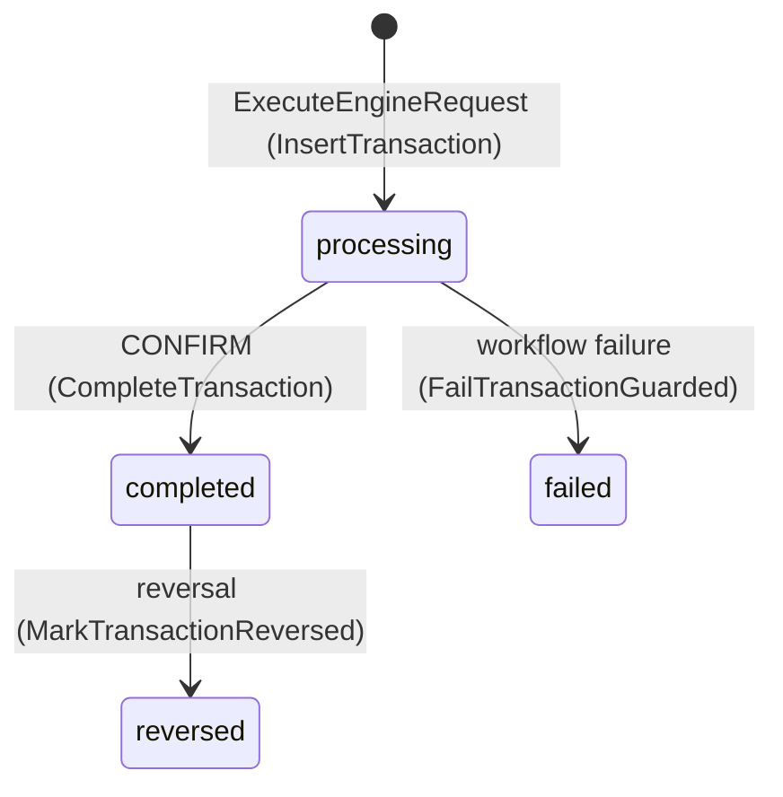

# Transfers, fees and offer limits

## 1. Purpose
Turns a user request (P2P transfer, money-request payment, bank top-up, vault deposit/withdraw) into a `transactions` row plus a started workflow instance, after checking service availability, offer limits and balance, and after freezing the fee on the row. The workflow steps (VALIDATE, FRAUD_CHECK, MOVE_FUNDS, CONFIRM, ROUND_UP) then do the money movement through `ledger.Post`. This doc does NOT cover the workflow engine internals, fraud rules, reversal, org disbursement or approvals. `internal/product` is only an admin CRUD facade (organizations, services, offers, audit logs, workflow instances, fraud flags listing, `product/service.go`) and holds no transfer logic.

## 2. Key concepts
- **Service**: a row in `services` with `code`, `status`, and dispatch columns `workflow_name`, `ledger_txn_type`, `wallet_strategy` (000006:15-25). Seeded: `P2P_TRANSFER`, `MONEY_REQUEST` (both p2p/user_to_user), `TOPUP_BANK` (topup/syscash_to_user), `VAULT_SAVINGS` (vault_move/user_to_vault), `ORG_DISBURSEMENT` (org_disbursement/org_to_user).
- **Engine request**: `POST /v1/transactions/request`, the single mounted entry point for user money movement.
- **Offer / offer_service**: package assigned to a user (`user_offers`) with per-service limits `min_amount`, `max_amount_per_txn`, `daily_limit`, `monthly_limit`, `interval_seconds` (0 means disabled). Fallback package when the user has none: `OFFER_CUST_L0` (override env `DEFAULT_OFFER_CODE`). KYC approval and rejection move the offer (see `product/kyc-tiers-and-limits.md`).
- **Auth matrix** (`offer_auth_matrix`): amount ranges mapped to `none|pin|otp|2fa`.
- **Fee policy** (`fee_policies`): per `txn_type` and optional `kyc_status`, with `fixed_fee`, `percent_bp`, `min_fee`, `max_fee`.
- **Ref code**: `MP` + 12 upper-hex chars (`wallet.NewRefCode`, see wallet.md BR-WAL-09).

## 3. Business rules

| ID | Rule | Enforced by (code or DB) | Test |
|----|------|--------------------------|------|
| BR-TRF-01 | Amount must be > 0 (service and HTTP binding `gt=0`). | `transfer/service.go:ExecuteEngineRequest` (278-280); `api/transaction_engine_handler.go:24` | `TestQA_DisbursementZeroOrNegativeAmountRejected` (org path only) |
| BR-TRF-02 | Every mounted money-moving POST requires header `Idempotency-Key` (1..64 chars); the engine service also rejects an empty key (`ErrIdempotencyKeyRequired`), there is no server-generated fallback. | `api/middleware.go:RequireIdempotencyKey`, `router.go:118`; `transfer/service.go:ExecuteEngineRequest` -> `wallet.FindReplay` | `TestTransactionRequestHTTP_MissingIdempotencyKeyRejected`, `TestIdempotency_MissingKeyRejectedInServices` (TC-IDM-004, -011) |
| BR-TRF-03 | The key is scoped to the calling user: a repeat of the same key AND the same request hash returns the stored transaction (status, amount, fee, `duplicate`) instead of creating a new one. Lookup is `initiated_by = caller AND idempotency_key = key`; a concurrent insert that loses the race (23505 on `uq_txn_user_idempotency`) re-reads and returns the winner. A stored NULL hash (pre-000015 row) accepts the replay. | `wallet/idempotency.go:FindReplay`; `service.go` (insert + conflict branch); `UNIQUE (initiated_by, idempotency_key)` (000015) | `TestTransactionRequestHTTP_IdempotencyKeyHeaderDedupes`, `TestIdempotency_Transfer_ReplaySameUserSamePayload`, `TestIdempotency_ConcurrentSameKeyOneTransaction` (TC-IDM-001, -005, -006) |
| BR-TRF-03a | The same key from another user never returns or collides with the first user's transaction. | per-user constraint and per-user lookup | `TestIdempotency_TwoUsersSameKeyAreIndependent`, `TestIdempotency_EngineHTTP_ReplayConflictAndIsolation` (TC-IDM-003, -006) |
| BR-TRF-03b | The same key with a different request is HTTP 409 `ERR_IDEMPOTENCY_KEY_REUSED` and creates nothing. The hash covers: service code, receiver id, receiver phone, amount, note, `extra_params` (engine); receiver id, amount, note (P2P service call). A replay is answered before OfferGuard, so it is not throttled. | `transfer/service.go:engineRequestHash`; `wallet.RequestHash` | `TestIdempotency_Transfer_SameKeyDifferentPayloadRejected`, `TestIdempotency_EngineHTTP_ReplayConflictAndIsolation` (TC-IDM-002, -006) |
| BR-TRF-04 | Service code is upper-cased/trimmed; empty means `P2P_TRANSFER`; an unknown code silently falls back to `P2P_TRANSFER`. | `service.go:283-294` | none |
| BR-TRF-05 | A service whose status is not `active` is refused. | `service.go:296-298` | none |
| BR-TRF-06 | With `ENGINE_DYNAMIC_DISPATCH != "false"` (default on) txn type, workflow definition and wallet strategy come from the service row; otherwise legacy P2P (`user_to_user`, `s.defName`). | `NewService` (49); `service.go:302-309` | none |
| BR-TRF-07 | OfferGuard runs first (unless env `OFFERGUARD_ENABLED=="false"`, default on). When off the auth method defaults to `pin` and no limits apply. | `service.go:311-320`; `NewService` (51) | none |
| BR-TRF-08 | A self-transfer (receiver == sender) is rejected with `ErrSelfTransfer`. | `service.go:planWallets` (488-490) | none (ledger BR-LED-04 has a unit test) |
| BR-TRF-09 | Receiver is resolved by `receiver_id` or `receiver_phone`; neither gives an error; unknown phone gives `ErrReceiverNotFound`. | `service.go:planWallets` (472-487) | none |
| BR-TRF-10 | Wallet strategies wired: `user_to_vault`, `syscash_to_user`, `user_to_user`. Any other (including `org_to_user`) returns an error. | `service.go:planWallets` (426-508) | none |
| BR-TRF-11 | Fail-fast balance check: if `checkBalance` and sender balance < amount + fee, `ErrInsufficientBalance`. `syscash_to_user` skips it. | `service.go:339-341` | `TestEdge_E12_LockedUserFailsMidWorkflow` (indirect) |
| BR-TRF-12 | Fee is computed once at request time and stored on the row (`transactions.fee`); later policy changes do not alter it. | `service.go:334-337,357-367`; MOVE_FUNDS reads `txn.Fee` (`handlers.go:130-138`) | `TestP2PTransferEndToEnd` |
| BR-TRF-13 | The transaction row (status `processing`) and the workflow start are created in ONE DB transaction. | `service.go:350-398`; `queries/transactions.sql:InsertTransaction` | `TestP2PTransferEndToEnd` |
| BR-TRF-14 | MOVE_FUNDS legs: debit sender `amount+fee`, credit receiver `amount`, credit `SYSTEM_FEE` `fee` when fee > 0; compensation mirrors exactly. | `handlers/handlers.go:Wallet.legs` (124-141) | `TestP2PTransferEndToEnd`, `TestEdge_E07_CompensationReversesMovedFunds` |
| BR-TRF-15 | VALIDATE and MOVE_FUNDS re-check sender and receiver OWNER status (`active`) inside the workflow (E12) and VALIDATE re-checks balance >= amount+fee. | `handlers.go:Validator.Execute` (46-68), `Wallet.Execute` (97-106) | `TestEdge_E12_LockedUserFailsMidWorkflow` |
| BR-TRF-16 | CONFIRM completes the transaction only from `processing`. | `handlers.go:Confirmer`; `queries/transactions.sql:CompleteTransaction` | `TestP2PTransferEndToEnd` |
| BR-TRF-17 | Fee = `fixed + amount*percent_bp/10000` using integer division (truncation toward zero), then raised to `min_fee`, then capped to `max_fee` when set, then floored at 0. | `fee/fee.go:Calc` (25-37) | `TestCalc` |
| BR-TRF-18 | Policy selection: active policies of the txn type with `kyc_status = user tier OR NULL`; tier-specific wins over NULL; highest `version` wins; none found means fee 0. | `queries/fee.sql:GetFeePolicy`; `fee.go:For` (45-58) | none |
| BR-TRF-19 | Seed policy: `p2p` fixed 1000 VND, `topup` and `disbursement` 0, tier NULL. | `000004...up.sql:98-103` | `TestP2PTransferEndToEnd` (fee 1000 asserted on SYSTEM_FEE net, `transfer_test.go:44`) |
| BR-TRF-20 | OfferGuard resolves the user's offer via `user_offers` (offer must be active); with no assignment it falls back to the default offer code; no matching service row gives `ErrServiceNotInOffer`. | `offerguard.go:65-78`; `queries/offer_guard.sql` | `TestOfferGuard_UnknownServiceRefused` |
| BR-TRF-21 | `is_enabled=false` gives `ErrServiceDisabled`. | `offerguard.go:82-84` | `TestOfferGuard_ServiceDisabled` |
| BR-TRF-22 | `amount < min_amount` gives `ErrBelowMin`. | `offerguard.go:85-87` | `TestOfferGuard_BelowMinimum` |
| BR-TRF-23 | Per-transaction limit: `max_amount_per_txn > 0` and `amount > max` gives `ErrLimitPerTxn` (equal passes). | `offerguard.go:88-90` | `TestOfferGuard_LimitPerTxn` |
| BR-TRF-24 | Daily limit: `daily_limit > 0` and `used + amount > daily_limit` gives `ErrLimitDaily`. `used` = SUM(amount+fee) of the user's transactions of the same ledger txn type created since local midnight, excluding statuses `failed` and `reversed`. | `offerguard.go:93-102`; `queries/offer_guard.sql:SumUserTxnAmountSince` | none |
| BR-TRF-25 | Monthly limit: same, since the first of the month at 00:00 local. | `offerguard.go:103-112` | none |
| BR-TRF-26 | Interval throttle: `interval_seconds > 0` and last transaction of that type (any status) younger than the interval gives `ErrTooFrequent`. | `offerguard.go:113-121`; `queries/offer_guard.sql:LastUserTxnAt` | none |
| BR-TRF-27 | Quota is counted per ledger txn type, not per service: `P2P_TRANSFER` and `MONEY_REQUEST` share type `p2p` and therefore one counter. | `offerguard.go:126-132` (key is `txnType`); 000006:21-22 | none |
| BR-TRF-28 | Required auth is the matrix row covering the amount (`min_amount <= amount < max_amount`, NULL max means open); above all ceilings the highest tier; no rows or query error yields `pin`. The server only returns it as `auth_required`; it is not enforced (see 10). | `offerguard.go:authFor` (136-152); `service.go:319,403-413` | `TestAuthMatrix_FromDB` |
| BR-TRF-29 | Default matrix: pin 0-2,000,000; otp 2,000,000-50,000,000; 2fa >= 50,000,000 (L0 copy added by 000023). Customer limits per offer (per txn / day / month): L0 2.5M / 2.5M / 25M, L1 62.5M / 125M / 625M, L2 250M / 375M / 2,500M (000023); BIZ_STARTER keeps 100M / 500M / 2,000M. | `000023_offer_limits_tiers.up.sql`, `000006...up.sql:116-124` | `TestOfferLimits_PerTxnCapsByTier` |
| BR-TRF-31 | A request whose auth method is `pin` or `otp` is stored as `awaiting_auth` with `auth_method`, `workflow_name`, `service_code` recorded; the workflow is not started and the ledger is untouched. | `service.go:ExecuteEngineRequest`; `queries/transactions.sql:HoldTransactionForAuth`; migrations 000019-000021 | `TestRequest_PinTransferWaitsForAuth` |
| BR-TRF-32 | `confirm` finds the transaction with `WHERE id = $1 AND initiated_by = $2`; another user's id and an unknown id both return `ErrTxnNotFound`. | `queries/transactions.sql:GetOwnedTransactionForUpdate`; `service.go:ExecuteEngineConfirm` | `TestConfirm_OtherUsersTransactionIsNotFound` |
| BR-TRF-33 | `confirm` verifies the credential for the recorded method (PIN; PIN and a transaction-bound OTP for the otp band) before anything starts; a wrong, missing or locked PIN starts nothing. | `auth_gate.go:confirmCredential`; `auth/pin.go` | `TestConfirm_WrongPinDoesNotStartWorkflow`, `TestConfirm_NoPinSet`, `TestConfirm_LockoutRefusesCorrectPin` |
| BR-TRF-34 | `confirm` starts the recorded workflow once: guarded `awaiting_auth -> processing` in the same transaction as `engine.Start`; repeated or concurrent confirms return the current state. | `queries/transactions.sql:StartAwaitingAuthTransaction` | `TestConfirm_ConcurrentStartsWorkflowOnce` |
| BR-TRF-35 | A request in the 2fa band needs an enrolled authenticator (ADR-0017): without one it is refused with 403 `ERR_TOTP_NOT_ENROLLED` and nothing is held; with one it is held in `awaiting_auth` with `auth_method = 2fa`. Confirm needs the PIN AND a TOTP code or a recovery code (`totp` field); a missing code is `ERR_CREDENTIAL_REQUIRED`, a wrong one `ERR_TOTP_INVALID`; the PIN and otp bands ignore the `totp` field. | `transfer/service.go:ExecuteEngineRequest`, `transfer/auth_gate.go:confirmCredential` | `TestRequest_TwoFactorBandIsHeldWhenEnrolled`, `TestRequest_TwoFactorBandRefusedWithoutEnrolment`, `TestConfirm_TwoFactorStartsWorkflowWithPINAndTOTP`, `TestConfirm_TwoFactorWithoutValidTOTPDoesNotStart`, `TestConfirm_TwoFactorAcceptsRecoveryCodeOnce`, `TestConfirm_PINBandIgnoresTOTP` |
| BR-TRF-36 | An unconfirmed `awaiting_auth` request fails with `auth_expired` after 10 minutes, moves no money, and never consumes the daily/monthly quota or the interval throttle. | `auth_gate.go:ExpireAwaitingAuth`; `queries/offer_guard.sql` | `TestAwaitingAuth_ExpiresWithoutMovingMoney`, `TestOfferGuard_AwaitingAuthDoesNotConsumeQuota` |
| BR-TRF-30 | Vault moves require a vault the caller owns (`extra_params.vault_id`, `direction`). | `service.go:planWallets` (428-459) | `TestVault_ForeignVaultRejected`, `TestVault_DirectionMustBeValid` |
| BR-TRF-31 | Failure code shown in timelines is an allowlist: insufficient balance, "blocked by fraud", "not active", else `ERR_TRANSFER_FAILED`. | `service.go:failureCode` (195-206) | `TestTimeline_FailureCode` |

## 4. Lifecycle / state machine
Transaction status enum: `created, pending_approval, processing, processing_async, completed, failed, reversed` (000002:11). Transfer-created transactions start in `processing`.



| Transition | Owner |
|------------|-------|
| `-> processing` | `transfer/service.go:ExecuteEngineRequest`, SQL `InsertTransaction` (status literal `'processing'`) |
| `processing -> completed` | `handlers/handlers.go:Confirmer` via `CompleteTransaction` (`WHERE status='processing'`) |
| `-> failed` | workflow engine via `queries/workflow.sql:FailTransactionGuarded` (from created/processing/pending_approval/processing_async) |
| `completed -> reversed` | reversal package, out of scope |

Workflow definition for p2p-type services: `p2p_transfer` v2 = VALIDATE, FRAUD_CHECK, MOVE_FUNDS (on_failure compensate), CONFIRM, ROUND_UP (000009:18-27). v1 is deactivated.

## 5. Main flows

```mermaid
sequenceDiagram
    participant M as Mobile
    participant A as API (RequireAuth + RequireIdempotencyKey)
    participant T as transfer.ExecuteEngineRequest
    participant G as OfferGuard
    participant F as fee.Service
    participant E as workflow.Engine
    M->>A: POST /v1/transactions/request {service_code, amount, receiver}
    A->>T: input + Idempotency-Key
    T->>T: load service, active? dispatch profile
    T->>G: Check(user, service, txnType, amount)
    G-->>T: auth method or ErrLimit*/ErrBelowMin/...
    T->>T: planWallets, GetUserStatusByID
    T->>F: For(txnType, kyc tier, amount)
    T->>T: balance >= amount+fee ?
    T->>T: BEGIN; INSERT transactions (processing, request_hash)
    alt this user already used the key (same hash)
        T-->>A: stored transaction (no new row)
    else this user used the key with another hash
        T-->>A: 409 ERR_IDEMPOTENCY_KEY_REUSED
    else new, auth_required is pin or otp
        T->>T: status awaiting_auth, record auth_method, workflow_name, service_code
        T->>T: COMMIT (workflow NOT started, ledger untouched)
        T-->>A: {transaction_id, status: awaiting_auth, auth_required}
    else new, auth_required is none
        T->>E: Start(def, txnID) in same tx
        T->>T: COMMIT
        T-->>A: {transaction_id, status: processing}
    end
    M->>A: POST /transactions/confirm {transaction_id, pin, otp?}
    A->>T: ExecuteEngineConfirm
    T->>T: lock row WHERE id AND initiated_by (else not found)
    T->>T: verify PIN (and OTP for the otp band) via auth.Service
    T->>T: awaiting_auth to processing (guarded), Start(recorded workflow) in the same tx
    T-->>A: status processing
    Note over E: async: VALIDATE, FRAUD_CHECK, MOVE_FUNDS, CONFIRM, ROUND_UP
```

A request whose offer needs the 2fa band is refused up front unless the user has an active authenticator (`ErrTOTPNotEnrolled`, fail closed, ADR-0017). An `awaiting_auth` request expires to `failed` (`auth_expired`) after 10 minutes without moving money.

Key point (ADR-0014): the request is a quote that parks the transaction in `awaiting_auth`; `confirm` is the authentication gate and the only thing that starts the workflow for pin and otp transactions. `verify` (the 2fa step) has no provider yet and refuses.

## 6. Invariants
- Fee on the row equals what MOVE_FUNDS posts: legs are derived from the immutable row (BR-TRF-14).
- Sender debit = receiver credit + fee for p2p and vault moves, via the ledger balance rule.
- The transaction row and workflow start commit atomically (BR-TRF-13); a failed `engine.Start` rolls back the row.
- A request over a limit never creates a row (OfferGuard runs before the DB write). Limits are checked again at confirm under a per-user advisory lock, because held requests do not count toward the quota (BUG-0017).

## 7. Data
Link: `../reference/data-model.md`.

| Table | Purpose |
|-------|---------|
| `transactions` | one row per request: `ref_code UNIQUE`, `type`, wallets, `amount > 0`, `fee >= 0`, `status`, `initiated_by`, `idempotency_key`, `request_hash` (nullable), `UNIQUE (initiated_by, idempotency_key)` |
| `services` | catalog plus dispatch columns |
| `offers`, `offer_services`, `offer_auth_matrix`, `user_offers` | Offer Factory limits (`user_offers` is one row per user, `ON CONFLICT (user_id)` in `AssignUserOffer`) |
| `fee_policies` | fee rules: `txn_type`, `kyc_status` (NULL = any), `fixed_fee`, `percent_bp`, `min_fee`, `max_fee`, `is_active`, `version` |

## 8. Interfaces
Mounted (`api/router.go`): `POST /v1/transactions/request` (118, idempotency required), `POST /v1/transactions/confirm` (119), `POST /v1/transactions/verify` (120), `GET /v1/fees/preview?amount=` (114, uses txn type `p2p` and the user KYC tier only, ignores service and offer), `GET /v1/transactions/:refCode/timeline` (113).
Dead code (not mounted): `TransferHandler.Transfer` (`api/transfer_handler.go:32`, no route references it), `transfer.Service.Transfer`, `TransferToUser`, `wallet.WalletHandler.Topup`. These legacy methods now apply the per-transaction part of the user's offer (`offerguard.CheckAmount`) but not the daily, monthly or throttle checks.
Error mapping: limits -> `ERR_LIMIT_PER_TXN|ERR_LIMIT_DAILY|ERR_LIMIT_MONTHLY` (400), `ERR_TOO_FREQUENT` (429), `ERR_SERVICE_NOT_IN_OFFER` (403), `ERR_AMOUNT_BELOW_MIN` (400) (`api/errmap.go:58-64`). Link `../reference/api.md`.

## 9. Edge cases
- E01 idempotency: same user and key returns the first transaction (BR-TRF-03); another payload is 409 (BR-TRF-03b); another user is independent (BR-TRF-03a).
- E07 compensation: if a step after MOVE_FUNDS fails, forward legs are mirrored, ledger nets to 0 (`TestEdge_E07_CompensationReversesMovedFunds`).
- E12 account locked mid-workflow: workflow fails before money moves and no entries are written (`TestEdge_E12_LockedUserFailsMidWorkflow`).
- No policy row for a txn type/tier: fee 0 (BR-TRF-18).
- Unknown `service_code`: silently treated as `P2P_TRANSFER` (BR-TRF-04); the response `service_code` shows the fallback.
- Interval throttle uses the latest attempt of any status, so a failed attempt still delays the next one within the interval.
- A missing key never reaches the ledger: the route answers 400 `ERR_IDEMPOTENCY_KEY_REQUIRED` and the service returns `ErrIdempotencyKeyRequired` (the random fallback was removed).

## 10. Known gaps (as-is vs intended)
- BE-C2 is FIXED in the working tree (2026-11-21, not yet committed): BUG-0012, ADR-0014, BR-TRF-31 to 36. Remaining: no 2fa provider (the band is refused), no PIN reset flow, no admin unlock, the confirm rate limit is per user, not per transaction.
- BE-C1: MOVE_FUNDS can post twice on redelivery/crash (`handlers.go:83-121`; see ledger.md).
- BE-H1 (transfer/engine path) is fixed, see BR-TRF-03..03b and BUG-0002. `internal/org` (topup, disbursement) is fixed too, see BR-ORG-17.
- BE-H2: FIXED (BUG-0017): `ExecuteEngineConfirm` serializes a user's confirms with `pg_advisory_xact_lock` and re-runs `offerguard.CheckWindows` before the workflow starts; windows use Asia/Ho_Chi_Minh.
- BE-H4: compensation fails terminally if the receiver already spent the funds (`handlers.go:113-115`).
- Money request status is set before MOVE_FUNDS runs (BE-H5), documented in the money request domain.
- Personal limits now follow the offer (BR-TRF-29, ADR-0007). Weekly rolling limits, balance-ceiling enforcement and a currency model are not implemented.
- `GET /fees/preview` does not reflect the service or ledger type used by the engine request, so it can disagree with the fee actually frozen for non-p2p services.
- Fee truncates (rounds down) with no rounding unit; `amount*percent_bp` can overflow int64 only for absurdly large amounts (no guard).
- OfferGuard with `OFFERGUARD_ENABLED=false` removes all limits; no startup guard prevents that in production.
- `GetServiceByCode` failure fallback hides typos (BR-TRF-04).
- Error strings in `transfer/service.go` (lines 297, 486, 507, 518) and `offerguard.go` are Vietnamese; only the offerguard sentinels have `errTable` entries (`errmap.go`). The "dịch vụ hiện đang bảo trì" and "không tìm thấy giao dịch" errors are not mapped (audit mentions the latter).
- Dead legacy paths remain in code (`Transfer`, `TransferToUser`, `Topup`) and bypass OfferGuard if re-mounted.

## 11. Code map
| Path | Responsibility |
|------|----------------|
| `internal/transfer/service.go:277` | `ExecuteEngineRequest` main entry |
| `internal/transfer/service.go:426` | `planWallets` wallet strategies |
| `internal/transfer/service.go`, `internal/transfer/auth_gate.go` | `ExecuteEngineConfirm` (authenticate and start), `ExecuteEngineChallenge`, `ExpireAwaitingAuth`, `Authenticator` |
| `internal/transfer/service.go:88,163,209` | `TransferToUser` (dead), `FeePreview`, `TimelineFor` |
| `internal/fee/fee.go:25,45` | `Calc`, `For` |
| `internal/offerguard/offerguard.go:64,136` | `Check`, `authFor` |
| `internal/workflow/handlers/handlers.go:37,82,149` | VALIDATE, MOVE_FUNDS, CONFIRM |
| `internal/api/transaction_engine_handler.go` | HTTP adapter for request/confirm/verify |
| `internal/product/service.go` | admin listing/CRUD of services, offers, orgs, audit; no money logic |
| `test/integration/money/transfer_test.go`, `transaction_request_http_test.go`, `vault_test.go`, `internal/offerguard/offerguard_test.go`, `internal/fee/fee_test.go` | tests |

## 12. Open questions
- Whether a biometric factor is required from 10 million VND (State Bank Decision 2345/QD-NHNN) and how the mobile app collects it (owner: product and legal).
- Should quota be keyed per service rather than per ledger type (owner: product, undecided)?
- Which timezone defines "day" and "month" for limits (owner: product, undecided)?
- Should fee rounding use a unit (e.g. round to 1 VND is implicit) or ceil instead of floor (owner: finance, undecided)?
