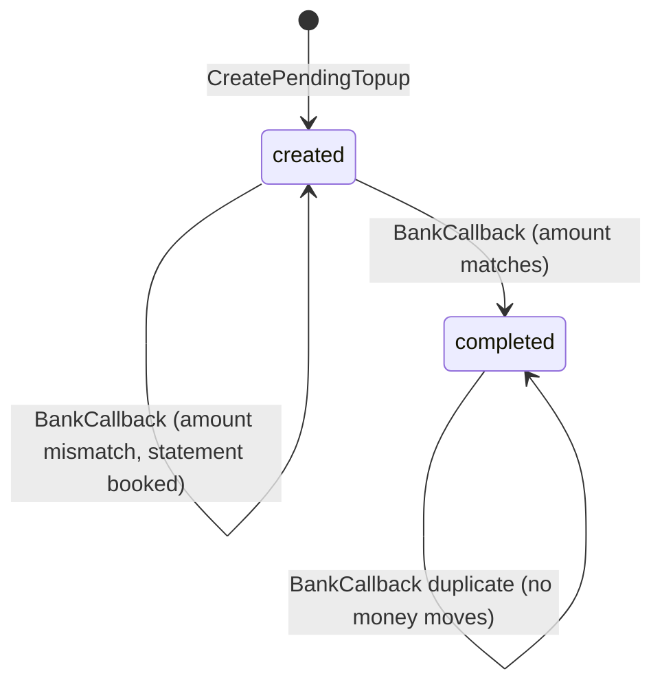
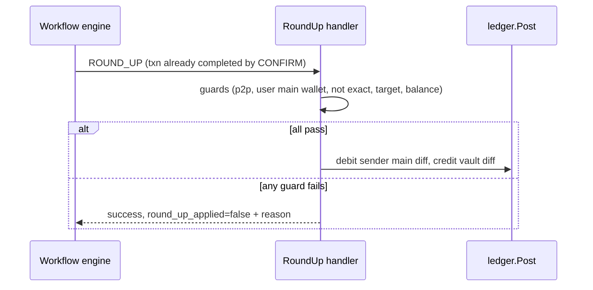

# Wallets and vaults

## 1. Purpose
Owns the wallet row model (main wallet per user, savings vaults, org and system wallets), the owner-facing transaction history/detail views, the bank top-up callback (`BankCallback`), and vault metadata plus the round-up step. It does NOT move money itself: every balance change goes through `ledger.Post` (see `ledger.md`). Vault deposit/withdraw money movement runs through the transaction engine (service `VAULT_SAVINGS`, see `transfer-and-fees.md`).

## 2. Key concepts
- **Main wallet**: `purpose='main'`, one per (owner, currency); created by `EnsureMainWallet` on register/login (`api/router.go:87`).
- **Vault**: a wallet with `purpose='vault'` and a required label (`wallet_vault_needs_label`, 000008:26-27). Several per user.
- **Round-up target**: the one vault of a user with `round_up_target = true` (000009:9-11).
- **Wallet type** (by `owner_type`): `user`, `organization`, `system` (000002:13).
- **Wallet status**: enum `wallet_status` = `active | locked | closed` (000002:9), column default `active`. No Go code reads or writes `wallets.status` (grep of internal excluding generated code finds none). Account activity is gated through the OWNER's status (`GetOwnerStatusByWalletID`, `queries/wallets.sql:44`).
- **Pending top-up**: a `transactions` row of type `topup` with status `created`, awaiting bank callback.

## 3. Business rules

| ID | Rule | Enforced by (code or DB) | Test |
|----|------|--------------------------|------|
| BR-WAL-01 | A user has at most one main wallet per currency. | partial unique index `idx_wallet_one_main_per_owner` (000008:19-21) | none |
| BR-WAL-02 | `EnsureMainWallet` is idempotent (ON CONFLICT DO NOTHING; unique violation swallowed). | `wallet/service.go:EnsureMainWallet` (55-71); `queries/wallets.sql:CreateUserWallet` | none |
| BR-WAL-03 | A wallet balance is never negative unless the owner is `system`. | DB `wallet_balance_non_negative` (000002:35; 000006:78); `ledger.go:111` | `TestEdge_E02_ConcurrentOverdraw` |
| BR-WAL-04 | Replaced by BR-WAL-05: per-transaction limits come from the user's offer (L0 2,500,000; L1 62,500,000; L2 250,000,000 VND), no longer from a fixed KYC table. | `offerguard/offerguard.go`, `000023_offer_limits_tiers.up.sql` | `TestOfferLimits_PerTxnCapsByTier` |
| BR-WAL-05 | `wallet.TxnLimit` no longer exists. Per-transaction limits come from the user's offer: the engine path uses `offerguard.Check`; money-request pay, `wallet.Topup` and `transfer.Transfer*` use `offerguard.CheckAmount`; `/users/me` returns `txn_limit` and an `offer` block from `offerguard.Limits`. | `offerguard/offerguard.go`, `api/user_handler.go` | `TestOfferLimits_*`, `TestUsersMe_ReportsOfferLimits` |
| BR-WAL-06 | A user may only see transactions where their MAIN wallet is sender or receiver; others get `ErrTxnNotFound` (404, existence not leaked). | `wallet/service.go:Detail` (237-239), `DetailRaw` (268-270) | `TestDetail_CounterpartyMasked` |
| BR-WAL-07 | Counterparty name and phone in history/detail are always masked; null for system/org counterparties. | `wallet/service.go:counterparty` (173-189), `user.MaskName/MaskPhone` | `TestHistory_CounterpartyMaskedAndDirection` |
| BR-WAL-08 | History is keyset-paginated; `limit` outside 1..50 becomes 20. | `wallet/service.go:History` (197-199) | none |
| BR-WAL-09 | Ref code format: `"MP"` + 12 upper-hex chars (14 chars total, column allows 24). | `wallet/service.go:NewRefCode` (275-279); `transactions.ref_code UNIQUE` | `TestNewRefCode` |
| BR-WAL-10 | Bank callback is idempotent by ref_code: only a `created` topup with matching amount posts legs and becomes `completed`; the row is locked `FOR UPDATE` first. | `wallet/callback.go:BankCallback` (69-96); `queries/transactions.sql:GetTopupByRefCodeForUpdate`, `CompleteTransactionFromCreated` (`WHERE status='created'`) | `TestEdge_E15_DuplicateBankCallback` |
| BR-WAL-11 | Every callback, including duplicates and mismatches, books a `bank_statements` row so reconciliation can flag it. | `wallet/callback.go:99-105`; `queries/recon.sql:InsertBankStatement` | `TestEdge_E15_DuplicateBankCallback`, `TestReconFourCategoriesAndIdempotent` |
| BR-WAL-12 | A callback whose amount differs from the transaction leaves it `created`, books the statement, commits, then returns `ErrCallbackAmountMismatch` (HTTP 422). | `callback.go:109-111`; `api/errmap.go:115` | none |
| BR-WAL-13 | The callback endpoint requires header `X-Mock-Bank-Secret` equal to config (constant-time compare); otherwise 401. | `api/mockbank_handler.go:30-36` | none |
| BR-WAL-14 | A vault label is trimmed, required, truncated to 60 chars; a duplicate label for the same owner gives `ErrLabelTaken`. | `vault/vault.go:Create` (69-91); `wallet_owner_unique (owner_type, owner_id, currency, purpose, label)` (000008:13-14) | `TestVault_MultipleVaultsPerUser` |
| BR-WAL-15 | `target_amount` is informational only; nothing blocks withdrawal below target. | 000008:5-7; `vault.Create` | none |
| BR-WAL-16 | Vault lookups are owner-scoped; another user's vault id yields `ErrNotFound` (404). | `queries/wallets.sql:GetUserVault`; `vault.Owned` | `TestVault_ForeignVaultRejected` |
| BR-WAL-17 | A vault must not be overdrawn: withdrawing more than its balance fails with `ErrInsufficientBalance`. | `transfer/service.go:planWallets` (checkBalance), `ledger.go:111` | `TestVault_WithdrawOverBalanceRejected` |
| BR-WAL-18 | Vault direction must be `deposit` (main -> vault) or `withdraw` (vault -> main); else `ErrDirectionInvalid`. | `transfer/service.go:planWallets` (445-459) | `TestVault_DirectionMustBeValid` |
| BR-WAL-19 | At most one round-up target vault per owner; setting a new one first clears the previous in the same tx. | partial unique index `idx_wallet_round_up_target_unique` (000009:9-11); `vault.SetRoundUpTarget` (117-146), `UnsetRoundUpTargets` | `TestRoundUp_ChangingTarget_UnsetsOld` |
| BR-WAL-20 | `SetRoundUpTarget` is owner-scoped and applies only to `purpose='vault'`. | `queries/wallets.sql:SetRoundUpTarget` | `TestRoundUp_TargetIsOwnerScoped` |
| BR-WAL-21 | ROUND_UP applies only if: txn.Type is `p2p`, sender wallet owner is a user, sender wallet is `main`, amount not a multiple of the unit, a target vault exists, and sender balance >= diff. Otherwise it is a no-op success with a `round_up_skipped_reason`. | `handlers/round_up.go:Execute` (63-103) | `TestRoundUp_AppliesDifference`, `_ExactAmount_Skipped`, `_NoTarget_Skipped`, `_InsufficientBalance_SkippedNotFailed` |
| BR-WAL-22 | Round-up diff = `unit - (amount % unit)`; unit defaults to 10,000 VND, overridable by env `ROUND_UP_UNIT_VND` (>0). | `round_up.go:RoundUpUnit`, `roundUpUnitFromEnv` (20-29), line 83 | `TestRoundUp_AppliesDifference` |
| BR-WAL-23 | Round-up posts debit sender main / credit vault for `diff`, using the original transaction id; a concurrent overdraft is skipped, not failed. | `round_up.go:111-122` | `TestRoundUp_InsufficientBalance_SkippedNotFailed` |
| BR-WAL-24 | ROUND_UP is never compensated (compensation is a no-op). | `round_up.go:49-53` | none |
| BR-WAL-25 | Top-up idempotency is per user and bound to the amount (`request_hash` over operation + amount): same user, key and amount returns the original (`Duplicate`); same key with another amount is `ErrIdempotencyKeyReused`; empty key is `ErrIdempotencyKeyRequired`; the same key from another user is independent and never returns the first user's transaction. | `wallet/service.go:Topup`, `wallet/idempotency.go`, `UNIQUE (initiated_by, idempotency_key)` (000015) | `TestEdge_E01_IdempotentTopup`, `TestIdempotency_TwoUsersSameKeyAreIndependent`, `TestIdempotency_Topup_DifferentAmountRejected` (TC-IDM-003, -010, -014) |

## 4. Lifecycle / state machine

Wallet status has no transitions in code (see Known gaps). The only lifecycle with code behind it is the top-up transaction:



| Transition | Owner |
|------------|-------|
| `[*] -> created` | `wallet/callback.go:CreatePendingTopup` (`InsertPendingTopup`) |
| `created -> completed` | `wallet/callback.go:BankCallback` + `CompleteTransactionFromCreated` |
| `completed -> completed` | `BankCallback` (`res.Duplicate`, line 96) |

A callback for a topup in any other status (e.g. `failed`) posts nothing and returns its current status, `Duplicate=false`.

## 5. Main flows

Bank top-up via callback:

```mermaid
sequenceDiagram
    participant B as Bank (mock)
    participant H as POST /internal/mock-bank/callback
    participant S as wallet.BankCallback
    participant L as ledger.Post
    B->>H: ref_code, amount, X-Mock-Bank-Secret
    H->>S: BankCallback
    S->>S: tx begin, SELECT topup FOR UPDATE
    alt status=created and amount matches
        S->>L: debit SYSTEM_CASH_IN, credit user wallet
        S->>S: CompleteTransactionFromCreated
    else duplicate or mismatch
        S->>S: no ledger legs
    end
    S->>S: INSERT bank_statements (always)
    S-->>H: commit; ErrCallbackAmountMismatch if mismatch on created
```

Round-up (workflow `p2p_transfer` v2 appends ROUND_UP after CONFIRM, 000009:18-27):



Interactive top-up as actually mounted: the mobile/web flow uses `POST /v1/transactions/request` with service `TOPUP_BANK` (`wallet_strategy=syscash_to_user`, `ledger_txn_type=topup`, workflow `p2p_transfer`, 000006:23). That path moves SYSTEM_CASH_IN -> user through MOVE_FUNDS immediately, with no bank callback. The callback flow (`CreatePendingTopup` + `BankCallback`) is used by tests and the seeder (comment `callback.go:21-23`) and by the mounted mock-bank route.

## 6. Invariants
- Balances change only via `ledger.Post` (comment `wallet/service.go:1-2`).
- Vault money is real ledger money: `balance == SUM(entries)` holds for vaults (`TestVault_DepositMovesMoneyAndBalances`).
- A top-up credits the user at most once per ref_code (row lock + guarded transition, BR-WAL-10).
- One main wallet and at most one round-up target per owner (partial unique indexes).

## 7. Data
Link: `../reference/data-model.md`.

| Table / column | Purpose | Constraints |
|----------------|---------|-------------|
| `wallets(owner_type, owner_id, currency, purpose, label, balance, status, version, system_code, target_amount, round_up_target)` | all wallets | `wallet_owner_unique`, `idx_wallet_one_main_per_owner`, `wallet_vault_needs_label`, `idx_wallet_round_up_target_unique`, `wallet_balance_non_negative` |
| `transactions` | topup records | `ref_code UNIQUE`, `UNIQUE (initiated_by, idempotency_key)`, `request_hash` (000015) |
| `bank_statements` | one row per callback | see recon |

`purpose` is VARCHAR(20) with no enum; used values in code: `main`, `vault`, `system_cash`, `system_fee`, `system_suspense` (000002:98-100). Org wallets: `purpose='main'` with `owner_type='organization'` (`queries/wallets.sql:CreateOrgWallet`).

## 8. Interfaces
Mounted (`api/router.go`): `GET /v1/wallets` (110), `GET /v1/transactions` (111), `GET /v1/transactions/:refCode` (112), `GET /v1/vaults`, `POST /v1/vaults`, `PATCH /v1/vaults/:id/round-up-target` (124-126), `POST /internal/mock-bank/callback` (82, mounted for every environment when the process serves the public API).
Not mounted (dead code): `WalletHandler.Topup` (`api/wallet_handler.go:33`), `wallet.Service.Topup`. `POST /v1/vaults` and the round-up PATCH have no `RequireIdempotencyKey` on purpose: they change metadata only; vault money moves through `POST /v1/transactions/request` (VAULT_SAVINGS), which requires the key (BR-WAL-25). Link `../reference/api.md`.

## 9. Edge cases
- E01 idempotent topup: repeated key from the same user and payload returns the first transaction with `Duplicate=true` (`TestEdge_E01_IdempotentTopup`); a different amount is `ErrIdempotencyKeyReused`, an empty key `ErrIdempotencyKeyRequired`, another user's identical key is independent (BR-WAL-25). `Topup` is still dead code in the router.
- E15 duplicate bank callback: no second credit; a second statement row (`TestEdge_E15_DuplicateBankCallback`).
- Vault label collision: 409 `ERR_VAULT_LABEL_TAKEN`.
- Round-up when balance moved between check and post: skipped (BR-WAL-23).

## 10. Known gaps (as-is vs intended)
- Wallet `status` (`locked`, `closed`) is never read or written by Go; locking a wallet has no effect. Only owner (user/org) status is checked in VALIDATE and MOVE_FUNDS.
- Per-transaction limits: `wallet.TxnLimit` was removed; see BR-WAL-05.
- BE-H1 is fixed for the wallet service (BR-WAL-25, BUG-0002) and for org topup and disbursement (BR-ORG-17).
- BE-H7: mock-bank callback is mounted in every env, secret default is `dev-mock-bank-secret`, no rate limit/allowlist (`router.go:82`).
- BE-C1: ROUND_UP and MOVE_FUNDS are not protected against re-execution at ledger level; ROUND_UP posts in its own tx separate from the step record.
- `POST /vaults` and round-up PATCH have no idempotency key by design (metadata only, decided in `specs/w1-idempotency/spec.md`); creating the same label twice is already rejected by `ERR_VAULT_LABEL_TAKEN`.
- `vault.Create` returns `Balance`/target from DB; negative `target_amount` is rejected only by the HTTP binding (`min=0`), and a zero target is stored as NULL (`vault.go:81`).
- The round-up unit is a system constant, not a per-user setting.

## 11. Code map
| Path | Responsibility |
|------|----------------|
| `internal/wallet/service.go:33,55,84,192,225,275` | `EnsureMainWallet`, `Topup` (dead), `History`, `Detail`, `NewRefCode` |
| `internal/wallet/callback.go:24,61` | `CreatePendingTopup`, `BankCallback` |
| `internal/vault/vault.go:51,69,99,117` | `List`, `Create`, `Owned`, `SetRoundUpTarget` |
| `internal/workflow/handlers/round_up.go:48` | ROUND_UP step |
| `internal/api/vault_handler.go`, `mockbank_handler.go` | HTTP adapters |

## 12. Open questions
- Intended semantics of wallet `locked`/`closed` (owner: product, undecided).
- Should real bank integration replace the mock callback, and should engine TOPUP_BANK become callback-driven (owner: product/payments, undecided)?
