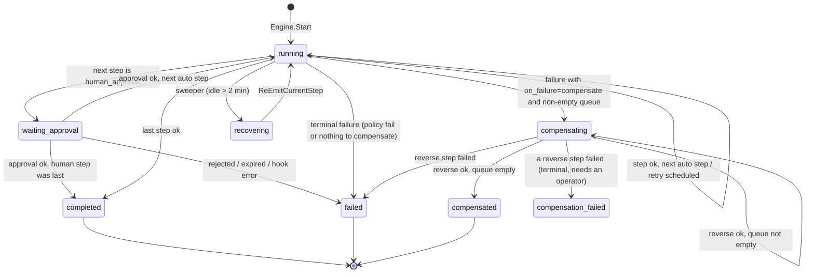
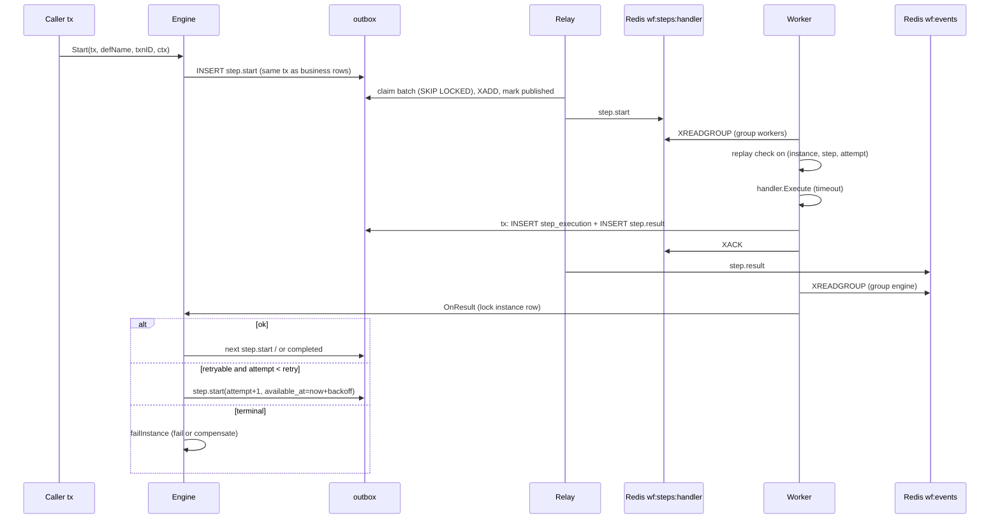
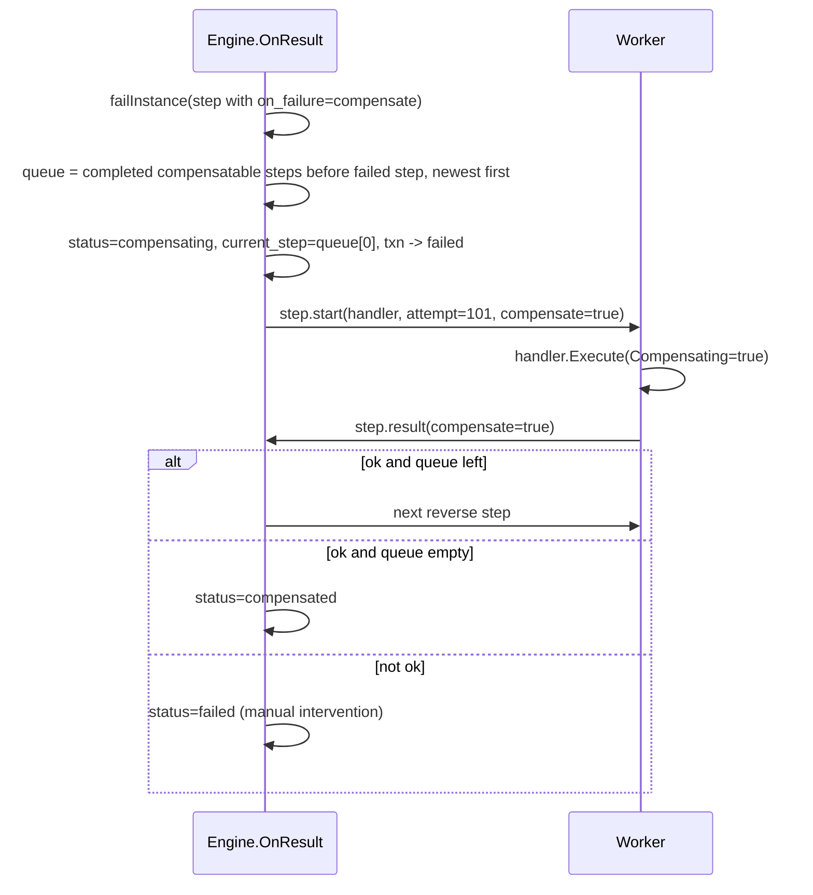

# Workflow Engine

## 1. Purpose
The engine runs multi-step business processes (P2P transfer, org disbursement, KYC verification) as a database-driven state machine. A definition (JSONB list of steps) is stored in `workflow_definitions`; each run is a row in `workflow_instances`; every handler execution is recorded in `step_executions`. Steps are dispatched through the transactional outbox and Redis Streams, retried with backoff, compensated in reverse order when a compensatable flow fails, and parked on a `human_approval` step until the approval module resumes them. It does NOT own the money rules (ledger, fees, limits), the approval policy, or the stream transport itself (see `outbox-and-events.md`). Scheduling is in-process goroutines; there is no asynq or golang-migrate.

## 2. Key concepts
- **Definition**: row in `workflow_definitions` (name, version, steps JSONB, is_active). The engine always starts the active row for a name (`workflow.sql:6-8`).
- **Step** (`StepDef`, `types.go:29-37`): name, type (`auto` | `human_approval`), handler, retry, timeout_ms, on_failure (`fail` | `compensate` | `manual` | empty), config.
- **Instance**: one run, bound to a definition id (so in-flight runs keep their version after a new version is activated) and optionally a transaction id.
- **Attempt**: 1..retry for forward execution; 101 for compensation. `(instance_id, step_name, attempt)` is UNIQUE in `step_executions` (index `idx_step_exec`).
- **Context**: JSONB on the instance; each successful step output `{"context": {...}}` is merged key by key (`engine.go:460-477`).
- **Handler registry** (`registry.go`): name to implementation; duplicate name panics (`registry.go:14-16`).

## 3. Business rules

| ID | Rule | Enforced by (code or DB) | Test |
|----|------|--------------------------|------|
| BR-WF-01 | A definition must have at least one step, unique non-empty step names, known step types, an `auto` step must name a handler, on_failure must be one of fail/compensate/manual/empty, and the FIRST step must be `auto`. | `workflow/types.go:ParseSteps` (45-77) | none (no direct parse test) |
| BR-WF-02 | Starting a workflow uses the single active definition of that name; no active definition returns `ErrDefinitionNotFound`. | `engine.go:Start` (52-58), `workflow.sql:GetActiveDefinitionByName` | `TestWorkflowHappyPath` |
| BR-WF-03 | Instance creation and the first step dispatch (outbox row) commit in the caller's transaction when a `tx` is passed, so a business row never exists without its start event. | `engine.go:Start` (48-77) | `TestWorkflowHappyPath` |
| BR-WF-04 | Every state change happens inside a DB transaction holding `SELECT ... FOR UPDATE` on the instance row. | `engine.go:OnResult` (83-90), `workflow.sql:GetInstanceForUpdate` | none |
| BR-WF-05 | A result event is applied only if instance `current_step` equals the event step and the status is `running` (or `waiting_approval` for a `human_approval` step); anything else is dropped as stale. The attempt number is NOT compared. | `engine.go:OnResult` (107-139) | `TestEdge_E06_DuplicateResultEventIdempotent` |
| BR-WF-06 | A handler runs at most once per `(instance, step, attempt)`: a replay re-emits the recorded result instead of re-executing. | `consumer.go:processStepMessage` (111-116), idx `idx_step_exec` | `TestEdge_E04_RedeliveryNoDoubleSideEffect` |
| BR-WF-07 | The step_execution row and the result outbox row are written in one transaction; a unique-violation (23505) on the execution insert means a concurrent replay already recorded it and returns without emitting. | `consumer.go:recordAndEmit` (164-213) | `TestEdge_E04_RedeliveryNoDoubleSideEffect` |
| BR-WF-08 | A step failure marked retryable is retried while `attempt < max(retry,1)`; delay is `2^attempt` seconds capped at 60s, implemented as outbox `available_at`. | `engine.go:OnResult` (150-156), `backoffFor` (436-442), `maxRetry` (429-434) | `TestWorkflowRetryThenSuccessWithBackoff` |
| BR-WF-09 | A non-retryable error, or a retryable one with attempts exhausted, applies the step `on_failure` policy. | `engine.go:OnResult` (156-159), `failInstance` | `TestWorkflowTerminalFailure` |
| BR-WF-10 | Policy `fail` (also `manual` and empty, which have no special code) sets instance `failed` and, if the instance has a transaction, moves it to `failed` only from created/processing/pending_approval/processing_async. | `engine.go:failInstance` (214-226), `workflow.sql:FailTransactionGuarded` (73-77) | `TestWorkflowTerminalFailure` (instance only) |
| BR-WF-11 | Policy `compensate` reverses, newest first, the already-completed steps BEFORE the failed step whose `config.compensatable` is true. If that queue is empty it degrades to plain failure. | `engine.go:buildCompensationQueue` (233-261), `isCompensatable` (263-271), `failInstance` (204-213) | `TestEdge_E07_CompensationReversesMovedFunds` (`test/integration/money/transfer_test.go:69`) |
| BR-WF-12 | Starting compensation marks the transaction `failed` immediately (guarded), stores the remaining queue in context key `_compensate`, and dispatches compensation executions with attempt 101 and `compensate=true`. | `engine.go:startCompensation` (275-299), `dispatchCompensate` (334-347) | `TestEdge_E07_...` |
| BR-WF-13 | A failed compensation step (any error) ends the instance as `compensation_failed` (ADR-0009, migration 000022) with `current_step` = the compensation step, and logs "COMPENSATION FAILED". The transaction stays `failed`; nothing is posted twice. | `engine.go:onCompensateResult` | `TestCompensationFailureIsItsOwnState` |
| BR-WF-14 | When the compensation queue is empty after a successful reverse, the instance becomes `compensated`. | `engine.go:onCompensateResult` (311-316) | `TestEdge_E07_...` |
| BR-WF-15 | A compensation result is applied only when instance status is `compensating` and `current_step` equals the event step; otherwise dropped. | `engine.go:OnResult` (97-101) | none |
| BR-WF-16 | A `compensating` instance untouched for 2 minutes (the result event was lost) is re-dispatched by the recovery sweep (`ClaimStuckCompensations` bumps `updated_at` as the lease, then `ReEmitCompensation` re-sends attempt 101; a step that already ran replays its stored result). | `recovery.go:SweepStuck`, `engine.go:ReEmitCompensation` | `TestStuckCompensationIsRecovered` |
| BR-WF-16 | Advancing onto a `human_approval` step sets `waiting_approval` and calls the PauseHook inside the same transaction; if no hook is wired or the hook errors, the instance fails cleanly (and the transaction is failed per BR-WF-10). | `engine.go:advance` (169-186) | approval integration tests (not in workflow pkg) |
| BR-WF-17 | A human step resolves from a result event produced by the approval module (never a worker): OK advances, not-OK applies the human step's own `on_failure`. | `engine.go:OnResult` (131-135), `approval/service.go:resumeWorkflow` (521-571) | none in workflow pkg |
| BR-WF-18 | The recovery sweeper claims only instances with status `running` and `updated_at` older than 2 minutes (batch 20), via an UPDATE to `recovering`; `SKIP LOCKED` plus the UPDATE make concurrent sweepers claim disjoint rows. | `recovery.go:SweepStuck`, `workflow.sql:ClaimStuckInstances` (54-67) | `TestEdge_E20_StuckRecoveryLeaseNoDoubleClaim` |
| BR-WF-19 | Re-emitting a recovered instance dispatches the current step with attempt = first free attempt above `max(retry,1)`, then returns the instance to `running`. | `engine.go:ReEmitCurrentStep` (374-411), `nextFreeAttempt` (444-458), `workflow.sql:ResumeRecoveredInstance` | `TestEdge_E20_...` |
| BR-WF-20 | Handler timeout is `timeout_ms` (default 10s when <= 0), applied by context deadline around `Execute`. | `consumer.go:processStepMessage` (149-158) | none |
| BR-WF-21 | A message whose processing returns an error is not ACKed (stays pending, redelivered by XAUTOCLAIM); a malformed payload is dropped. | `consumer.go:handleMessage` (88-98), `processStepMessage` (103-107) | none |

## 4. Lifecycle / state machine

Instance status is the Postgres enum `wf_status` (`000003...up.sql:8`, `compensation_failed` added by `000022`): running, waiting_approval, compensating, completed, failed, compensated, recovering, compensation_failed.



| Transition | Owner |
|-----------|-------|
| `[*] -> running` | `workflow.sql:InsertWorkflowInstance` (status literal 'running', line 18) via `engine.go:Start` |
| `running -> running / waiting_approval / completed` | `engine.go:advance` (165-201) |
| `waiting_approval -> running/completed/failed` | `engine.go:OnResult` after approval result event |
| `running -> failed` | `engine.go:failInstance` (214) |
| `running -> compensating`, `compensating -> compensating/compensated/failed` | `engine.go:startCompensation`, `onCompensateResult` |
| `running -> recovering` | `workflow.sql:ClaimStuckInstances` |
| `recovering -> running` | `workflow.sql:ResumeRecoveredInstance`, called from `engine.go:ReEmitCurrentStep` |

Step executions: enum `step_status` has only `completed` and `failed` (`000003:9`). There is no "running" row; a row exists only after the handler returned. For a human step, the approval module writes the row with attempt 1 (`approval/service.go:540-543`).

Per-step attempt timeline: attempt 1 fails retryable -> outbox start(attempt 2, available_at = now + 2s) -> attempt 2 -> start(attempt 3, +4s) ... until `attempt == retry`, then `failInstance`.

## 5. Main flows

### 5.1 Happy path and retry


### 5.2 Compensation


### 5.3 Human approval pause/resume
`advance` -> status `waiting_approval` + `PauseHook.OnPause` (approval module: snapshot policy, create request, transaction `pending_approval`; `approval/service.go:86-141`). On finalize, the approval module (in its own transaction) writes the human step_execution, resumes the transaction to `processing` if approved (`ResumeTransactionGuarded`), and inserts a `workflow.step.result` outbox row with attempt 1 (`approval/service.go:521-571`). Expiry uses the same path via `ExpireDue` (`approval/service.go:585-622`). The human step `timeout_ms` in the definition is not read by the engine; request expiry comes from step `config.expires_h` (default 24h) (`approval/service.go:124-130`).

### 5.4 Recovery
```mermaid
sequenceDiagram
    participant RC as Recovery (every 30s)
    participant DB as Postgres
    participant E as Engine
    RC->>RC: XAUTOCLAIM idle >= 60s on wf:events and all wf:steps:* (count 20) and reprocess
    RC->>DB: UPDATE running & updated_at < now-2m -> recovering (SKIP LOCKED, limit 20)
    RC->>E: ReEmitCurrentStep(id)
    E->>DB: lock row; if status != recovering return
    E->>DB: INSERT step.start(attempt = first free > max(retry,1)); status -> running
```

## 6. Invariants
- Exactly-once handler effect per `(instance, step, attempt)` is guaranteed only for the recording of the execution (unique index `idx_step_exec`), NOT for the handler's own side effects: the execution row is written after `Execute` returns, in a separate transaction (`consumer.go:154-189`). For MOVE_FUNDS and ROUND_UP the side effect is made replay-safe by the ledger posting guard (BR-LED-15); every other handler is replay-safe as classified in the redelivery matrix in `outbox-and-events.md` (G19, BUG-0019, BUG-0020).
- No paused instance without an approval request: PauseHook runs in the advance transaction (`engine.go:176-186`).
- Compensation attempts (101) never collide with forward attempts when retry < 101 (`engine.go:249` filters forward completions with `Attempt < 101`).
- Terminal instance states: completed, failed, compensated. A result event for an unknown instance is dropped (`engine.go:92-94`).
- Transaction status moves only through guarded UPDATEs (`FailTransactionGuarded`, `CompleteTransaction` requires processing).

## 7. Data
See `../reference/data-model.md`.
- `workflow_definitions(id, name, version, steps jsonb, is_active)` UNIQUE `wf_def_unique (name, version)`. No unique constraint ensures only one active version per name; `GetActiveDefinitionByName` is `:one` and relies on migrations flipping `is_active` (`000009`, `000010`).
- `workflow_instances(id, definition_id FK, transaction_id FK nullable, status wf_status, current_step varchar(40), context jsonb, created_at, updated_at)`; index `idx_wf_status`.
- `step_executions(id, instance_id FK, step_name, attempt smallint, status step_status, input, output, error, started_at, finished_at)`; UNIQUE `idx_step_exec (instance_id, step_name, attempt)`. `input` is always NULL (`consumer.go:192`); `error` truncated to 1000 chars; instance failure reason to 500 chars on the transaction.
- Seeded definitions (active versions today): `p2p_transfer` v3 (VALIDATE, FRAUD_CHECK, ACTIONS_BEFORE_GL, MOVE_FUNDS[compensate], ACTIONS_AFTER_GL, CONFIRM, ROUND_UP; migration 000010 lines 8-20), `org_disbursement` v2 (VALIDATE, FRAUD_CHECK, ACTIONS_BEFORE_GL, WAIT_APPROVAL, MOVE_FUNDS, CONFIRM; 000010:24-35), `kyc_verification` v1 (SCORE, CLASSIFY; 000003:92-95). Older versions are flagged inactive by 000009/000010.

### Registered step handlers
All are registered in `cmd/server/main.go:94-124` (worker/all roles). A step stream and consumer loop exists per registered handler name (`consumer.go:46-50`).

| Handler (`Name()`) | Source | Inputs read | Output context | Side effects | Terminal errors | Retryable errors |
|---|---|---|---|---|---|---|
| `validator` | `handlers/handlers.go:37-70` | transaction row; owner status of both wallets (users.status / organizations.status); sender balance | `validated: true` | none (read only) | sender/receiver lookup error or not `active`; `ledger.ErrInsufficientBalance` when `balance < amount+fee` (soft check) | transaction load, wallet load |
| `wallet` (MOVE_FUNDS; forward posts kind `forward`, compensating posts kind `compensate`; a replay returns success) | `handlers/handlers.go` | transaction row (`amount`, `fee`, wallets) | `funds_moved: true` (forward) / `false` (compensating) | in ONE tx: re-check both owners active (forward only), `ledger.Post` debit sender `amount+fee`, credit receiver `amount`, credit SYSTEM_FEE `fee` if fee > 0; compensating swaps directions | owner not active at posting time; `ErrInsufficientBalance`; `ErrWalletNotFound` | tx begin/commit, txn load, SYSTEM_FEE wallet lookup, other ledger errors |
| `confirmer` | `handlers/handlers.go:149-159` | `TransactionID` | `confirmed: true` | `CompleteTransaction` (processing -> completed); compensating is a no-op | none | any DB error (including 0 rows because status is not `processing`, see Known gaps) |
| `action_pipeline` | `handlers/action_pipeline.go` | `context.service_code`, `context.ref_code`, services row | `pipeline`, `pipeline_actions` | outbound HTTP calls (see `service-catalog.md`) | malformed `actions` JSON | service lookup error; failure of a `required` action |
| `round_up` | `handlers/round_up.go:48-131` | transaction, sender wallet/owner, round-up target vault | `round_up_applied`, `round_up_amount` or `round_up_skipped_reason` | ledger post of `unit - (amount % unit)` from sender main wallet to the target vault; unit = env `ROUND_UP_UNIT` or 100 cents | none (every non-applicable case is a successful skip: not_a_spend, sender_not_user, sender_not_main, exact, no_target, insufficient_balance, or ledger insufficient/wallet-not-found) | DB errors, tx begin/commit, other ledger errors |
| `fraud` | `fraud/handler.go:35-93` | transaction, sender velocity (5 min), 30-day avg, new-receiver flag, hour of day | pass: `fraud_score`, `fraud_verdict=safe`; flag: `fraud_verdict=flagged`, `fraud_flag_id` | inserts `fraud_flags` row for flag/block; async advisory goroutine (never affects decision) | `ErrBlocked` when decision is block | any DB read/insert error |
| `kyc_scorer` | `kyc/handlers.go:49-121` | `context.kyc_request_id`, KYC request, images from storage, active `kyc_scoring` AI setting | `kyc_score` | LLM/mock scoring call, `SetKYCScore`; replay guard returns stored score when `ai_score >= 0` | missing/invalid request id; image load failure; inactive AI key; scorer errors that it classifies terminal | KYC request load, AI setting load, `SetKYCScore`, scorer errors classified retryable |
| `kyc_classifier` | `kyc/handlers.go:131-171` | request id, `ai_score` | `kyc_status` | one tx: `ClassifyKYCGuarded` and `SetUserKycFromPending`; replay no-op if request not `pending` | missing id; `ai_score < 0` | DB errors |

All handlers return an empty successful output when `Compensating` is true except `wallet` (real reverse posting). `human_approval` steps have no handler.

Compensation attempt number in handlers: `StepInput.Attempt` is 101 for reverse runs; the handlers ignore it.

## 8. Interfaces
- Admin read-only: `GET /v1/admin/workflows` (filters `status` incl. alias `waiting` -> `waiting_approval`, `definition`, `stuck_only` = running and older than 5 minutes, plus list filter) and `GET /v1/admin/workflows/:id` (instance + step_executions). `api/router.go:203-204`, `api/admin_ops_handler.go:375-424`, `product/service.go:172-219`. There is no endpoint to retry, cancel or edit a workflow or definition.
- Events: `workflow.step.start` and `workflow.step.result` (`types.go:125-128`), streams `wf:steps:<handler>` (group `workers`) and `wf:events` (group `engine`), see `outbox-and-events.md`.
- Callers of `Engine.Start`: `transfer/service.go:152,390`, `moneyrequest/service.go:244`, `org/service.go:437`, `kyc/service.go:115`.

## 9. Edge cases
- E04 redelivery of the same start message: side effect runs once, the result is re-emitted (two result events); engine dedupes. `TestEdge_E04_RedeliveryNoDoubleSideEffect`.
- E05 Redis outage: outbox rows survive. `TestEdge_E05_OutboxSurvivesBrokerOutage`.
- E06 duplicate result event: no-op. `TestEdge_E06_DuplicateResultEventIdempotent`.
- E07 failure after money moved: compensation restores balances; instance `compensated`, transaction `failed`.
- E17 Redis down: consumer loop sleeps 1s and retries (`consumer.go:76-78`); relay logs and continues.
- E20 stuck instance: sweeper lease, one re-emit. `TestEdge_E20_StuckRecoveryLeaseNoDoubleClaim`.

## 10. Known gaps (as-is vs intended)
- **BE-C1 (audit), fixed in the working tree 2026-11-21, not yet committed**: `wallet.Execute` still commits `ledger.Post` in its own transaction while the execution row is written later in `recordAndEmit`, so a crash or redelivery between them still re-runs the handler. Since ADR-0010 the re-run is harmless: `ledger.Post` rejects a second posting of the same (transaction, kind) with `ErrAlreadyPosted`, and the handler returns success with `replayed: true` (and treats `ErrPostingConflict` as a terminal error). Covered by `TestEdge_E06_DuplicateStepNoDoublePost`. The engine comment in `engine.go:80-81` mentions an `(status, current_step, attempt)` guard, but attempt is not compared (`engine.go:107`).
- **BE-H4 (audit)**: fixed in the working tree (ADR-0009, ADR-0013). A failed compensation ends the instance as `compensation_failed` and a stuck compensation is recovered by the sweep; the money-side decision (reversal impossible) is parked as `needs_manual`, see `domain/approval-maker-checker.md`. G12 (2026-11-24): the admin "Needs attention" page lists `compensation_failed` instances (`GET /v1/admin/workflows?status=compensation_failed`) and the sidebar badge counts them (`GET /v1/admin/attention/summary`). Resolution is still manual.
- New (not in audit) - compensation has no retry: `onCompensateResult` fails on any `!ev.OK`, ignoring `Retryable` (`engine.go:302`).
- New - forward duplicate result vs compensation: when status is `compensating`, any event with the same step name as `current_step` is taken as the compensation result, even if it is a late forward event (`engine.go:97-102`; the `Compensate` flag is only OR-ed in, never required).
- New - `ACTIONS_AFTER_GL` runs after `MOVE_FUNDS` with `on_failure: fail` (000010:15). If a required action there exhausts retries, `failInstance` marks the transaction `failed` (it is still `processing` until CONFIRM) although funds were already moved; no compensation is attempted. `ROUND_UP` failures do not change the transaction because it is already `completed`.
- New - recovery only claims `running`. A stuck `compensating` instance is never recovered; an instance whose `ReEmitCurrentStep` returns an error stays `recovering` forever because `ClaimStuckInstances` ignores that status (`workflow.sql:61`, `recovery.go:92-94`). A late result arriving while the instance is `recovering` is dropped by the status guard (`engine.go:136-138`), then the re-emitted attempt executes the handler again.
- New - after recovery the re-emitted attempt is `max(retry,1)+1`, so `ev.Attempt < maxRetry` is false and a retryable failure of that attempt fails the instance immediately (`engine.go:150`, `403`).
- New - all replicas use the consumer name `c1` (`consumer.go:24`) and XAUTOCLAIM idles at 60s (`recovery.go:17`); a long handler on another replica can be reclaimed and run concurrently (see BE-C1).
- `manual` on_failure and empty on_failure behave exactly like `fail`; no manual-intervention queue exists.
- Outbox: at-least-once, no dead-letter (audit Medium "Outbox"); `time.Sleep(1s)` ignores ctx (audit Medium "Workflow").
- BE-H5: money request `paid` is set before MOVE_FUNDS runs; see `moneyrequest` doc when written.
- `confirmer` uses `CompleteTransaction` which only matches status `processing`; `QueryRow ... RETURNING id` on 0 rows yields `pgx.ErrNoRows`, so a transaction not in `processing` makes CONFIRM retry then fail (code path `handlers.go:154-156`; behavior inferred from the query, no test).
- Unknown handler name in a definition: `processStepMessage` returns an error forever, the message stays pending and is retried by XAUTOCLAIM every pass (`consumer.go:141-144`); nothing fails the instance except the stuck sweeper's re-emit loop. No dead-letter.

## 11. Code map
| Package/file | Responsibility |
|--------------|----------------|
| `workflow/engine.go` | Start, OnResult, advance, failInstance, compensation, ReEmitCurrentStep |
| `workflow/consumer.go` | Worker: consumer loops, step execution, recordAndEmit, PumpLocal |
| `workflow/recovery.go` | XAUTOCLAIM and stuck-instance sweeper |
| `workflow/types.go` | StepDef, ParseSteps, events, RetryableError |
| `workflow/registry.go` | handler registry |
| `workflow/handlers/` | validator, wallet, confirmer, action_pipeline, round_up |
| `fraud/handler.go`, `kyc/handlers.go` | fraud, kyc_scorer, kyc_classifier handlers |
| `approval/service.go` | PauseHook implementation and resume event |
| `store/queries/workflow.sql` | all instance, definition and step queries |

## 12. Open questions
- Should `manual` on_failure park the instance for operators instead of failing? (no owner/date; code treats it as `fail`)
- Should `compensation_failed` instances also raise a push or e-mail alert? (G12 added the admin list and badge only)
