# HPay Admin: User Guide for Staff

Version: 2026-11-24 (matches the admin app after the sample-free demo data, the English text and the layout fixes). English only.

---

## What changed in this version

Date: 2026-11-24. Every screenshot was retaken.

- **Section 3, Your first 10 minutes:** new demo values (customer Tran Van Ba, flag #c751, one reversal of 500,000 ₫).
- **Section 4, Roles:** the **KYC Review** page is now hidden from Ops and Risk Officer; menus re-listed from the code. New Figure 5.
- **5.1 Dashboard:** the daily cards show a dash and "(no analytics API yet)". The stuck-payments card now shows a real count. Cards your role cannot use say so.
- **5.2 KYC Review:** new customer name, new screenshots.
- **5.3 Fraud Monitor:** English evidence text, new columns, the page no longer shows a technical title.
- **5.4 Workflow and 5.5 My Tasks:** money now reads like 500,000 ₫. Dates read day/month/year.
- **5.6 Needs attention:** now a full chapter with the menu number. It describes both kinds of case.
- **5.7 Reconciliation:** the date box starts on today.
- **5.8 Service Catalog:** rewritten. Five services with English names, a larger window with five tabs, plain notices on two tabs, empty states on two tabs.
- **5.9 Offer Factory:** rewritten. English plan names, real limits and a real authentication matrix.
- **5.10 Organizations & Policy:** rewritten around the real policy list, **Edit**, **Save as version N** and **Earlier versions**.
- **5.11 AI Settings:** new provider wording. **5.12 Audit Log:** new screenshot and notes.
- **Section 6, Glossary:** new terms (level, signature, version) and updated demo values.

---

## 1. What is HPay Admin, and who is this guide for?

HPay is a digital wallet. Customers send money, top up and pay bills in the HPay phone app.

**HPay Admin** is the website your team uses behind the scenes. You use it to check customer identity documents, review suspicious payments, approve special requests and watch that money moves correctly.

This guide is for back-office staff who have never used HPay Admin. You do not need any technical knowledge.

> **Tip**
> Read section 2 first, then section 3. After that, use the chapters in section 5 as a reference when you need a page.

---

## 2. Before you start

### 2.1 The safe rule

> **The safe rule**
> If you are not sure, press **Cancel**. Nothing is final until you press the red or green confirm button at the bottom of a window. Reading and clicking around the lists is always safe.

### 2.2 Open HPay Admin

1. Open your web browser (Chrome, Edge or Firefox).
2. Type the address your manager gave you. Press Enter.

*You should see: the HPay Admin login page (Figure 1).*

For the practice (demo) system the address is `http://localhost:5173`. Your manager will give you the real address.

### 2.3 Log in

1. Click the **Email** box and type your work email.
2. Click the **Password** box and type your password.
3. Click **Log in**.

*You should see: the Dashboard page, with a dark menu on the left (Figure 2).*

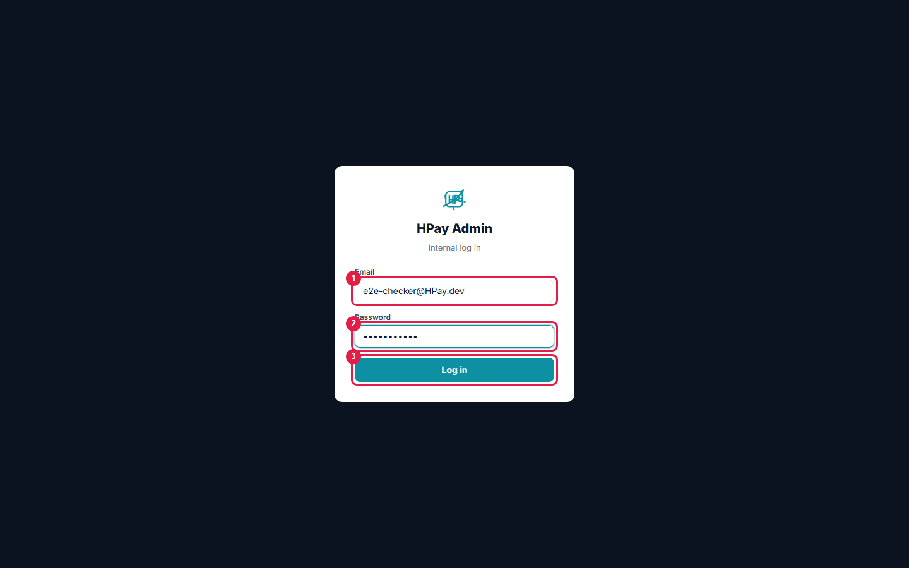

*Figure 1: The login page. Badge 1 is Email, badge 2 is Password, badge 3 is Log in.*

> **Careful**
> After 5 wrong passwords your account is locked for 15 minutes. Wait, then try again. Do not keep guessing.

### 2.4 Log out

1. Look at the top right corner of the page.
2. Click the small arrow-out icon next to your name (badge 3 in Figure 2). Its hover text is **Log out**.

*You should see: the login page again.*

Log out when you leave your desk. Your session also ends when you close the browser tab.

### 2.5 If the page shows an error or you are logged out

- **You are sent back to the login page.** Your session ran out. Log in again.
- **A red message says "Could not load".** Press the **Refresh** button on that page, or press F5 on your keyboard. If it stays, tell your contact (section 8).
- **"No access".** Your role cannot open that page. See section 4.
- **"Page not found" (404).** The address is wrong. Click **← Back to Dashboard**.

### 2.6 How the screen is laid out

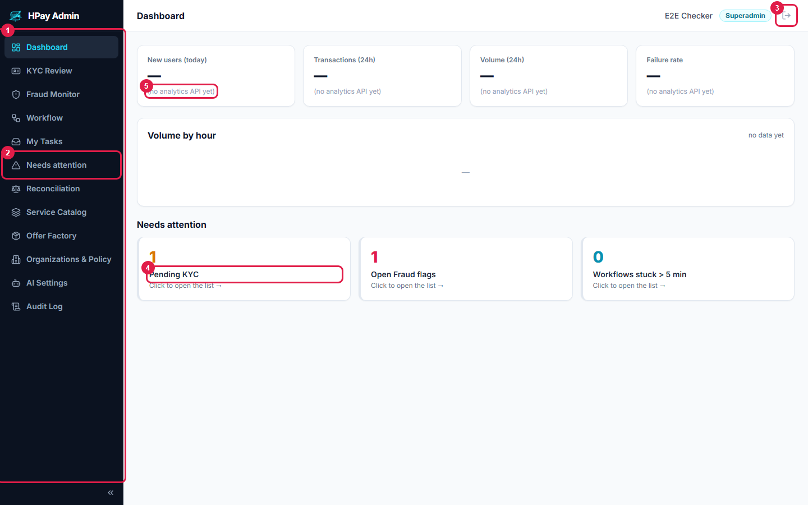

*Figure 2: The Dashboard. Badge 1 is the left menu. Badge 2 is the Needs attention entry. Badge 3 is Log out. Badge 4 is the Pending KYC card. Badge 5 is the note "(no analytics API yet)".*

- **Left menu (badge 1):** one entry for each page you can use. It only shows pages your role may open.
- **Top bar:** the page name, your name, your role and **Log out**.
- **Main area:** the page itself.
- A **red number** next to **Needs attention** in the menu means cases are waiting for a person. The demo has none, so Figure 2 shows no number.

Money is written with commas and the currency sign after the number, for example 1,000,000 ₫. Dates are written day/month/year.

---

## 3. Your first 10 minutes

Do these steps in order. They only read information, so they are safe. Use the practice system with the demo data. The values below are what the demo shows on 2026-11-24. Yours may differ a little.

1. Log in (section 2.3) as the demo Superadmin. *You should see: the Dashboard.*
2. Look at the three cards under **Needs attention**. *You should see: "1" on **Pending KYC**, "1" on **Open Fraud flags** and "0" on **Workflows stuck > 5 min**.* Click **Pending KYC**.
3. On **KYC Review**, click **Open →** on the row for Tran Van Ba. *You should see: two photo boxes, the registration details and notes from the AI.* Click **← Back**. Do not approve anything yet.
4. Click **Fraud Monitor** in the left menu. *You should see: one open flag, **#c751**, rule **VELOCITY_5MIN**, status **Open**.* Click the flag number to read its explanation below the table.
5. Click **Workflow** in the left menu. *You should see: a list of payments with a **Status** for each, such as **Failed** and **Completed**.* Click **Open →** on any row to see its steps.
6. Click **My Tasks**. *You should see: one request, a **reversal** of 500,000 ₫, with a **Process** button.* Do not press **Approve** or **Reject** while practising.
7. Click **Needs attention**. *You should see: "Open cases: 0" and "Nothing needs attention." That is the good result.*
8. Click **Audit Log**. *You should see: a table with columns Time, Actor, Action. In the demo it says "Nothing here yet".*
9. Click **Log out** (top right).

Well done. You now know every kind of screen in HPay Admin.

> **Not available yet**
> In the demo system the **Audit Log** table is empty ("Nothing here yet"). The page still works.

---

## 4. Roles and permissions

Your **role** decides which pages you can open and which buttons work. Your role name is shown at the top right, next to your name.

| Role | Can do | Menu items you will see |
|---|---|---|
| **Superadmin** | Everything: review KYC, resolve fraud flags, handle workflows and approvals, run reconciliation, edit organization policies, manage AI settings, change services. | All 12 |
| **Ops** | Handle workflows and approvals, run reconciliation. | Dashboard, Workflow, My Tasks, Needs attention, Reconciliation, Organizations & Policy, Audit Log |
| **KYC Reviewer** | Approve or reject identity (KYC) requests. | Dashboard, KYC Review, Workflow, My Tasks, Audit Log |
| **Risk Officer** | Resolve fraud flags, handle workflows and approvals. | Dashboard, Fraud Monitor, Workflow, My Tasks, Needs attention, Organizations & Policy, Audit Log |
| **Viewer** | Look only. No buttons that change anything. | Dashboard, Workflow, My Tasks |

How this table was built: from the role list in the admin app code, as it works today. The roles can change; ask a Superadmin if your menu looks different.

**What "View only" means.** You can see the information but cannot change it. A button may be greyed out, or a row may say **View only** instead of a **Process** button. Hover over a greyed button to read the reason. It says: "Your role does not have permission for this action."

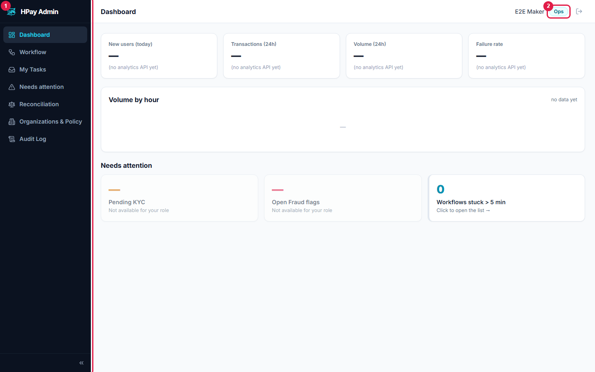

*Figure 3: What an Ops user sees. Badge 1 is the shorter menu: no KYC Review, Fraud Monitor, Service Catalog, Offer Factory or AI Settings. Badge 2 is the role name.*

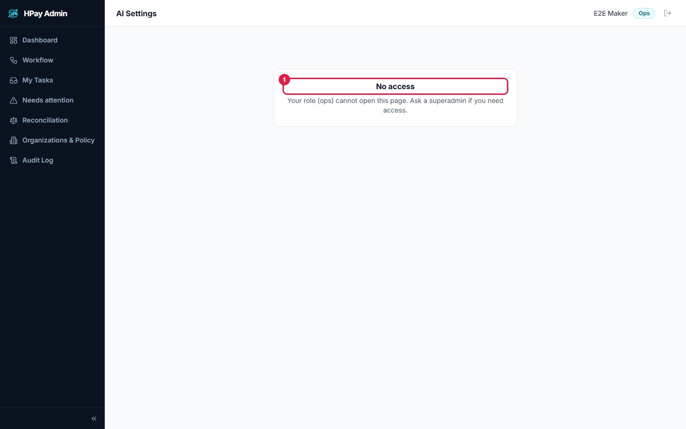

*Figure 4: If you type the address of a page your role cannot open, you see "No access". Badge 1 marks the words "No access".*

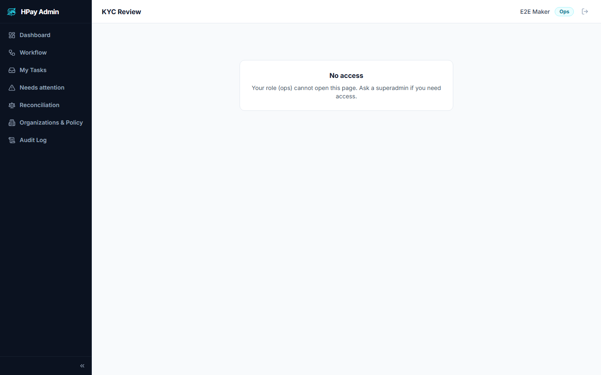

*Figure 5: An Ops user who types the KYC Review address also sees "No access". The KYC Review entry is missing from their menu.*

> **Careful**
> The dashboard cards follow the same rule. A card your role cannot use shows a dash and the words "Not available for your role". It is not a link. That is normal.

---

## 5. The pages, one by one

### 5.1 Dashboard

**What this page is for.** A one-screen summary of what needs your attention.

**When you need it.** Open it first thing in the morning.

**Task: Find out what is waiting**

1. Click **Dashboard** in the left menu. *You should see: four number cards, a chart and three alert cards (Figure 2).*
2. Read the alert cards under **Needs attention**: **Pending KYC**, **Open Fraud flags**, **Workflows stuck > 5 min**.
3. Click a card. *You should see: the matching page opens.*

| Card | What it means |
|---|---|
| **Pending KYC** | Identity requests that need a person to decide. |
| **Open Fraud flags** | Suspicious payments nobody has handled yet. |
| **Workflows stuck > 5 min** | Payments that have not moved for more than 5 minutes. Click it to open the **Workflow** page. |
| **New users (today)**, **Transactions (24h)**, **Volume (24h)**, **Failure rate** | Daily numbers. Not connected yet (see below). |

> **Not available yet**
> The four daily-number cards show "—" and the words "(no analytics API yet)". The **Volume by hour** chart shows "no data yet". These parts are not connected to data. Use the **Workflow** page for payment problems.

**If something looks wrong.** If a card says "Could not load this count", the system is busy. Press F5. If a card says "Not available for your role", your role cannot see that information (section 4).

---

### 5.2 KYC Review

**What this page is for.** Check each customer's identity documents (KYC) and approve or reject them. KYC means "Know Your Customer".

**When you need it.** When **Pending KYC** on the Dashboard is above zero.

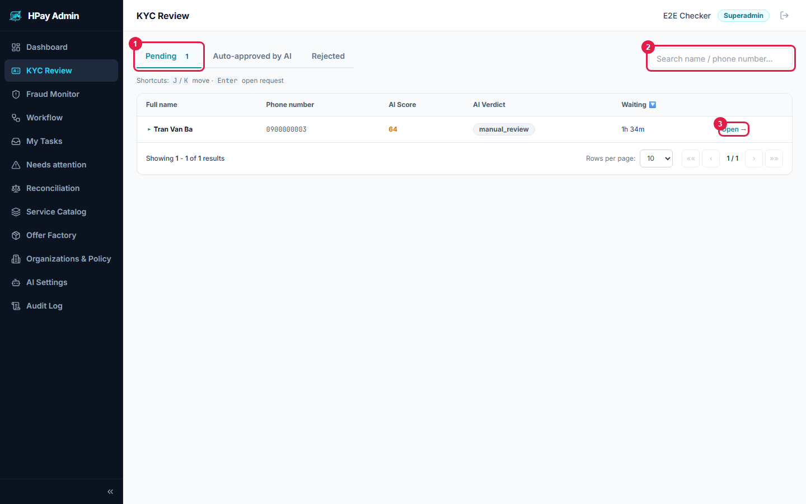

*Figure 6: The KYC list. Badge 1 is the Pending tab. Badge 2 is the search box. Badge 3 is Open →.*

**Task A: Approve a request**

1. Click **KYC Review** in the left menu. *You should see: the list, with the **Pending** tab selected.*
2. Click **Open →** at the end of a row (badge 3 in Figure 6). *You should see: two photo boxes, the registration details and the AI analysis (Figure 7).*
3. Compare the name and face with the photos. Read the **AI analysis** notes.
4. Click **✓ Approve (A)**. *You should see: a green message "Application approved."*

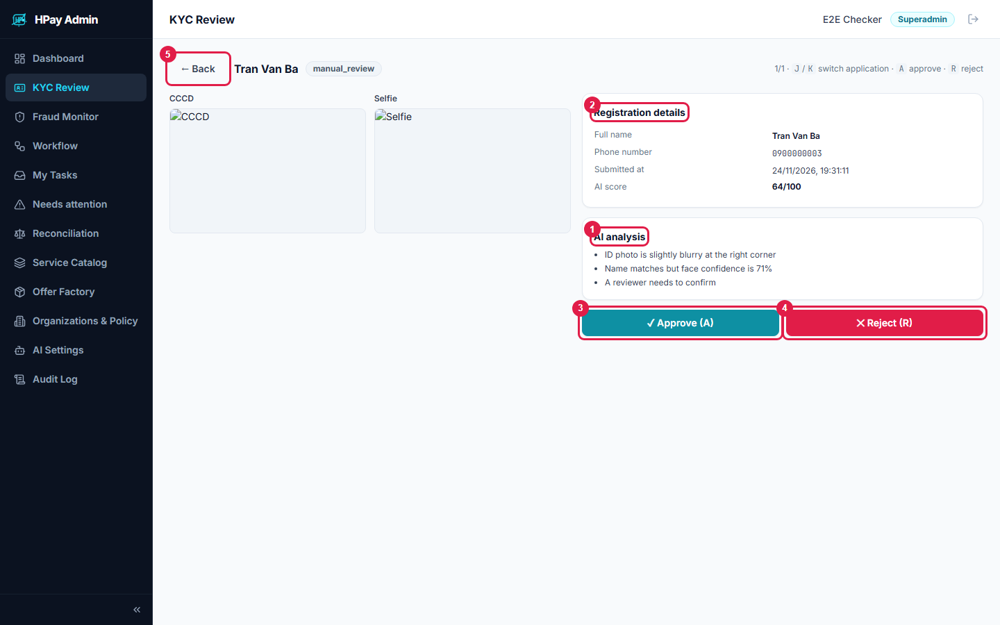

*Figure 7: One request. Badge 1 is the AI analysis. Badge 2 is the registration details. Badge 3 is Approve. Badge 4 is Reject. Badge 5 is Back.*

> **Careful**
> **✓ Approve (A)** works at once. There is no "Are you sure?" window. Check the photos before you click. Do not press the **A** key by accident.

**Task B: Reject a request**

1. Open the request as in Task A.
2. Click **✕ Reject (R)**. *You should see: a window titled "Reject KYC application" (Figure 8).*
3. Click the big box and type the reason. It needs at least 10 characters. The reason is saved to the Audit log.
4. Click **Confirm rejection** (badge 3). *You should see: a green message "Application rejected."*

To stop, click **Cancel** (badge 2) instead. Nothing changes.

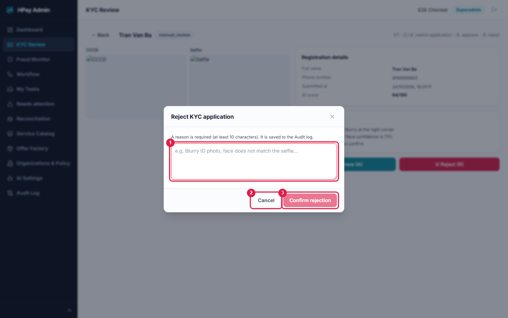

*Figure 8: The reject window. Badge 1 is the reason box. Badge 2 is Cancel. Badge 3 is Confirm rejection.*

**Task C: Find a customer**

1. Click the search box (badge 2 in Figure 6).
2. Type part of the name or phone number. *You should see: the list shrinks.*

**What the columns and tabs mean**

| Item | Meaning |
|---|---|
| **Pending** tab | Needs a person to decide. |
| **Auto-approved by AI** tab | The AI approved it. Look only. |
| **Rejected** tab | Already rejected. Look only. |
| **AI Score** | 0 to 100. Higher means the documents look more genuine. Green is 70 or more, amber 40 to 69, red below 40. |
| **AI Verdict** | The AI's suggestion, shown as a word badge, such as manual_review (a person must decide). |
| **Waiting** | How long the request has been in the queue. |

Keyboard shortcuts exist (J and K move up and down, Enter opens, A approves, R rejects). You can ignore them.

> **Careful**
> Only **Pending** requests can be decided. If another person already handled one, you see "This application was already handled elsewhere." Nothing is lost.

> **Not available yet**
> In the demo the two photo boxes are empty. The demo has no photo files. In real use you see the ID card and the selfie.

**If something looks wrong.** If the photos are blank in real use, press F5; the photo links expire after a short time. If the list is empty, the queue is clear.

---

### 5.3 Fraud Monitor

**What this page is for.** Review payments the system marked as suspicious (a "fraud flag") and decide what to do.

**When you need it.** When **Open Fraud flags** on the Dashboard is above zero.

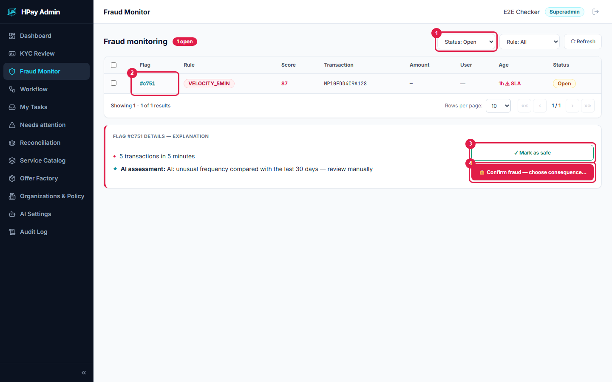

*Figure 9: The fraud list. Badge 1 is the status filter. Badge 2 is the flag number. Badge 3 is Mark as safe. Badge 4 is Confirm fraud.*

**Task A: Read a flag**

1. Click **Fraud Monitor** in the left menu. *You should see: one row per flag.*
2. Click the flag number, for example **#c751** (badge 2). *You should see: its explanation below the table. It lists the reasons in plain words, such as "5 transactions in 5 minutes", and an "AI assessment".*

**Task B: Mark a flag as safe**

1. Read the flag (Task A).
2. Click **✓ Mark as safe** (badge 3). *You should see: a small browser window asking "Mark flag ... as safe?"*
3. Click **OK** to confirm, or **Cancel** to stop. *You should see: the flag turns **Cleared**.*

**Task C: Confirm fraud and choose a consequence**

1. Click **🔒 Confirm fraud — choose consequence…** (badge 4). *You should see: a window "Confirm resolution" with three choices (Figure 10).*
2. Click one choice (badges 1 and 2 show two of them).
3. Type a reason in the box (badge 3). It needs at least 10 characters.
4. Click **Confirm Fraud resolution** (or **Mark as safe** if you chose the third option). To stop, click **Cancel** (badge 4).

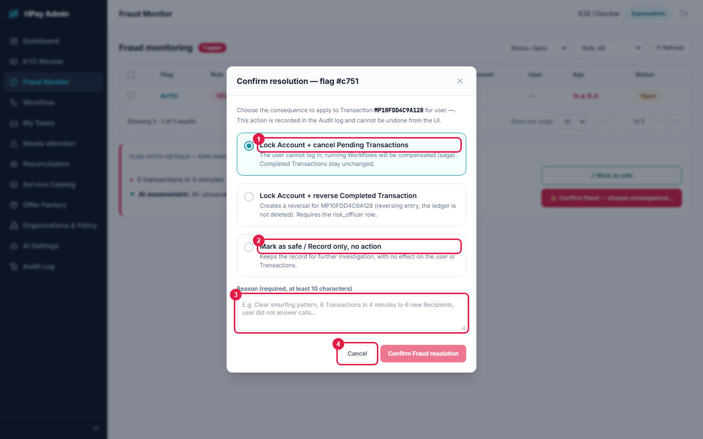

*Figure 10: The three consequences. Badge 1 is "Lock Account + cancel Pending Transactions". Badge 2 is "Mark as safe / Record only, no action". Badge 3 is the reason box. Badge 4 is Cancel.*

| Choice | What happens |
|---|---|
| **Lock Account + cancel Pending Transactions** | The customer cannot log in. Payments still running are undone. Finished payments stay. |
| **Lock Account + reverse Completed Transaction** | Also creates a reversal request for the finished payment. Needs the Risk Officer role. |
| **Mark as safe / Record only, no action** | Keeps a record. No effect on the customer. |

> **Careful**
> The lock choices affect a real customer's access to their money. The window says it "cannot be undone from the UI". If unsure, press **Cancel** and ask a Risk Officer.

**What the columns mean**

| Column | Meaning |
|---|---|
| **Flag** | The flag's short number. |
| **Rule** | Why it was flagged: **VELOCITY_5MIN** (many payments in 5 minutes), **AMOUNT_SPIKE** (much bigger than usual), **NEW_DEVICE** (new phone), **ODD_HOURS** (middle of the night). |
| **Score** | Risk from 0 to 100. 80 or more is red, 60 to 79 is amber. |
| **Transaction** | The payment's code. |
| **Amount** | The payment amount. It can show "—" when the amount is not known. |
| **User** | The customer. It can show "—" when the customer is not known. |
| **Age** | Time since the flag was raised. "⚠ SLA" means a high-risk flag has waited too long. Handle it first. |
| **Status** | **Open** (not handled), **Cleared** (marked safe), **Blocked** (fraud confirmed). |

Other controls: the **Status: Open** filter, the **Rule: All** filter and **⟳ Refresh**. You can tick boxes in the table and click **☑ Mark safe (n)** to clear several flags at once. Use it only when you have read every selected flag. The page refreshes by itself every 30 seconds.

**If something looks wrong.** If the buttons are grey, your role cannot resolve flags (section 4). If you see an error after confirming, the flag was probably handled by someone else. Press **⟳ Refresh**.

---

### 5.4 Workflow

**What this page is for.** Watch each payment as it moves through its steps. A "workflow" is the list of steps a payment goes through, such as check the user, check for fraud, move the money, confirm. One run of those steps is a "workflow instance".

**When you need it.** When a payment looks stuck or failed.

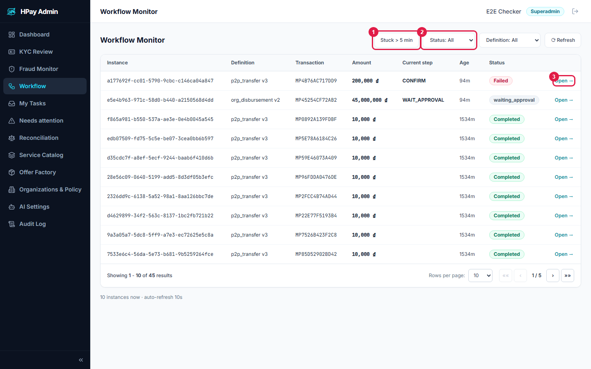

*Figure 11: The workflow list. Badge 1 is the "Stuck > 5 min" button. Badge 2 is the status filter. Badge 3 is Open →.*

**Task A: Find stuck payments**

1. Click **Workflow** in the left menu.
2. Click **Stuck > 5 min** (badge 1). *You should see: only payments that have not moved for 5 minutes.*

**Task B: See why a payment failed**

1. Click **Open →** on the row (badge 3). *You should see: the payment details and a step timeline (Figure 12).*
2. Read the **TIMELINE STEP EXECUTIONS**. The step that failed has a red cross.

**Task C: Retry a failed step**

1. Open the payment (Task B).
2. Click the box under **Reason for this action (required):** and type why (badge 2 in Figure 12).
3. Click **⟳ Retry** followed by the step name (badge 3). *You should see: a green message "Retry command sent. The system will retry the current step."*

**Task D: Undo a payment (compensate)**

1. Open the payment and type the reason as in Task C.
2. Click **↩ Compensate now (reverse entries)** (badge 4). *You should see: "Compensate command sent. Earlier ledger entries have been reversed."*

The button **Force fail + compensate** at the top right does the same as **Compensate now**. "Compensate" means the system undoes the steps already done, for example by giving the money back to the sender.

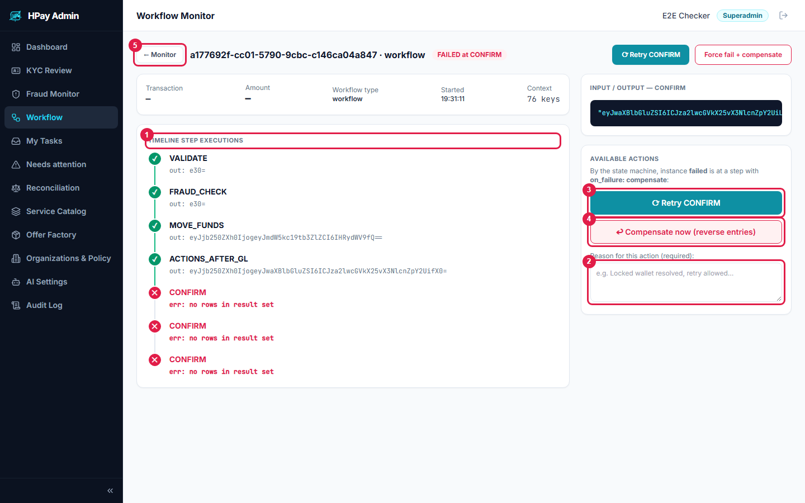

*Figure 12: One payment. Badge 1 is the timeline. Badge 2 is the reason box. Badge 3 is Retry. Badge 4 is Compensate now. Badge 5 is Monitor (back).*

> **Careful**
> **Compensate** moves money back. It happens at once, with no confirm window. Use it only when told to, and always write a clear reason. **Retry** only repeats the failed step.

**What the statuses mean**

| Status | Meaning |
|---|---|
| **Running** | In progress. |
| **Waiting** | Waiting for something outside, such as an approval. The list can show it as **waiting_approval**. |
| **Completed** | Finished correctly. |
| **Failed** | A step failed. Needs a person. |
| **Compensated** | Failed, and the money was given back. |
| **Age** | Time since it started, in minutes. Red means stuck. |

The list refreshes by itself every 10 seconds. The code boxes on the detail page ("out:" lines and the input box) are for technical staff; ignore them.

**If something looks wrong.** If **Retry** and **Compensate now** are grey, your role cannot act (Viewer). If the failure repeats, do not retry again and again. Tell your contact (section 8) with the Transaction code.

---

### 5.5 My Tasks

**What this page is for.** Your inbox of special requests that need a decision, such as reversing a payment or locking an account. This is the "maker-checker" idea: one person asks (the maker), a different person approves (the checker).

**When you need it.** When your manager asks you to "clear the approvals".

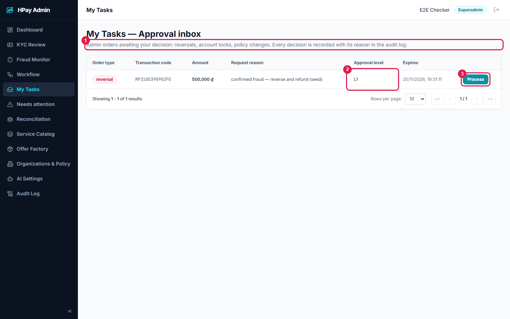

*Figure 13: The inbox. Badge 1 is the intro line. Badge 2 is the approval level. Badge 3 is Process.*

**Task: Approve or reject a request**

1. Click **My Tasks** in the left menu. *You should see: one row per waiting request.*
2. Read the **Order type**, **Amount** and **Request reason**.
3. Click **Process** at the end of the row. *You should see: a window "Process order" (Figure 14).*
4. Type your reason in **Decision reason**. It needs at least 10 characters.
5. Click **Approve** or **Reject**. *You should see: a green message "Order approved." or "Order rejected."*

To stop, click **Cancel**.

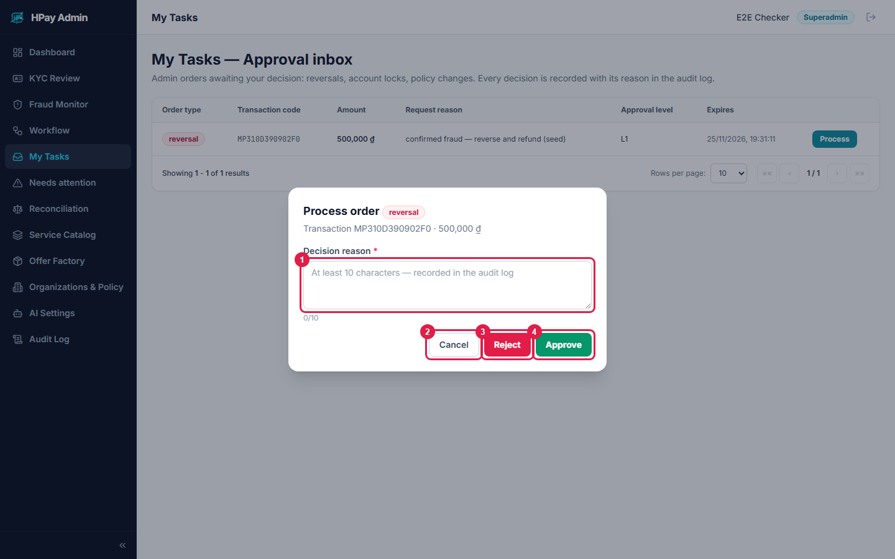

*Figure 14: The decision window. Badge 1 is the reason box. Badge 2 is Cancel. Badge 3 is Reject. Badge 4 is Approve.*

> **Careful**
> **Approve** on a **reversal** gives money back to a customer. **Approve** and **Reject** work at once. If you press the wrong one, you cannot take it back from this page. Read the amount and reason first.

| Column | Meaning |
|---|---|
| **Order type** | The kind of request: **reversal** (give money back), **account_lock** (lock a customer), or a policy change. |
| **Transaction code** | The payment the request is about. |
| **Amount** | The size of the payment, for example 500,000 ₫. |
| **Approval level** | **L1**, **L2** and so on. Bigger requests need more levels of approval. |
| **Expires** | After this time the request is closed without a decision. |

**If something looks wrong.** If a row says **View only** instead of **Process**, your role cannot decide. If you see "handled elsewhere", someone else decided first; the list updates.

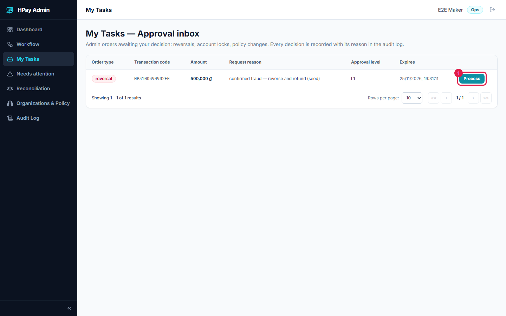

*Figure 15: Ops users can press Process (badge 1). A Viewer sees "View only" there instead.*

---

### 5.6 Needs attention

**What this page is for.** A list of money cases that the system parked for a person. It lists two kinds. The first kind is an approval the system could not apply (the screen calls it **needs_manual**). The second kind is a payment whose undo step failed (the screen calls it **compensation_failed**).

**When you need it.** When the red number appears next to **Needs attention** in the menu.

**Task: Check for parked cases**

1. Click **Needs attention** in the left menu. *You should see: "Open cases: 0" and "Nothing needs attention." when all is well (Figure 16).*
2. If rows appear, read the **Ref code**, **Amount**, **Age** and **Reason** columns.
3. Click **Audit log** (on an approval) or **Detail** (on a payment) to read more. *You should see: the Audit Log page, or the payment's step timeline.*

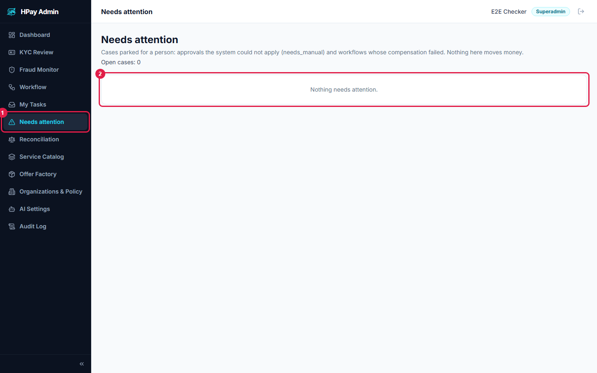

*Figure 16: The page when nothing is parked. Badge 1 is the menu entry. Badge 2 is the "Nothing needs attention." message.*

> **Careful**
> This page only shows cases. It cannot fix them and it moves no money. A parked case is serious. Tell your contact (section 8) with the Ref code.

| Column | Meaning |
|---|---|
| **Type** / **Workflow** | Which kind of case. |
| **Ref code** | The payment's code. Quote it when you ask for help. |
| **Amount** | The size of the payment. |
| **Age** | Time since it was parked. |
| **Reason** | Why it needs a person. |

The red number in the menu is the total of both kinds. It updates about every 30 seconds. Ops and Risk Officer roles see this page. Other roles do not.

> **Not available yet**
> There is no button here to resolve a case. How a parked case is solved is still being decided.

**If something looks wrong.** If the page shows "Could not load", press F5. If it stays, tell your contact (section 8).

---

### 5.7 Reconciliation

**What this page is for.** Compare HPay's records of top-ups with the bank's statement, day by day. "Reconciliation" means checking that two lists agree.

**When you need it.** Once a day, or when finance asks you to re-check a date. The system also runs by itself each night.

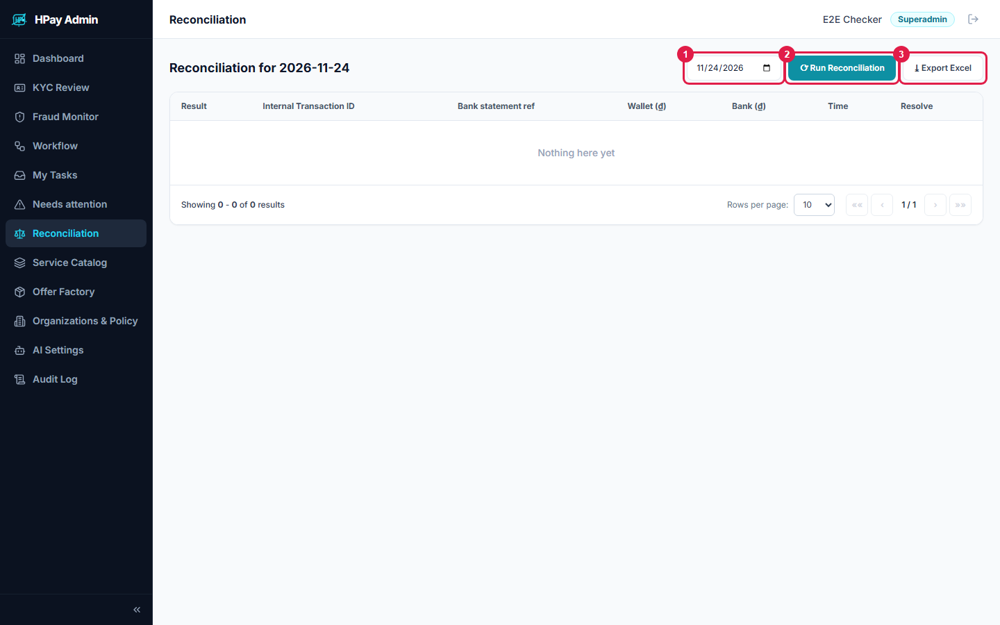

*Figure 17: Reconciliation. Badge 1 is the date box. Badge 2 is Run Reconciliation. Badge 3 is Export Excel.*

**Task A: Look at one day**

1. Click **Reconciliation** in the left menu. *You should see: the page opens on today's date.*
2. Click the date box (badge 1) and choose a date. *You should see: the results for that day, or "Nothing here yet" if it has not run.*

**Task B: Run a check for a day**

1. Choose the date.
2. Click **⟳ Run Reconciliation** (badge 2). *You should see: a browser message "Reconciliation completed for" and the date, then the table fills.*

**Task C: Get the Excel file**

1. Choose a date that has results.
2. Click **⤓ Export Excel** (badge 3). *You should see: the file opens in a new tab. If not, a message says "No Reconciliation file for ... yet."*

> **Careful**
> A day can be run only once. Running the same date again gives an error. That is normal and safe.

| Result | Meaning |
|---|---|
| **matched** | HPay and the bank agree. |
| **amount_mismatch** | Both have the payment but the amounts differ. |
| **missing_external** | HPay has the payment but the bank statement does not. |
| **missing_internal** | The bank has it but HPay does not. |

After a run, the top cards show **Total reconciled**, **Matched**, **Mismatched** and **Run time**. An amber badge shows how many items are mismatched. A purple "AI root-cause summary" may appear when there are mismatches.

> **Not available yet**
> The last column, **Resolve**, only shows a pop-up message. It does not resolve anything yet.

**If something looks wrong.** The **⟳ Run Reconciliation** button is grey if your role cannot run it. A table that says "Nothing here yet" is normal for a day with no top-ups.

---

### 5.8 Service Catalog

**What this page is for.** See every service HPay offers (transfer, bill payment and so on) and switch one into maintenance. In the demo there are five services: Vault savings, Request money & split bill, P2P transfer, Corporate payroll and Bank top-up.

**When you need it.** When a service has a problem and customers must not use it for a while.

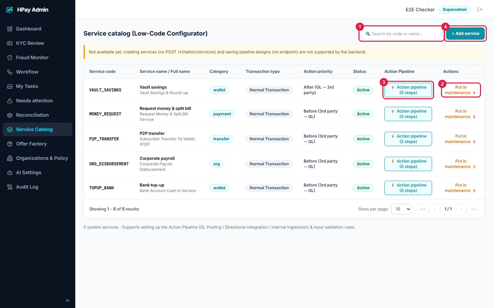

*Figure 18: The service list. Badge 1 is the search box. Badge 2 is Put in maintenance. Badge 3 is the Action pipeline button. Badge 4 is Add service.*

**Task A: Look at a service**

1. Click **Service Catalog** in the left menu.
2. Click **⚡ Action pipeline** on a row (badge 3). The label ends with the number of steps, for example "(2 steps)". *You should see: a window "Transaction Design Manager" with five tabs (Figure 19).*
3. Click each tab to read it (Figures 20 to 24).
4. Click **Close** when done.

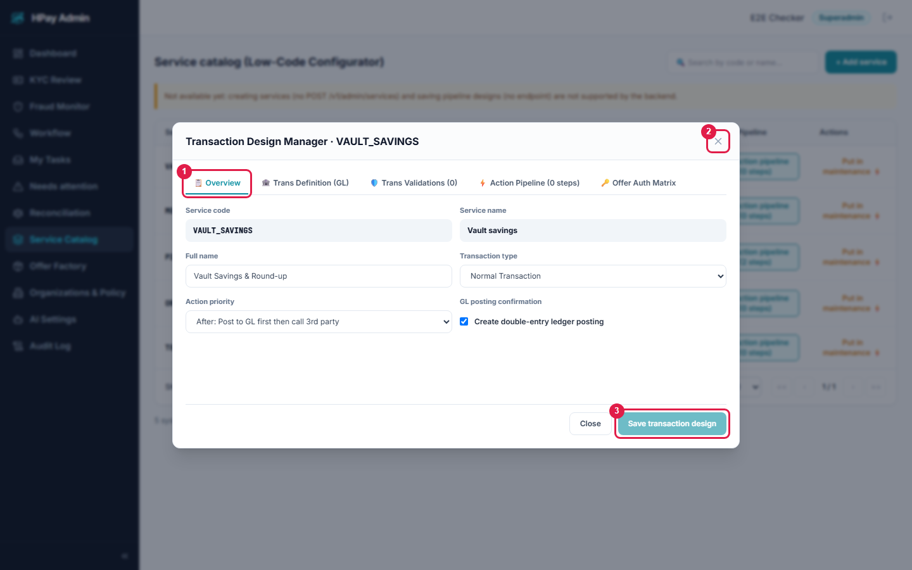

*Figure 19: The service window. Badge 1 is the Overview tab. Badge 2 is the X that closes the window. Badge 3 is Save transaction design (grey).*

The window shows only what the system knows about the service. It opens on **Overview** each time you open a service. If the window is taller than your screen, it scrolls inside. The tab bar scrolls sideways on a narrow screen.

| Tab | What you see |
|---|---|
| **Overview** | Service code, name, transaction type, action priority and ledger posting. |
| **Trans Definition (GL)** | A notice: "Ledger rules are not shown here yet" (Figure 20). |
| **Trans Validations** | The input fields and their rules, or "No input fields configured for this service." (Figure 21). |
| **Action Pipeline** | The steps the service runs, or "No actions configured" (Figures 22 and 23). |
| **Offer Auth Matrix** | A notice and a link **Open Offer Factory →** (Figure 24). |

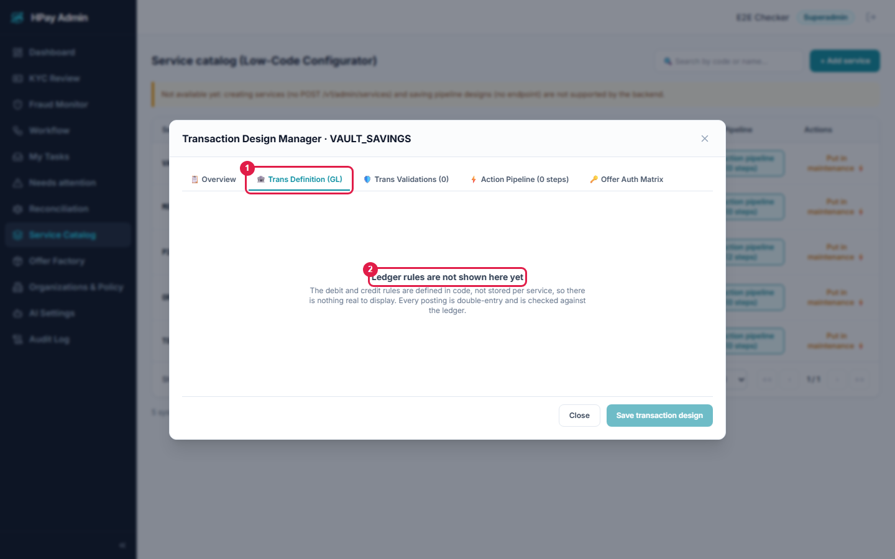

*Figure 20: The ledger tab. Badge 1 is the tab. Badge 2 is the notice. There is no table.*

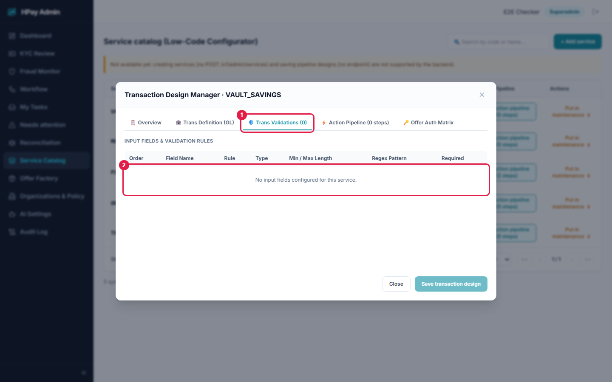

*Figure 21: The validations tab for a service with no input fields. Badge 1 is the tab. Badge 2 is the empty-state message.*

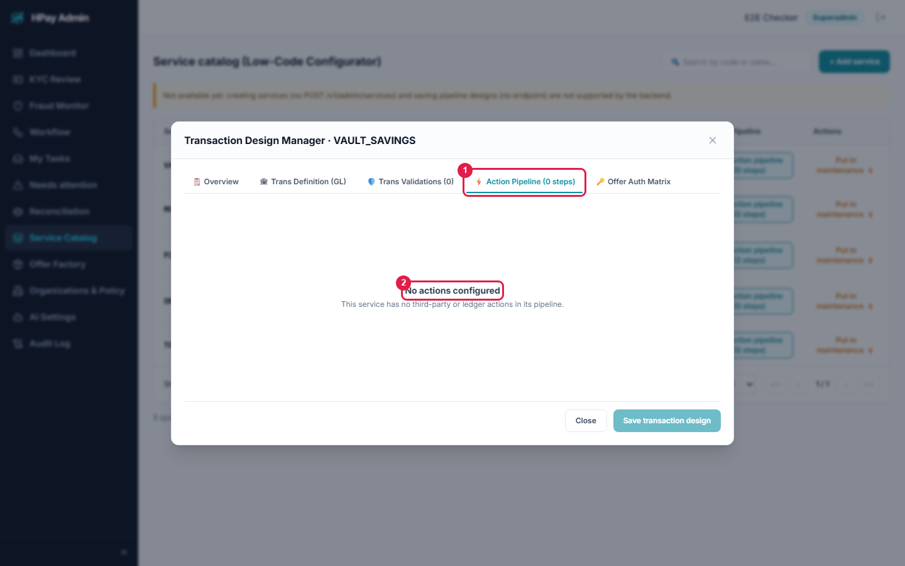

*Figure 22: The pipeline tab for a service with no steps. Badge 1 is the tab. Badge 2 is "No actions configured".*

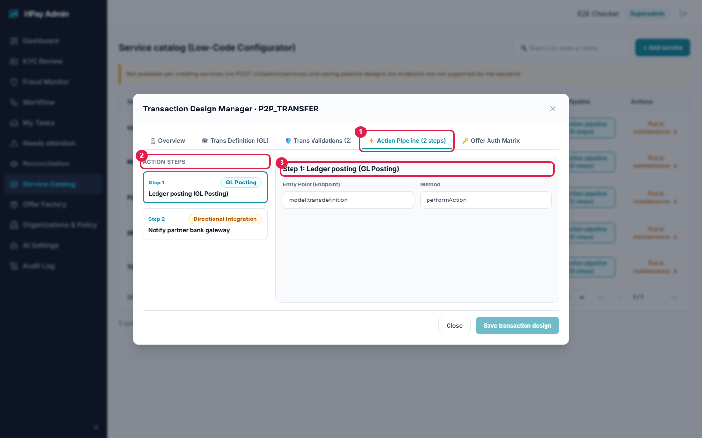

*Figure 23: The pipeline tab for P2P transfer. Badge 1 is the tab. Badge 2 is the list of steps. Badge 3 is the detail of the chosen step.*

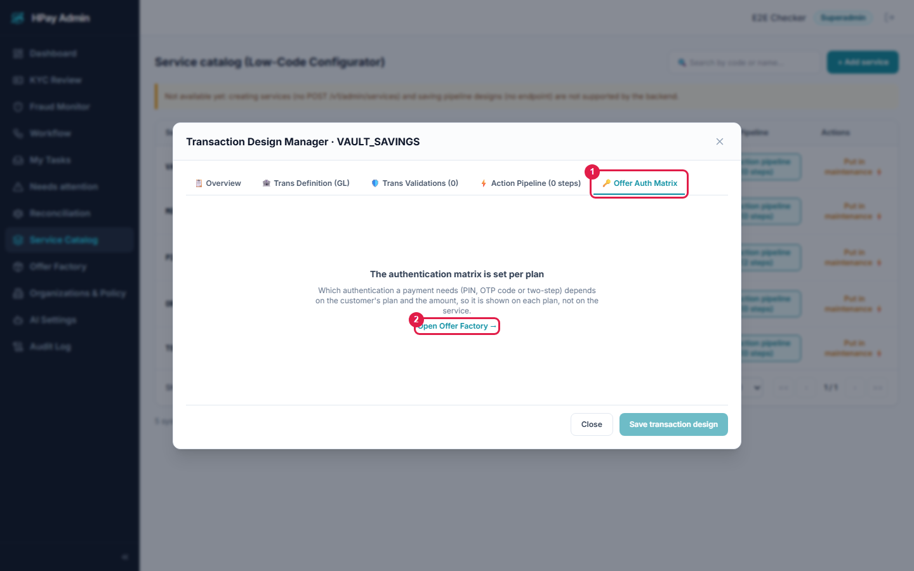

*Figure 24: The authentication tab. Badge 1 is the tab. Badge 2 is the link Open Offer Factory →.*

**Task B: Put a service in maintenance, then back**

1. Click **Put in maintenance ⚡** on the row (badge 2 in Figure 18). *You should see: a browser window "Confirm changing the status of service ... to: MAINTENANCE?"*
2. Click **OK** to confirm or **Cancel** to stop. *You should see: the Status becomes **Maintenance** (amber).*
3. To restore, click **Reactivate →** on the same row, then **OK**. *You should see: the Status is **Active** again.*

> **Careful**
> While a service is in **Maintenance**, customers cannot use it. Do it only on instruction. Always put it back with **Reactivate →** afterwards.

| Status | Meaning |
|---|---|
| **Active** | Customers can use it. |
| **Maintenance** | Paused on purpose. |
| **Disabled** | Switched off. |

> **Not available yet**
> **+ Add service** is greyed out: HPay cannot create a service from this page yet. In the service window the **Save transaction design** button is also grey: the design can be read but not changed. An amber banner at the top of the page says so. The boxes on the **Overview** tab look editable but nothing can be saved.

**If something looks wrong.** Only a Superadmin can change a service's status. If **Put in maintenance ⚡** is grey, that is why.

---

### 5.9 Offer Factory

**What this page is for.** See the customer and business plans (offers) and the limits that come with them. A **plan** decides what a customer may do and how much, based on how well HPay knows them. In the demo there are five plans: Personal (unverified), Personal (KYC tier 1), Personal (KYC tier 2), Business Starter (Maker/Checker L1) and Business Enterprise (Maker/Checker L2).

**When you need it.** When someone asks "what is the limit for this plan?"

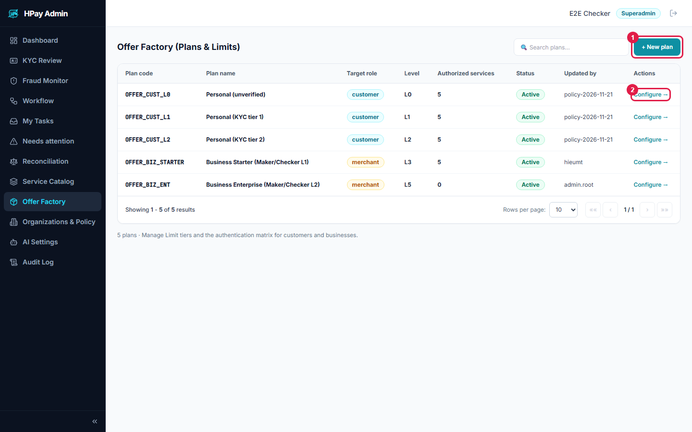

*Figure 25: The plan list. Badge 1 is + New plan. Badge 2 is Configure →.*

**Task: Read a plan's limits**

1. Click **Offer Factory** in the left menu. *You should see: a table of five plans.*
2. Click **Configure →** on a row (badge 2). *You should see: the plan page (Figure 26).*
3. Click a service in the **AUTHORIZED SERVICES** list. *You should see: that service's limits on the right.*
4. Read **MAX PER TRANSACTION**, **DAILY LIMIT**, **MONTHLY LIMIT** and the **Authentication matrix**.
5. Click **← Back to Plans**.

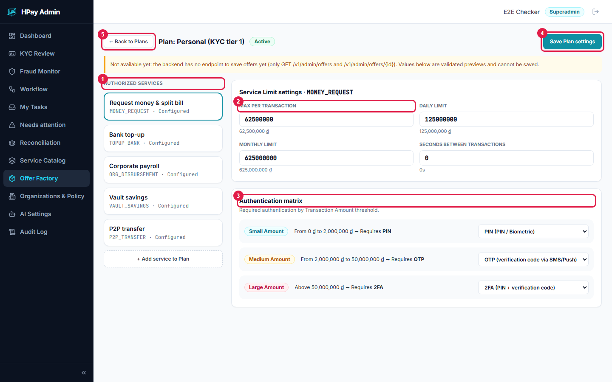

*Figure 26: One plan. Badge 1 is the services list. Badge 2 is a limit. Badge 3 is the Authentication matrix. Badge 4 is Save Plan settings (grey). Badge 5 is Back to Plans.*

| Column | Meaning |
|---|---|
| **Plan code** | The plan's short name. |
| **Plan name** | The plan's readable name. |
| **Target role** | **customer** (personal) or **merchant** (business). |
| **Level** | L0, L1, L2... The higher, the more the customer may do. This is the "tier". |
| **Authorized services** | How many services the plan can use. |
| **Status** | **Active** or **Draft**. |
| **Updated by** | Who last changed the plan. |

Limits are shown as whole numbers with the amount in words under the box, for example 62,500,000 ₫.

The **Authentication matrix** says what proof a customer must give, by payment size: **PIN**, **OTP** (a code by text message) or **2FA** (PIN and code). Bigger payments need stronger proof.

> **Not available yet**
> You cannot save changes to a plan yet. **Save Plan settings** is greyed out and **+ New plan** does nothing. An amber banner on the plan page says so. The numbers on the plan page are for reading only.

**If something looks wrong.** The page opens only for a Superadmin. Others see "No access".

---

### 5.10 Organizations & Policy

**What this page is for.** See each business customer (an "organization") and the rules for approving its payments. A **policy** says how many approvers (checkers) must sign a payment of a given size. This page shows the real policies of the organization.

**When you need it.** When a business asks why a large payment needs two approvals, or when you must change the rule.

**What you see on a policy**

- **The name and version**, for example "Large spend (version 3)". A policy changes by getting a new version, never by being overwritten.
- **The amount range**, for example "From 10,000,000 ₫ with no upper limit". The policy applies to payments in that range.
- **Levels.** Each level is one round of approval. "Level 1" signs first, then "Level 2".
- **Signatures.** "Needs 1 signature from a level 1 checker" means one checker at that level must approve. A person who approves is giving a signature.
- **Active.** The version in use today.

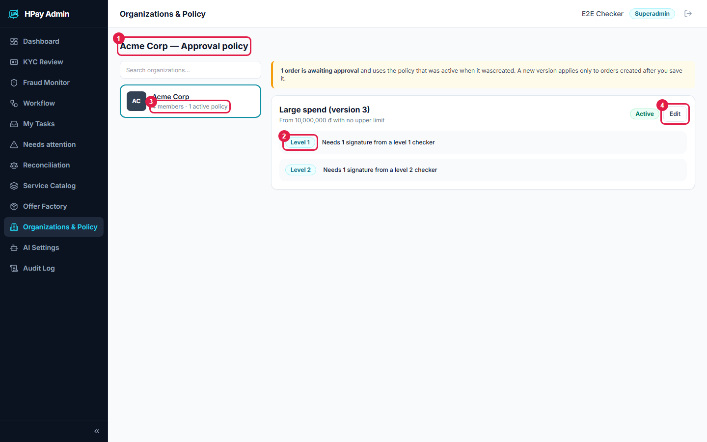

*Figure 27: The policy page. Badge 1 is the heading with the organization name. Badge 2 is a level. Badge 3 is the organization card. Badge 4 is Edit.*

**Task A: Read a policy**

1. Click **Organizations & Policy** in the left menu. *You should see: the first organization and its active policy (Figure 27).*
2. Click another organization card in the left list if you have more than one. *You should see: that organization's policies.*
3. Read the levels. *You should see: lines such as "Needs 1 signature from a level 1 checker".*

**Task B: Save a new version with a different number of signatures**

1. Click **Edit** on the policy (badge 4 in Figure 27). *You should see: **−** and **+** buttons, **Remove**, **+ Add level**, **Discard changes** and a green **Save as version 4** button (Figure 28).*
2. Click **+** or **−** next to a level to change its number of signatures. *You should see: the number change.*
3. Click **Save as version 4**. *You should see: a green message such as: Saved version 4 of "Large spend" for Acme Corp.*

To leave without saving, click **Discard changes**. Nothing changes.

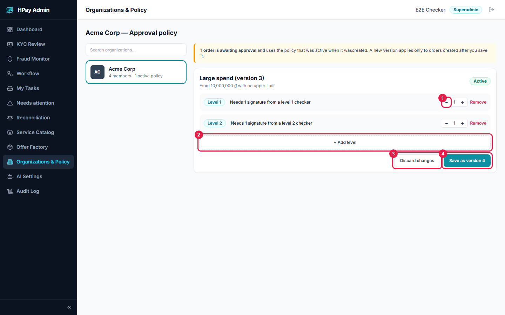

*Figure 28: Edit mode, before saving. Badge 1 is the minus button for level 1. Badge 2 is + Add level. Badge 3 is Discard changes. Badge 4 is Save as version 4.*

> **Careful**
> **Save as version 4** works at once. It creates a NEW version. It does not change orders that are already waiting. Those orders keep the rule that was active when they were created. The yellow note on the page tells you how many orders are waiting. A level needs at least 1 signature. Check every number before you save.

**Other edit buttons.** **+ Add level** adds a new last level with 1 signature. **Remove** deletes a level. It shows only when the policy has more than one level. The levels are then numbered again from 1.

**What "Earlier versions" means.** When a new version becomes active, the old version is kept. A line **Earlier versions (n)** appears under the policy. Click it to open the list. Each old version shows its name, version number, amount range, a short summary such as "L1×1 · L2×1" and the badge **Replaced**. Old versions are for reading only. The demo has only one version, so Figure 27 has no such line.

**If there is no policy.** The page says "This organization has no approval policy yet, so its members cannot send disbursements."

**If something looks wrong.** If you see "Your role does not have permission for this action. (orgs.edit)", you can read the page but not change it (Figure 29). **Edit** is greyed out. Only a Superadmin can edit.

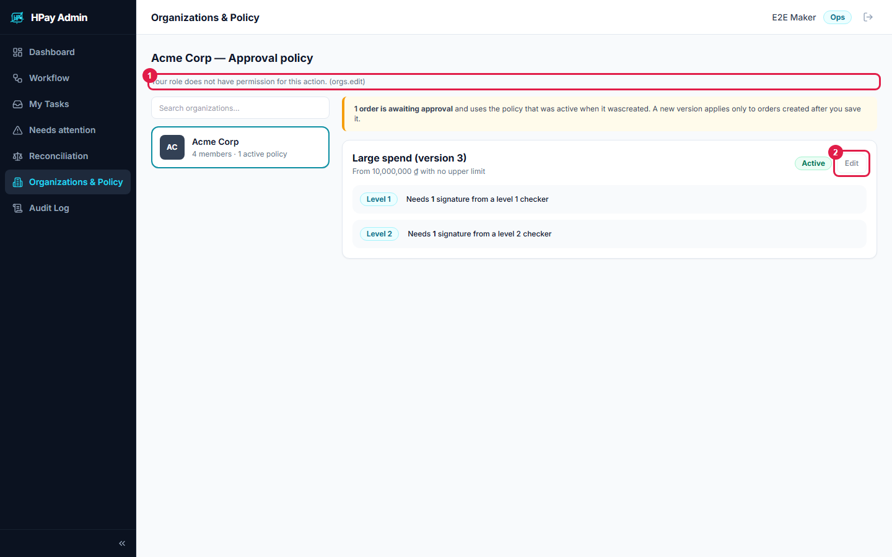

*Figure 29: View only. Badge 1 is the permission note. Badge 2 is the grey Edit button.*

---

### 5.11 AI Settings

**What this page is for.** Choose which AI service reads ID documents and explains fraud flags, and store the secret key it needs.

**When you need it.** Rarely. Only a Superadmin should change it.

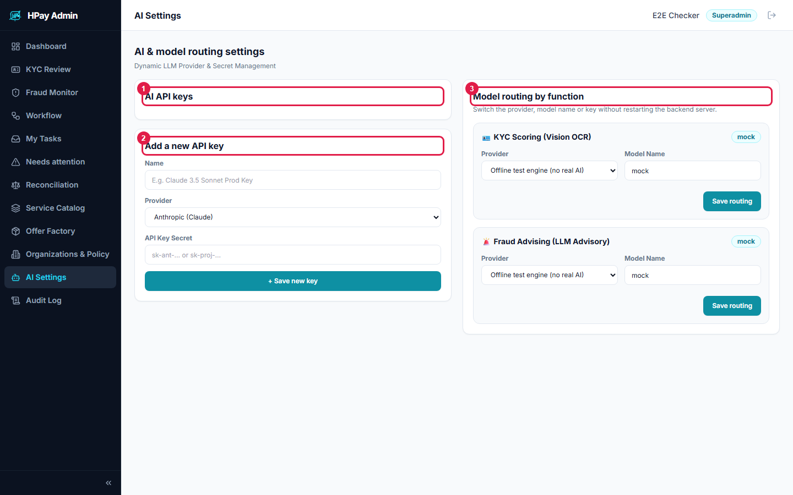

*Figure 30: AI Settings. Badge 1 is the key list. Badge 2 is the Add a new API key form. Badge 3 is Model routing by function.*

**Task: Read the current setup**

1. Click **AI Settings** in the left menu.
2. Read **AI API keys**: each key shows **ACTIVE** or **INACTIVE**. The demo has no keys, so the list is empty.
3. Read **Model routing by function**: for each job (**KYC Scoring (Vision OCR)** and **Fraud Advising (LLM Advisory)**) it shows the provider in use.

Changing settings is for experts. The page has **+ Save new key** and **Save routing** buttons.

> **Careful**
> Turning off a key that is in use makes that AI job fail. The page warns you first ("Confirm disabling API key"). If you are not told to do this, do not touch this page. The secret key is like a password: never write it in an email.

**What the words mean**

| Word | Meaning |
|---|---|
| **Provider** | The company running the AI (Anthropic or OpenAI), or **Offline test engine (no real AI)**, a built-in stand-in used for practice. The demo uses it for both jobs. |
| **Model Name** | Which version of the AI to use. |
| **API key** | A secret code that lets HPay use the AI service. |

**If something looks wrong.** Only a Superadmin can open this page. Others see "No access".

---

### 5.12 Audit Log

**What this page is for.** The record of what staff did and what happened, with who, when and why.

**When you need it.** When someone asks "who approved this?" or "when was this rejected?"

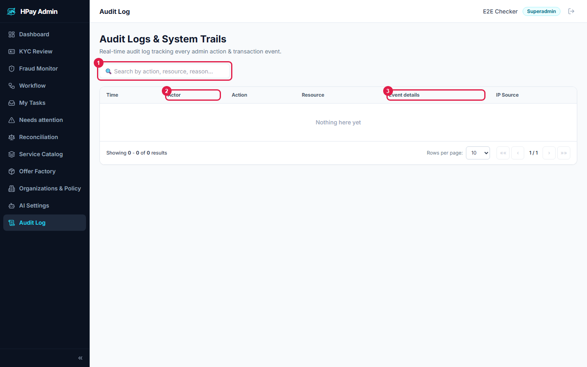

*Figure 31: The audit log. Badge 1 is the search box. Badge 2 is Actor. Badge 3 is Event details.*

**Task: Find an entry**

1. Click **Audit Log** in the left menu. *You should see: the page "Audit Logs & System Trails".*
2. Click the search box (badge 1) and type a word, such as a reason or a transaction code. *You should see: only matching rows.*

| Column | Meaning |
|---|---|
| **Time** | When it happened. |
| **Actor** | Who did it. |
| **Action** | What was done. |
| **Resource** | What it was done to. |
| **Event details** | The reason or extra information. |
| **IP Source** | The computer address it came from. |

The log cannot be edited. It is read-only for everyone.

> **Not available yet**
> In the demo system the table is empty ("Nothing here yet"), so no rows can be shown in Figure 31.

**If something looks wrong.** The page opens for every role except Viewer. If you see "No access", ask a Superadmin to look up an entry for you.

---

## 6. Glossary

| Word | Plain meaning |
|---|---|
| **KYC** | "Know Your Customer". Checking a customer's identity with an ID card photo and a selfie. |
| **Fraud flag** | A warning that a payment looks suspicious. A person decides if it is real. |
| **Maker** | The person who asks for something to be done. |
| **Checker** | The person who approves or rejects what the maker asked. A different person from the maker. |
| **Approval level (L1, L2)** | Large requests need several rounds of approval. L1 signs first, then L2, and so on. |
| **Level (in a policy)** | One round of approval inside an organization's policy. |
| **Signature** | One approval given by a checker. "Needs 2 signatures" means two checkers must approve. |
| **Policy version** | A numbered copy of a policy. Saving a change creates the next number. Old versions stay as **Earlier versions**. |
| **Reconciliation** | Checking that HPay's records agree with the bank's records for a day. |
| **Workflow instance** | One payment as it moves through its steps. |
| **Stuck** | A workflow instance that has not moved for more than 5 minutes. |
| **Parked case** | A money case the system could not finish alone. It appears on **Needs attention**. |
| **Compensation** | Undoing the steps a payment already did, for example giving the money back. |
| **Reversal** | A request to give money back for a finished payment. It needs approval. |
| **Plan / offer** | A package of services and limits given to a customer. Demo plans: Personal (unverified), Personal (KYC tier 1), Personal (KYC tier 2), Business Starter (Maker/Checker L1), Business Enterprise (Maker/Checker L2). |
| **Service** | One thing customers can do, such as send money or pay a bill. Demo services: P2P transfer, Request money & split bill, Bank top-up, Corporate payroll, Vault savings. |
| **Policy** | The rule saying how many approvers a payment of a given size needs. Demo example: "Large spend" for the organization Acme Corp. |
| **Tier / level** | How much HPay knows a customer. Higher level means higher limits. |
| **Organization** | A business customer with several staff using HPay. Demo: Acme Corp. |
| **Audit log** | The permanent list of who did what and why. |
| **API** | A technical link between two programs. It appears on screens in messages like "no analytics API yet". It means the data feed is not built yet. |
| **Role** | Your job type in HPay Admin. It decides what you can do. |

---

## 7. FAQ and troubleshooting

**I cannot log in.** Check that Caps Lock is off. Check your email spelling. If the message says the account is locked, wait 15 minutes. After 5 wrong tries the lock starts. Still stuck? See section 8.

**I was logged out suddenly.** Sessions end after a short time (the sign-in is valid for about 15 minutes, as set in the code today). Log in again.

**A button is grey.** Your role cannot use it. Hover over it for the reason. Read section 4.

**I see "Not available yet", "(no analytics API yet)" or a dash on a card.** That part of HPay Admin is not built yet, or your role cannot see it. It is not your mistake. Use the other pages named in this guide.

**The list is empty.** "Nothing here yet" or "Nothing needs attention." usually means all is clear. Check the tab and filter at the top (for example **Status: Open**).

**I approved the wrong item.** Stay calm. Do not try to fix it yourself. Write down the item, the time and what you did. Contact your manager at once (section 8). Your action is saved in the Audit log with your name.

**I saved a policy version by mistake.** Do not save again. Tell your manager. Old versions are kept under **Earlier versions**, so the previous rule can be restored by saving a new version with the old numbers.

**The page looks wrong or stuck.** Press F5 to reload. If it still looks wrong, log out and in again.

**I cannot find a menu item.** Your role does not include it (section 4).

---

## 8. Who to contact

> **TO BE FILLED IN BY THE OWNER BEFORE SENDING TO STAFF**
>
> - Support contact name: `________________`
> - Phone or chat: `________________`
> - Email: `________________`
> - Office hours: `________________`
> - Out of hours (urgent money problem): `________________`
>
> When you ask for help, tell them: your name, the page, what you clicked, the exact message on screen and the time.
