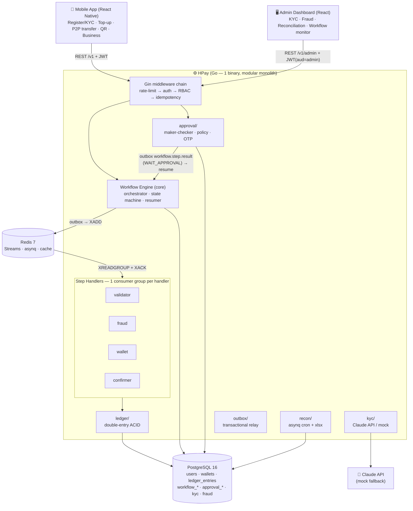

# HPay v2 — Backend Redesign in Golang

> Version 2.0 — replaces the Node.js plan. Additions: a stricter schema (double-entry ledger, outbox, idempotency), a Maker-Checker module learned from a reference approval engine, and an AI automation suite (Claude Code skills + AI runtime + CI/CD).

---

## 1. Assessment of a reference approval engine — what to take, what to drop

The the reference approval docs describe a **Corporate Request-Approval engine** (a maker-checker authorization matrix). Assessment of each concept:

| Concept in the reference engine | Assessment | Decision for HPay |
|---|---|---|
| Maker-Checker by policy tiers (`Policy.tiers`, `buildApprovalRecord`) | This is genuine fintech business logic that almost every corporate banking product has. The brightest spot of the docs. | **Take.** Build the Business Wallet module: the maker creates an order, the checker approves it according to the policy matrix. |
| `TransactionTrail` keeps pending state separate from the final ledger (`Transaction`) | Separating the "transaction request" from the "financial entry" is the right pattern — the ledger is written only once the transaction is final. | **Take**, but leaner: `transactions` (state) + `ledger_entries` (double-entry postings, immutable). |
| `TransactionApprove` snapshots the policy + pushes the checker inside an ACID session | Snapshotting the policy at order creation prevents a race when an admin edits the policy midway; pushing the checker inside the transaction prevents parallel-approve. | **Take as is.** `approval_requests.policy_snapshot` (JSONB) + approve inside `SELECT ... FOR UPDATE`. |
| Pubsub `VERIFY_TRANSACTION` bridges async from approve → core engine | The right event-driven direction, and it fits HPay's existing Workflow Engine. | **Take**, generalized into a **resume workflow** mechanism: approval finished → publish event → the engine continues with the financial steps. |
| Auth bypass after checker approval (`engineVerifyTransaction` skips single-party auth) | Reasonable from a business standpoint, but the implementation (a bypass flag in the core) easily becomes a vulnerability. | **Fix:** no bypass via a flag; a workflow instance in the `waiting_approval` state can only be resumed by an internal event from the approval module — authority lives in the state machine, not in if-else. |
| `NeonMessage` / `fieldBuilder` / `TransDefinition` dynamic mapping | A configurable field-mapping framework — powerful but too complex for a portfolio app, hard to explain in an interview. | **Drop.** Go structs + validator tags are enough and more type-safe. |
| SOTP / BioAuthMatrix / CustomerStatistic | A lot of infrastructure, little demo value. | **Drop**; keep the mock OTP (logged to the console) + a properly designed `otp_challenges` table (hash, expiry, attempts). |

**Conclusion:** this engine is worth studying. The greatest value is the **human-in-the-loop approval gate** — something your v1 workflow engine does not have (v1 only has auto-steps). HPay v2 will unify them: maker-checker becomes a **step type `human_approval`** in the workflow definition, not a separate system.

---

## 2. Architecture overview

**Modular monolith** (1 Go binary, cleanly separated modules) — right-sized for a portfolio, easy to demo, and still shows event-driven design because the modules communicate through Redis Streams instead of direct function calls.



### Stack

| Layer | Technology | Reason |
|---|---|---|
| HTTP | **Gin** | Fast, popular, good middleware ecosystem |
| DB access | **sqlc + pgx/v5** | Write plain SQL → generate type-safe Go code; fintech interviewers like candidates who can write SQL |
| Migration | **golang-migrate** | De-facto standard, runs in CI |
| Message | **Redis Streams** (not Pub/Sub) | Pub/Sub loses messages when a consumer dies; Streams have consumer groups + XACK + XAUTOCLAIM → real retry/at-least-once. A good interview talking point. |
| Cron/Queue | **asynq** | Scheduled jobs (reconciliation, outbox relay, OTP cleanup) on Redis |
| Config | viper or plain env | — |
| Log | **slog** (stdlib) + request_id middleware | Structured logs to trace workflows |
| Test | testify + **testcontainers-go** | Integration tests with real Postgres/Redis |
| AI | Claude API (anthropic-sdk-go), mock fallback | KYC + fraud |

### Strict design principles (different from v1)

1. **Money is `BIGINT` in the smallest unit** (VND: dong). Never use float. There is no `balance` column in `users` — the balance lives only in `wallets`, and `wallets.balance` is a **derived value verified** by `ledger_entries`.
2. **Double-entry:** every transaction produces ≥2 postings, total debit = total credit. A top-up is also double-entry (counterparty is the system wallet `SYSTEM_CASH_IN`).
3. **Idempotency:** every write API accepts an `Idempotency-Key` header, with a unique constraint in the DB — a client retry does not create a duplicate transaction.
4. **Transactional Outbox:** an event is published to Redis only after the DB transaction commits (written to the `outbox` table in the same transaction; the relay reads and publishes). Prevents lost events / ghost events.
5. **Lock ordering:** when debiting+crediting 2 wallets, always `SELECT FOR UPDATE` in ascending `wallet_id` order → no deadlock.
6. **Policy snapshot:** the approval matrix is captured into `approval_requests.policy_snapshot` when the order is created; editing the policy does not affect pending orders (E09).
7. **Controlled state machine:** every transaction/workflow state change goes through a single function with a valid-transition table; an invalid transition → error, never silently overwritten.

---

## 3. Database Schema (PostgreSQL)

### 3.1. Identity & organization

```sql
CREATE TYPE kyc_status AS ENUM ('none','pending','auto_approved','manual_review','verified','rejected');
CREATE TYPE account_status AS ENUM ('active','suspended','locked','closed');

CREATE TABLE users (
    id              UUID PRIMARY KEY DEFAULT gen_random_uuid(),
    phone           VARCHAR(15) NOT NULL UNIQUE,
    password_hash   TEXT NOT NULL,                -- bcrypt/argon2id
    full_name       VARCHAR(120) NOT NULL,
    kyc_status      kyc_status NOT NULL DEFAULT 'none',
    status          account_status NOT NULL DEFAULT 'active',
    created_at      TIMESTAMPTZ NOT NULL DEFAULT now(),
    updated_at      TIMESTAMPTZ NOT NULL DEFAULT now()
);
-- NOTE: there is no balance column. The balance belongs to wallets.

-- Business Wallet (learned from the reference engine: corporate entity + maker/checker role)
CREATE TABLE organizations (
    id              UUID PRIMARY KEY DEFAULT gen_random_uuid(),
    name            VARCHAR(200) NOT NULL,
    status          account_status NOT NULL DEFAULT 'active',
    created_by      UUID NOT NULL REFERENCES users(id),
    created_at      TIMESTAMPTZ NOT NULL DEFAULT now()
);

CREATE TYPE org_role AS ENUM ('admin','maker','checker');

CREATE TABLE org_members (
    org_id          UUID NOT NULL REFERENCES organizations(id),
    user_id         UUID NOT NULL REFERENCES users(id),
    role            org_role NOT NULL,
    checker_level   SMALLINT,                     -- NULL if not a checker
    created_at      TIMESTAMPTZ NOT NULL DEFAULT now(),
    PRIMARY KEY (org_id, user_id),
    CONSTRAINT checker_has_level CHECK (role <> 'checker' OR checker_level >= 1)
);
```

### 3.2. Wallets & ledger (double-entry)

```sql
CREATE TYPE owner_type AS ENUM ('user','organization','system');

CREATE TABLE wallets (
    id              UUID PRIMARY KEY DEFAULT gen_random_uuid(),
    owner_type      owner_type NOT NULL,
    owner_id        UUID,                          -- NULL for system wallets
    system_code     VARCHAR(40),                   -- 'SYSTEM_CASH_IN', 'SYSTEM_FEE'...
    currency        CHAR(3) NOT NULL DEFAULT 'VND',
    balance         BIGINT NOT NULL DEFAULT 0,
    version         BIGINT NOT NULL DEFAULT 0,     -- optimistic lock for the read path
    created_at      TIMESTAMPTZ NOT NULL DEFAULT now(),
    updated_at      TIMESTAMPTZ NOT NULL DEFAULT now(),
    CONSTRAINT balance_non_negative CHECK (system_code IS NOT NULL OR balance >= 0),
    CONSTRAINT owner_or_system CHECK (
        (owner_type = 'system' AND system_code IS NOT NULL AND owner_id IS NULL) OR
        (owner_type <> 'system' AND owner_id IS NOT NULL AND system_code IS NULL)
    ),
    UNIQUE (owner_type, owner_id, currency),
    UNIQUE (system_code)
);
-- System wallets are allowed to go negative (e.g. SYSTEM_CASH_IN decreases as users top up) — this is the true nature of accounting.

CREATE TYPE txn_type   AS ENUM ('topup','p2p','org_disbursement','fee','reversal');
CREATE TYPE txn_status AS ENUM ('created','pending_approval','processing','completed','failed','reversed');

CREATE TABLE transactions (
    id               UUID PRIMARY KEY DEFAULT gen_random_uuid(),
    ref_code         VARCHAR(24) NOT NULL UNIQUE,        -- user-facing code, e.g. MP26070800001
    idempotency_key  VARCHAR(64) NOT NULL UNIQUE,
    type             txn_type NOT NULL,
    status           txn_status NOT NULL DEFAULT 'created',
    sender_wallet_id   UUID NOT NULL REFERENCES wallets(id),
    receiver_wallet_id UUID NOT NULL REFERENCES wallets(id),
    amount           BIGINT NOT NULL CHECK (amount > 0),
    fee              BIGINT NOT NULL DEFAULT 0 CHECK (fee >= 0),
    currency         CHAR(3) NOT NULL DEFAULT 'VND',
    note             VARCHAR(255),
    initiated_by     UUID NOT NULL REFERENCES users(id), -- maker (for org txn)
    failure_reason   TEXT,
    metadata         JSONB NOT NULL DEFAULT '{}',
    created_at       TIMESTAMPTZ NOT NULL DEFAULT now(),
    completed_at     TIMESTAMPTZ,
    CONSTRAINT no_self_transfer CHECK (sender_wallet_id <> receiver_wallet_id)
);
CREATE INDEX idx_txn_sender   ON transactions (sender_wallet_id, created_at DESC);
CREATE INDEX idx_txn_receiver ON transactions (receiver_wallet_id, created_at DESC);
CREATE INDEX idx_txn_status   ON transactions (status) WHERE status NOT IN ('completed','failed');

CREATE TYPE entry_direction AS ENUM ('debit','credit');

-- Immutable ledger: INSERT only, no UPDATE/DELETE (enforced by trigger + DB privileges)
CREATE TABLE ledger_entries (
    id              BIGINT GENERATED ALWAYS AS IDENTITY PRIMARY KEY,
    transaction_id  UUID NOT NULL REFERENCES transactions(id),
    wallet_id       UUID NOT NULL REFERENCES wallets(id),
    direction       entry_direction NOT NULL,
    amount          BIGINT NOT NULL CHECK (amount > 0),
    balance_after   BIGINT NOT NULL,               -- audit: wallet balance after the posting
    created_at      TIMESTAMPTZ NOT NULL DEFAULT now()
);
CREATE INDEX idx_ledger_wallet ON ledger_entries (wallet_id, id);
-- Invariant (checked by tests + recon job): for each transaction_id,
--   SUM(amount) WHERE direction='debit' = SUM(amount) WHERE direction='credit'
```

### 3.3. Workflow Engine

```sql
CREATE TABLE workflow_definitions (
    id          UUID PRIMARY KEY DEFAULT gen_random_uuid(),
    name        VARCHAR(60) NOT NULL,              -- 'p2p_transfer', 'org_disbursement'
    version     INT NOT NULL,
    steps       JSONB NOT NULL,                    -- see spec §4
    is_active   BOOLEAN NOT NULL DEFAULT false,    -- only 1 active version / name
    created_at  TIMESTAMPTZ NOT NULL DEFAULT now(),
    UNIQUE (name, version)
);
CREATE UNIQUE INDEX one_active_per_name ON workflow_definitions (name) WHERE is_active;

CREATE TYPE wf_status AS ENUM ('running','waiting_approval','completed','failed','compensating','compensated');

CREATE TABLE workflow_instances (
    id               UUID PRIMARY KEY DEFAULT gen_random_uuid(),
    definition_id    UUID NOT NULL REFERENCES workflow_definitions(id),
    transaction_id   UUID NOT NULL UNIQUE REFERENCES transactions(id),
    status           wf_status NOT NULL DEFAULT 'running',
    current_step     VARCHAR(60),
    context          JSONB NOT NULL DEFAULT '{}',  -- data passed between steps
    created_at       TIMESTAMPTZ NOT NULL DEFAULT now(),
    updated_at       TIMESTAMPTZ NOT NULL DEFAULT now()
);
CREATE INDEX idx_wf_stuck ON workflow_instances (status, updated_at)
    WHERE status IN ('running','waiting_approval','compensating');

CREATE TYPE step_status AS ENUM ('started','completed','failed','timed_out','compensated');

CREATE TABLE step_executions (
    id           BIGINT GENERATED ALWAYS AS IDENTITY PRIMARY KEY,
    instance_id  UUID NOT NULL REFERENCES workflow_instances(id),
    step_name    VARCHAR(60) NOT NULL,
    attempt      SMALLINT NOT NULL DEFAULT 1,
    status       step_status NOT NULL,
    input        JSONB,
    output       JSONB,
    error        TEXT,
    started_at   TIMESTAMPTZ NOT NULL DEFAULT now(),
    finished_at  TIMESTAMPTZ
);
CREATE INDEX idx_step_instance ON step_executions (instance_id, id);
```

### 3.4. Approval Matrix (maker-checker, learned from the reference engine)

> **F6 update (implemented):** the schema below is the original v2.0 version. The actual implementation generalized `transaction_approvals` → `approval_requests(subject_type, subject_id, ...)` already in migration 000005 (F1), following the direction settled in [04-feature-extensions.md §2.3](04-feature-extensions.md#23-generalized-approval-engine-p1--architecture-upgrade) — shared by `org_transaction` as well as later `reversal`/`account_lock`/`policy_change`. Read §4.3 and §5.1 below for the real resume mechanism (it does not use a separate `approval.finalized` event as originally described).

```sql
-- Equivalent to the reference engine's Policy.tiers
CREATE TABLE approval_policies (
    id          UUID PRIMARY KEY DEFAULT gen_random_uuid(),
    org_id      UUID NOT NULL REFERENCES organizations(id),
    name        VARCHAR(100) NOT NULL,
    min_amount  BIGINT NOT NULL DEFAULT 0,
    max_amount  BIGINT,                            -- NULL = no ceiling
    tiers       JSONB NOT NULL,
    -- tiers: [{"level":1,"required_approvals":1},{"level":2,"required_approvals":2}]
    version     INT NOT NULL DEFAULT 1,
    is_active   BOOLEAN NOT NULL DEFAULT true,
    created_by  UUID NOT NULL REFERENCES users(id),
    created_at  TIMESTAMPTZ NOT NULL DEFAULT now(),
    CONSTRAINT valid_range CHECK (max_amount IS NULL OR max_amount > min_amount)
);

CREATE TYPE approval_status AS ENUM ('pending','approved','rejected','expired');

-- Equivalent to the reference engine's TransactionApprove
CREATE TABLE transaction_approvals (
    id               UUID PRIMARY KEY DEFAULT gen_random_uuid(),
    transaction_id   UUID NOT NULL UNIQUE REFERENCES transactions(id),
    instance_id      UUID NOT NULL REFERENCES workflow_instances(id),
    policy_id        UUID NOT NULL REFERENCES approval_policies(id),
    policy_snapshot  JSONB NOT NULL,               -- tiers captured at creation time — prevents a race when the policy is edited
    status           approval_status NOT NULL DEFAULT 'pending',
    current_level    SMALLINT NOT NULL DEFAULT 1,
    expires_at       TIMESTAMPTZ NOT NULL,         -- an order pending past its deadline → expired, workflow fails cleanly
    finalized_at     TIMESTAMPTZ,
    created_at       TIMESTAMPTZ NOT NULL DEFAULT now()
);

CREATE TYPE approval_action AS ENUM ('approve','reject');

CREATE TABLE approval_actions (
    id            BIGINT GENERATED ALWAYS AS IDENTITY PRIMARY KEY,
    approval_id   UUID NOT NULL REFERENCES transaction_approvals(id),
    checker_id    UUID NOT NULL REFERENCES users(id),
    level         SMALLINT NOT NULL,
    action        approval_action NOT NULL,
    auth_method   VARCHAR(20) NOT NULL DEFAULT 'otp',
    acted_at      TIMESTAMPTZ NOT NULL DEFAULT now(),
    UNIQUE (approval_id, checker_id)               -- a checker can act only once per order
);

CREATE TABLE otp_challenges (
    id          UUID PRIMARY KEY DEFAULT gen_random_uuid(),
    user_id     UUID NOT NULL REFERENCES users(id),
    purpose     VARCHAR(40) NOT NULL,              -- 'approve_txn','topup','login'
    ref_id      UUID,                              -- bound to an approval/transaction
    code_hash   TEXT NOT NULL,                     -- NEVER store plaintext
    attempts    SMALLINT NOT NULL DEFAULT 0,
    max_attempts SMALLINT NOT NULL DEFAULT 3,
    expires_at  TIMESTAMPTZ NOT NULL,
    consumed_at TIMESTAMPTZ,
    created_at  TIMESTAMPTZ NOT NULL DEFAULT now()
);
```

### 3.5. KYC, Fraud, Reconciliation, Outbox

```sql
CREATE TABLE kyc_requests (
    id           UUID PRIMARY KEY DEFAULT gen_random_uuid(),
    user_id      UUID NOT NULL REFERENCES users(id),
    id_card_url  TEXT NOT NULL,
    selfie_url   TEXT NOT NULL,
    ai_score     NUMERIC(5,2),                     -- 0–100
    ai_verdict   VARCHAR(20),                      -- 'auto_approve','manual_review','auto_reject'
    ai_reasons   JSONB,                            -- the LLM explains why
    status       kyc_status NOT NULL DEFAULT 'pending',
    reviewer_id  UUID REFERENCES admin_users(id), -- F8: the reviewer is an ADMIN (doc 01 §3.1), not a user
    reviewed_at  TIMESTAMPTZ,
    created_at   TIMESTAMPTZ NOT NULL DEFAULT now()
);

CREATE TYPE flag_status AS ENUM ('open','cleared','confirmed_fraud');

CREATE TABLE fraud_flags (
    id             UUID PRIMARY KEY DEFAULT gen_random_uuid(),
    transaction_id UUID NOT NULL REFERENCES transactions(id),
    rule_code      VARCHAR(40) NOT NULL,           -- 'VELOCITY_5MIN','AMOUNT_SPIKE','NEW_DEVICE'
    score          NUMERIC(5,2) NOT NULL,
    reasons        JSONB NOT NULL DEFAULT '[]',
    status         flag_status NOT NULL DEFAULT 'open',
    reviewer_id    UUID REFERENCES admin_users(id), -- F8: the reviewer is an ADMIN, fixed in the same migration 000015
    reviewed_at    TIMESTAMPTZ,
    created_at     TIMESTAMPTZ NOT NULL DEFAULT now()
);

-- Simulated partner-bank statement for the reconciliation job
CREATE TABLE bank_statements (
    id          BIGINT GENERATED ALWAYS AS IDENTITY PRIMARY KEY,
    ref_code    VARCHAR(24) NOT NULL,
    amount      BIGINT NOT NULL,
    stmt_date   DATE NOT NULL,
    raw         JSONB NOT NULL DEFAULT '{}'
);

CREATE TYPE recon_result AS ENUM ('matched','amount_mismatch','missing_internal','missing_external');

CREATE TABLE reconciliation_runs (
    id          UUID PRIMARY KEY DEFAULT gen_random_uuid(),
    run_date    DATE NOT NULL UNIQUE,
    total       INT NOT NULL DEFAULT 0,
    matched     INT NOT NULL DEFAULT 0,
    mismatched  INT NOT NULL DEFAULT 0,
    report_url  TEXT,
    created_at  TIMESTAMPTZ NOT NULL DEFAULT now()
);

CREATE TABLE reconciliation_items (
    id             BIGINT GENERATED ALWAYS AS IDENTITY PRIMARY KEY,
    run_id         UUID NOT NULL REFERENCES reconciliation_runs(id),
    transaction_id UUID REFERENCES transactions(id),
    statement_id   BIGINT REFERENCES bank_statements(id),
    result         recon_result NOT NULL,
    detail         JSONB
);

-- Transactional Outbox: the event is written in the same DB transaction, the relay publishes after commit
CREATE TABLE outbox (
    id           BIGINT GENERATED ALWAYS AS IDENTITY PRIMARY KEY,
    aggregate    VARCHAR(40) NOT NULL,             -- 'workflow','approval','kyc'
    event_type   VARCHAR(60) NOT NULL,             -- 'workflow.step.start', 'workflow.step.result'
    payload      JSONB NOT NULL,
    published_at TIMESTAMPTZ,
    created_at   TIMESTAMPTZ NOT NULL DEFAULT now()
);
CREATE INDEX idx_outbox_unpublished ON outbox (id) WHERE published_at IS NULL;
```

---

## 4. Workflow Engine Spec (Go)

### 4.1. Step definition — adding the `human_approval` type

The biggest difference from v1: a step has a `type`. An `auto` step runs through a handler as before; a `human_approval` step **suspends the workflow** until the approval module resumes it — this is exactly where a reference approval engine is merged in.

> **F6 constraint (implemented):** the first step of every definition MUST be `type: auto` — the engine's `Start()` dispatches the first step straight to the handler stream, so a definition that begins with `human_approval` makes no sense (there is nothing yet to suspend). The engine validates this at parse time (`ParseSteps`).

```json
{
  "name": "org_disbursement",
  "version": 1,
  "steps": [
    { "name": "VALIDATE",        "type": "auto",           "handler": "validator",  "retry": 3, "timeout_ms": 5000,  "on_failure": "fail" },
    { "name": "FRAUD_CHECK",     "type": "auto",           "handler": "fraud",      "retry": 1, "timeout_ms": 3000,  "on_failure": "flag_review" },
    { "name": "WAIT_APPROVAL",   "type": "human_approval", "expires_h": 24,         "on_reject": "fail", "on_expire": "fail" },
    { "name": "DEBIT",           "type": "auto",           "handler": "wallet",     "retry": 2, "timeout_ms": 10000, "on_failure": "compensate", "config": {"action": "debit"} },
    { "name": "CREDIT",          "type": "auto",           "handler": "wallet",     "retry": 2, "timeout_ms": 10000, "on_failure": "compensate", "config": {"action": "credit"} },
    { "name": "CONFIRM",         "type": "auto",           "handler": "confirmer",  "retry": 1, "timeout_ms": 5000,  "on_failure": "manual" }
  ]
}
```

A personal `p2p_transfer` uses a similar definition but **without** the `WAIT_APPROVAL` step — the same engine serves both. Adding a new flow = INSERT a new definition, keeping v1's "low-code" highlight.

### 4.2. Core types

```go
type StepType string
const (
    StepAuto          StepType = "auto"
    StepHumanApproval StepType = "human_approval"
)

type StepDef struct {
    Name      string          `json:"name"`
    Type      StepType        `json:"type"`
    Handler   string          `json:"handler,omitempty"`
    Retry     int             `json:"retry"`
    TimeoutMs int             `json:"timeout_ms"`
    OnFailure string          `json:"on_failure"` // fail | compensate | flag_review | manual
    Config    json.RawMessage `json:"config,omitempty"`
}

// Each step handler implements this interface and registers itself in the registry
type StepHandler interface {
    Name() string
    Execute(ctx context.Context, in StepInput) (StepOutput, error)
}

type StepInput struct {
    InstanceID    uuid.UUID
    TransactionID uuid.UUID
    Context       map[string]any  // workflow context accumulated across steps
    Config        json.RawMessage
}
```

### 4.3. Runtime mechanism (Redis Streams)

- The engine publishes `workflow.step.start` to the stream `wf:steps:{handler}` (via the outbox relay).
- Each handler is its own **consumer group**: `XREADGROUP` → process → `XACK`. A message not ACKed after `timeout_ms` is `XAUTOCLAIM`ed by another worker → **at-least-once**; handlers must be idempotent (check the current `step_executions` attempt before doing a side effect).
- When a handler finishes it publishes `workflow.step.completed` / `workflow.step.failed` to the stream `wf:events`. The engine (consumer group `engine`) receives it, writes `step_executions`, and decides the next move: next step, retry (exponential backoff), or run `on_failure`.
- **Compensation (saga):** `on_failure: compensate` → the instance moves to `compensating`, and the engine runs the completed steps that have ledger postings in reverse (if `DEBIT` already ran → post a reversing entry, never delete the ledger) → `compensated`, transaction → `failed`.
- **human_approval:** when the engine reaches this step → it sets the instance to `waiting_approval` and calls `PauseHook` — the approval module (which implements the hook) creates `approval_requests` (a policy snapshot matching org + amount) and sets the transaction to `pending_approval`, ALL in the same DB transaction as suspending the instance, then stops.
- **Resume (F6, implemented):** there is no dedicated event type. When the request is finalized (enough signatures), the approval module itself writes `step_executions` for the `WAIT_APPROVAL` step and then emits a **standard outbox `workflow.step.result`** (identical to the result of an auto step) in the same transaction as the approval decision — the engine's `OnResult` receives it and advances to DEBIT → CREDIT → CONFIRM as usual. The state guard is relaxed to accept a result from `waiting_approval` when the step is `human_approval`, and stays strict for auto steps. This approach reuses the entire F4 pipeline (outbox → wf:events → OnResult, already idempotent per E06) instead of adding a new consumer/event type as in the original design — the practical generalization of the reference engine's `VERIFY_TRANSACTION` pubsub.

### 4.4. Wallet handler — the most important ACID section

```go
// DEBIT + CREDIT in 1 DB transaction, lock in wallet_id order to avoid deadlock
func (h *WalletHandler) transfer(ctx context.Context, tx pgx.Tx, t Txn) error {
    ids := []uuid.UUID{t.SenderWalletID, t.ReceiverWalletID}
    slices.SortFunc(ids, compareUUID)                       // lock ordering
    rows, _ := tx.Query(ctx,
        `SELECT id, balance FROM wallets WHERE id = ANY($1) FOR UPDATE`, ids)
    // ... check the balance, then:
    // UPDATE wallets SET balance = balance - $amt, version = version + 1 WHERE id = sender
    // UPDATE wallets SET balance = balance + $amt, version = version + 1 WHERE id = receiver
    // INSERT ledger_entries (debit sender, credit receiver, balance_after)
    // INSERT outbox ('workflow.step.completed')
    return nil // commit everything or nothing
}
```

---

## 5. Maker-Checker module (approval/)

### 5.1. 3-phase flow — mapping from the reference engine to HPay

| the reference engine | HPay v2 | Notes |
|---|---|---|
| `corporateRequestTransaction` (Maker) | `POST /v1/org/:id/transactions` | The service layer checks `org_members.role = maker` via a query, not only middleware. Creates the transaction + workflow instance; the engine runs VALIDATE, FRAUD_CHECK, then suspends at WAIT_APPROVAL. |
| `corporateConfirmTransaction` (Checker handshake) | `POST /v1/org/approvals/:id/challenge` | Checks eligibility before sending the OTP (matching the intent of the reference engine's simulated `evaluateApprovalLogic`): is the checker in the right org? is the `checker_level` = `current_level`? has not acted before? is the request still `pending` and not expired? Only then create `otp_challenges` (mock delivery: console log / returned in the response in the dev environment). |
| `corporateApproveTransaction` (Checker approve) | `POST /v1/org/approvals/:id/decide` | Body: `{action, otp}`. Verify the OTP (hash, attempts, expiry). In 1 DB transaction: `SELECT approval_requests FOR UPDATE` → insert `approval_actions` (UNIQUE(request_id, checker_id) blocks double-act) → recompute the state from `policy_snapshot` (the pure `Evaluate` function, §5.2). |
| `VERIFY_TRANSACTION` pubsub | outbox `workflow.step.result` (not a dedicated event type) | In the same transaction as finalize: write `step_executions` for the `WAIT_APPROVAL` step + emit the standard ResultEvent → the engine resumes the workflow, running DEBIT → CREDIT → CONFIRM. See §4.3. |

### 5.2. evaluateApprovalLogic, Go version

```go
// Computed from policy_snapshot + approval_actions, purely functional — easy to unit test
func Evaluate(snapshot PolicySnapshot, actions []Action) Decision {
    for _, a := range actions {
        if a.Action == Reject { return Decision{Status: Rejected} }
    }
    for _, tier := range snapshot.Tiers {                    // ascending level
        n := countApprovals(actions, tier.Level)
        if n < tier.RequiredApprovals {
            return Decision{Status: Pending, CurrentLevel: tier.Level}
        }
    }
    return Decision{Status: Approved}                        // isFullyApproved
}
```

Race protection like the reference engine but using Postgres: two checkers press approve at the same time → both take `FOR UPDATE` on the `approval_requests` row, run sequentially, and `UNIQUE (request_id, checker_id)` on `approval_actions` blocks double-act (test `TestEdge_E08_CheckerRaceSingleFinalize`).

### 5.3. Fixes relative to the reference engine (talking points for interviews)

the reference engine bypasses auth in the core engine after the checker approves (`engineVerifyTransaction` skips `processVerifyStepV2` when `serviceType = corporate`). HPay needs no bypass flag: the financial steps can only run when the state machine has passed through a valid `WAIT_APPROVAL`, and the resume event is only emitted from the approval module in the same DB transaction as the approval decision. Authority is encoded in the **structure of the state machine**, not an if condition in code — safer and easier to audit.

---

## 6. API Surface

### Public (Mobile)

| Method | Path | Notes |
|---|---|---|
| POST | `/auth/register`, `/auth/login` | JWT access + refresh |
| POST | `/kyc/submit` | multipart: id_card, selfie → KYC workflow |
| GET | `/kyc/status` | |
| GET | `/wallets/me` | |
| POST | `/transactions/topup` | Idempotency-Key required; mock OTP |
| POST | `/transactions/transfer` | P2P; Idempotency-Key required |
| GET | `/transactions` | filter type/status/date, cursor pagination |
| GET | `/transactions/:refCode` | with step_executions timeline (public view) |
| GET | `/qr/me` | payload of the receiving QR |

### Business (Org)

| Method | Path | Role |
|---|---|---|
| POST | `/org` , `POST /org/:id/members` | admin |
| POST | `/org/policies` , `PUT /org/policies/:id` | admin |
| POST | `/org/transactions` | maker |
| GET | `/org/approvals?status=pending` | checker — queue of orders awaiting their approval |
| POST | `/org/approvals/:id/challenge` | checker |
| POST | `/org/approvals/:id/decide` | checker |

### Admin (Dashboard)

| Method | Path | Notes |
|---|---|---|
| GET | `/admin/metrics/overview` | users, txn count, volume per hour |
| GET | `/admin/kyc?tab=auto\|manual\|rejected` + `POST /admin/kyc/:id/review` | |
| GET | `/admin/fraud-flags` + `POST /admin/fraud-flags/:id/resolve` | clear / lock account |
| GET | `/admin/workflows?status=stuck` | stuck instances with step_executions input/output |
| POST | `/admin/workflows/:id/retry` | manually retry a failed step |
| GET | `/admin/recon/runs/:date` + export xlsx | |

---

## 7. Project structure

```
HPay/
├── cmd/
│   ├── server/main.go            # API + engine + workers (1 binary)
│   └── seed/main.go              # seed definitions, system wallets, fake bank statements
├── internal/
│   ├── api/                      # gin handlers, middleware (auth, idempotency, ratelimit), dto
│   ├── workflow/                 # engine, registry, resumer, saga
│   │   └── handlers/             # validator, fraud, wallet, confirmer
│   ├── approval/                 # policy, evaluate, otp
│   ├── ledger/                   # posting service (double-entry, lock ordering)
│   ├── kyc/                      # ai client (claude / mock), classifier
│   ├── recon/                    # asynq cron job + xlsx report
│   ├── outbox/                   # relay: poll outbox → XADD → mark published
│   ├── store/                    # sqlc generated + queries/*.sql
│   └── platform/                 # config, redisclient, logger, txmanager
├── db/migrations/                # golang-migrate
├── .claude/skills/               # AI dev skills — see §8
├── .github/workflows/ci.yml
├── docker-compose.yml            # postgres, redis, mailhog(optional)
└── Makefile                      # make dev / test / lint / migrate / sqlc
```

---

## 8. AI Automation — 3 tiers

### 8.1. Claude Code Skills (automating dev work)

Placed in `.claude/skills/`, each skill is a folder with a `SKILL.md`. These are the "AI skills" that help you build the project quickly and consistently:

| Skill | Trigger | What it does |
|---|---|---|
| `scaffold-module` | "create module X" | Generates the full set: `internal/X/` (service, store queries .sql, Gin handler, DTO, wiring into the router) following the project convention |
| `gen-migration` | "add table/column..." | Generates an up/down file pair for golang-migrate, runs `make migrate-dry` to check, runs `sqlc generate`, fixes compile errors |
| `gen-workflow-step` | "add step handler Y" | Generates a handler implementing `StepHandler`, registers it in the registry, adds the consumer group config, and unit tests covering timeout/retry/idempotent-replay cases |
| `fintech-review` | before every commit | Fintech-specific review checklist: is money BIGINT? any float? do write APIs have idempotency? is lock ordering correct? is the ledger ever UPDATEd? is the OTP stored in plaintext? do state transitions go through the common function? are secrets hardcoded? |
| `gen-api-test` | "test endpoint Z" | Generates integration tests with testcontainers (real Postgres + Redis), happy path + concurrent case |
| `seed-demo-data` | "prepare the demo" | Generates demo data: an org with 2 checker tiers, stuck transactions in various states, mismatched bank statements to demo recon |

Example `SKILL.md` for `fintech-review`:

```markdown
---
name: fintech-review
description: Fintech-standard code review before commit. Trigger when the user says "review", "check code", or before creating a PR.
---
Run in order, report each item PASS/FAIL with file:line:
1. grep for float32/float64 types touching amount/balance/fee → FAIL if any
2. Every POST handler that creates a transaction must read the Idempotency-Key header
3. Every UPDATE wallets must be inside a tx with SELECT ... FOR UPDATE, sorting ids before locking
4. No UPDATE/DELETE on ledger_entries outside migrations
5. Do not log balance/OTP/password at info level or above
6. Transaction/workflow state changes must go through transition.Apply()
7. go vet ./... && golangci-lint run && go test ./... must be green
```

Real-world usage: `claude "add a transaction_limits table following the existing pattern"` → the `gen-migration` skill runs the migration + sqlc + tests by itself. The whole code–build–test loop is done by the AI, and you review the diff.

### 8.2. AI runtime (product features)

**KYC scoring** — replace v1's random function with the real Claude API, with a fallback:

```go
type KYCScorer interface {
    Score(ctx context.Context, idCardImg, selfieImg []byte) (KYCResult, error)
}
// claudeScorer: sends 2 images via anthropic-sdk-go (vision), the prompt asks for JSON:
// {score: 0-100, id_readable: bool, face_match_likelihood: ..., reasons: [...]}
// mockScorer: seeded random — used when ANTHROPIC_API_KEY is missing (CI, offline demo)
```

Classification by verdict: `score ≥ 85` → auto_approved; `50–85` → manual_review (goes to the admin queue with `ai_reasons` for the reviewer to read); `< 50` → rejected. KYC also runs through the workflow engine (definition `kyc_verification`) → reusing retry/timeout/log.

**Hybrid fraud detection** — the rule engine goes first (cheap, deterministic, explainable): 5-minute velocity, amount N times the 30-day average, unusual hours, new receiver. Rules produce a score; only the gray zone (40–70) calls the LLM to synthesize the transaction context → returns a verdict + explanation in Vietnamese, stored in `fraud_flags.reasons` for the admin to read. Interview point: "The LLM does not decide to block money — it only assists human review; the hard decision belongs to deterministic rules."

**Recon summary** — after each reconciliation run, call the LLM to generate a summary paragraph of the likely causes of the mismatches (for example "the 3 missing_external transactions are all within the 23:58–00:02 window, likely a day-cutoff mismatch") and attach it to the report.

### 8.3. CI/CD (GitHub Actions)

```yaml
# .github/workflows/ci.yml — main jobs
jobs:
  lint:      golangci-lint run
  sqlc:      sqlc diff        # the .sql queries and the generated code must match
  migrate:   run all migrations up then down on a Postgres service — guards against broken migrations
  test:      go test -race ./... with testcontainers (Postgres + Redis)
  build:     docker build multi-stage (distroless, ~20MB)
  ai-review: anthropics/claude-code-action — auto-reviews the PR against the fintech-review checklist
```

The `main` branch is protected: needs green CI + AI review pass. It demonstrates the story "from commit to a runnable image, no manual steps".

---

## 9. Build roadmap (5 weeks)

| Week | Work | Notes |
|---|---|---|
| 1 | Set up repo, docker-compose, migrations for the whole schema §3, sqlc, Makefile, CI skeleton. Write the Claude skills set first. | Skills written early → faster coding in later weeks. Auth + wallets + topup (not yet through the engine). |
| 2 | Workflow engine core: definitions, instance lifecycle, Redis Streams consumer, outbox relay, saga compensation. 4 auto handlers. P2P transfer end-to-end. | The heaviest week. Test concurrent transfer (both directions at once — prove no deadlock, no negative wallet). |
| 3 | Approval module: org, policies, `human_approval` step, OTP, 3 checker APIs. KYC workflow + Claude scorer. | Demo the 2-tier maker-checker flow. |
| 4 | Fraud rules + LLM hybrid. Recon cron + xlsx report. Mobile app (React Native) main screens. | |
| 5 | Admin dashboard (React): KYC queue, fraud queue, workflow monitor, recon. README + diagram + demo video. | Buffer + polish. |

---

## 10. Interview "highlights" (updated for v2)

1. **Learning from a production system:** "I studied the maker-checker engine of a real corporate wallet, identified good patterns (policy snapshot, ACID checker push, async bridge) and also the weakness (auth bypass via a flag) — I redesigned it so authority lives in the state machine."
2. **Double-entry ledger:** "The balance is not a number that gets added and subtracted — it is a consequence of the immutable ledger. The internal reconciliation job verifies SUM(ledger) = wallets.balance."
3. **Exactly-once effect on at-least-once delivery:** "Redis Streams guarantees at-least-once; I achieve exactly-once effect with the idempotency key + an attempt check in the step handler."
4. **Transactional outbox:** "An event is never emitted before the DB commits, and never lost after the commit."
5. **Human-in-the-loop workflow:** "My workflow engine can suspend an instance awaiting human approval under a multi-tier authorization matrix, then resume by event — the same engine runs both automated flows and flows requiring approval."
6. **AI in the right places:** "AI is used at 3 tiers: automating dev with Claude skills, assisting the business logic (KYC scoring, fraud explanation), and gatekeeping CI. But hard financial decisions are always deterministic rules + humans."

---

HPay docs · auto-generated from `architecture/00-backend-design-v2-base.md` by `tools/build-html.py`
