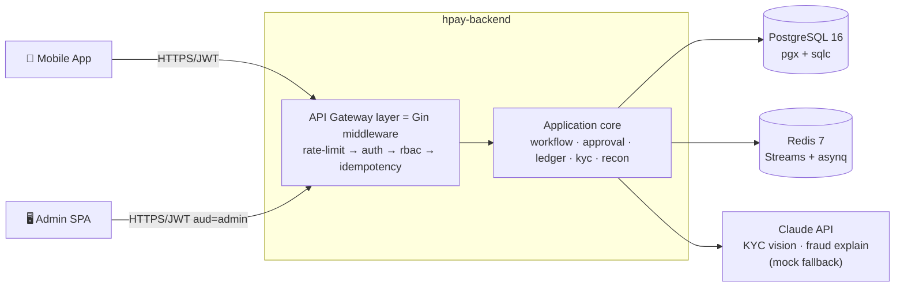

# Solution Architecture — hpay-backend (Golang)

> This doc is the official solution architecture for the `hpay-backend` repo. The domain model, SQL schema, workflow engine spec, and maker-checker are fully defined in [`00-backend-design-v2-base.md`](./00-backend-design-v2-base.md) — this doc does NOT repeat them; it only references them and adds the missing layers: security, non-functional requirements, the transaction-handling edge case matrix, deployment, and observability.

## 1. Scope & role in the system

| Repo | Role | Communication |
|---|---|---|
| `hpay-backend` | All business logic, ledger, workflow engine, approval, KYC, fraud, recon | Serves 2 clients over REST/JSON + JWT |
| `hpay-mobile` | End-user client | Calls the `/v1/*` (public) API group |
| `hpay-admin` | Internal operations client | Calls the `/v1/admin/*`, `/v1/org/*` API groups |

The backend is a **modular monolith in 1 binary** (reasons in base doc §2), but it exposes a versioned API (`/v1`) and clearly separated modules so that splitting services later does not require rewriting the contract.

## 2. Context diagram (C4 level 1–2)



## 3. Security Architecture

### 3.1. Authentication

| Item | Decision | Notes |
|---|---|---|
| Password | argon2id (t=3, m=64MB, p=2) | Not bcrypt, because we want to show an understanding of memory-hard hashing |
| Token | JWT access 15 minutes + refresh 30 days (rotated on every use) | The refresh token hash is stored in the `refresh_tokens` table; reuse detection → revoke the whole chain (theft detection) |
| Device binding | `device_id` sent at login, stored in the claim | Transaction from an unknown device → fraud rule `NEW_DEVICE` |
| OTP | `otp_challenges` table (base doc §3.4): hash, TTL 120s, max 3 attempts, creation rate-limit 1/30s | Dev/demo: code logged to the console + returned in the response when `ENV=dev` |
| Admin auth | Separate `admin_users` table + a dedicated JWT audience (`aud=admin`) | A mobile token can never call the admin API even if leaked |

### 3.2. Authorization (3 layers)

1. **RBAC middleware:** route groups are tagged with a minimum role — `/v1/admin/*` requires `admin_users`, `/v1/org/*` requires membership + the right role (`maker`/`checker`/`admin` in `org_members`).
2. **Row-level in queries:** every user-data query always carries an owner condition (`WHERE w.owner_id = $current_user`) — written in advance in the sqlc queries, not trusting the handler.
3. **State machine:** sensitive actions (approve, retry workflow) are valid only when the record is in an allowed state — enforced in the DB transaction, not only at the API.

### 3.3. API hardening

- Rate limit by (IP, user): login 5/minute, OTP 1/30s, transfer 10/minute — Redis sliding window.
- `Idempotency-Key` is required on every POST that creates a transaction; a duplicate key → return the old response (response snapshot stored for 24h).
- 2-layer input validation: DTO binding (go-playground/validator) + domain invariants (amount > 0, ≤ KYC tier limit).
- Responses do not leak: 4xx/5xx errors return standard error codes (`ERR_INSUFFICIENT_BALANCE`), never a stack trace/SQL; other people's balances never appear in a recipient lookup response (only a masked name: `Nguyen V** A`).
- Security headers + a CORS allowlist for the exact origin of the admin SPA; mobile does not need CORS.
- Secrets via env (12-factor), none in the repo; a complete `.env.example` with all keys.
- Audit log: table `audit_logs(actor_id, actor_type, action, resource, before, after, ip, created_at)` — written for every admin and checker action.

### 3.4. Data protection

- PII (the ID-card number extracted from KYC) is column-encrypted with AES-GCM, key from env (demo of KMS-style envelope: the data key is encrypted with a master key).
- KYC images are stored in simulated object storage (local folder / MinIO), with a signed URL valid for 5 minutes when an admin views them.
- Logs: middleware automatically masks the `password`, `otp`, `balance` fields — enforced via slog ReplaceAttr and checked by the `fintech-review` skill.

## 4. Transaction-handling Edge Case Matrix (tests mandatory)

| # | Situation | Handling mechanism | Expected result |
|---|---|---|---|
| E01 | Client sends a duplicate transfer request (double-tap / network retry) | `Idempotency-Key` UNIQUE | Exactly 1 transaction; request 2 receives the old response |
| E02 | 2 transactions withdraw from 1 wallet at once, total exceeds the balance | `SELECT FOR UPDATE` serializes them | 1 succeeds, 1 fails `ERR_INSUFFICIENT_BALANCE`; balance is not negative (the CHECK constraint is the last line of defense) |
| E03 | A→B and B→A simultaneously | Lock ordering by wallet_id | No deadlock, both complete |
| E04 | Worker dies midway after DEBIT is done, before CREDIT | Redis Streams not yet XACKed → XAUTOCLAIM hands it to another worker; handler is idempotent (checks `step_executions`) | The CREDIT step continues, no second debit |
| E05 | DB commits but event publish fails | Transactional outbox — the event sits in the DB, the relay re-publishes | No event lost |
| E06 | An event is published twice (relay retry) | The consumer checks `step_executions` (instance, step, attempt) before the side effect | Processed exactly once |
| E07 | CREDIT fails permanently after DEBIT succeeded (the receiving wallet is locked midway) | Saga compensation: post a reversing entry, transaction → `failed`, user gets a refund notification | Ledger balances, with a full trail (no entry deleted) |
| E08 | Checker A and B press approve at the same time in a tier needing 1 approval | `FOR UPDATE` on `transaction_approvals` + UNIQUE(approval_id, checker_id) | 1 action is recorded as finalize, the later action gets `ERR_ALREADY_FINALIZED` |
| E09 | Admin edits the policy while an order is awaiting approval | `policy_snapshot` captured at creation | The old order follows the old policy, new orders follow the new policy |
| E10 | An org order awaiting approval for more than 24h | `expires_at` + a sweeping cron → approval `expired`, workflow fails cleanly | No order hangs forever, the maker is notified |
| E11 | Wrong OTP 3 times | `attempts >= max_attempts` → challenge invalidated, a new challenge must be requested; 5 consecutive failed challenges → approve is locked for 15 minutes | Brute-force protection |
| E12 | User is locked (fraud) while a transaction is mid-workflow | The VALIDATE step has passed, but every wallet step re-checks `account_status` in the same tx | The transaction fails in a controlled way, compensation if needed |
| E13 | Amount is 0, negative, or exceeds the KYC tier limit | Validator + CHECK constraint | Rejected before the workflow is created |
| E14 | Transfer to oneself | CHECK `no_self_transfer` + validation at the API | `ERR_SELF_TRANSFER` |
| E15 | Top-up: bank callback (simulated) arrives twice | Idempotent by the statement `ref_code` | Money is credited exactly once; the 2nd is recorded as a duplicate for recon |
| E16 | Clock skew / a transaction straddling midnight | Recon matches by `ref_code`, not only by date; cutoff-mismatched items are classified separately | No false mismatch reports |
| E17 | Redis is completely down | The create-transaction API still writes DB + outbox; the engine stops progressing, instances stay in their current state | No data loss; when Redis is back, the relay + XAUTOCLAIM resume automatically. Health check reports degraded |
| E18 | A new migration breaks the schema | CI job runs migrate up+down on a clean DB before merge | Never reaches prod |

Every E* row must have at least 1 corresponding integration test (testcontainers), named `TestEdge_E01_...` — CI fails if one is missing (a script counts coverage against the list).

## 5. Non-Functional Requirements

| Group | Requirement | How it is achieved |
|---|---|---|
| Consistency | The ledger always balances; balance = derived from the ledger | ACID + a daily internal recon (SUM ledger vs wallets.balance) |
| Latency | p95 read API < 100ms, end-to-end transfer < 2s (through 4 async steps) | Proper indexes (base doc §3), consumer prefetch |
| Demo target throughput | 100 TPS transfer on a laptop | Load test with k6, results placed in the README |
| Availability | Single-node is acceptable (portfolio), but no data loss in any failure | Outbox + Streams + idempotency (E04–E06) |
| Observability | Trace 1 transaction from the API → each step | `request_id` + `transaction_id` propagated through every log/event; an admin endpoint to view the timeline |
| Auditability | Every state change has an actor + timestamp | `step_executions`, `approval_actions`, `audit_logs` |

## 6. Repo structure of `hpay-backend`

Following base doc §7 exactly (cmd/, internal/, db/migrations/, .claude/skills/, .github/workflows/). Additions:

```
src/backend/
├── api/openapi.yaml          # contract-first; FE generates the client from this file
├── deployments/
│   ├── docker-compose.yml    # postgres, redis, minio, backend
│   └── Dockerfile            # multi-stage → distroless
├── scripts/
│   ├── loadtest/k6-transfer.js
│   └── check-edge-tests.sh   # CI: cross-check E01–E18 against existing tests
└── docs/ → symlink or copy from ../docs when packaging the repo separately
```

**Contract-first:** `api/openapi.yaml` is the source of truth for all 3 repos. The backend validates that handlers match the spec (oapi-codegen), mobile/admin generate a TypeScript client (openapi-typescript). Changing the API = edit the spec first → all 3 repos see the diff.

## 7. Environments & Deployment

| Env | Infrastructure | Notes |
|---|---|---|
| dev | local docker-compose | OTP returned in the response, Claude mock can be enabled via env |
| ci | GitHub Actions services | testcontainers |
| demo | 1 small VPS / Railway / Fly.io | HTTPS required, demo seed data |

Pipeline (base doc §8.3) + additions: `check-edge-tests.sh`, `govulncheck`, trivy image scan.

## 8. Accepted risks & trade-offs

| Trade-off | Reason for accepting | Escape hatch if scaling |
|---|---|---|
| Monolith in 1 binary | Portfolio, 1 dev, easy demo | Module boundaries + Streams already in place → split the consumers into a separate process first |
| Redis Streams instead of Kafka | Enough of the needed semantics (group, ack, claim), light to operate | An `EventBus` interface in code — swap the adapter |
| KYC images local/MinIO | No cloud cost | Storage interface, swap in an S3 driver |
| LLM in fraud is advisory only | Avoids non-determinism in money decisions | Keep this principle even when scaling |
