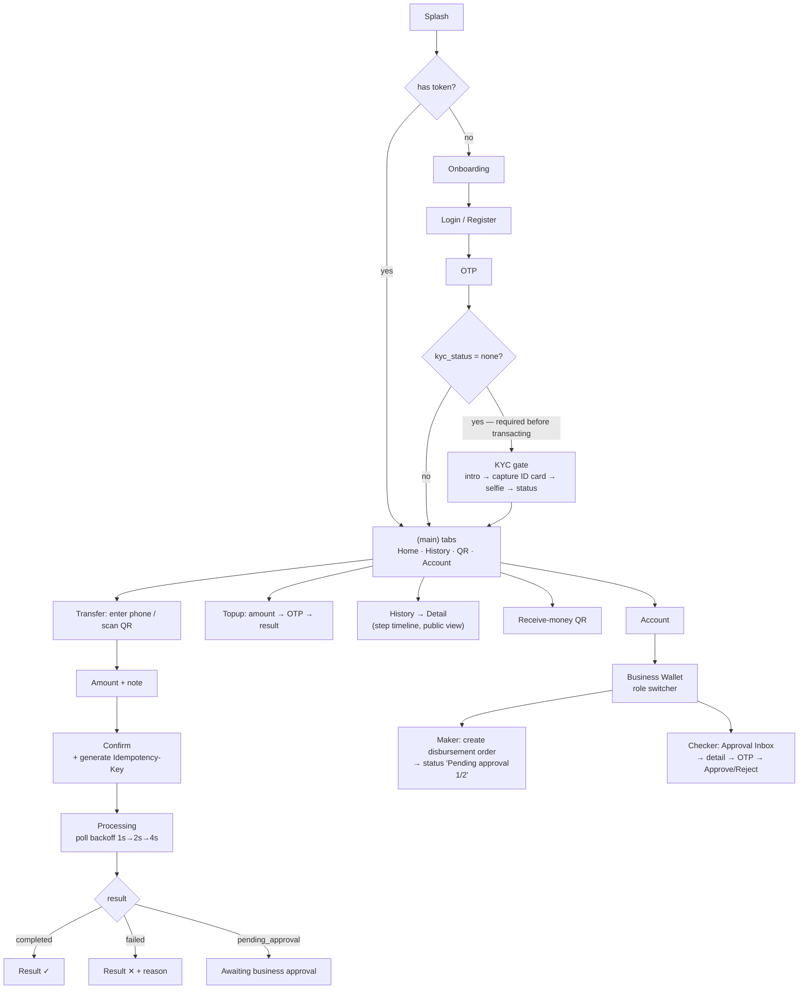

# Solution Architecture — hpay-mobile (React Native / Expo)

> The end-user client of HPay. This doc defines the app architecture, navigation, state, client-side security, and how to handle the network/transaction situations that a real e-wallet must cover. For detailed UI see [`../design/ui-design-spec.md`](../../design/ui-design-spec.md).

## 1. Stack

| Layer | Technology | Reason |
|---|---|---|
| Framework | Expo SDK (React Native, TypeScript strict) | Fast build/OTA update, enough native modules |
| Navigation | expo-router (file-based) | Deep links out of the box (open the app from an order-approval notification) |
| Server state | TanStack Query | Cache, retry, polling — fits the async transaction model |
| Client state | Zustand (lightweight) | Holds only session + UI state, no server data stuffed in |
| Form | react-hook-form + zod | Validation schema shareable with the API DTO |
| API client | Generated from `api/openapi.yaml` (openapi-typescript + fetch wrapper) | Contract-first, no hand-written endpoints |
| Secure storage | expo-secure-store (Keychain/Keystore) | Tokens never live in AsyncStorage |
| Camera/QR | expo-camera, expo-barcode-scanner | KYC + QR scanning |

## 2. Repo structure

```
src/mobile/
├── app/                        # expo-router routes
│   ├── (auth)/                 # login, register, otp
│   ├── (kyc)/                  # intro, capture-id, capture-selfie, status
│   ├── (main)/                 # tab navigator
│   │   ├── home.tsx            # balance + quick actions + recent transactions
│   │   ├── history.tsx
│   │   ├── qr.tsx
│   │   └── account.tsx
│   ├── transfer/               # transfer flow (enter → confirm → result)
│   ├── topup/
│   └── org/                    # Business: create order (maker), approve order (checker)
├── src/
│   ├── api/                    # generated client + interceptors (auth, idempotency)
│   ├── features/<domain>/      # hooks + components per domain (wallet, kyc, approval…)
│   ├── stores/                 # zustand: session, device
│   ├── lib/                    # money format (BigInt-safe), masking, polling helpers
│   └── ui/                     # design system components (1-1 mapping with Figma)
├── e2e/                        # maestro flows
└── .claude/skills/             # gen-screen, gen-feature-hook (similar to the backend skills)
```

## 3. Main screen flow



## 4. Client-side transaction handling — cases that must be covered

| # | Situation | Handling |
|---|---|---|
| M01 | User double-taps the "Transfer" button | Disable the button immediately on tap + the `Idempotency-Key` is generated once for the whole confirm flow (a UUID created when entering the confirm screen, not when pressing) |
| M02 | Request timeout / network lost after pressing transfer | Do NOT rush to show "failed" — switch to the Processing screen, poll `GET /transactions/:refCode` using the idempotency retry itself; poll timeout 30s → "Processing, check again in History" |
| M03 | Async transaction not yet finished (workflow running) | The Processing screen polls 1s→2s→4s (backoff); the `pending_approval` status is shown separately as "Awaiting business approval" |
| M04 | Access token expires mid-flow | The interceptor refreshes automatically (single-flight, queued requests wait); refresh fails → back to Login but KEEP the form draft |
| M05 | Refresh token revoked (logged in on another device / theft detection) | Force logout + a clear explanation of the reason |
| M06 | Amount entry | Accept integer VND only, thousands-separator formatting while typing, block pasting of odd characters; parse via string→BigInt, never passing through a JS float |
| M07 | App goes to background while on the OTP/confirm screen | Blur the entire app content with a native Blur effect to protect the user's sensitive information (like VCB Digibank) when the app enters the Task Switcher (background). If the OTP TTL is still valid keep it, otherwise tell the user to request a new one. |
| M08 | "Approve order" deep link while not logged in | Save the pending route → navigate onward after login |
| M09 | Checker opens an order already approved/rejected by someone else | The UI handles `ERR_ALREADY_FINALIZED`: refresh the inbox, toast the new status |
| M10 | KYC image is blurry/dark | Client-side check (blur/brightness heuristic) before upload, guide the user to retake — reduces reject loops |
| M11 | KYC upload drops mid-way | Upload the 2 images separately, resume by request id; draft state saved locally |
| M12 | Long history list | Cursor pagination + `FlashList`; pull-to-refresh does not jump position |

## 5. Client-side security

- Tokens in SecureStore; no token/OTP logging; console.log is stripped in production builds.
- Certificate pinning (expo-ssl-pinning) for the API domain — a demonstrable mobile security interview point.
- Root/jailbreak detection (expo-device heuristics) → warn only, do not block (portfolio).
- Hide screenshots on sensitive screens (OTP, balance) on Android (`FLAG_SECURE`), and on iOS hide when entering the app switcher.
- Session idle 5 minutes → require local biometric/passcode (expo-local-authentication) to reopen the Home tab.
- The receive-money QR contains a signed payload (HMAC from the server) with user_id + masked phone — the other client verifies via the API, not trusting the raw QR content.

## 6. Backend connection

- Base URL per env (dev/staging/demo) via `app.config.ts`.
- Every request carries the headers: `Authorization`, `X-Device-Id`, `X-Request-Id` (a uuid per request), `Idempotency-Key` (POST that creates a transaction).
- Error contract: the FE maps `ERR_*` codes (backend doc §3.3) to Vietnamese messages centrally in `src/lib/errors.ts` — no hardcoded messages scattered around.
- Realtime: do NOT use websockets for v1 — polling with backoff is enough and simple; leave a `TransactionWatcher` interface to later swap in SSE.

## 7. Testing

| Type | Tool | Scope |
|---|---|---|
| Unit | jest + testing-library | lib/money, error mapping, hooks |
| Component | testing-library | transfer form, OTP input |
| E2E | Maestro | 5 golden flows: register→KYC, top-up, P2P transfer, maker creates order, checker approves |
| Contract | openapi-typescript CI check | the generated client matches the latest spec |
