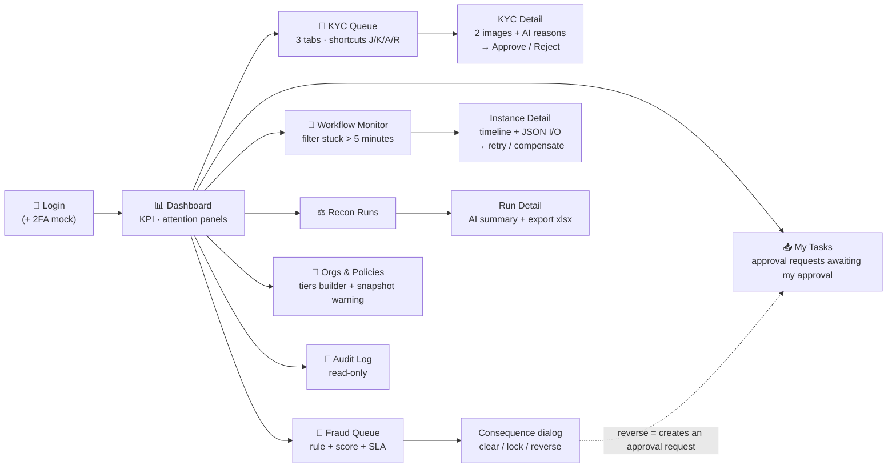

# Solution Architecture — hpay-admin (React)

> Internal operations dashboard: KYC review, fraud monitoring, workflow tracking, reconciliation. The users are operations staff — prioritize information density, fast keyboard-driven operations, and full audit. For detailed UI see [`../design/ui-design-spec.md`](../../design/ui-design-spec.md).

## 1. Stack

| Layer | Technology | Reason |
|---|---|---|
| Framework | React 18 + Vite + TypeScript strict | Pure SPA, no SSR needed (internal app behind VPN) |
| UI kit | shadcn/ui + Tailwind | Matches the Figma design tokens, has enough table/dialog/form |
| Router | TanStack Router | Type-safe routes + search params (filters kept in the URL) |
| Server state | TanStack Query | Queue polling, invalidation after actions |
| Table | TanStack Table | Server-side sort/filter/pagination |
| Chart | Recharts | Dashboard metrics |
| API client | Generated from `api/openapi.yaml` | Same contract as mobile |
| Form | react-hook-form + zod | |

## 2. Repo structure

```
src/admin/
├── src/
│   ├── routes/                 # TanStack Router file routes
│   │   ├── dashboard.tsx
│   │   ├── kyc/                # queue + detail
│   │   ├── fraud/              # flags queue + detail
│   │   ├── workflows/          # monitor + instance detail
│   │   ├── recon/              # runs + report
│   │   ├── orgs/               # organizations + policies
│   │   └── audit/              # audit log viewer
│   ├── features/<domain>/      # query hooks + components
│   ├── components/ui/          # shadcn, mapped to Figma tokens
│   └── lib/                    # api client, error map, money format, rbac helpers
├── e2e/                        # Playwright
└── .claude/skills/             # gen-crud-page: generates route+table+detail following the pattern
```

## 3. Internal RBAC

| Admin role | Permissions |
|---|---|
| `viewer` | View everything, no actions |
| `kyc_reviewer` | Approve/reject KYC |
| `risk_officer` | Handle fraud flags, lock accounts |
| `ops` | Retry workflows, view recon, export |
| `superadmin` | Everything + manage admin users |

The FE hides actions by role (UX), while the backend remains the real enforcement point (backend doc §3.2). Every action writes `audit_logs`, with a mandatory reason input (rejecting KYC or locking an account must have a reason of ≥ 10 characters).

## 4. Screens & business logic



### 4.1. Dashboard

KPI cards (new users, txn count, volume, fail rate) + an hourly volume chart + an "needs attention" panel: KYC waiting > 1h, open fraud flags, workflows stuck > 5 minutes, yesterday's recon mismatch. Each panel click-throughs to the corresponding queue.

### 4.2. KYC Review

- 3 tabs by `ai_verdict`: auto_approved (view/spot-check only), manual_review (the main queue), rejected.
- Detail: 2 images side by side (URL signed for 5 minutes), `ai_score` + `ai_reasons` shown as a suggestion checklist, user information, prior KYC history.
- Actions: Approve / Reject (+ reason). Shortcuts `A`/`R`/`J`/`K` move through the queue — the reviewer processes in bulk quickly.
- Covered case: 2 reviewers open the same case → optimistic lock (`updated_at` as the version), the later one gets a conflict and refreshes.

### 4.3. Fraud Monitor

- Queue of open `fraud_flags`: columns rule_code, score, txn ref, user, flag age. Expanding a row shows `reasons` (LLM explanation + rule hits).
- Actions: `Mark safe` (clear) / `Confirm fraud` → a dialog to choose the consequence: lock the account, reverse the transaction (if not yet completed cancel the workflow, if completed create a reversal — calls the proper backend API, the FE does not decide the logic itself).
- SLA hint: a flag unhandled for > 30 minutes is highlighted red.

### 4.4. Workflow Monitor (demo highlight)

- Instance table: filter by status (`running`, `waiting_approval`, `failed`, `compensating`), definition, stuck time.
- Instance detail: a vertical timeline of each `step_executions` — attempt, input/output JSON (the viewer has collapse + copy), error, time. Exactly the observability spirit of the base doc.
- Actions by state: `Retry step` (failed), `Force fail + compensate` (stuck manual), with confirm + reason. Disabled exactly per the state machine — the FE reads `allowed_actions` from the API instead of inferring it itself.

### 4.5. Reconciliation

- List of runs by day: matched/mismatched, result badge.
- Run detail: an items table filtered by `result`; an AI summary panel (generated by the backend); an export xlsx button (the backend returns the file, the FE only downloads).
- Covered case: a run in progress → status `running` + auto-refresh; a day without a run → a manual trigger button (role ops).

### 4.6. Organizations & Policies

- CRUD for orgs, members (assign maker/checker + level), policies (amount range + a visual tiers builder: drag the number of approvals per level).
- Show a warning when editing a policy: "Pending orders keep the old policy snapshot" — exactly the backend E09 semantics.

### 4.7. Audit Log

A read-only table, filtered by actor/action/resource/time range. Immutable — no button other than export.

## 5. Operational FE edge cases

| # | Situation | Handling |
|---|---|---|
| A01 | An action happens just as the record changes state (handled elsewhere) | The backend returns 409 + the new state → the FE toasts + updates the row in place, without reloading the whole table |
| A02 | Long queue, the reviewer is on page 3, new data is pushed in | Server-side cursor pagination, no offset (avoids row drift) |
| A03 | Admin token expires mid review session | Single-flight refresh like mobile; on failure → a re-login modal that preserves the URL + filter (all in search params) |
| A04 | The signed KYC image URL expires while viewing | Image error → automatically request a new URL once, beyond that report it |
| A05 | 2 browser tabs operating at the same time | Every mutation relies on a version/state check in the backend; the FE handles 409 uniformly via an interceptor |
| A06 | Heavy xlsx export | Backend async job → the FE polls + notifies when ready, never freezing the UI |
| A07 | The step's JSON input/output contains PII | The backend pre-masks before returning (`***`), the FE never receives raw — cannot leak from DevTools |

## 6. Internal app security

- JWT audience `admin`, short TTL (10 minutes) + refresh; idle 15 minutes → lock the screen.
- Strict CSP (no inline script), nothing stored in localStorage other than UI prefs — the token is kept in memory + an httpOnly refresh cookie (SameSite=Strict).
- Route guard by role; every page has a `RequireRole` wrapper.
- No "God mode": even superadmin goes through the audit log.

## 7. Testing

| Type | Tool | Scope |
|---|---|---|
| Unit | vitest | rbac helpers, error map, money format |
| Component | testing-library | tiers builder, JSON viewer, confirm dialogs |
| E2E | Playwright | 4 flows: KYC review, fraud resolve, workflow retry, recon export |
| Contract | CI check client vs openapi.yaml | same mechanism as mobile |
