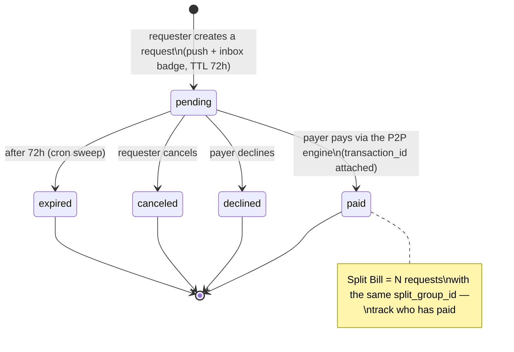

# Feature Extensions v2.1 — learning from TMDS Wallet & MoMo, keeping the "American wallet" soul

> Reference sources: the TMDS Wallet Flow Overview (a production retail wallet in Thailand — a 3-step engine, GL, settlement, 18 feature groups) and the patterns of MoMo/Venmo/Cash App/Revolut. **Principle: HPay's core logic stays unchanged** (event-driven workflow engine, double-entry ledger, human-in-the-loop maker-checker, outbox, idempotency). This doc only adds to, and does not replace, the design in docs 00/01.

## 1. Assessment of TMDS — what to take, what to drop

| TMDS pattern | Comment | Decision |
|---|---|---|
| 3-step engine Request→Confirm→Verify, `transactionTrail` throughout | The same philosophy as the earlier DEH docs. Our workflow engine is more general (N configurable steps, with a human gate) | **Keep our engine.** Only learn the invariant: after `completed` the state is IMMUTABLE, and to refund you must use a reversal |
| `processing` state (code 9999 — slow partner) + cron recovery replay | Very practical: an async error is not failed but "recoverable" | **Take.** Add the txn status `processing_async` + a `recover_stuck` job that sweeps stuck instances and replays the step (idempotent already) |
| Void/Reversal = a passive reversing entry, not going through the engine; operators must go through maker-checker | Matches our immutable ledger | **Take.** Standardize the reversal flow: swap Dr/Cr from the original ledger, add a `transactions.reversal_of` column |
| Maker-checker for **18 types of admin operations** (adjustment, lock user, config change…), not only transactions | This is the biggest insight: the approval engine is shared infrastructure, not a feature of the org wallet alone | **Take.** Generalize `transaction_approvals` → `approval_requests(subject_type, subject_id)`: used for org txn, admin reversal, account lock, policy change |
| Offer factory: fee/tax/discount catalogue + distribution rules | We currently hardcode fee=0 | **Take a lean version:** a `fee_policies` table (fixed + % + min/max per txn_type + KYC tier). Drop the complex tax/distribution |
| RTP — Request to Pay in 2 stages (create a request → the payer pays through the engine) | This is exactly Venmo's "Request" and MoMo's "debt reminder" | **Take — the new flagship feature** (§2.1) |
| 1 codebase deployed in 3 MODEs (mobile/admin/ppin) deciding routes + queue consumers | Elegant for a modular monolith | **Take.** `HPay serve --role=api\|worker\|admin\|all` — demo scale-out without splitting code |
| Runtime config reload via Redis pub/sub to every pod | A good ops story | **Take a lean version:** an `app_configs` table + feature flags, a refresh endpoint |
| Notification with 4 priority levels/channel | Nice but we only need 2 levels | Take the idea: asynq queue `critical` (OTP) vs `default` |
| Biometrics only for login, NOT for transaction authentication | A correct auth principle | **Take the principle**, record it in 02-mobile (fix the auth matrix) |
| GL settlement biller→aggregator→bank, SFTP, PromptPay rails, Node-RED, DipChip agent | Specific to Thai banks / real partner systems | **Drop.** Outside portfolio scope, no real partner to integrate with |
| Sails.js/MongoDB/AngularJS, 200 collections, external cron scheduler | Legacy stack | **Drop** — the stack we settled on is more modern |

## 2. New features (keeping the American-wallet vibe)

### 2.1. Request Money — "Ask for money / Debt reminder" (P1 ⭐ flagship)



Venmo Request + MoMo debt reminder, running on the existing infrastructure — Stage 1 creates the request, Stage 2 the payer pays through the existing `p2p_transfer` workflow:

```sql
CREATE TYPE money_request_status AS ENUM ('pending','paid','declined','expired','canceled');
CREATE TABLE money_requests (
    id             UUID PRIMARY KEY DEFAULT gen_random_uuid(),
    requester_id   UUID NOT NULL REFERENCES users(id),
    payer_id       UUID NOT NULL REFERENCES users(id),
    amount         BIGINT NOT NULL CHECK (amount > 0),
    note           VARCHAR(255),
    split_group_id UUID,                              -- NULL if not a bill split
    status         money_request_status NOT NULL DEFAULT 'pending',
    transaction_id UUID REFERENCES transactions(id),  -- attached when paid
    expires_at     TIMESTAMPTZ NOT NULL,              -- default 72h
    created_at     TIMESTAMPTZ NOT NULL DEFAULT now(),
    CONSTRAINT no_self_request CHECK (requester_id <> payer_id)
);
```

Includes **Split Bill**: choose N people + a total amount → split evenly/custom → generate N money_requests with the same `split_group_id`, plus a screen tracking who has paid. UI: inbox badge, swipe to pay quickly, a Venmo-style avatar stack.

### 2.2. Vaults — savings jars (P2, MoMo "Tui Than Tai" / Revolut Vault)

The wallets schema already has a unique `owner_type+owner_id+currency` — relax it into multiple wallets per user with a `purpose` column:

```sql
ALTER TABLE wallets ADD COLUMN purpose VARCHAR(20) NOT NULL DEFAULT 'main';  -- main | vault
ALTER TABLE wallets ADD COLUMN label   VARCHAR(60);                          -- "Da Lat trip 🏔"
-- the unique constraint changes to (owner_type, owner_id, currency, purpose, label)
```

Moving main↔vault is a transaction type `vault_move` that runs through the engine as usual (2 postings, same invariants). Stretch: round-up — every small spending transaction automatically drops the rounding remainder into the vault (add 1 optional `ROUND_UP` step in the definition — exactly the place to show off the configurable engine).

### 2.3. Generalized approval engine (P1 — architecture upgrade)

Rename `transaction_approvals` → `approval_requests` with a `subject_type` (`org_transaction` | `admin_reversal` | `account_lock` | `policy_change`), keeping the policy snapshot + evaluate + OTP unchanged. An admin who wants a reversal/account lock → creates a request → another admin approves (exactly the TMDS principle: Maker ≠ Checker even within internal operations). The admin "My Tasks" screen = the queue of requests awaiting my approval.

### 2.4. Lean fee engine (P1)

```sql
CREATE TABLE fee_policies (
    id          UUID PRIMARY KEY DEFAULT gen_random_uuid(),
    txn_type    txn_type NOT NULL,
    kyc_tier    kyc_status,                 -- NULL = every tier
    fixed_fee   BIGINT NOT NULL DEFAULT 0,
    percent_bp  INT NOT NULL DEFAULT 0,     -- basis points (25 = 0.25%)
    min_fee     BIGINT NOT NULL DEFAULT 0,
    max_fee     BIGINT,
    is_active   BOOLEAN NOT NULL DEFAULT true,
    version     INT NOT NULL DEFAULT 1
);
```

The fee is computed in the VALIDATE step, shown as a preview before confirm (learning from TMDS's enquiry-first UX), and the fee posting goes to the `SYSTEM_FEE` wallet. Changing a fee via admin → must go through an approval request (§2.3).

### 2.5. Scheduled & recurring transfer (P2, Cash App style)

A table `scheduled_transfers(user_id, receiver, amount, cron_expr, next_run_at)` + an asynq scheduler creating a transaction that runs the workflow as usual. A show-off point: cron → engine → idempotency (key = schedule_id + run_date, never runs twice).

### 2.6. The processing_async state + recovery (P1)

Add the value `processing_async` to the `txn_status` enum; the `recover_stuck` job (asynq, every 5 minutes) sweeps `workflow_instances` in `running`/`compensating` beyond a threshold → replays the current step (handlers are idempotent already — E04/E06 cover this). Maps to the admin Workflow Monitor "stuck > 5 minutes" screen.

### 2.7. Deploy role (P1, ~0 cost)

`HPay serve --role=api|worker|admin|all`: `api` mounts only the public HTTP, `worker` only consumes streams + asynq, `admin` mounts the admin API + cron endpoints, `all` for dev. Demo: one command yields 3 role-split processes — answering the interview question "how does this monolith scale".

### 2.8. QR with amount + payment link (P2, MoMo/Venmo)

QR v2: a payload signed with HMAC containing `user_id + amount + note + exp`. Accompanied by a link `HPay.app/pay/<token>` shared via chat — opening the app goes straight to the confirm screen.

## 3. Not doing (and why)

Integration with real billers/telcos, multi-tier settlement biller→aggregator→bank, SFTP reconciliation with a real bank, DipChip agent onboarding, seasonal lucky-money (li xi), a MoMo-style mini-app ecosystem — all need real partners or deviate from the positioning of "a P2P wallet + a clean American-style business wallet". A portfolio scores on the technical depth of the core, not on feature breadth.

## 4. Impact on existing documents

| Doc | Change |
|---|---|
| `00-backend-design-v2-base.md` | Unchanged. The schema delta lives in this doc, to be merged into migrations when coding |
| `01-backend-solution-architecture.md` | Add edge case E19 (a money request expires exactly as it is being paid), E20 (a recovery replay collides with a running step — needs a lease/lock per instance) |
| `02-mobile-solution-architecture.md` | Fix the auth matrix per the TMDS principle: biometrics ONLY unlock the app; transferring money = PIN/OTP. Add screens: Request Money (3), Split Bill (2), Vaults (2) |
| `03-admin-solution-architecture.md` | Add "My Tasks" (the approval requests queue), reversal via maker-checker instead of a direct action in the Fraud dialog |
| `design/ui-design-spec.md` | +7 mobile screens (Request/Split/Vault), +1 admin screen (My Tasks); new components: `RequestCard`, `SplitAvatarStack`, `VaultCard` |
| Roadmap | P1 (§2.1, 2.3, 2.4, 2.6, 2.7) in weeks 3–4; P2 (§2.2, 2.5, 2.8) after week 5 if time permits |

## 5. New interview points gained from this round

1. "I read the architecture of 2 production wallet systems (a corporate wallet + a Thai retail wallet) and **selected critically**: took the invariants and operating patterns, dropped the partner-specific parts."
2. "My approval engine is shared infrastructure: from business disbursement approval to admin reversals — the same state machine, the same policy snapshot."
3. "The `processing_async` state + recovery job: I distinguish terminal errors from recoverable ones — a money system must not be allowed to 'forget' a transaction left hanging."
