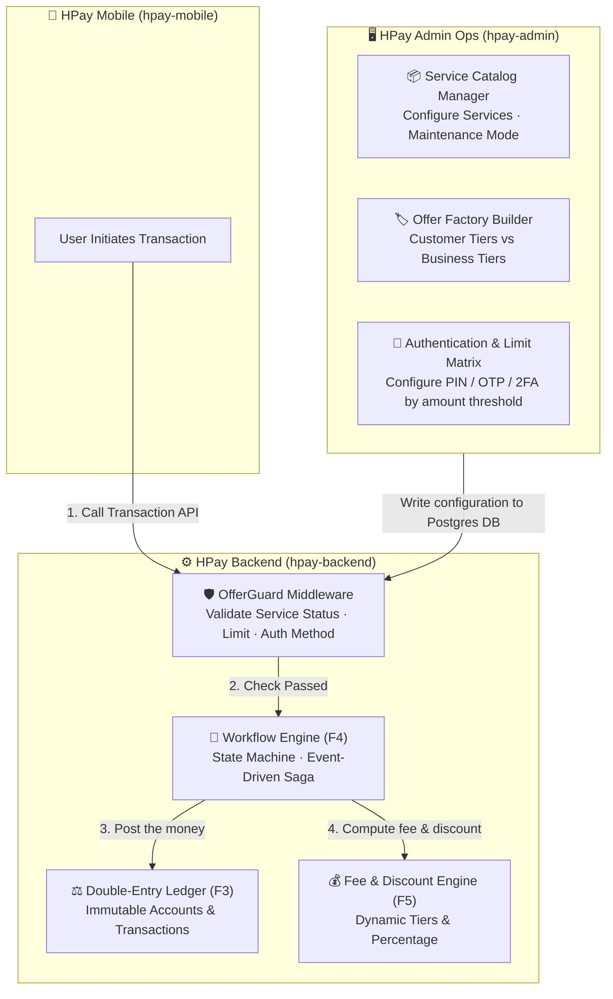
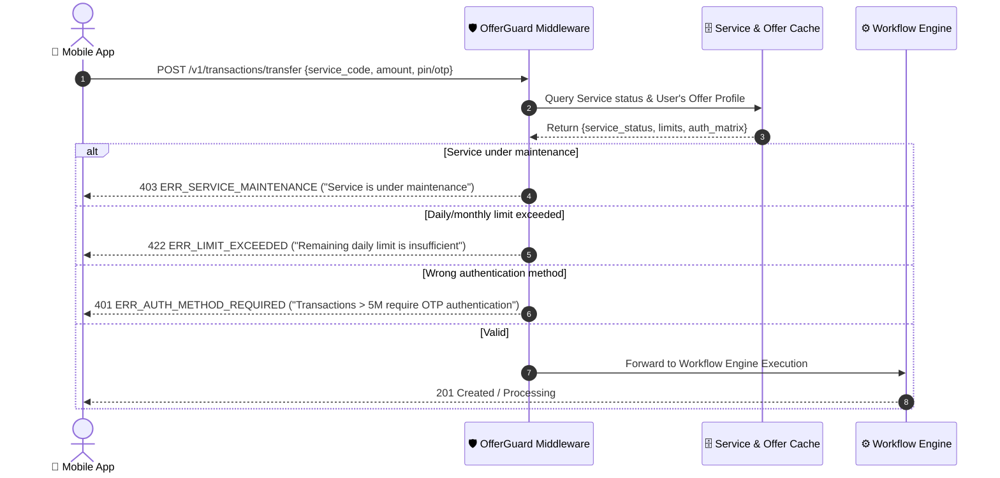

# 05 — Offer Factory & Service Catalog Architecture (Enterprise Product Engine)

> **Source of inspiration:** an Enterprise financial services governance framework (Digital Engagement Payment Platform / Offer Factory). Simplified into a flexible architecture for HPay: separating the **Executable Core (Workflow & Ledger Engine)** from the **Dynamic Product Configuration (Service Catalog, Offer Factory & Authentication Matrix)**.

## 1. Overview & Motivation

In traditional payment systems, transaction parameters (limits, the authentication method PIN/OTP, the on/off state of a service) are often hardcoded in the processing logic of each API. This makes operations difficult:

- To temporarily lock a service (for example: maintenance of the P2P Transfer or Withdrawal feature) you must change backend code or gateway configuration.
- It is hard to tier different product packages between **Personal Customers** (Personal Customer Level 1, 2) and **Businesses** (Business Starter, Enterprise).
- Authentication requirements (PIN vs OTP vs 2FA) are fixed and cannot be flexibly adjusted according to monetary risk thresholds.

The **Offer Factory & Service Catalog** architecture lets Admin Ops easily configure all of these rules in the Admin UI **without restarting the server or changing backend code**.

## 2. Overall Architecture Diagram



## 3. Database Schema (Delta)

Additional table design in PostgreSQL supporting the Service Catalog and Offer Factory:

```sql
-- 1. Service Catalog
CREATE TYPE service_status AS ENUM ('active', 'maintenance', 'disabled');
CREATE TABLE services (
    id             UUID PRIMARY KEY DEFAULT gen_random_uuid(),
    code           VARCHAR(50) UNIQUE NOT NULL,       -- P2P_TRANSFER, MONEY_REQUEST, ORG_DISBURSEMENT
    name           VARCHAR(100) NOT NULL,
    category       VARCHAR(50) NOT NULL,              -- transfer, payment, org, wallet
    status         service_status NOT NULL DEFAULT 'active',
    action_priority VARCHAR(20) NOT NULL DEFAULT 'before_gl', -- before_gl | after_gl
    created_at     TIMESTAMPTZ NOT NULL DEFAULT now()
);

-- 2. Product Packages / Subject Tiering (Offer Factory)
CREATE TYPE offer_role AS ENUM ('customer', 'agent', 'merchant', 'biller', 'operator');
CREATE TABLE offers (
    id             UUID PRIMARY KEY DEFAULT gen_random_uuid(),
    code           VARCHAR(50) UNIQUE NOT NULL,       -- OFFER_CUST_L1, OFFER_CUST_L2, OFFER_BIZ_ENT
    name           VARCHAR(100) NOT NULL,
    role           offer_role NOT NULL DEFAULT 'customer',
    level          INT NOT NULL DEFAULT 1,            -- Level 1 to 20
    is_active      BOOLEAN NOT NULL DEFAULT true,
    created_at     TIMESTAMPTZ NOT NULL DEFAULT now()
);

-- 3. Service configuration within an Offer package (Offer Services & Limits)
CREATE TABLE offer_services (
    id                 UUID PRIMARY KEY DEFAULT gen_random_uuid(),
    offer_id           UUID NOT NULL REFERENCES offers(id) ON DELETE CASCADE,
    service_id         UUID NOT NULL REFERENCES services(id) ON DELETE CASCADE,
    is_enabled         BOOLEAN NOT NULL DEFAULT true,
    min_amount         BIGINT NOT NULL DEFAULT 0,
    max_amount_per_txn BIGINT NOT NULL DEFAULT 100000000, -- 100M VND
    daily_limit        BIGINT NOT NULL DEFAULT 500000000, -- 500M VND
    monthly_limit      BIGINT NOT NULL DEFAULT 2000000000,-- 2 billion VND
    interval_seconds   INT NOT NULL DEFAULT 0,            -- Minimum seconds between 2 transactions
    UNIQUE(offer_id, service_id)
);

-- 4. Authentication Matrix by Amount Threshold
CREATE TYPE auth_method_enum AS ENUM ('none', 'pin', 'otp', '2fa');
CREATE TABLE offer_auth_matrix (
    id               UUID PRIMARY KEY DEFAULT gen_random_uuid(),
    offer_service_id UUID NOT NULL REFERENCES offer_services(id) ON DELETE CASCADE,
    min_amount       BIGINT NOT NULL DEFAULT 0,
    max_amount       BIGINT,                            -- NULL = unlimited
    auth_method      auth_method_enum NOT NULL DEFAULT 'pin',
    created_at       TIMESTAMPTZ NOT NULL DEFAULT now()
);
```

## 4. Runtime Flow (OfferGuard Middleware)

When a user performs a transaction on Mobile or Web, the system checks through 4 protection steps:



## 5. Admin Ops Screen Plan (hpay-admin)

| Admin screen | Main functions | Backend APIs |
|---|---|---|
| **Service Catalog (`/services`)** | Manage the list of financial services, toggle Maintenance Mode instantly, view statistics on the number of Offers using a service. | `GET /v1/admin/services`<br>`POST /v1/admin/services`<br>`PUT /v1/admin/services/:id` |
| **Offer Factory (`/offers`)** | Create & edit Offer packages (Customer / Business tiering), assign the list of Services allowed to be accessed, configure transaction limits (Per-transaction/Day/Month). | `GET /v1/admin/offers`<br>`POST /v1/admin/offers`<br>`PUT /v1/admin/offers/:id` |
| **Authentication Matrix Manager** | Configure a flexible Authentication Matrix (e.g. under 2M use PIN/Biometrics; from 2M-50M use OTP; above 50M use 2FA PIN+OTP). | `PUT /v1/admin/offers/:id/auth-matrix` |

---

HPay Architecture Docs · 05 — Offer Factory & Service Catalog Architecture · 2026
