# HPay — a digital wallet & business payments platform

**Functional Overview by Role** · Product introduction document · for presenting to the team

See also: [Technical guide](technical-overview.md) · [Project overview](../overview-v2.md)

HPay is an end-to-end digital wallet system, built in the style of popular US wallet apps (Venmo, Cash App, Revolut): instant P2P transfers, payment requests & split bills, plus a **business wallet with two-layer dual-control approval (maker–checker)** — where one person creates a payout request and one or more other people must sign off before the money actually moves. Every dollar flows through a **configurable workflow engine** sitting on top of an **immutable double-entry ledger**.

- 3 roles: personal → business → operations
- Mobile app (Expo/React Native)
- Admin web (React)
- Backend in Go

Contents:

1. [Personal user — Mobile app](#personal-user--mobile-app)
2. [Business wallet — Maker & Checker](#business-wallet--maker--checker)
3. [Operations team — Admin web](#operations-team--admin-web)
4. [Background infrastructure — not tied to any one role](#background-infrastructure--not-tied-to-any-one-role)

Each feature below has a description, key steps and a flow diagram.

---

## Personal user — Mobile app

**Tag: PERSONAL USER**

Anyone can download the app and sign up with a phone number. One personal wallet covers everyday money needs: topping up, sending money to friends, requesting money back, and saving.

### 01. Sign up & log in

Badge: Onboarding

Sign up with a phone number and password. Sessions use a self-rotating access/refresh token pair — if a refresh token is stolen and reused, every session on every device is revoked immediately. After that, the app can be unlocked quickly with Face ID/fingerprint.

**Key steps**

1. Enter phone number + password
2. The system issues a short-lived access token and a long-lived refresh token
3. The app silently refreshes the access token when it expires — no forced re-login
4. Next time: Face ID/fingerprint unlocks the app quickly — but it does NOT replace the PIN required to move money

**Flow diagram**

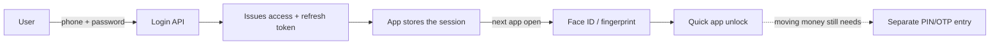

### 02. Identity verification (KYC)

Badge: KYC

Take a photo of your ID card plus a selfie. An AI reads the images and automatically scores their trustworthiness — a high score approves instantly, a borderline score routes to an ops reviewer (with the AI's explanation attached), and a very low score is rejected outright. Once verified, your daily transaction limit goes up.

**Key steps**

1. Photograph your ID document
2. Take a selfie for face matching
3. AI (Claude vision) returns a trust score plus reasons
4. High score → auto-approved · borderline score → human reviewer · low score → rejected
5. Once approved: your daily transaction limit increases based on your KYC tier

**Flow diagram**

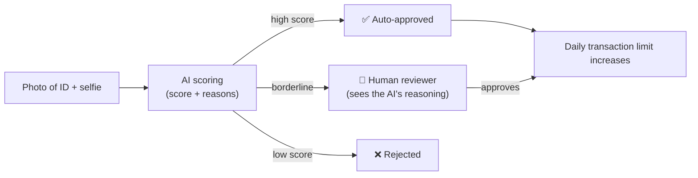

### 03. Top up the wallet

Badge: Topup

Top up from a bank (simulated in this demo) with OTP verification. This action is safe to retry — the system never credits the same top-up twice.

**Key steps**

1. Choose the top-up amount
2. Verify with an OTP sent to your phone
3. The bank confirms (mock) → money lands in the wallet instantly
4. If the app freezes/loses connection mid-way and the user retries: the system recognizes it as the same request and does not double-credit

**Flow diagram**

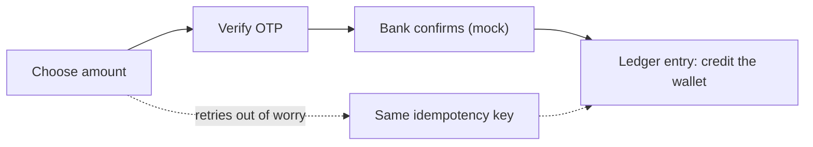

### 04. P2P money transfer

Badge: Core

Send money instantly to another user by phone number. Before confirming, the app clearly shows the fee (if any). After sending, there is a real-time progress screen instead of just "success"/"failed" — because a whole chain of processing steps runs behind the scenes.

**Key steps**

1. Enter the recipient's phone number and the amount
2. Preview the transaction fee (if any)
3. Confirm with a PIN
4. The transaction runs through the workflow engine — a status screen tracks it
5. The recipient gets the money and both sides are notified

**Flow diagram**

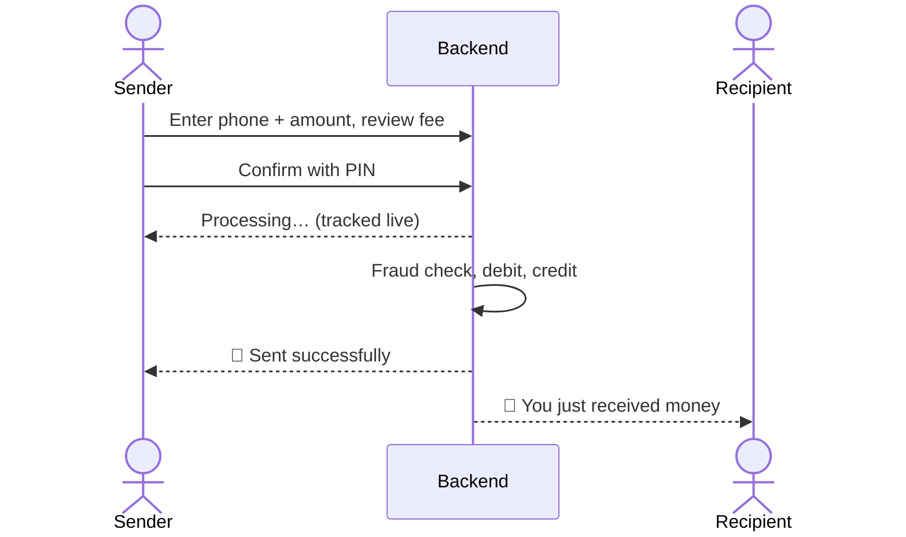

### 05. Request Money & Split Bill

Badge: Request Money

Like Venmo/MoMo: nudge someone to pay you back a specific amount, with a note explaining why. "Split Bill" creates several requests at once for a group of people — with a visual tracking screen (avatars of people who've paid stand out, unpaid ones are dimmed) plus a progress bar showing how much has been collected out of the total.

**Key steps**

1. Pick who to remind, the amount, and the reason
2. Send the request — the other person is notified, with a 72-hour deadline
3. They tap "Pay" → the money moves exactly like a normal P2P transfer
4. The request automatically flips to "paid" and the requester is notified
5. For a group: see a progress bar plus who has/hasn't paid, and "nudge" the ones still owing

**Flow diagram**

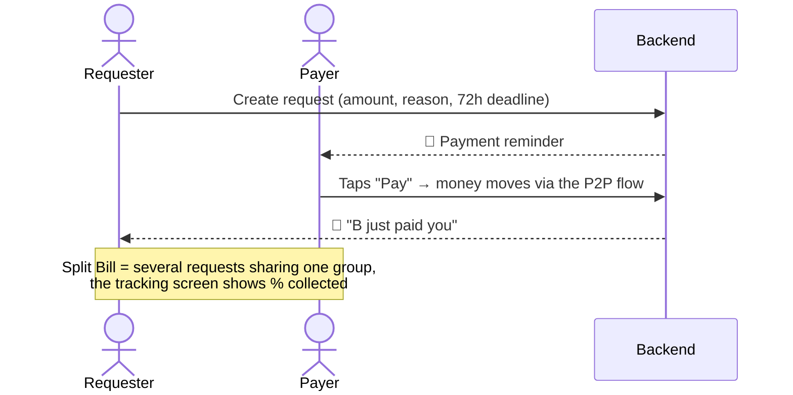

### 06. Receive money via QR

Badge: QR

Generate a personal QR code so others can scan and send money without typing a phone number. The QR can be pre-loaded with a specific amount (e.g. a shop owner generating a 50,000 VND QR) so the payer just scans and confirms.

**Key steps**

1. Open "My QR"
2. (Optional) pre-fill the amount to collect
3. The payer scans the code with the app's camera
4. The app pre-fills the recipient (and the amount, if set) — the payer just confirms

**Flow diagram**

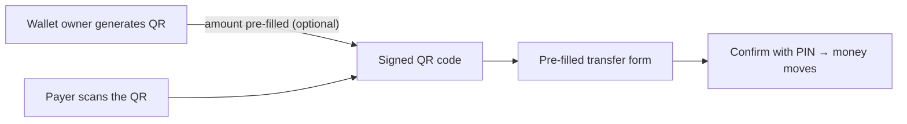

### 07. Savings vaults & auto round-up

Badge: Vaults

Create separate "vaults" for different goals (a trip, a purchase...) — the money stays inside your account but is set apart from everyday spending. "Round-up" can be turned on for a vault — every time you make a transfer, the spare change is automatically swept into it.

**Key steps**

1. Create a vault, name it, optionally set a target amount
2. Deposit / withdraw at any time — each move is a recorded transaction
3. Turn on "round-up" for the vault you want
4. From then on, every P2P transfer's rounding remainder is automatically deposited into it

**Flow diagram**

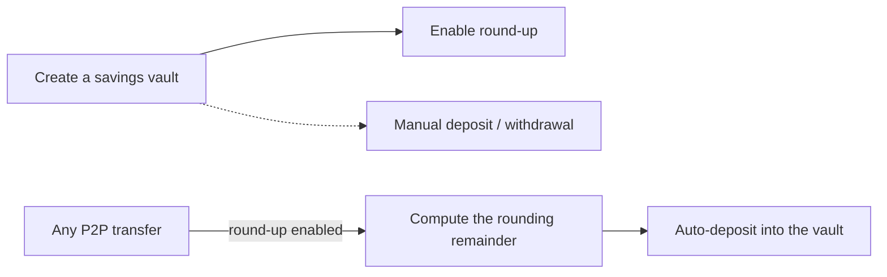

### 08. History & transaction timeline

Badge: History

Review every past transaction. Each one has a detailed step-by-step timeline (not just "success/failed" but the steps in between too) — useful when you need to look something up. The balance is hidden by default so it isn't exposed when the app is open in public.

**Key steps**

1. Open the history list, filter by date/transaction type
2. Tap a transaction for its detail view
3. View the timeline: each processing step and its timestamp
4. The wallet balance is hidden by default — tap to reveal it temporarily

**Flow diagram**

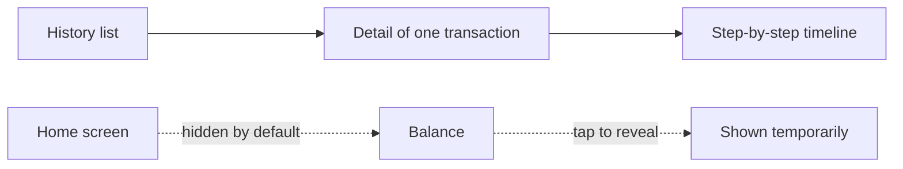

---

## Business wallet — Maker & Checker

**Tag: BUSINESS WALLET**

An organization (a company, a shop, a team...) opens a business wallet inside the app. Two roles are strictly separated: a **Maker** — who proposes/creates a payout request — and a **Checker** — who has the authority to sign off before money moves. One organization can have multiple checkers across multiple approval levels.

### 01. Create an organization & invite members

Badge: Maker · Org admin

An org administrator creates a business wallet, invites members by phone number, and assigns them a role: org admin, maker (who creates payout requests), or checker (who signs off, with an approval level such as L1/L2...).

**Key steps**

1. Create the organization, give it a name
2. Invite members by phone number
3. Assign roles: admin / maker / checker + a level for checkers
4. Members appear in the organization with the right permissions

**Flow diagram**

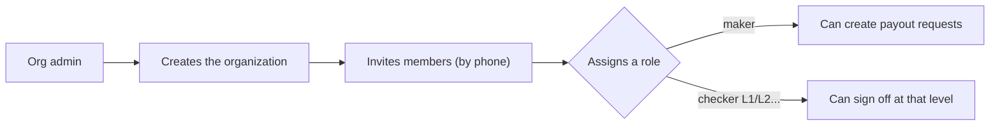

### 02. Set approval policy

Badge: Policy

Define rules for how much sign-off a payout needs, based on its amount. Example: under 5,000,000 VND needs just one L1 checker signature; above 5,000,000 VND needs both an L1 and an L2 signature. Policies can be edited later, but any request already pending keeps the policy that was active when it was created.

**Key steps**

1. Name the policy and its applicable amount range
2. Define each "tier": which checker level, how many signatures required
3. Save the policy — it's versioned, and the old version still governs any requests already pending

**Flow diagram**

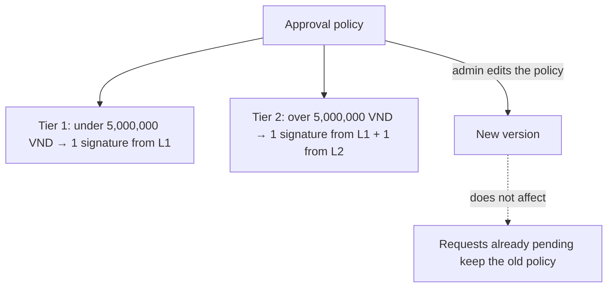

### 03. Create a payout request

Badge: Maker

A maker creates a request to pay a recipient, with a reason attached. The request doesn't move money right away — it pauses, waiting for enough signatures under the policy that applies to that amount.

**Key steps**

1. Choose the recipient, amount, and reason
2. The system automatically looks up the matching policy for this amount
3. The request is created in "pending approval" status; the relevant checkers are notified
4. The maker tracks approval progress on the "Order status" screen

**Flow diagram**

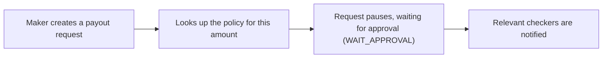

### 04. Track payout order status

Badge: Maker

After creating a request, the maker sees a timeline-style screen: request created → which checker signed → who's next → money transferred. No guessing where the request stands.

**Key steps**

1. Open "Order status" right after creating the request
2. See each milestone: created → L1 signature → L2 signature → money moved
3. Each milestone shows a timestamp and the name of who signed
4. Once fully signed: the money moves automatically, no further action needed

**Flow diagram**

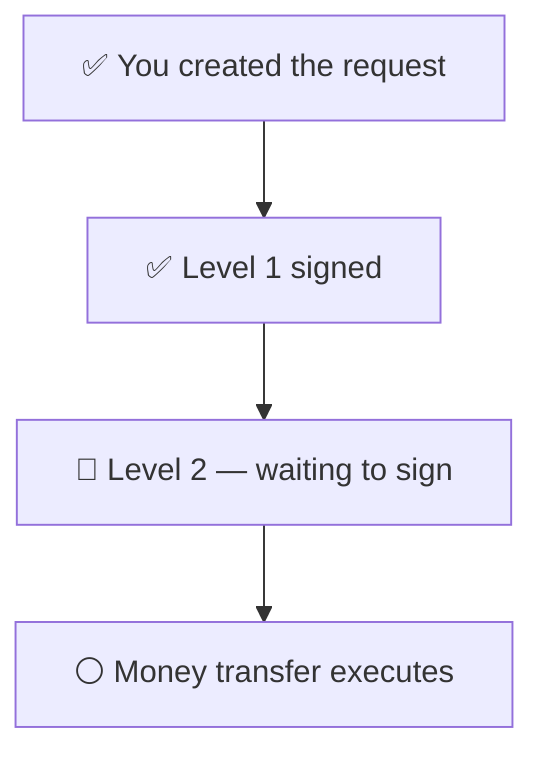

### 05. Cancel a pending order

Badge: Maker

If a request hasn't been signed yet (or is only partly signed), the maker who created it can cancel it — say, they entered the wrong amount. Cancellation isn't possible once a request is fully approved, rejected, or expired.

**Key steps**

1. Open a request that's still "pending approval"
2. Tap "Cancel order" and confirm — this can't be undone
3. The request moves to "cancelled" — no one can sign it anymore

**Flow diagram**

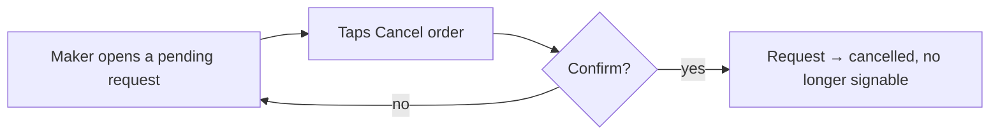

### 06. Approval inbox (My Tasks)

Badge: Checker

A checker sees a list of exactly the requests waiting for their own signature — filtered to their approval level and their turn (if a request needs both L1 and L2, the L2 item only appears once L1 has already signed).

**Key steps**

1. Open the "Waiting for my approval" inbox
2. The list only shows requests at this checker's level that are still within their deadline
3. Tap into a request to review it before deciding

**Flow diagram**

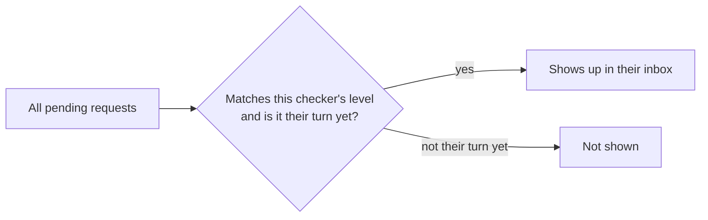

### 07. Request detail + signature history

Badge: Checker

Before signing, a checker sees everything: the amount, who created the request (the maker), the reason, and a list of everyone who already signed, with timestamps — so they know exactly what they're signing, not signing blind.

**Key steps**

1. Open a request from the inbox
2. See the amount, the maker, and the reason for the payout
3. See the "Signatures" section: who signed at which level, and when

**Flow diagram**

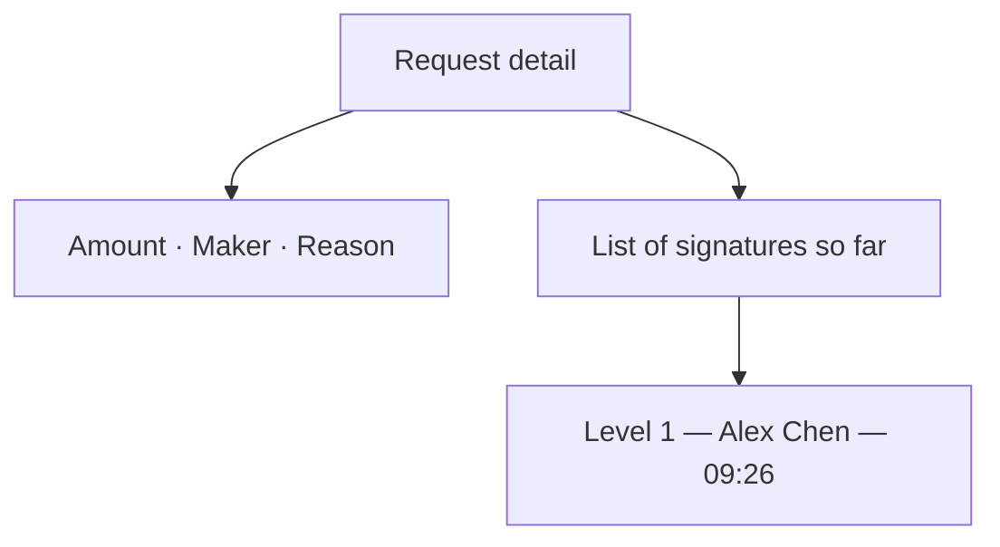

### 08. Approve / reject with OTP

Badge: Checker

Approving or rejecting a request requires entering an OTP sent specifically to that checker — turning the signature into an act they cannot later deny (it was truly that checker who agreed, not someone tapping on their behalf).

**Key steps**

1. Tap "Approve" or "Reject"
2. The system sends an OTP to the checker's phone
3. Enter the correct OTP to confirm the signature
4. If it's the last signature needed: money moves right away; otherwise the request waits for the next checker

**Flow diagram**

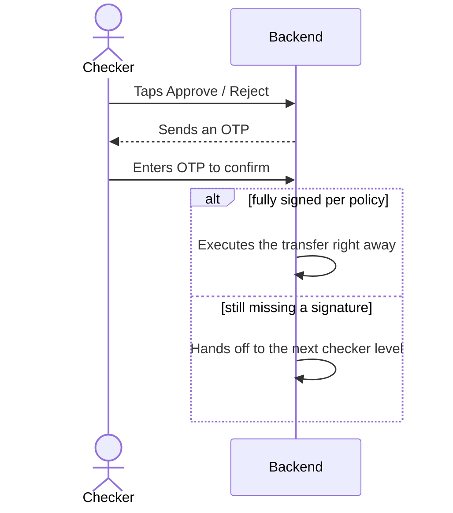

### 09. Result after signing

Badge: Checker

After signing, a checker immediately sees a clear result: if it was the final signature → "Approved, transfer in progress"; if more are needed → "recorded, still waiting on N more people". A rare edge case: two checkers tap approve almost simultaneously — whoever arrives second sees a clear "this order was just handled by someone else" screen instead of a confusing error.

**Key steps**

1. Right after signing, see the outcome on screen
2. If it was the final signature: see "transfer in progress"
3. If not fully signed yet: see "still waiting on N more people"
4. If someone else signed a few seconds before you: a clear screen explains it, not a raw error

**Flow diagram**

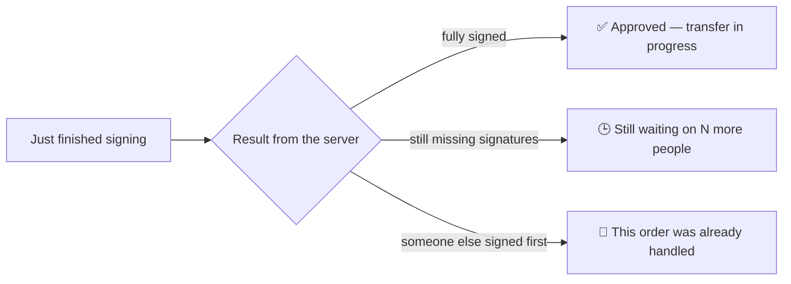

---

## Operations team — Admin web

**Tag: OPERATIONS**

HPay staff (not customers) use a separate admin website to oversee the whole system: reviewing identity documents, monitoring fraud, resolving stuck transactions, reconciling money — and even they must go through the same dual-control mechanism for sensitive actions (refunds, account locks).

### 01. Operations dashboard

Badge: Ops

The operations team's home page: the day's key metrics (transaction count, pending KYC reviews, fraud alerts...) plus a "needs attention" area so urgent items don't get missed.

**Key steps**

1. Open the admin site
2. Review today's KPI metrics
3. Check the "needs attention" area to see what's a priority

**Flow diagram**

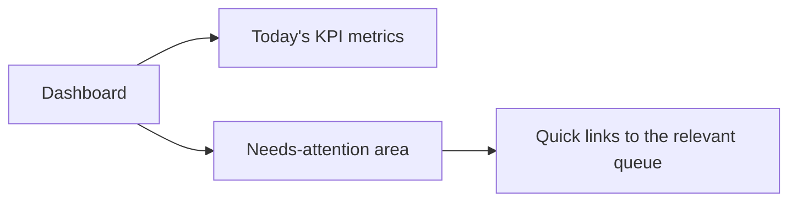

### 02. KYC review queue

Badge: Ops

A list of identity documents that scored in the not-confident-enough-to-auto-approve range — a staff member reviews the ID photo, the selfie, and the AI's explanation, then decides to approve or reject. Keyboard shortcuts speed up bulk review.

**Key steps**

1. Open the KYC queue
2. Review the document photo, selfie, AI score, and AI reasoning
3. Decide to approve or reject (keyboard shortcuts available)

**Flow diagram**

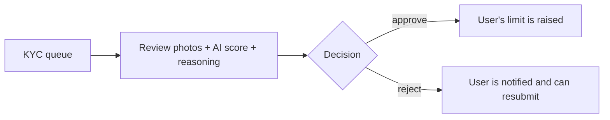

### 03. Fraud monitoring

Badge: Ops

A list of transactions the system flagged as potentially fraudulent (rapid consecutive transfers, unusual amount spikes, an unfamiliar device...), each with a plain-language explanation generated by AI so staff can understand the flag quickly, with an SLA to resolve it.

**Key steps**

1. Open the fraud alerts list
2. Review why it was flagged (hard rules + the AI's explanation)
3. Resolve it: confirm it as fraud or dismiss the alert

**Flow diagram**

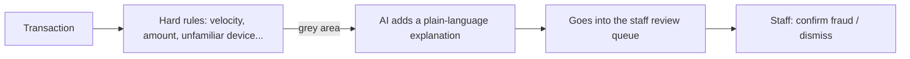

(The Vietnamese source version stated that the AI explanation is written in Vietnamese; the English version does not specify a language.)

### 04. Workflow monitor

Badge: Ops

Every transaction runs through several processing steps behind the scenes; this screen shows operations which ones are "stuck" or failed mid-way, filterable by status or transaction type, so staff can step in instead of leaving a customer waiting indefinitely.

**Key steps**

1. Open the workflow monitor
2. Filter by status (running / failed / stuck too long) or transaction type
3. Drill into one stuck instance to see exactly which step it stopped at

**Flow diagram**

```mermaid
flowchart LR
  M["Workflow monitor"] --> F["Filter: status · type · stuck >5 min"]
  F --> D["View one instance's detail"]
  D --> S["Which step it's stuck at, and why"]
```

### 05. Daily reconciliation

Badge: Ops

Every night, the system automatically matches internal transactions against a (simulated) bank statement — which ones match, which ones are off, which ones are missing on either side. AI summarizes the reasons for mismatches in plain language, and the report can be exported to Excel.

**Key steps**

1. Run reconciliation (automatic at 00:15, or on demand)
2. Review the list: matched / mismatched / missing
3. Read the AI-written summary of why things are off
4. Export an Excel report if needed

**Flow diagram**

```mermaid
flowchart LR
  C["00:15 cron job"] --> M["Match by reference code<br/>against the bank statement"]
  M --> R["Matched / Mismatched / Missing"]
  R --> AI["AI summarizes the causes"]
  R --> X["Export to Excel"]
```

### 06. Admin's My Tasks

Badge: Ops

Dual-control approval isn't just for business payouts — the operations team's own sensitive actions (refunding a transaction, locking a user's account, changing a fee policy) also require sign-off from a different admin, using the exact same maker-checker mechanism.

**Key steps**

1. Admin A proposes a sensitive action (e.g. a refund)
2. It lands in a different admin's "My Tasks" queue
3. Admin B reviews the reason and approves or rejects it
4. Once approved, the action is actually carried out

**Flow diagram**

```mermaid
flowchart LR
  A1["Admin A proposes<br/>(refund / account lock / policy change)"] --> Q["My Tasks"]
  Q --> A2["Admin B reviews it"]
  A2 -->|"approves"| DO["Action is carried out"]
  A2 -->|"rejects"| STOP["Stopped, with a reason"]
```

### 07. Audit log search

Badge: Ops

Every important action (who approved what, who changed which policy, and when) is recorded permanently and can never be edited. This screen lets staff search by keyword when they need to look something up.

**Key steps**

1. Open the audit log screen
2. Type a search keyword (e.g. a person's name, an action type)
3. Review results with the time, actor, and reason

**Flow diagram**

```mermaid
flowchart LR
  E["Every sensitive action"] --> LOG["Written to audit_logs (immutable)"]
  U["Staff member"] -->|"searches by keyword"| LOG
  LOG --> R["Results: who · what · when · why"]
```

### 08. Organization & policy management

Badge: Ops

Operations staff can view every active business organization on the platform and each one's current approval policy, to help when a business customer needs support.

**Key steps**

1. Open the organization list
2. View a given org's members, roles, and current policy
3. Assist with adjustments when a customer asks

**Flow diagram**

```mermaid
flowchart LR
  L["Organization list"] --> O["Pick one organization"]
  O --> M["Members + roles"]
  O --> P["Current approval policy"]
```

---

## Background infrastructure — not tied to any one role

**Tag: RUNS IN THE BACKGROUND**

Mechanisms that run behind every action above. Users never see them directly, but they are exactly what makes HPay trustworthy: fraud detection, protection against losing money on network failures, and self-healing when something breaks.

### 01. Automated fraud detection

Badge: Platform

Runs in the background on every transaction. Clear, deterministic rules (rapid consecutive transfers, sudden amount spikes, an unfamiliar device, an unusual hour) are checked first; only when a case falls into a "grey area" is AI asked for an explanation — and AI never gets to block money on its own. The final call is always a hard rule or a human.

**Key steps**

1. Every transaction passes through a fraud check
2. Hard rules score the risk first
3. A score in the uncertain range → AI is asked to add an explanation
4. The block/allow decision is always made by a hard rule or a human, never by AI

**Flow diagram**

```mermaid
flowchart LR
  T["Transaction"] --> R["Hard rules: velocity / amount / device"]
  R -->|"clearly safe"| OK["Allowed through"]
  R -->|"grey area"| AI["AI adds an explanation"]
  R -->|"clearly dangerous"| BLOCK["Blocked immediately"]
  AI --> H["A human reviewer makes the final call"]
```

### 02. Safe to retry (idempotency)

Badge: Platform

Every action that moves money (topping up, transferring, creating a payout...) carries a unique "request key". If a user retries the exact same request because of a network hiccup, the system recognizes it as the same request and returns the original result — it never debits or credits twice.

**Key steps**

1. The app attaches one unique random key to each transfer request
2. The request is sent to the server
3. If the same key is sent again: the server returns the original transaction's result instead of creating a new one

**Flow diagram**

```mermaid
flowchart LR
  A["Request #1 (key X)"] --> S["Server processes it, creates a transaction"]
  B["Request #2 (same key X, due to a dropped connection)"] --> C{"Has key X already been processed?"}
  C -->|"yes"| R["Return the original result, create NOTHING new"]
```

### 03. Self-healing on failure

Badge: Platform

If a transaction is mid-processing and the server handling that step fails partway through, a periodic job automatically finds "forgotten" transactions and resumes processing right from the step they were stuck on — nothing is left hanging forever, and nothing gets processed twice.

**Key steps**

1. A transaction stalls mid-way due to a failure (network loss, server restart...)
2. A periodic sweep (every few minutes) finds transactions stuck too long
3. The transaction is retried exactly from the step it was on, not repeating steps already done
4. If it still fails after several retries: the transaction is closed out cleanly as failed, with a refund if needed

**Flow diagram**

```mermaid
flowchart LR
  X["Transaction stuck mid-way"] --> S["Periodic sweeper job"]
  S --> C["Identifies transactions stuck too long"]
  C --> RT["Retries exactly from the step it was on"]
  RT -->|"succeeds"| DONE["Completed"]
  RT -->|"still fails, retries exhausted"| FAIL["Closed out as failed + refunded if needed"]
```

---

HPay · functional guide · Technical guide (ACID, workflow engine, AI…) → [technical-overview.md](technical-overview.md)
