# HPay — architecture & the technical concepts behind it

**Technical document** · for understanding code that was written on your behalf

See also: [Functional guide](functional-overview.md) · [Project overview](../overview-v2.md)

This document explains the **underlying technical concepts** behind every feature in the functional guide (ACID, saga-style workflow engines, auth & security, AI, how the code is organized...) — written for someone new to these ideas, so you can judge for yourself what's missing or risky before moving forward with more development.

- Go · Gin · sqlc · PostgreSQL 16
- Redis 7 (Streams + cron)
- Claude API (with a mock fallback)
- React / React Native

Contents:

1. [Money & correctness (ACID)](#money--correctness-acid)
2. [Business workflow processing & dual-control authorization](#business-workflow-processing--dual-control-authorization)
3. [Authentication & security](#authentication--security)
4. [AI in the system](#ai-in-the-system)
5. [Engineering foundations](#engineering-foundations)

Each concept below has an explanation, an "In HPay" implementation note, a "How it works" list and a diagram.

---

## Money & correctness (ACID)

**Tag: MONEY & ACID**

The set of concepts that guarantee **money never spontaneously appears, disappears, or gets miscounted** — the foundation of any financial system, and more important than any other feature.

### 01. Double-entry ledger

Badge: Ledger

A centuries-old accounting concept: a money movement is never "one balance that changes" — it's at least **two entries**, a debit (where money left) and a credit (where it arrived), and the two sides always sum to zero. Because of this, a wallet balance is never a single fragile number that can drift out of sync — it can always be recomputed from the full entry history and reconciled.

**In HPay:** `internal/ledger` — the `ledger_entries` table (direction: debit/credit). `wallets.balance` must always equal `SUM(ledger_entries)` for that wallet; an internal reconciliation job checks this every day.

**How it works**

1. One P2P transfer produces ≥2 entries: a debit on the sender's wallet, a credit on the recipient's
2. Both entries are written inside the same database transaction — either both succeed or neither is written
3. A wallet's balance is the sum of all its entries — never a loose, independently-stored number
4. An internal reconciliation job runs periodically to catch drift early

**Diagram**

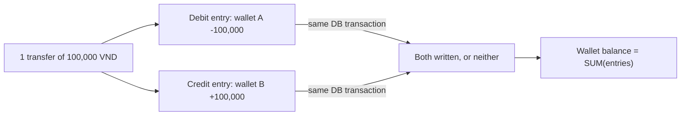

### 02. Atomicity via database transactions

Badge: ACID

The "A" in ACID = Atomicity: a group of database operations must happen **entirely or not at all** — no half-finished state. If something fails part-way through, the whole group is rolled back as if it never happened.

**In HPay:** every ledger write, transaction creation, and workflow status update is wrapped in a single Postgres transaction (`tx.Begin()` ... `tx.Commit()`/`Rollback()`).

**How it works**

1. Start a database transaction
2. Perform several writes (e.g. write 2 ledger entries + update transaction status)
3. If everything succeeds: commit — all changes take effect at once
4. If any step fails: roll back — every change in the group is discarded, the database is as if nothing changed

**Diagram**

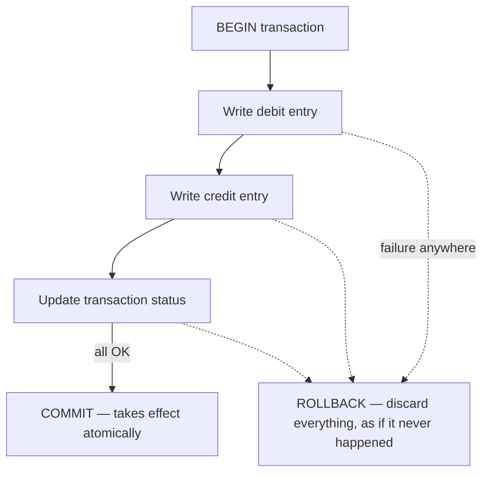

### 03. Lock ordering — avoiding deadlocks

Badge: Concurrency

When two transactions touch the same two wallets at the same time but in opposite order (transaction 1 locks wallet A then waits for B; transaction 2 locks wallet B then waits for A), both wait on each other forever — a **deadlock**. The classic fix: always lock wallets in one fixed order (e.g. ascending ID), regardless of who's the sender or receiver.

**In HPay:** before debiting/crediting, the wallets involved are locked with `SELECT ... FOR UPDATE` in ascending `wallet_id` order, never in "sender first" order.

**How it works**

1. A transaction needs to lock wallet A and wallet B to update balances
2. Sort the two wallets by ID, always lock the lower-ID wallet first
3. Lock the second wallet after
4. Because EVERY transaction follows this same rule, two transactions can never wait on each other in a cycle

**Diagram**

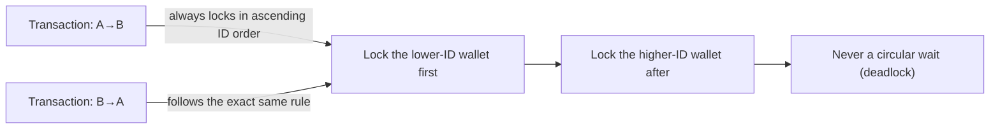

### 04. Idempotency keys — never double-charge

Badge: Reliability

When the network is flaky, a client can't be sure whether a request actually reached the server, so it tends to retry. If the server treats every retry as a brand-new request, money can get debited or credited twice. The fix: the client attaches one unique random key per *intent* to transact (not per HTTP call), and the server enforces a unique constraint on that key so it's processed exactly once — retries just get back the original result.

**In HPay:** the `Idempotency-Key` header is required on every money-creating endpoint; middleware checks a Postgres unique constraint before proceeding.

**How it works**

1. The client generates one unique random key when the user taps "Send"
2. It sends the request with that key in the header
3. Server: if the key already exists in the DB → return the original transaction's result, don't reprocess
4. If the key is new → process normally, and store the key for future recognition

**Diagram**

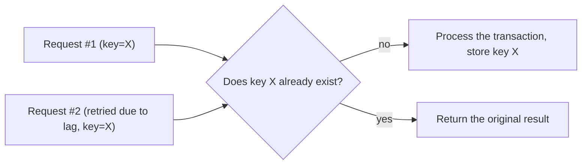

### 05. Immutable ledger (append-only)

Badge: Ledger

A posted ledger entry is never UPDATEd or DELETEd — not even to fix a mistake. To "correct" something, the system posts a new, reversing entry instead (a refund is a new transaction that points back at the original). This preserves the full, true history for auditing and investigation later.

**In HPay:** the `ledger_entries` table is only ever INSERTed into anywhere in the codebase; a reversal creates a new entry with a `reversal_of` column pointing back at the original transaction.

**How it works**

1. A transaction is identified as needing a refund
2. The original entry is NOT edited or deleted
3. A new, opposite-direction entry is created, with a reversal_of link back to the original
4. The full history remains intact — the ledger shows both the original and the reversal

**Diagram**

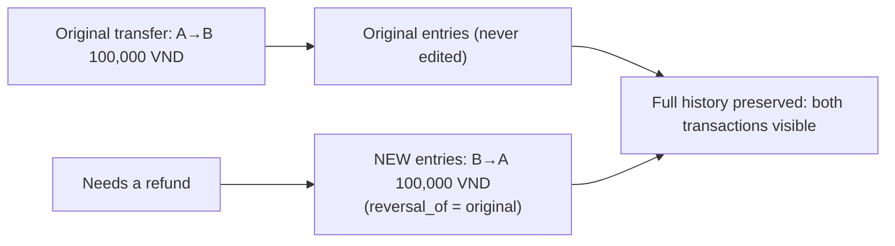

---

## Business workflow processing & dual-control authorization

**Tag: WORKFLOW & APPROVAL**

How a transaction moves reliably through several processing steps (even through network failures and mid-step server crashes), and how the system enforces a "second person" sign-off for sensitive actions.

### 01. Workflow engine = a configurable state machine

Badge: Engine

Instead of hard-coding "a transfer does A, then B, then C" in application code, each transaction type is a **workflow definition** stored as versioned data (JSON) — a list of steps and each step's type (automatic, or waiting on a human). Adding a new transaction type means adding a definition, not touching processing code.

**In HPay:** `internal/workflow`, the `workflow_definitions` table (JSONB, versioned) + `workflow_instances` (one running transaction = one instance) + `step_executions` (a log of every step run).

**How it works**

1. A new transaction → a new "instance" starts, following that transaction type's definition
2. Steps run in sequence: automatic steps (validate, debit funds...) or steps that pause for human approval
3. Every step run is logged individually (step_executions) — useful for later investigation
4. Adding a new transaction type = adding one new definition row, without touching live code

**Diagram**

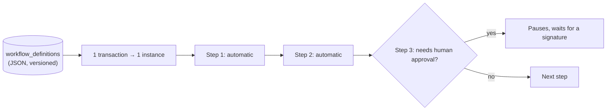

### 02. Transactional outbox — never lose or duplicate an event

Badge: Pattern

A classic problem: writing to a database and publishing an event to a queue (Redis, Kafka...) as two separate operations means one can succeed while the other fails — leaving the data and the event out of sync. The "outbox" fix: write the event into the **same database transaction** as the data change (into a temporary "outbox" table), and let a separate process read that table and actually publish it.

**In HPay:** the `outbox` table is written inside the same transaction as every workflow status change; an "outbox relay" periodically reads it and pushes events into Redis Streams.

**How it works**

1. Change the workflow status + insert one row into the outbox table — SAME transaction
2. The transaction commits: both are guaranteed to take effect together, or neither does
3. An outbox relay process periodically reads unpublished outbox rows
4. It pushes the event onto Redis Streams and marks the row as sent

**Diagram**

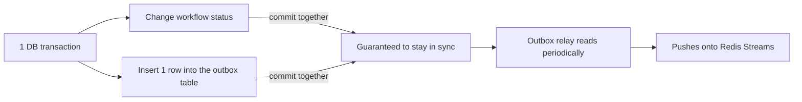

### 03. Redis Streams consumer groups

Badge: Messaging

Unlike plain Pub/Sub (an event is broadcast, and anyone not listening at that moment loses it forever), Redis Streams keeps events around and tracks exactly how far each "consumer group" has read. If a worker picks up an event but crashes before acknowledging it (XACK), the event is still there for another worker to pick up — nothing is lost.

**In HPay:** each processing step type (validator, fraud check, wallet, confirmer...) is its own consumer group on Redis Streams, acknowledged with XACK once processing is done.

**How it works**

1. An event is pushed onto a Stream (it doesn't disappear after being sent)
2. A worker in a consumer group reads the event and starts processing
3. If the worker crashes mid-way: the event was never XACKed, so it's still "pending" in the stream
4. Another worker (or the same one after restarting) picks up that exact event to finish it

**Diagram**

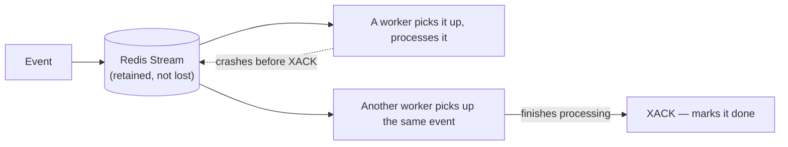

### 04. Saga compensation — undoing a mid-way failure

Badge: Pattern

A transaction runs through several steps — if step 3 fails after step 1 and 2 already succeeded (e.g. the sender's money was already debited), the system can't simply "rewind" because each step is its own already-committed transaction. The saga fix: run "compensating" steps that undo the effect of completed steps, in reverse order.

**In HPay:** every step handler has both a main function and a compensate function (idempotent); when a step fails and can't be retried, the engine runs compensation for prior steps in reverse order.

**How it works**

1. Step 1 (debit the sender): succeeds
2. Step 2 (fraud check): succeeds
3. Step 3 (credit the recipient): fails, retries exhausted
4. The engine runs compensation for step 1: refund the sender via a reversing entry (the original entry is never deleted)

**Diagram**

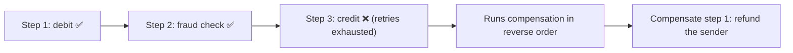

### 05. Recovery sweeper (claim-lease)

Badge: Reliability

A periodic job scans for transactions stuck too long (the server handling that step crashed before reporting a result). To keep two sweepers running in parallel from grabbing the same stuck transaction and double-processing it, each transaction is "claimed" with a single conditional UPDATE — only one sweeper wins, and the transaction is marked "someone owns this" (a lease) before it's actually retried.

**In HPay:** a job runs every 5 minutes looking for instances stuck in running/compensating past a threshold, claiming with an `UPDATE ... WHERE status=... RETURNING` (only one caller wins, thanks to the condition).

**How it works**

1. The sweeper scans for "running" instances stuck too long (e.g. >10 minutes with no update)
2. It attempts to claim one via a conditional UPDATE — succeeding only if no one else has claimed it yet
3. If the claim succeeds: it retries exactly the step that was in progress (the handler must be idempotent)
4. If retries still fail repeatedly: the transaction is closed out as failed and compensation runs

**Diagram**

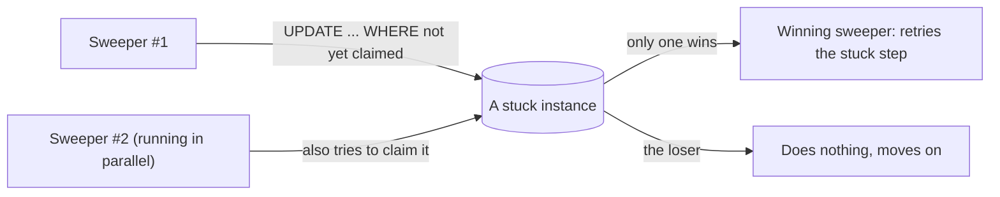

### 06. Maker-checker / approval engine

Badge: Authorization

The "separation of duties" principle: the person who proposes a sensitive action must not be the same person who approves it — at least one other person must agree. HPay built this engine to be **generic**, shared by both business payout requests and sensitive admin actions (refunds, account locks, policy changes) — not a separate, hand-rolled flow for each.

**In HPay:** `internal/approval` — the `approval_requests` table has a `subject_type` column (org_txn / reversal / account_lock / policy_change) sharing one state machine; each signature requires its own OTP.

**How it works**

1. The proposer creates an approval_request, freezing ("snapshotting") the policy in effect at that moment
2. An approver reviews the request and enters their own OTP to confirm the signature
3. Once enough signatures match the snapshotted policy → the engine executes the real action (transfer / refund / account lock...)
4. Everything is written to an immutable audit log

**Diagram**

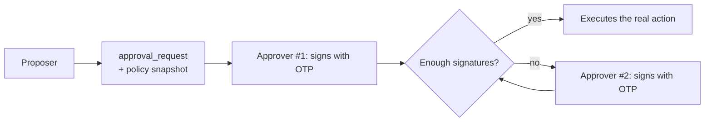

---

## Authentication & security

**Tag: SECURITY**

How the system verifies "you are who you say you are," and how it limits the blast radius if credentials ever leak.

### 01. JWT access/refresh rotation + theft detection

Badge: Auth

The access token is short-lived (minutes to hours) to limit damage if it leaks; the refresh token lives longer but is **usable exactly once** — every time the app asks for a new access token, the old refresh token is "burned" and a new one is issued (rotation). If the server ever sees an already-used refresh token get used again, that's a near-certain sign of theft — the entire token "family" across every device is revoked immediately.

**In HPay:** `internal/auth` — every refresh token belongs to a `family_id`; reusing a token already marked `used_at` revokes the whole family and writes an audit log entry.

**How it works**

1. Login: issues an access token (short-lived) + a refresh token (long-lived), tied to one "family"
2. When the app's access token expires, it sends the refresh token for a new pair
3. The server marks the old refresh token as "used" and issues a new pair in the same family
4. If an already-used refresh token is sent again → suspected theft → revoke the entire family, forcing re-login

**Diagram**

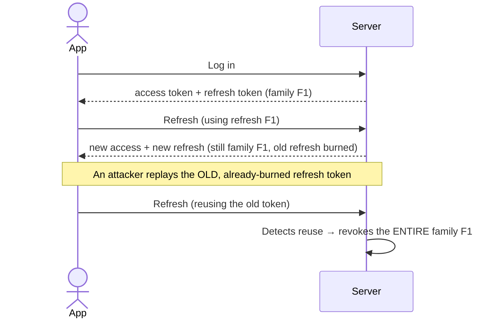

### 02. argon2id password hashing

Badge: Auth

Passwords are never stored in plaintext, and never hashed with a fast algorithm like MD5/SHA (trivially crackable with modern hardware/GPUs). argon2id is a "memory-hard" algorithm — deliberately expensive in both RAM and time to compute — which makes brute-forcing large numbers of passwords prohibitively expensive, even for an attacker with serious hardware.

**In HPay:** `internal/auth/password.go`, using `golang.org/x/crypto/argon2`, stored as an encoded string with its parameters (memory, time, threads) and a per-password salt.

**How it works**

1. A user sets a password
2. A random salt is generated, unique to this password
3. The password + salt is hashed with argon2id (deliberately RAM/time-expensive)
4. The hash + salt + parameters are stored — the original password is never stored

**Diagram**

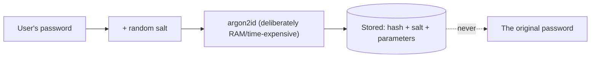

### 03. Device binding

Badge: Auth

A login session is tied to a specific device (via a device ID the app generates itself) — helping detect and flag logins from an unfamiliar device, and limiting the damage if a token leaks (it's bound to one device, not freely usable anywhere).

**In HPay:** the `X-Device-Id` header is sent with sensitive requests and recorded alongside the token/audit log for cross-referencing.

**How it works**

1. The app generates a device ID the first time it's installed
2. That ID is sent with login/sensitive requests
3. The server records which device is tied to which session
4. A login from a never-seen device can trigger a warning or extra verification

**Diagram**

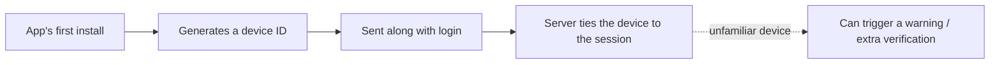

### 04. Rate limiting

Badge: Security

Blocks a single person/IP from sending too many requests in a short window — both to stop brute-forcing passwords/OTPs and to protect the system from overload. Call counts are stored in Redis (fast, shared across every server) instead of each server's own local memory.

**In HPay:** the `RateLimit`/`RateLimitUser` middleware wraps sensitive endpoints (login, requesting an OTP, user lookup...), counted against Redis with a time window.

**How it works**

1. Every call to a sensitive endpoint increments a counter in Redis (by IP or by user)
2. If it exceeds the threshold within the configured window → the request is rejected with a clear error
3. The counter automatically expires after the window, allowing retries later

**Diagram**

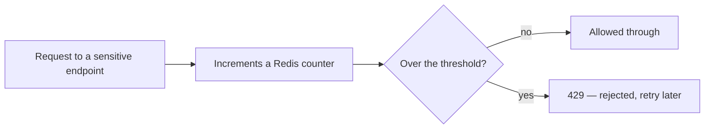

---

## AI in the system

**Tag: AI**

Where AI is actually used (not marketing) — and the single most important rule: AI never gets to make a final decision about money.

### 01. KYC vision scoring

Badge: AI · KYC

AI reads a photo of an ID document plus a selfie and returns a trust score with a plain-language reason — instead of a human having to eyeball every submission for an initial read. AI only ever produces a **scored suggestion**; which score threshold auto-approves and which requires human review is decided by the system's hard rules.

**In HPay:** `internal/kyc` calls the Claude vision API; when no API key is configured (dev/CI), it automatically falls back to a deterministic mock so tests don't depend on the network.

**How it works**

1. The user submits an ID photo + a selfie
2. The Claude vision API is called, returning {score, reasons}
3. A high score (e.g. ≥85): auto-approved
4. A borderline score (e.g. 50–85): goes to a review queue, where a human sees both the photos and the AI's reasoning
5. A low score: auto-rejected

**Diagram**

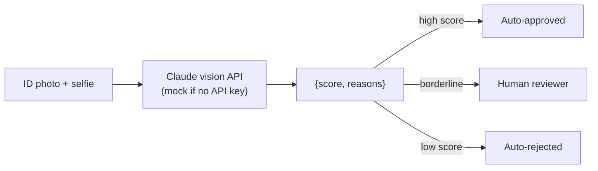

### 02. Fraud: hybrid hard rules + AI advisory

Badge: AI · Fraud

The single most important rule: **AI never gets to block money on its own**. Clear, verifiable, deterministic rules (rapid consecutive transfers, an unusual amount, an unfamiliar device) always run first and are the ones authorized to decide clearly safe/clearly dangerous. Only cases that fall into a "grey area" — where the rules aren't confident enough — get sent to AI to generate an explanation that helps a human decide faster.

**In HPay:** `internal/fraud` + `internal/ai` (the `Advisor` interface) — AI only returns explanatory text (`Complete()`); it has no ability to call a function that blocks a transaction.

**How it works**

1. A transaction passes through hard rules: risk score based on velocity, amount, device...
2. A clearly-safe or clearly-dangerous score → the decision is made right away, WITHOUT calling AI
3. A score in the uncertain range → AI is called to generate a plain-language explanation
4. It's routed to a staff queue — a human (or a hard rule) always makes the final call

**Diagram**

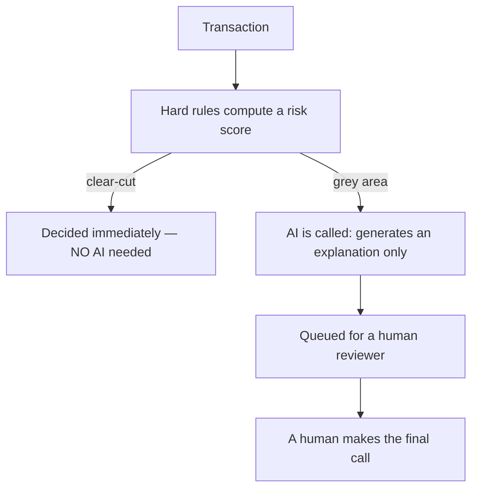

### 03. AI-summarized reconciliation

Badge: AI · Recon

After automatically matching internal records against a bank statement, the list of "mismatches" is often hard to read at a glance (many reference codes, odd amounts). AI reads through the mismatch list and writes a short, plain-language summary of the likely causes, so the reconciliation staff doesn't have to eyeball every row.

**In HPay:** the reconciliation job (a 00:15 cron) reuses the same `ai.Advisor` interface as KYC/fraud — the same mock-fallback mechanism when there's no API key.

**How it works**

1. The reconciliation job matches internal transactions against a (mock) statement by reference code
2. It produces a list: matched / mismatched / missing
3. The mismatch list is sent to AI, which writes a summary of likely causes
4. The summary is shown alongside a detailed table, exportable to Excel

**Diagram**

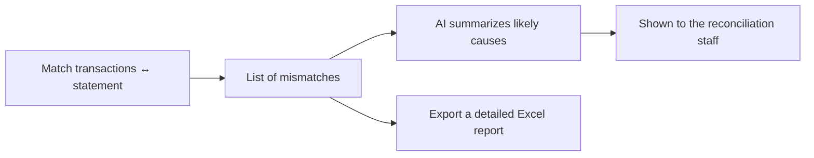

### 04. A 3-layer AI architecture + mock fallback

Badge: AI · Architecture

AI is used at 3 genuinely different layers in HPay, which shouldn't be conflated: (1) **dev-time** — "skills" that help an AI assistant write code following the right conventions (module scaffolding, generating migrations, a fintech-review checklist); (2) **runtime** — KYC/fraud/recon as above; (3) **CI/CD** — automatic pull-request review against a checklist. All three layers fall back gracefully when no API key is present (a mock), so a missing key can never block development or testing.

**In HPay:** `internal/ai.New(apiKey)` returns a `MockAdvisor` when the key is empty — the same logic is shared by all three runtime layers.

**How it works**

1. Dev layer: Claude Code skills help scaffold modules, write migrations, and review against a fintech checklist
2. Runtime layer: KYC scoring, fraud explanations, recon summaries — all runnable in demos/CI without a real key
3. CI/CD layer: automatic pull-request review against a financial-security checklist
4. No API key at any layer → automatically falls back to a deterministic mock, never a hard error

**Diagram**

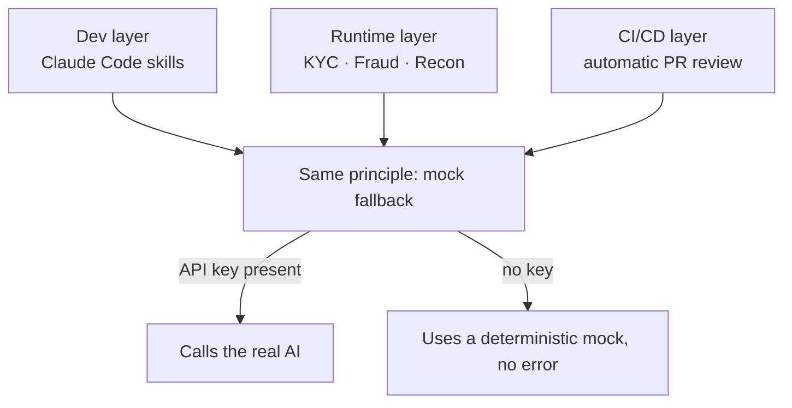

---

## Engineering foundations

**Tag: ENGINEERING PRACTICE**

How the code is organized, verified, and shipped to reduce the risk of bugs — tooling choices you don't see on screen but that shape long-term quality.

### 01. sqlc — SQL checked at compile time

Badge: Data layer

Instead of an ORM (write Go code, the ORM generates SQL for you — easy, but hard to control the final query and prone to N+1 queries), sqlc goes the other way: write plain SQL first, and the tool reads it and **generates the matching Go code** (structs + call functions). If the SQL references the wrong column or type, the error shows up at build time, not after it reaches production.

**In HPay:** `internal/store/queries/*.sql` → run `sqlc generate` → produces `internal/store/gen/*.go` (these generated files are never hand-edited).

**How it works**

1. Write a plain SQL statement in a .sql file, naming the query
2. Run sqlc generate
3. The tool reads the real database schema plus the SQL and generates Go structs matching each column's exact type
4. If a column is later renamed in a migration but the SQL is forgotten: the build fails immediately

**Diagram**

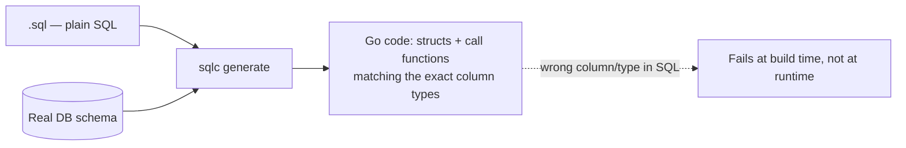

### 02. golang-migrate — schema version control

Badge: Data layer

Every database structure change (a new table, a new column, a type change...) is written as a numbered `up` file (apply the change) and `down` file (undo it). This means the dev, CI, and production databases can always be brought to the exact same state, and a bad change can be rolled back.

**In HPay:** `db/migrations/000N_name.up.sql`/`.down.sql`; CI runs up → down → up against a clean database to guarantee every change is genuinely reversible.

**How it works**

1. Write an up.sql (the new change) and a down.sql (undoing exactly that change)
2. Run migrate up against a database — applied in numeric order
3. CI automatically runs up → down → up on a clean DB — if down doesn't undo it cleanly, the build fails right at review time

**Diagram**

```mermaid
flowchart LR
  U["000N.up.sql"] --> A["Applied to the DB"]
  A --> D["000N.down.sql"] --> B["Undoes exactly that change"]
  B --> U2["Re-applied (up)"]
  U2 --> OK["CI: up→down→up must run clean before merge"]
```

### 03. Testcontainers — testing against a real Postgres/Redis

Badge: Testing

Instead of mocking the database in tests — easy to write, but easy to "test-lie": tests pass while real SQL/transaction logic is actually broken — HPay's integration test suite spins up a **real** Postgres and Redis (via Docker) for every test run, guaranteeing tests exercise real database behavior, including constraints (unique constraints, locks, transactions) a mock can't faithfully simulate.

**In HPay:** `test/integration/` — every test uses a connection pool to a real Postgres/Redis, with helpers to clean up data between runs.

**How it works**

1. CI/the dev machine starts real Postgres + Redis containers before running tests
2. Tests create real data and call the same service functions production uses
3. Results are checked against the real database (not an assumed mock value)
4. After each test, data is cleaned up/rolled back so it doesn't affect the next one

**Diagram**

```mermaid
flowchart LR
  T["Test run starts"] --> C["Real Postgres + Redis containers spin up (Docker)"]
  C --> R["Tests call real services, write real data"]
  R --> V["Results checked against the real DB"]
  V --> CL["Data cleaned up, ready for the next test"]
```

### 04. Edge-case-ID-driven testing

Badge: Testing

Instead of only testing the happy path, the team pre-lists the tricky scenarios that tend to cause bugs in financial systems (two people approving at once, a worker dying mid-saga, a network lag causing a double submit, a checker's level changing mid-signature...) — each gets an ID (E01, E02...) and must have a test named after that exact ID. CI counts how many IDs have a matching test; a missing one fails the build.

**In HPay:** `scripts/check-edge-tests.sh` scans for every `TestEdge_*` function and cross-checks it against the required ID list.

**How it works**

1. High-risk scenarios are pre-listed (assigned IDs E01, E02...)
2. A test named TestEdge_E08_... is written for each ID, reproducing exactly that scenario (e.g. two goroutines calling approve concurrently)
3. CI runs a scan script that cross-checks the required ID list against existing tests
4. Any missing ID → the build fails, blocking the merge

**Diagram**

```mermaid
flowchart LR
  L["Pre-known risk list<br/>(E01...E20)"] --> T["Each ID → 1 TestEdge_*"]
  T --> CI["CI scans all tests"]
  CI --> C{"Every ID covered?"}
  C -->|"yes"| OK["Build passes"]
  C -->|"no"| FAIL["Build fails — names the missing ID"]
```

### 05. openapi.yaml — the single source of truth for the API

Badge: API contract

The entire API is described in one specification file (OpenAPI/Swagger): what each endpoint accepts, returns, and which error codes it can return. The backend, mobile app, and admin site must all match this file instead of each side guessing the contract independently. A script automatically cross-checks the real routes in the Go code against what's declared in the file — any mismatch fails immediately, so the docs can never quietly lie.

**In HPay:** `api/openapi.yaml` + `scripts/check-openapi-sync.py`; the mobile app uses openapi-typescript to generate types straight from this same file.

**How it works**

1. Add or change a route in router.go
2. Update the matching entry in openapi.yaml (including any ERR_* codes)
3. Run the sync-check script — it cross-references real routes against declared ones
4. Regenerate TypeScript types for mobile/admin from the latest openapi.yaml

**Diagram**

```mermaid
flowchart LR
  R["router.go<br/>(real routes)"] --> CHK["check-openapi-sync.py"]
  Y["openapi.yaml<br/>(declared routes)"] --> CHK
  CHK -->|"match"| OK["Passes"]
  CHK -->|"mismatch"| FAIL["Flags the missing/extra route"]
  Y --> GEN["openapi-typescript"] --> TS["TypeScript types for mobile/admin"]
```

### 06. Frontend architecture: Expo Router + TanStack Query/Table

Badge: Frontend

The mobile app uses **Expo Router** — the file structure itself determines the app's routes, with no manual router configuration. Both mobile and admin use **TanStack Query** to manage server data (automatic caching, automatic refetching) instead of hand-rolling loading/error/refetch state with useState. The admin web app additionally uses **TanStack Table** for large data grids with server-side pagination.

**In HPay:** the mobile app's (`src/mobile`) `app/(main)/...` structure = its routes; each feature has a `useXQueries.ts` file calling an API whose types are generated from openapi.yaml.

**How it works**

1. Create a new file under app/ → it automatically becomes a new screen/route
2. Write a TanStack Query hook that calls the API and declares when its data should be invalidated
3. Screens just call the hook — no manual loading/error state management
4. For admin data tables: TanStack Table handles pagination, so the server returns exactly one page of data instead of the whole table

**Diagram**

```mermaid
flowchart LR
  F["A file under app/"] --> R["Automatically becomes a route"]
  H["useXQueries.ts"] --> Q["TanStack Query: caches + auto-refetches"]
  R --> H
  A["Admin: a large data table"] --> TT["TanStack Table + server-side pagination"]
```

---

HPay · technical guide · Functional guide (product overview) → [functional-overview.md](functional-overview.md)
