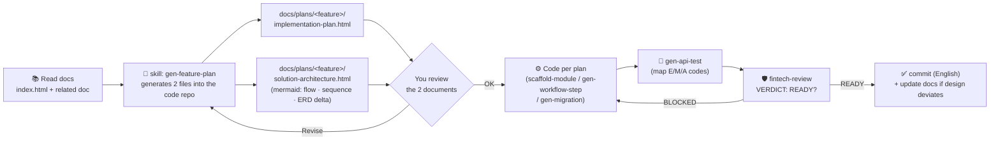
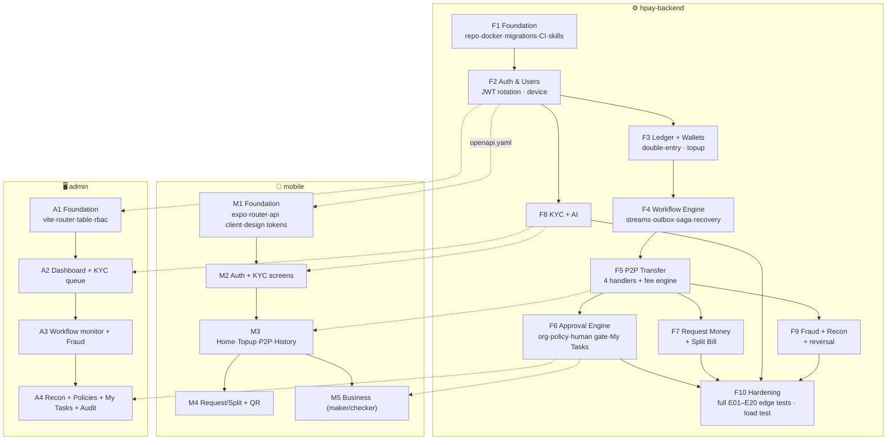

# HPay Master Plan: overall plan and execution process

[← HPay Docs](../README.md)

The overall plan for the 3 code repos. Cross-cutting principle: **docs-first**, and **before any feature is coded, two documents must be produced** in the corresponding code repo: Implementation Plan + Solution Architecture (diagrams must be mermaid). The `gen-feature-plan` skill enforces this automatically.

## 1. Mandatory process for EVERY feature

> Document location: **inside the code repo** being worked on (for example `src/backend/docs/plans/f3-workflow-engine/`), not in the docs repo. The docs repo holds the overall design; the code repo holds its own execution plan. Plans are written as self-contained HTML (mermaid CDN) per the common standard.

## 2. Lessons drawn from a reference wallet source (real code was read)

| Finding in the source | Application to HPay |
|---|---|
| Recovery sweeper flips status `pending → attempt` in batches (`$lte createdAt` + limit) BEFORE replaying — a claim so that 2 workers do not recover the same item | **Adopt.** The `recover_stuck` job must claim with `UPDATE ... SET status='recovering' WHERE ... RETURNING` (lease) and only then replay — this also settles edge case E20 |
| `MPRequest`: a separate document controlling dedup for the partner-initiated flow, keeping the pair `transRefId` (request trail) / `exeTransRefId` (execution trail) + `expiredAt` + a status that includes `timeout` | **Adopt the pattern.** Our `money_requests` is exactly this form — add separate `request_txn_id`/`paid_txn_id` columns, and the `expired` status already exists |
| errorCode `9999` (async-hold) is distinguished from real errors at EVERY layer of the engine — checked separately at 3 places in Transaction.js | **Confirms** the `processing_async` design — classify RetryableError vs terminal directly in the StepHandler contract, not later |
| The engine uses one shared cross-section for every actor: the officer/adjustment flow calls `engineRequestTransaction` + `engineVerifyTransaction` programmatically, with no separate shortcut | **Adopt the principle:** admin reversal / recovery replay / scheduled transfer all go through exactly the same engine + workflow as a normal user — there is never a "back door" writing directly to the ledger |
| `transStepLog` embeds per-step logs (input/output/errorMsg/timestamp) directly in the trail document | We already split this into a `step_executions` table (better for query/index) — keep it, but take the lesson of logging **fee calculation detailed per tier** into the context for fee auditing |

> **Anti-pattern caught in the source (to tell in interviews):** MPRequest's money column is declared `columnType: 'float'` — money stored as float in a real production system. This is exactly why rule #1 of `fintech-review` forbids float; HPay uses BIGINT minor units from the DB to the client.

## 3. Overall breakdown: dependencies between parts

## 4. Detailed Backend plan (each F = 1 pair of plans in the backend repo)

| Phase | Main scope | Edge cases that must have tests | Weeks |
|---|---|---|---|
| **F1 Foundation** | go.mod, internal/ structure, docker-compose (pg16+redis7), all migrations from doc 00§3 + 04§2, sqlc, Makefile, CI with all jobs, copy skills into `.claude/skills/`, skeleton openapi.yaml | E18 (migrate up-down-up in CI) | 1 |
| **F2 Auth & Users** | argon2id, JWT access/refresh rotation + theft detection, device binding, OTP service (hash/TTL/attempts), rate-limit middleware, audit_logs | E11 | 1 |
| **F3 Ledger + Wallets** | ledger service (post double-entry, lock ordering), system wallets, topup mock bank + idempotency middleware | E01, E02, E13, E14, E15 | 1–2 |
| **F4 Workflow Engine** | definitions/instances/step_executions, Streams consumer groups, outbox relay, retry/backoff, saga compensation, recover_stuck (claim-lease learned from the reference wallet), `--role` | E04, E05, E06, E17, E20 | 2 |
| **F5 P2P + Fee** | 4 handlers (validator/fraud-stub/wallet/confirmer), fee_policies + preview, P2P end-to-end, transaction timeline API | E03, E07, E12 | 2 |
| **F6 Approval Engine** | orgs/members/policies, generalized approval_requests (org_txn + reversal + lock + policy_change), human_approval step, checker API, expiry cron, My Tasks API | E08, E09, E10 | 3 |
| **F7 Request Money** | money_requests + split groups, notify, pay-flow attached to the engine, expiry | E19 | 3 |
| **F8 KYC + AI** | image upload (storage interface), Claude vision scorer + mock, kyc_verification workflow, admin review API | — | 3–4 |
| **F9 Fraud + Recon + Reversal** | rule engine + LLM advisory, fraud flags API, recon cron + xlsx + AI summary, reversal (reversing ledger entry via approval) | E16 | 4 |
| **F10 Hardening** | check-edge-tests.sh covering E01–E20, k6 load 100 TPS, govulncheck/trivy, complete seed-demo-data | all | 5 |

Mobile (M1–M5) and Admin (A1–A4) are broken down similarly. Detailed scope for each phase is in docs 02/03; the pair of plans is generated in the corresponding repo when that phase starts.

## 5. Definition of Done (every phase)

- The 2 plan documents are generated and approved BEFORE coding; if the finished code deviates from the plan, update the plan in the same PR.
- The phase's edge cases have tests named `TestEdge_*`, run with `-race`, CI green.
- `fintech-review` returns VERDICT: READY.
- openapi.yaml is updated if the API changes; the docs repo is updated if the design changes.
- Commit messages in English, standard prefix (`feat:`/`fix:`/`docs:`/`test:`).

---

HPay Master Plan · v1 · 09/07/2026 · sources: docs 00–04 + reading the a reference wallet backend source
