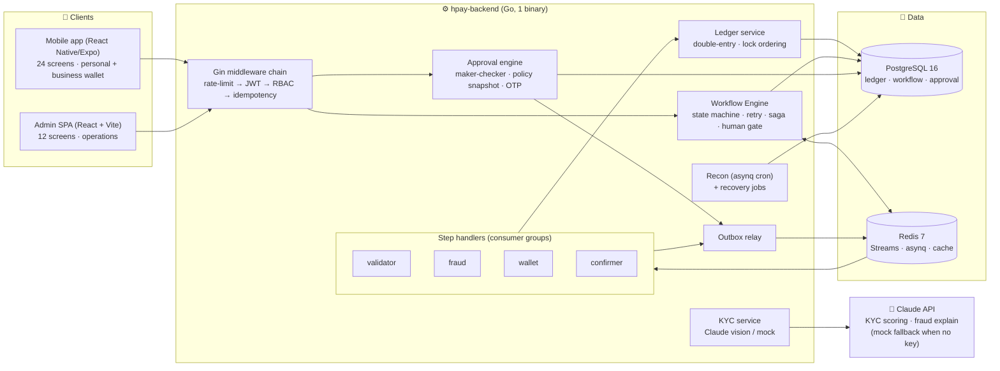
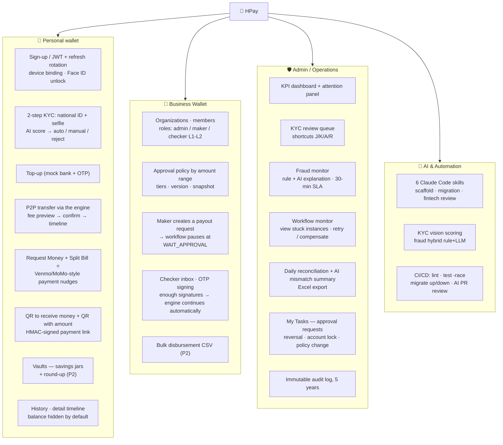
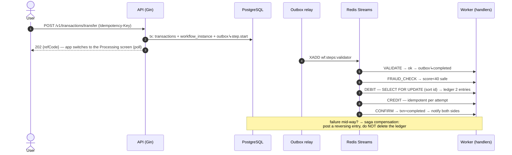
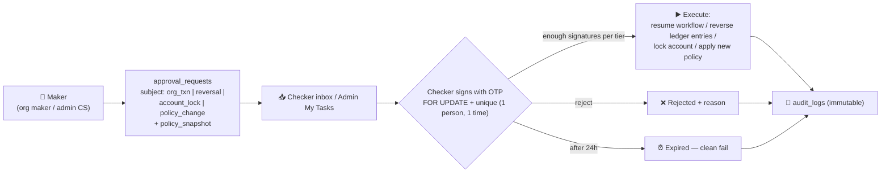
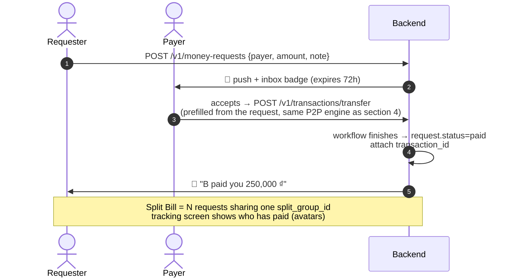
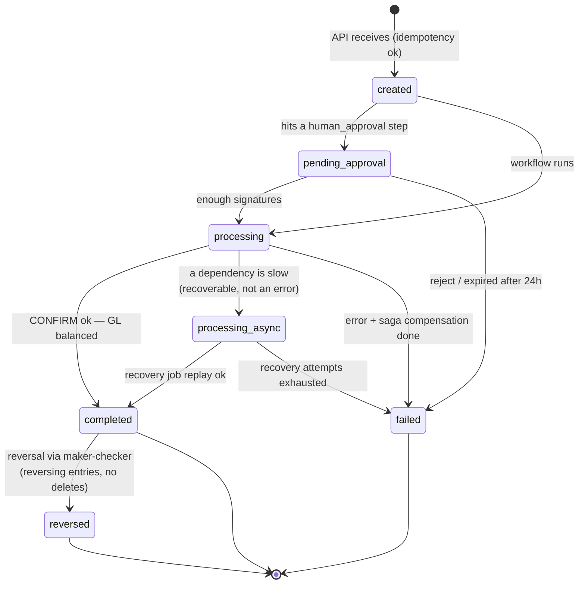

> **History, not truth.** Converted from the original design index (v2.1, 07/2026). It predates the code and still contains errors (asynq, a docs repo, other products named as references). For the current system read [../README.md](../README.md) and ../domain/, ../architecture/.

# HPay — Overview of all features

An end-to-end digital wallet system (Go backend + React Native mobile + React admin) positioned in the style of US wallets (Venmo/Cash App/Revolut): fast P2P, Request Money, and a maker-checker Business Wallet. The heart of the system is a **configurable Workflow Engine** running on a **double-entry ledger**.

- 3 code repos + 1 docs repo
- Go · Gin · sqlc · PostgreSQL · Redis Streams
- 3-layer AI: dev skills · runtime · CI/CD
- v2.1 · 07/2026

## Contents

1. [Overall architecture](#1-overall-architecture)
2. [Deploy 1 binary — 4 roles](#2-deploy-1-binary--4-roles-learning-the-mode-pattern-of-a-production-wallet)
3. [Feature map (4 groups)](#3-feature-map--4-groups)
4. [Workflow Engine — the standard P2P flow](#4-workflow-engine--the-standard-p2p-flow)
5. [Maker-Checker & Approval engine](#5-maker-checker--approval-engine-shared-infrastructure)
6. [Request Money & Split Bill](#6-request-money--split-bill-two-phase-model)
7. [Transaction state lifecycle](#7-transaction-state-lifecycle)
8. [Money & Ledger — invariants](#8-money--ledger--invariants)
9. [KYC · Fraud · Reconciliation](#9-kyc--fraud--reconciliation)
10. [AI automation — 3 layers](#10-ai-automation--3-layers)
11. [Edge-case matrix](#11-edge-case-matrix-tests-required)
12. [Roadmap & detailed documents](#12-roadmap--detailed-documents)

## 1. Overall architecture

A modular monolith in 1 Go binary — modules communicate through **Redis Streams** (consumer group + XACK, not plain Pub/Sub) and a **transactional outbox**, so any module can be split into its own service at any time without changing contracts.

## 2. Deploy 1 binary — 4 roles (learning the MODE pattern of a production wallet)

| Command | Mount | Serves |
|---|---|---|
| `HPay serve --role=api` | HTTP public /v1/* | Mobile traffic |
| `HPay serve --role=worker` | Stream consumers + asynq | Step handlers, cron, outbox relay |
| `HPay serve --role=admin` | /v1/admin/*, /v1/org/* | Admin SPA + org API |
| `HPay serve --role=all` | Everything | Dev/demo with 1 command |

> **Note:** Scale-out needs no code split: run 3 processes with 3 roles and you have a production-like topology. A ready-made answer to the interview question "how does this monolith scale?".

## 3. Feature map — 4 groups

| Priority | Features |
|---|---|
| **CORE** | Auth, KYC, top-up, P2P, workflow engine, ledger, org maker-checker, admin queues, reconciliation |
| **P1** | Request Money, generic approval engine (admin ops), fee engine, `processing_async` + recovery, deploy roles |
| **P2** | Vaults + round-up, Split Bill, recurring transfers, QR with amount + payment link, bulk CSV |

## 4. Workflow Engine — the standard P2P flow

Each transaction type is a **workflow definition** (JSONB, versioned) — add a new flow with an INSERT, no code changes. An `auto` step runs through a handler; a `human_approval` step pauses the instance to wait for an approver.

## 5. Maker-Checker & Approval engine (shared infrastructure)

Not only for business payout requests — **every sensitive admin action** (reversal, account lock, policy/fee change) goes through the same approval engine: Maker ≠ Checker, policy snapshot prevents races, OTP signatures, full audit.

> **Note:** Difference from the reference system: there is no "bypass auth" flag after approval — a financial step can only run when the state machine passes through a valid `WAIT_APPROVAL`. Authorization lives in the state structure, not in if-else.

## 6. Request Money & Split Bill (two-phase model)

## 7. Transaction state lifecycle

> **Warning — invariant:** after `completed`, the state is never modified in place. A refund = a new reversing transaction with `reversal_of` pointing at the original.

## 8. Money & Ledger — invariants

| Invariant | Guaranteed by |
|---|---|
| Money is `BIGINT` in the smallest unit — never float | Schema + the `fintech-review` skill blocks it in CI |
| Every transaction has ≥ 2 entries, total debits = total credits | Ledger service + invariant tests + internal recon |
| `wallets.balance` = SUM(ledger_entries) of the wallet | Daily internal recon cross-check |
| Ledger is INSERT-only — no UPDATE/DELETE | Trigger + DB permissions + review |
| A retry never creates a duplicate transaction | Unique Idempotency-Key + attempt check in the handler |
| Events are not emitted before commit, and not lost after commit | Transactional outbox + Streams XACK/XAUTOCLAIM |
| No deadlock when 2 wallets transfer to each other crosswise | Lock ordering by ascending wallet_id |
| Biometrics only unlock the app — transfers always need PIN/OTP | Auth matrix on client + server |

## 9. KYC · Fraud · Reconciliation

**🪪 KYC** — Photograph the national ID + a selfie → Claude vision returns `{score, reasons}` → ≥85 auto-approve · 50–85 goes to the reviewer queue (with the AI explanation) · <50 reject. Runs as its own workflow definition — reusing retry/timeout/log.

**🚨 Fraud** — Deterministic rules first (velocity, amount spike, new device, unusual hour) → only the grey zone 40–70 asks the LLM to synthesize + explain in Vietnamese. **The LLM never decides on its own to block money** — the hard decision is rules + humans.

**⚖️ Reconciliation** — Cron 00:15: match by `ref_code` against the mock statement → matched / mismatch / missing in each direction → AI summarizes the cause of mismatches → Excel export. Plus internal recon: SUM of ledger = each wallet's balance.

**🔄 Recovery** — A job every 5 minutes scans for stuck instances (`running/compensating` past the threshold) → replays the current step (handlers are idempotent). A "dangling" transaction is never forgotten.

## 10. AI automation — 3 layers

| Layer | Content |
|---|---|
| **Dev** — Claude Code skills | `scaffold-module` · `gen-migration` (generates up/down + sqlc + fixes compile) · `gen-workflow-step` (handler + registry + test) · `fintech-review` (checklist: float? idempotency? lock ordering? ledger UPDATEd?) · `gen-api-test` · `seed-demo-data` |
| **Runtime** — product features | KYC scoring (vision), fraud explain, recon summary — all have a mock fallback when the API key is missing |
| **CI/CD** — GitHub Actions | golangci-lint · sqlc diff · migrate up+down on a clean DB · test -race (testcontainers) · docker build distroless · claude-code-action PR review against the fintech checklist |

## 11. Edge-case matrix (tests required)

**37 cases** are listed and tied to tests: **E01–E20** backend (double-spend, crosswise deadlock, worker dying mid-saga, duplicate events, checker race, policy changing mid-flight, Redis down…), **M01–M12** mobile (double-tap, timeout without rushing to report failure, refresh token single-flight, BigInt money…), **A01–A07** admin (409 conflict between 2 reviewers, cursor pagination preventing row drift…). CI counts tests against the list — a missing one fails the build. Details in doc 01/02/03.

## 12. Roadmap & detailed documents

| Week | Work |
|---|---|
| 1 | Repo setup, migrations for the full schema, sqlc, CI, write the Claude skills first · Auth + wallet + top-up |
| 2 | Workflow engine core + 4 handlers + outbox + saga · P2P end-to-end + concurrent tests |
| 3 | Approval engine (org + admin ops) · KYC AI · **Request Money** |
| 4 | Fraud hybrid · recon + recovery · fee engine · main Mobile app screens |
| 5 | Admin dashboard · P2 features if time allows · README + demo video |

### Detailed documents

| Document | Description |
|---|---|
| [00 · Backend base design](design-v2/00-backend-design-v2-base.md) | Full SQL schema, engine spec, maker-checker, AI |
| [01 · Backend solution architecture](design-v2/01-backend-solution-architecture.md) | Security, NFR, E01–E18, deployment |
| [02 · Mobile solution architecture](design-v2/02-mobile-solution-architecture.md) | RN/Expo, M01–M12, client security |
| [03 · Admin solution architecture](design-v2/03-admin-solution-architecture.md) | RBAC, operations screens, A01–A07 |
| [04 · Feature extensions v2.1](design-v2/04-feature-extensions.md) | reference wallets / MoMo analysis, schema delta |
| [05 · Offer Factory & Service Catalog](design-v2/05-offer-service-factory.md) | Enterprise Product Engine architecture, Limit & Auth Matrix, Service Catalog |
| [06 · Service Engine API Consolidation](design-v2/06-service-engine-api-consolidation.md) | Plan for restructuring & streamlining the Backend API (Service Engine Consolidation) |
| [07 · TanStack Table & Query Pagination](design-v2/07-tanstack-table-query-pagination.md) | Plan for standardizing TanStack Table v8 & TanStack Query server-side pagination |
| [Design · UI spec](../design/ui-design-spec.md) | Tokens, components, 36 screens |
| [Planning · Master Plan](master-plan.md) | 2-docs-per-feature process, F1–F10/M/A breakdown, lessons from a reference wallet source |
| [Skills · Agent loop](../../.claude/skills/SOURCES.md) | 6 Claude Code skills: scaffold, migration, workflow step, fintech review, api test, seed demo |
| [Design · HTML mockups](design/mockups/) | 42 US-wallet-style screens — including Request Money, Split Bill, Vaults, My Tasks (open directly in a browser) |
| [Guide · Functional overview](guide-v2/functional-overview.md) | All features by role, with explanations + mermaid diagrams — for presentations/demos |
| [Guide · Technical architecture](guide-v2/technical-overview.md) | Explains the underlying concepts (ACID, workflow engine, AI, security...) behind each feature |

---

HPay · docs v2.1 · updated 08/07/2026 · reference sources: Acme Corporate Authorization Matrix, an external retail wallet flow overview, MoMo/Venmo/Cash App/Revolut patterns
