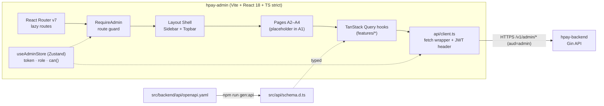
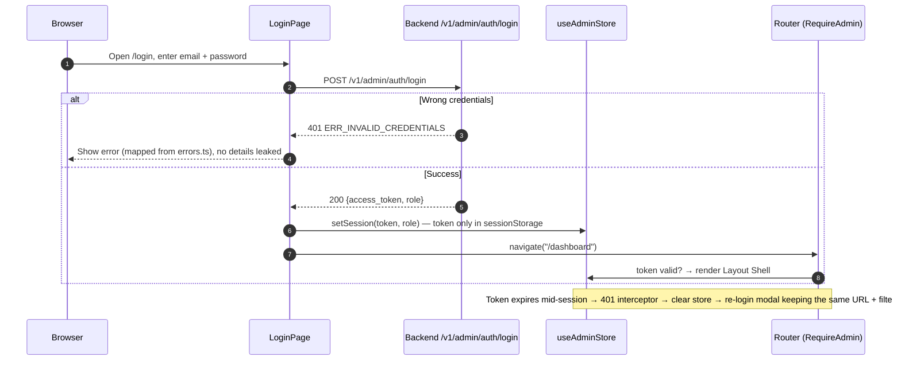
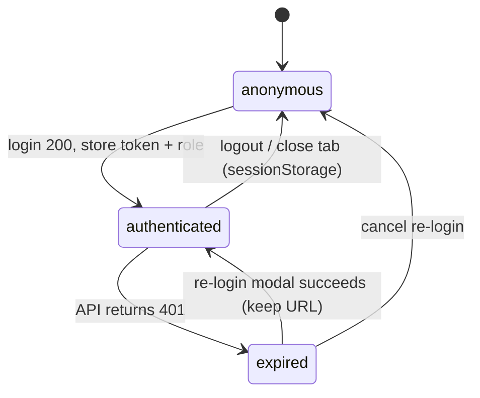

# Solution Architecture — A1 Foundation hpay-admin

Foundation architecture for the internal operations SPA: layout shell, auth store, API client generated from the contract, and the RBAC helper. All phases A2–A4 build on these layers. Overall design reference: `docs/architecture/03-admin-solution-architecture.html`.

## 1. Context — position in the system

**Contract-first:** FE types are generated from the backend's `openapi.yaml` — API types are never written by hand. If a new API is needed, change the backend + openapi.yaml first (two-way, same as mobile).

## 2. Main flow — login & bootstrapping the admin session

## 3. State — admin session lifecycle

## 4. Data model delta

**None** — pure FE, no DB schema change. Client data consists of `useAdminStore` (token, role — memory/sessionStorage) and the TanStack Query cache (keyed by endpoint + filter).

## 5. Decisions & trade-offs

| Decision | Alternative | Reason |
|---|---|---|
| Vanilla CSS tokens (no Tailwind/shadcn) | shadcn/ui + Tailwind (as doc 03 suggests) | Consistent with the token system already used in mobile, small bundle, no extra build step; doc 03 will be updated accordingly (docs-first: design deviation → fix the docs) |
| React Router v7 instead of TanStack Router | TanStack Router (doc 03) | Data Router is sufficient for the need (lazy + loader), team is familiar; filters are still kept in URL search params as doc 03 requires |
| Token in sessionStorage, no automatic refresh | httpOnly refresh cookie + single-flight | Internal app, short TTL; closing the tab = logout is the desired behavior; 401 → re-login modal (A03). Will be upgraded if the backend adds refresh for admin |
| Generate types with the `gen-api.ts` script copied from mobile | openapi-typescript directly | Reuse tooling that already works well, same single openapi.yaml source |

## 6. Invariants & edge cases to uphold

| ID | Invariant / edge | How A1 upholds it |
|---|---|---|
| A03 | Token expires in the middle of a review session | Central 401 interceptor in `client.ts`; re-login modal; URL + filter live in search params so no context is lost |
| A05 | 2 tabs acting at the same time | Every mutation relies on a state-check in the backend; FE handles 409 uniformly via the interceptor (toast + refetch row) |
| — | Money is BIGINT minor units | `lib money format` accepts string/bigint, amounts NEVER go through Number |
| — | RBAC: FE only hides UX, the backend truly enforces | `can()` only controls display; no authorization decision is made in the FE |
| — | No secret leaks | Do not log token/balances to the console; localStorage holds UI prefs only |
