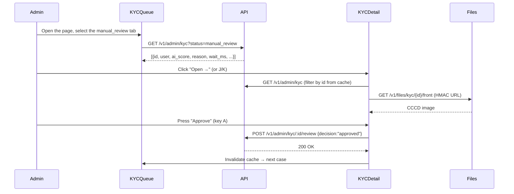

# Implementation Plan — A2 Dashboard & KYC hpay-admin

Phase that implements the **overview Dashboard** (KPIs + volume chart + alert cards) and the **KYC review** flow (queue → detail → approve/reject with ID card (CCCD)/selfie images). It uses the `/v1/admin/*` APIs that already exist from backend F8.

## 1. Screens

| Screen | Mockup | API |
|---|---|---|
| Dashboard (A1 mockup) | KPI cards + volume bar chart + alert cards KYC/Fraud/Workflow/Recon | `GET /healthz` + client-side aggregation from the KYC queue count |
| KYC Queue (A2 mockup) | 3 tabs: Pending review / AI auto-approved / Rejected; table with AI score, reason, waiting time | `GET /v1/admin/kyc?status=manual_review\|auto_approved\|rejected` |
| KYC Detail (A3 mockup) | CCCD front + selfie image viewer, AI analysis, registration info, Approve/Reject buttons, J/K navigation | `POST /v1/admin/kyc/:id/review` with `{decision, reason}` |

## 2. Tasks

| # | Task | Files | Size | Depends |
|---|---|---|---|---|
| T1 | KPI cards component + Dashboard page: call KYC queue count, fraud flag count, health check; display simulated static KPIs (transactions, volume — the backend has no analytics API yet) | `src/pages/DashboardPage.tsx` | M | A1 |
| T2 | Mini bar chart (pure CSS-only, no library) to render volume by hour — mock data of 24 values | `src/ui/BarChart.tsx` | S | A1 |
| T3 | Alert cards on the Dashboard: fetch pending KYC count + open fraud + stuck workflow (queried in parallel with `Promise.all`); click → navigate to the corresponding page | `src/pages/DashboardPage.tsx` | S | T1 |
| T4 | KYC hooks: `useKYCQueue(status)`, `useKYCDetail(id)`, `useKYCReview()` — TanStack Query, typed from schema.d.ts | `src/features/kyc/hooks.ts` | S | A1 T2 gen:api |
| T5 | KYC Queue page: 3 tabs (manual_review / auto_approved / rejected), Table with columns Name/Phone/AI Score/Reason/Wait/Status/Action; J/K shortcuts; client-side search filter | `src/pages/KYCPage.tsx` | M | T4 |
| T6 | KYC Detail page: 2-column layout (CCCD + selfie images with zoom/rotate) / (registration info + decision). The image viewer calls the URL from `GET /v1/files/*key` (HMAC, self-auth). J/K navigation between cases in the queue. | `src/pages/KYCDetailPage.tsx` | L | T4 |
| T7 | Review action: POST review (approve/reject + reason ≥10 characters) → invalidate cache → toast + navigate to the next case | `src/pages/KYCDetailPage.tsx` | S | T6 |

## 3. KYC Review Flow



## 4. API endpoints used

| Endpoint | Screen | Note |
|---|---|---|
| `GET /v1/admin/kyc?status=…` | KYC Queue | Filter by status; returns a list with ai_score, reason, wait_ms |
| `POST /v1/admin/kyc/:id/review` | KYC Detail | `{decision: "approved"\|"rejected", reason?: string}` |
| `GET /v1/files/*key` | KYC Detail image | HMAC self-auth URL from the backend; 5-minute expiry |
| `GET /v1/admin/fraud-flags?status=open` | Dashboard alert count | Fetch the count to display the sidebar badge |

## 5. Verification

```
npm run typecheck
npm run build
# Manual check: login → dashboard → KYC queue → open detail → approve → see toast + navigate next
```
