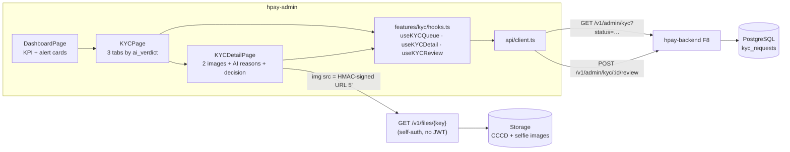
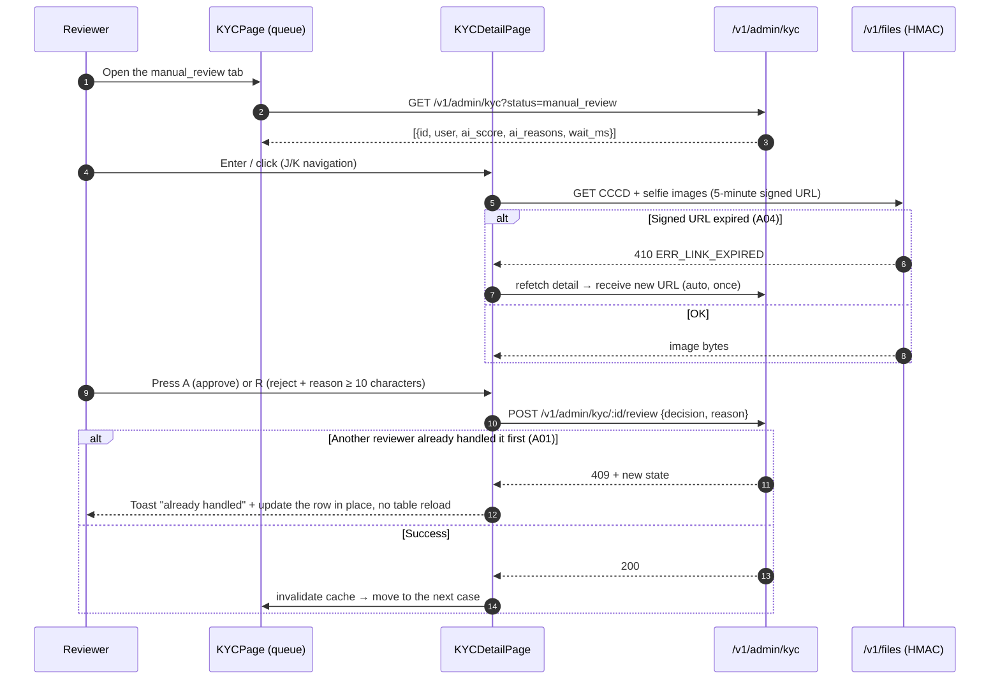
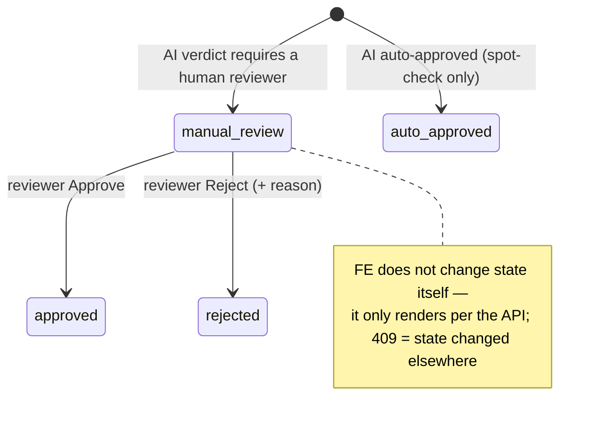

# Solution Architecture — A2 Dashboard & KYC hpay-admin

Architecture for the overview Dashboard and the KYC review flow (queue → detail → approve/reject). Corresponding backend: F8 KYC + AI. Built on top of A1 (shell, client, store, Table).

## 1. Context — the parts of the system this phase touches

## 2. Main flow — reviewing one KYC application (including error branches)

## 3. State — KYC application lifecycle as seen from admin

## 4. Data model delta

**No schema change** — read/write through the existing F8 API. Client cache: query keys `['kyc', status]` and `['kyc', id]`; the review mutation invalidates both.

## 5. Decisions & trade-offs

| Decision | Alternative | Reason |
|---|---|---|
| Transaction/volume KPIs use mock data in A2 | Wait for the backend to build an analytics API | The backend has no analytics endpoint yet; the dashboard can still demo the layout, and alert cards use real counts from the KYC/fraud queues. Documented explicitly to avoid mistaking them for real numbers |
| J/K/A/R shortcuts handled at page level | Global hotkey manager | Only 2 screens need them; avoids conflicts when focus is in an input (disabled while typing the reason) |
| Images loaded directly via HMAC-signed URL | Proxy through FE / fetch blob | The backend already designed a 5-minute self-auth URL (F8); a direct `` is the simplest, retry once on expiry (A04) |
| Pure CSS BarChart | Recharts | Only one chart in A2 — not worth adding a dependency; reconsider Recharts if A4 needs many charts |

## 6. Invariants & edge cases to uphold

| ID | Situation | How it is upheld |
|---|---|---|
| A01 | 2 reviewers open the same application, the later one acts | Backend returns 409 + new state → toast + update the row in place |
| A02 | Long queue, new data pushed in while on a later page | Cursor pagination from the API (not offset); J/K navigates over the cached list |
| A04 | Signed image URL expires while viewing | onError → request a new URL exactly once, beyond that show a message |
| — | Reject requires a reason ≥ 10 characters | Validate in FE before POST; the backend remains the real enforcer |
| — | Full audit | Every decision goes through the review API — no shortcut on the FE side |
