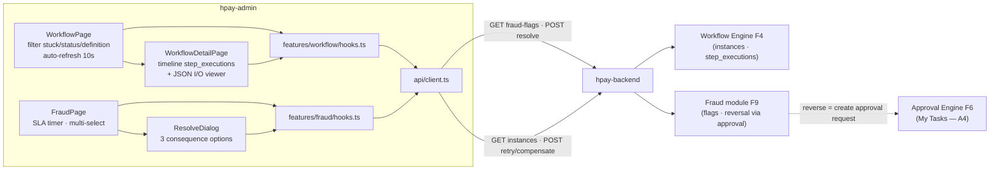
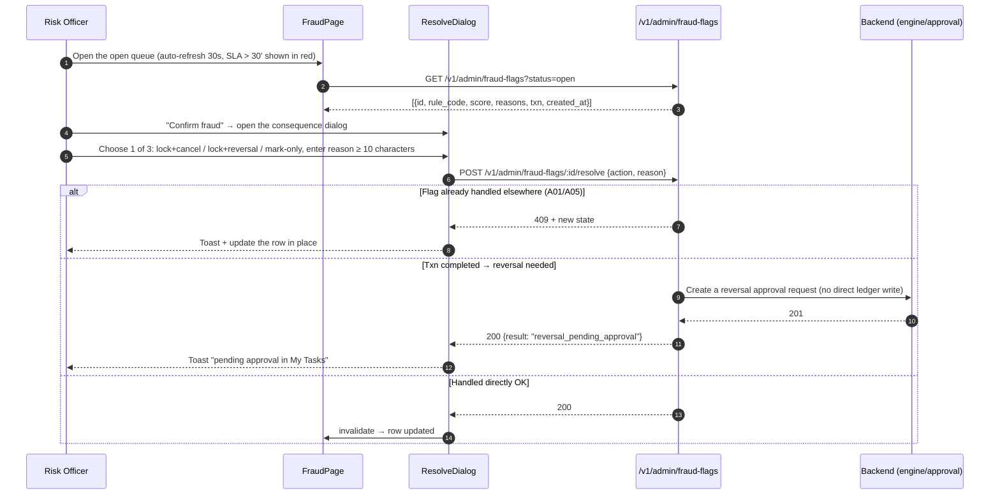
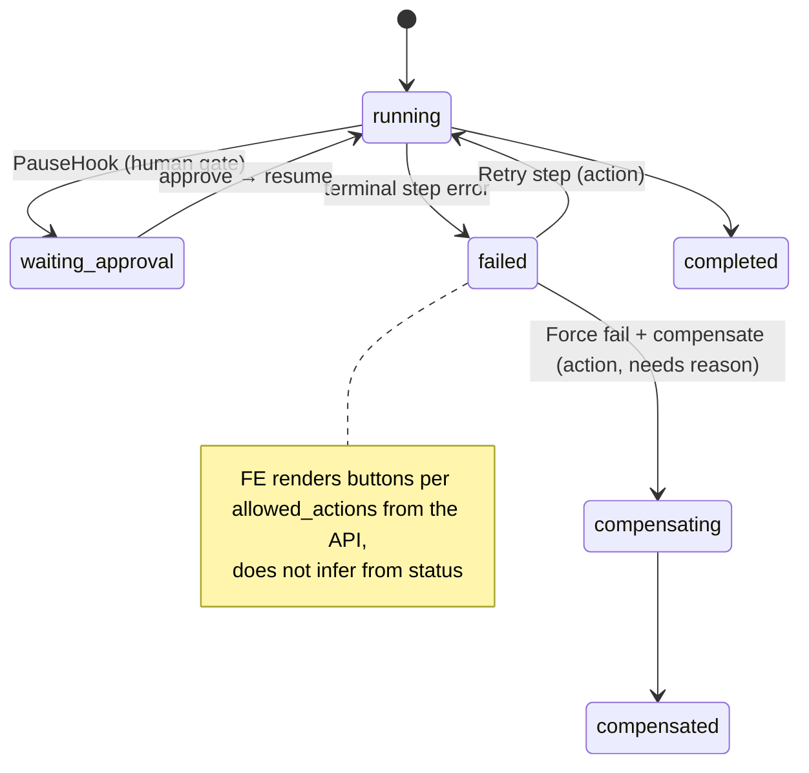

# Solution Architecture — A3 Workflow Monitor & Fraud hpay-admin

Architecture for 2 near-realtime operations screens: Workflow Monitor (observability of the F4 engine) and Fraud Monitor (handling F9 flags). Guiding principle throughout: **the FE does not decide business logic** — available actions are read from the API, and the consequences (lock/cancel/reversal) are carried out by the backend through the proper engine.

## 1. Context

## 2. Main flow — resolving 1 fraud flag (including error branches)

## 3. State — valid actions by workflow instance status

## 4. Data model delta

**No schema change.** Client state: query keys `['workflow', filters]`, `['workflow', id]` (refetch 10s), `['fraud', status]` (refetch 30s). The SLA timer is derived state (created_at → now, tick 60s) and is not stored.

## 5. Decisions & trade-offs

| Decision | Alternative | Reason |
|---|---|---|
| Auto-refresh via polling interval (10s/30s) | SSE / WebSocket push | Internal app with few users; polling through TanStack Query is sufficient and simple; the backend has no push channel yet |
| FE reads `allowed_actions` from the API | FE infers from status | The state machine lives in the backend (doc 03 §4.4); avoids drift when the engine adds states |
| Fraud consequence (lock/cancel/reversal) is a single resolve call | FE calls several APIs sequentially | The backend guarantees atomicity + goes through the approval engine for reversal — the FE never orchestrates money business logic |
| JSON I/O viewer uses a custom component (collapse + copy) | react-json-view | Narrow need; the backend already masks PII before returning (A07), so it only needs to render |

## 6. Invariants & edge cases to uphold

| ID | Situation | How it is upheld |
|---|---|---|
| A01 | Action taken just as the record changes state | 409 → toast + update the row in place, no table reload |
| A05 | 2 tabs acting at the same time | The backend checks state on every mutation; shared 409 interceptor |
| A07 | Step JSON contains PII | The backend pre-masks (`***`); the FE never receives raw data — cannot leak from DevTools |
| — | No "back door" ledger write | Reversal always goes through an approval request → engine; the FE only calls the resolve API |
| — | Force fail needs confirmation + reason | Two-step confirm dialog, reason ≥ 10 characters, audit written in the backend |
