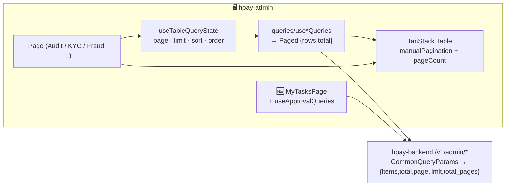
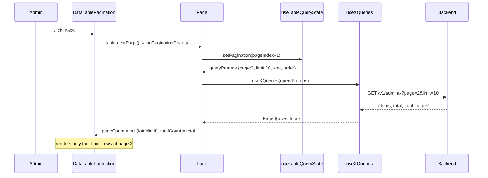
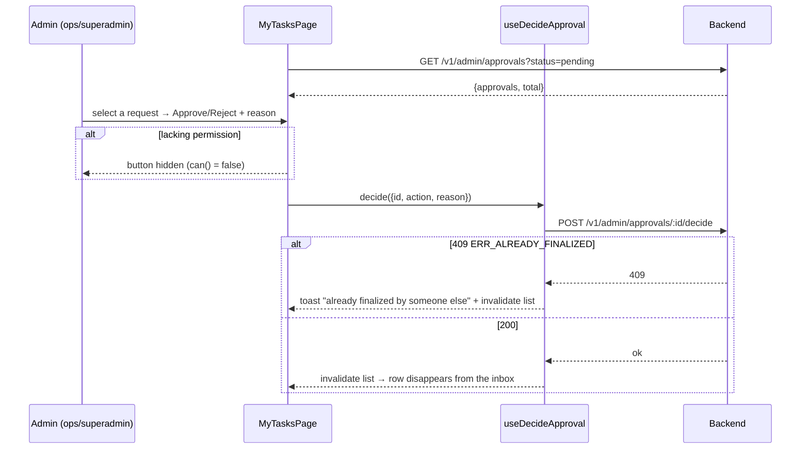
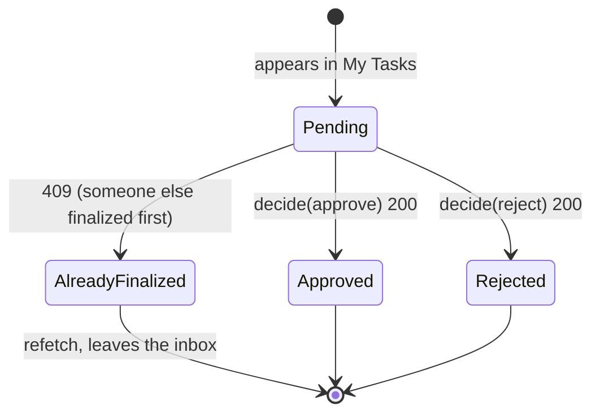
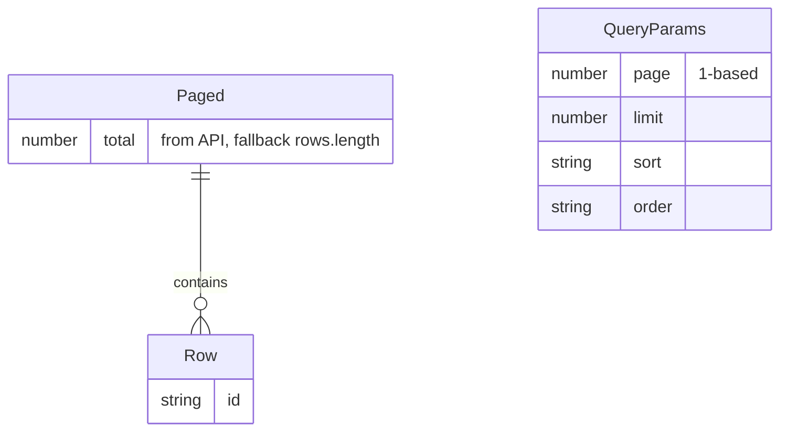

[← HPay Docs](../../../../docs/index.html) · repo `hpay-admin` · plan · solution architecture

# Solution Architecture — My Tasks & Server-side Pagination

Companion to [implementation-plan.md](./implementation-plan.md). All diagrams are mermaid; only the parts of the system this feature touches are drawn.

## 1. Context

The backend already provides the pagination contract; the change lies entirely in the hook + page layer of the admin SPA.

## 2. Main flow — changing page

## 3. Main flow — deciding an approval (My Tasks)

## 4. State — an approval in the inbox

## 5. Data model delta

No new tables — pure frontend. The data contract changes in the hook layer:

## 6. Decisions & trade-offs

| Decision | Alternative | Why |
|---|---|---|
| Offset pagination (`page`/`limit`) | Cursor pagination as doc 07 suggests | The backend already implements offset and returns `total_pages`; switching to cursor is a backend change out of scope. Debt recorded: offset can drift rows when data is inserted during pagination |
| `Paged<T>` instead of returning a flat array | Return an array + a separate hook to get total | A single source of truth for `pageCount`; the compiler catches every call site on change |
| `total` falls back to `rows.length` | Require the API to return total | Does not break when an endpoint is not yet upgraded or the backend reverts |
| Change one hook at a time | Refactor everything at once | The table is shared infrastructure; changing gradually + `tsc` keeps the repo always buildable |
| My Tasks reuses `DataTable` | Dedicated table | Consistent pagination/sorting UX with the other queues |

## 7. Invariants touched

| Invariant | How it is upheld |
|---|---|
| A01 — an action on a record whose state has changed must be handled gracefully | 409 → toast + invalidate, no crash, does not overwrite someone else's decision |
| A02 — the list must not drift rows during pagination | Real server-side + auto-reset to page 1 when filters change (already in `useTableQueryState`) |
| A05 — RBAC has 2 layers | FE hides buttons with `can()`; the backend remains the real enforcer (403), the FE does not trust itself |
| A07 — sensitive actions must have a reason in the audit | Reason is mandatory before sending decide; the backend writes audit_logs |
| No PII leak | The table only shows fields the API returns; does not assemble extra user data itself |

HPay · plan generated by the `gen-feature-plan` skill · repo hpay-admin · 2026-07-22
