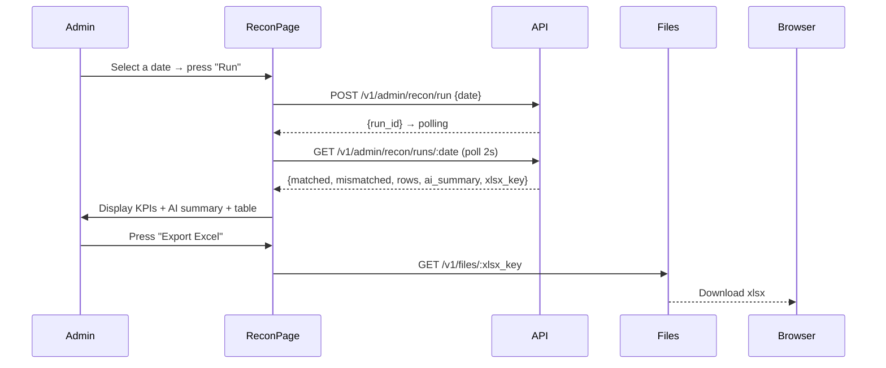

# Implementation Plan — A4 Recon, Orgs & Audit hpay-admin

Phase that completes the last 3 screens: **Reconciliation** (view recon results by day, AI summary, Excel export), **Organizations & Policy** (org list, view/edit policy tiers), **Audit Log** (immutable, filter, export). This is the final phase of hpay-admin.

## 1. Screens

| Screen | Mockup | APIs |
|---|---|---|
| Reconciliation (A8 mockup) | KPI cards (total/matched/mismatched/run time); AI summary card; detailed mismatch table; date picker; Excel export | `POST /v1/admin/recon/run`, `GET /v1/admin/recon/runs/:date`, `GET /v1/files/:key` |
| Organizations & Policy (A9 mockup) | Sidebar org list + search; editable policy tiers panel (level, min_amount, required_approvals); warning about in-flight requests; save → POST new policy | `GET /v1/org` (user token list), `POST /v1/org/:id/policies` |
| Audit Log (A10 mockup) | Immutable table: time/actor/action chip/resource/detail/IP; text search; date filter; export CSV | `GET /v1/admin/audit` (if not available yet → show a "Coming soon" placeholder) |
| AI Settings (F11 — no mockup yet, layout follows the Orgs 2-column) | AI keys table + CRUD form; routing panel for model/provider per function; is_active kill-switch | `GET\|POST /v1/admin/ai/keys`, `PUT /v1/admin/ai/keys/:id`, `GET\|PUT /v1/admin/ai/settings` — backend F11 (`src/backend/docs/plans/f11-dynamic-ai-config/`) |

## 2. Tasks

| # | Task | Files | Size | Depends |
|---|---|---|---|---|
| T1 | Recon hooks: `useReconRun(date)` — GET run; `useRunRecon()` — POST trigger; `useReconDownload()` — GET signed URL for the xlsx file | `src/features/recon/hooks.ts` | S | A1 |
| T2 | Recon page: date picker (input[type=date]); "Run reconciliation" button (POST + poll result); KPI cards; AI summary card (purple gradient as in the mockup); mismatch table (result/txn/ref/wallet/bank/time/handling); "Export Excel" button → GET signed file URL | `src/pages/ReconPage.tsx` | L | T1 |
| T3 | Orgs & Policy hooks: `useOrgs()` calls backend GET /v1/org with the admin token; `useOrgPolicies(orgId)`; `useSavePolicy()` — POST /v1/org/:id/policies with an idempotency key | `src/features/orgs/hooks.ts` | S | A1 |
| T4 | Orgs page: 2-column layout (org list sidebar + policy panel); org search; editable policy tiers (+ / − required_approvals; add level); warning card "N requests are pending approval under the old snapshot"; Save button → POST policy + idempotency-key | `src/pages/OrgsPage.tsx` | M | T3 |
| T5 | Audit Log page: read-only table; search box filtering client-side by actor/action/resource; date range filter; Export CSV button (client-side serialization from already-loaded data); pagination. If the endpoint is not available yet → show a placeholder but keep the correct layout. | `src/pages/AuditPage.tsx` | M | A1 |
| T6 | AI Settings hooks (F11): `useAIKeys()`, `useCreateAIKey()`, `useUpdateAIKey()`, `useAISettings()`, `useUpdateAISetting()` — 5 `/v1/admin/ai/*` endpoints | `src/features/ai/hooks.ts` | S | A1 |
| T6b | AI Settings page (F11): keys table (name, provider, masked key, is_active toggle, badge "in use by N functions"); add/edit key form (leaving api_key blank = keep the old key); per-function routing panel (kyc_scoring / fraud_advising → provider + model_name + key select); handle `ERR_KEY_INACTIVE`/`ERR_KEY_NOT_FOUND` inline; confirm dialog when disabling a key that settings point to | `src/pages/AISettingsPage.tsx` | M | T6 |
| T7 | Overall polish: responsive min-width 1280px, keyboard navigation (Esc closes modal, Enter confirms), loading skeleton, per-page error boundary; clean typecheck + lint + build | All pages | M | T1–T6 |

## 3. Recon page flow



## 4. Notes on Orgs & Policy

**Policy snapshot:** Warn if the org has approval_requests with status `pending` — a policy change only applies to new requests. The backend already enforces this (E09 snapshot) but the UI must clearly show the number of in-flight requests so the admin is careful.
**Admin can use GET /v1/org with an admin JWT** (the backend checks audience=admin) because it is the same endpoint but is not filtered by user_id — it returns all orgs. If the backend does not support this yet (needs checking), an additional `GET /v1/admin/orgs` endpoint will be needed.

## 5. Verification

```
npm run typecheck
npm run lint
npm run build
# Manual check:
# - Recon: select yesterday → run → view the result → export xlsx
# - Orgs: select an org → edit tier L2 required_approvals 2→1 → Save → toast
# - Audit: search "kyc.reject" → see the correct entries
```
