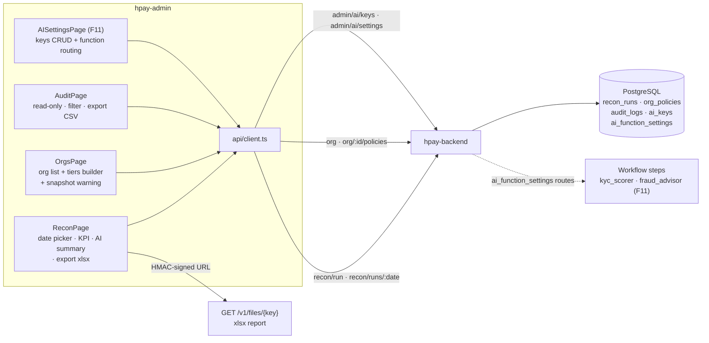
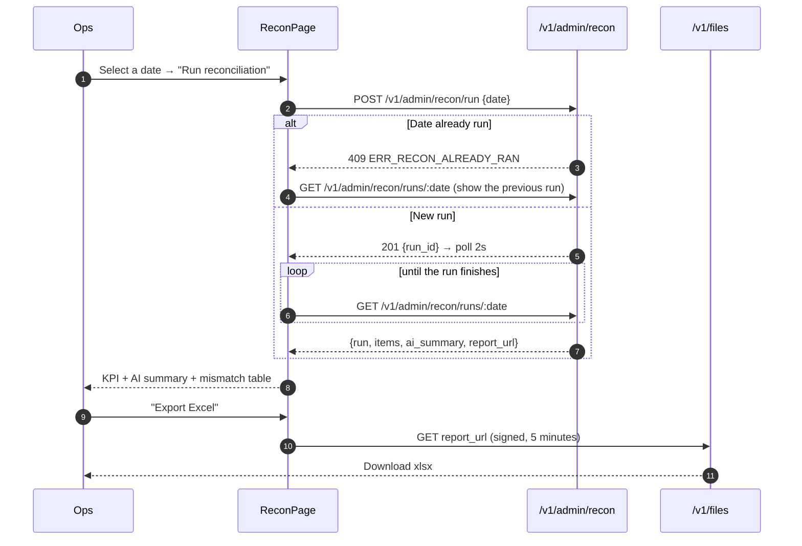
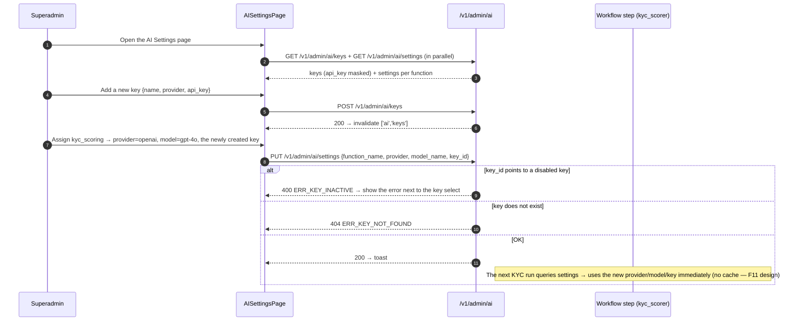
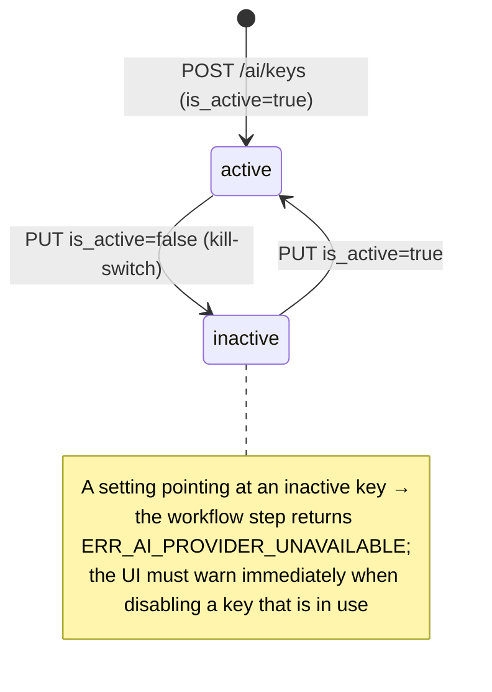

# Solution Architecture — A4 Recon, Orgs, Audit & AI Settings hpay-admin

Final phase of hpay-admin: Reconciliation (F9), Organizations & Policy (F6), Audit Log, and **AI Settings — the admin front-end of F11 Dynamic AI Config** (backend: `src/backend/docs/plans/f11-dynamic-ai-config/`).

## 1. Context

## 2. Main flow A — running reconciliation and exporting the report

## 3. Main flow B — dynamic AI configuration (F11)

## 4. State — AI key lifecycle (F11, as seen from admin)

## 5. Data model delta

**FE does not change the schema.** The related tables already exist from the backend: `recon_runs`, `org_policies` (snapshot — E09), `audit_logs` (immutable), and the F11 pair `ai_keys` / `ai_function_settings` (detailed ERD in the f11 solution-architecture). Client cache keys: `['recon', date]`, `['orgs']`, `['policies', orgId]`, `['ai','keys']`, `['ai','settings']`.

## 6. Decisions & trade-offs

| Decision | Alternative | Reason |
|---|---|---|
| AI Settings lives in A4, not a separate phase | A separate phase A5 for F11 | Only 1 CRUD page + 2 forms; backend F11 already has all the logic — thin FE. But the docs must describe it fully (sections 3–4 here) instead of a one-line task |
| api_key is write-only, never read back raw | Show the full key to superadmin | The backend returns it masked; leaving it blank on update = keep the old key. Reduces leak risk via DevTools/screenshots |
| Disabling a key that settings point to → warning dialog | Block disabling outright | The kill-switch must be fast when a key leaks (F11 design: no cache, takes effect immediately); only warn about the consequence (the AI step will fail) and then allow it |
| Audit export CSV client-side from loaded data | Backend export endpoint | Sufficient for the current scope; if a full export is needed → backend async job (A06) |
| The policy snapshot warning shows the number of in-flight requests | No warning | Matches E09 semantics: pending requests keep the old policy — the admin must see this clearly before saving |

## 7. Invariants & edge cases to uphold

| ID | Situation | How it is upheld |
|---|---|---|
| A05 | 2 tabs editing a policy / AI setting | Backend state-check; 409 handled via the shared interceptor |
| A06 | Heavy export | The xlsx is pre-generated by the backend, the FE only downloads via a signed URL; the audit CSV only serializes data already loaded |
| E09 | Policy snapshot for in-flight requests | Warning card counts pending approval_requests before saving the policy |
| F11 | Inactive key referenced by a setting | UI badge "in use by N functions" on each key; disabling → confirm dialog stating the consequence |
| — | Secrets not leaked | Do not log api_key; input type=password; masked from the backend |
| — | Audit is immutable | The page is strictly read-only — no button other than export |
