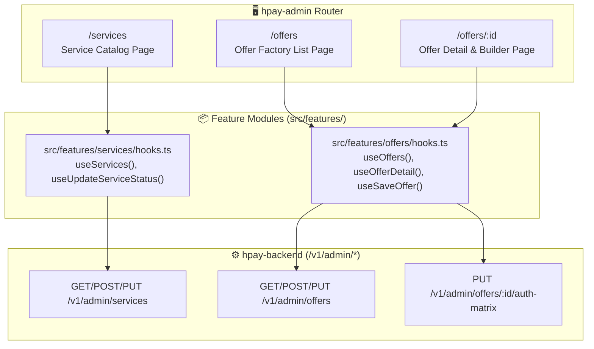

[implementation-plan →](implementation-plan.md) · a5-offer-service-factory

# A5 Offer Factory & Service Catalog — Solution Architecture

## 1. Executive Summary

The **A5 Offer Factory & Service Catalog** module provides an extended Admin Ops administration interface for `hpay-admin`. It lets Admins proactively create/edit the **Service Catalog**, toggle service Maintenance mode on/off instantly, and configure tiered **Product Offers (Offer Factory)** for each user segment (individual customers KYC 1/2 vs Businesses), together with a Limit Matrix and an Authentication Matrix (Auth Matrix: PIN vs OTP vs 2FA).

## 2. Frontend Architecture (React + React Router + TanStack Query)



## 3. Data Contracts & API Specifications

### 3.1 Service Catalog APIs

```
// GET /v1/admin/services
{
  "services": [
    {
      "id": "srv-1",
      "code": "P2P_TRANSFER",
      "name": "P2P Money Transfer",
      "category": "transfer",
      "status": "active", // active | maintenance | disabled
      "action_priority": "before_gl"
    },
    {
      "id": "srv-2",
      "code": "ORG_DISBURSEMENT",
      "name": "Business Payroll & Bonus Disbursement",
      "category": "org",
      "status": "active",
      "action_priority": "before_gl"
    }
  ]
}
```

### 3.2 Offer Factory APIs

```
// GET /v1/admin/offers
{
  "offers": [
    {
      "id": "off-1",
      "code": "OFFER_CUST_L2",
      "name": "Individual Customer (KYC Tier 2)",
      "role": "customer",
      "level": 2,
      "is_active": true,
      "authorized_services_count": 5
    },
    {
      "id": "off-2",
      "code": "OFFER_BIZ_ENT",
      "name": "Business (Business Enterprise)",
      "role": "merchant",
      "level": 5,
      "is_active": true,
      "authorized_services_count": 8
    }
  ]
}
```

## 4. UI Component Layout Specifications

### 4.1 Service Catalog Page (`/services`)

- **Filter Bar:** Search by service code/name, Category dropdown, toggle "Show only Services in Maintenance".
- **Service Table:** Columns Code, Name, Category, Priority, Maintenance Mode Switch Toggle (calls the API to change status instantly).
- **Form Modal:** Add/Edit Service information.

### 4.2 Offer Factory Builder (`/offers` & `/offers/:id`)

- **Offer List Grid:** Offer cards showing Role (Customer / Agent / Merchant / Biller), Level, Active status, and number of authorized Services.
- **Offer Builder Page (4 Steps Wizard / Tabs):**

  1. **Basic Info:** Offer name, Role, Level (1-20), Status.
  1. **Pocket Config:** Main wallet balance limits (Min/Max Balance Limit), maximum number of linked banks.
  1. **Authorized Services:** Choose the list of Services enabled for this Offer (multi-select list with search).
  1. **Service Component Config:** For each authorized Service:

     - Configure the Limit Matrix: `Max per transaction`, `Daily limit`, `Monthly limit`.
     - Configure the Authentication Matrix: choose `PIN` for small transactions (< 2M), `OTP` for medium transactions (2M-50M), `2FA (PIN+OTP)` for large transactions (> 50M).

hpay-admin · A5 Offer Factory & Service Catalog Solution Architecture v1 · 2026
