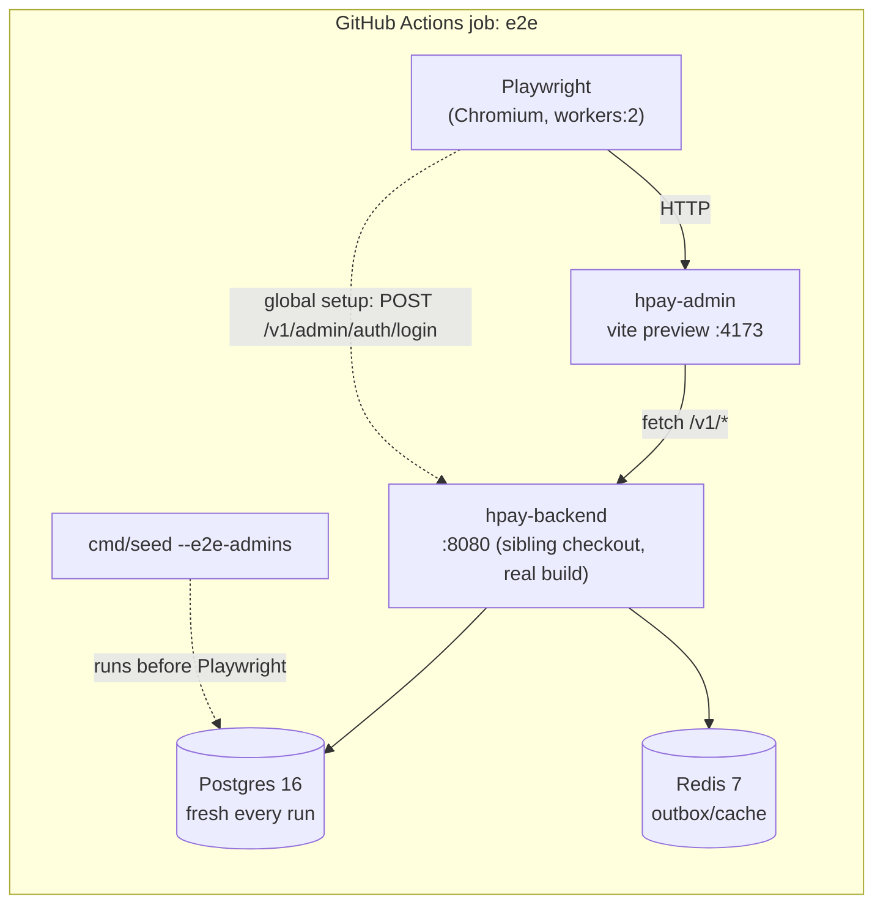
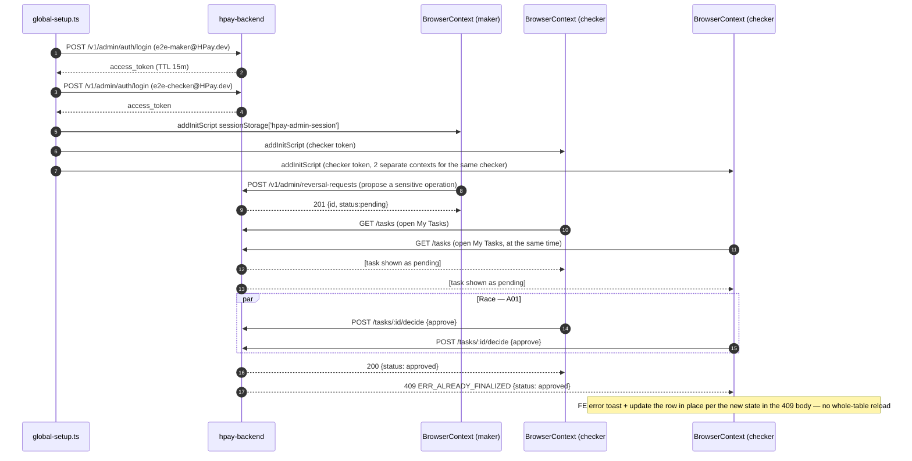
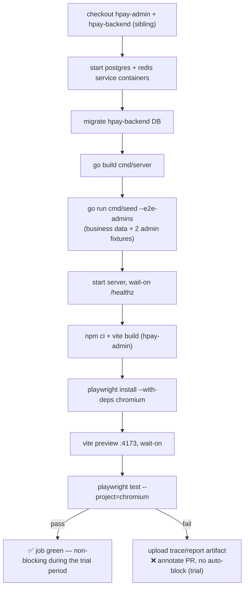
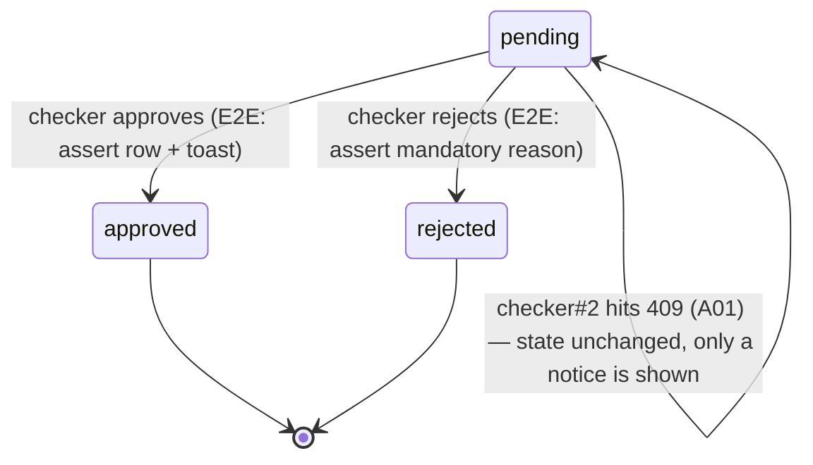

[← HPay Docs](../../../../docs/index.html) · repo `hpay-admin` · plan · solution architecture

# Solution Architecture — Playwright E2E Suite for hpay-admin

Companion to [implementation-plan.md](./implementation-plan.md). The suite runs real full-stack: Playwright (Chromium) → hpay-admin build (vite preview) → real hpay-backend (sibling checkout in CI) → Postgres + Redis containers, with no layer mocked.

## 1. Context

## 2. Main flow — a typical spec (My Tasks, maker-checker, A01)

## 3. CI job — sequence (mermaid, not a sequence between human actors but between steps)

## 4. State — lifecycle of 1 record tested through the UI (example approval_status, reused from the backend)

## 5. Data model delta

**No new tables/columns.** The only addition: 2 test-only `admin_users` rows (`e2e-maker@HPay.dev`, `e2e-checker@HPay.dev`) created by `cmd/seed --e2e-admins`, separate from the `admin@HPay.dev` row already seeded in migration 000001 — no migration is touched.

## 6. Decisions & trade-offs

| Decision | Alternative | Why |
|---|---|---|
| Auth: real login API (not through the form) for most tests + 1 real-form spec | (a) Go script minting the JWT directly, bypassing the auth service; (b) every test goes through the UI form | (a) removes the auth service from every test path — a coverage gap for the first thing every session passes through; (b) wastes CI time repeating the UI login dozens of times without increasing coverage. The mix keeps both speed and real auth coverage |
| 2 dedicated admin_users fixtures for E2E (`--e2e-admins`), not the existing `admin@HPay.dev` | Find/recover the plaintext of `admin@HPay.dev` to share with the dev demo | The demo account's plaintext appears nowhere in the repo (only the hash) — relying on it means relying on an unverifiable secret, fragile if anyone changes the demo seed. A separate test account with known plaintext, isolated from demo data, is clear and has no risk of leaking real credentials |
| Chromium-only in default CI | Full Chromium+Firefox+WebKit matrix | Full-stack E2E (backend build, migrate, seed) is already slow; multiplying by 3 browsers for an internal SPA with no engine-specific logic is a cost disproportionate to the benefit — a separate nightly cross-browser job can be added if needed |
| Check out hpay-backend as a sibling repo in the CI job (Option A) | hpay-backend publishes a Docker image to a registry, hpay-admin pulls it (Option B) | A can be implemented right away within hpay-admin's change scope, without changing hpay-backend. B is faster in the long run but requires new work in another repo, outside this plan's scope — recorded as a future improvement |
| Non-blocking (not a required check) for 1–2 weeks of trial before enabling blocking | Enable required/blocking from the very first commit | A brand-new suite with many infrastructure components coordinating for the first time (sibling checkout, full-stack healthcheck, dedicated E2E seed) — a CI infrastructure error (not a product bug) blocking PRs from day 1 would create pressure to bypass, damaging the gate's credibility in the long run |
| Mutation fixtures create their own records per `testId`, no transaction rollback | Wrap each test in a DB transaction then roll back (a common integration-test pattern) | E2E goes over real HTTP, triggering the async workflow engine + Redis outbox — rolling back the DB between tests would leave orphaned side effects (events already published, jobs already enqueued) with no corresponding DB record, making debugging harder than accepting accumulated data within one CI run (container destroyed at the end of the job) |

## 7. Invariants touched

| Invariant / edge case | How the suite keeps it within the verification scope |
|---|---|
| A01 — race of 2 reviewers | 2 separate `browserContext`s, same token or different tokens, click decide almost simultaneously (`Promise.all`), assert 1 wins 200 / 1 loses 409 + the row auto-updates |
| A02 — cursor pagination does not drift rows | Test inserts new data through a background API while "on page 3", assert next/prev still returns the correct logical set of rows, with no duplicated/missing rows from offset drift |
| A03 — refresh single-flight / re-login keeps filter | Write a garbage token into sessionStorage midway, trigger 1 action, assert the re-login modal appears and after logging in again the URL + query params (filter) are preserved |
| A04 — expired signed KYC image | Route interception returns 403 for the first image request, assert the FE requests a new URL exactly once and only then reports an error if it still fails |
| A05 — 2 tabs editing | 2 `page`s in the same `browserContext` (simulating 2 tabs) edit the policy, the tab saving later receives 409 through the shared interceptor, the UI does not crash |
| A06 — heavy export does not hang the UI | Assert the UI still accepts clicks/interaction while waiting for the export, with no overlay blocking the whole page for too long |
| A07 — PII masked | `page.on('response')` checks that the step detail JSON body does not contain known raw PII values (compared with the original values in the seed) — only `***` is accepted |
| Existence not revealed / 404 semantics (inherited from the backend) | The suite does not retest this backend logic (separate integration tests already exist in hpay-backend) — it only asserts the FE displays correctly on receiving 404/409, without further inference |

HPay · plan generated by the `gen-feature-plan` skill · repo hpay-admin · 2026-07-29
