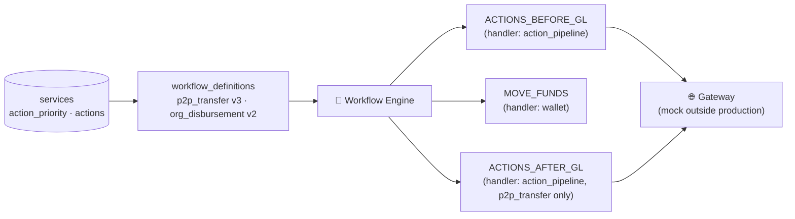
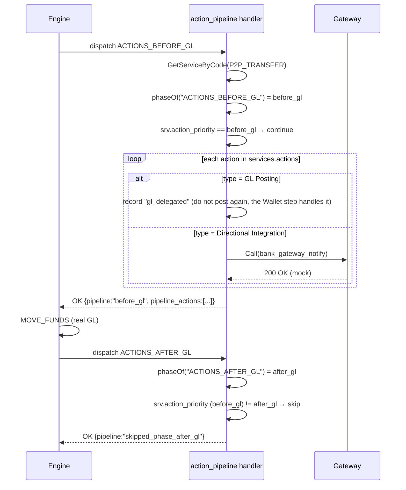
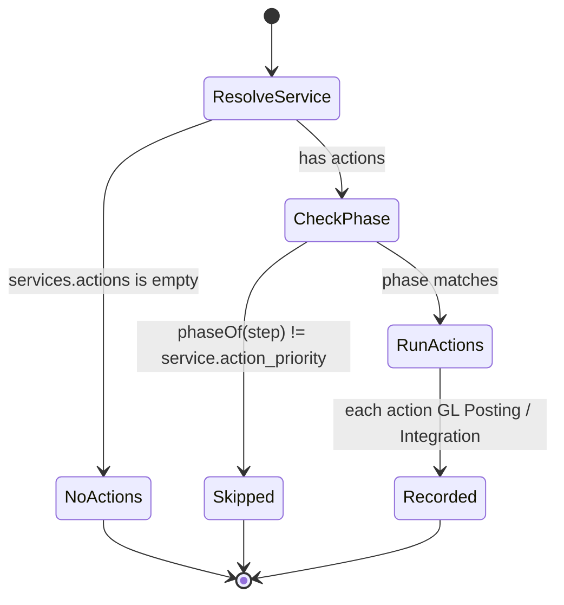
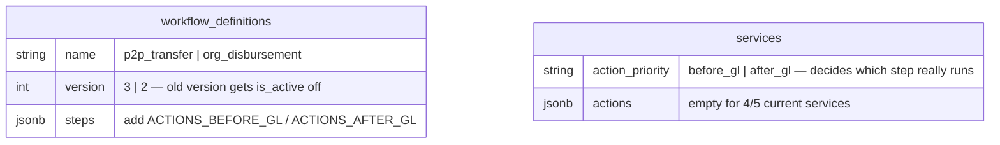

[← HPay Docs](../../../overview-v2.md) · repo `hpay-backend` · plan · solution architecture

# Solution Architecture — Wire Action Pipeline

> Companion to [implementation-plan.md](./implementation-plan.md). No new logic code — `action_pipeline.go` has always been correct; the only job is to make it appear in `workflow_definitions.steps`.

## 1. Context

## 2. Main flow — P2P_TRANSFER (action_priority=before_gl)

## 3. State — each step decides for itself whether to run

Exactly 1 of the 2 steps (`ACTIONS_BEFORE_GL` or `ACTIONS_AFTER_GL`) actually runs actions for a given service — the other is always `skipped_phase_*`. No service runs actions in both phases.

## 4. Data model delta

No new table/column — only a new `workflow_definitions` record version is added.

## 5. Decisions & trade-offs

| Decision | Alternative | Why |
| --- | --- | --- |
| Both steps (`ACTIONS_BEFORE_GL`, `ACTIONS_AFTER_GL`) exist in `p2p_transfer`, each service chooses via `action_priority` | Split into 2 separate workflow definitions per phase | 4 different services (P2P/MONEY_REQUEST/TOPUP/VAULT) already share `p2p_transfer`; splitting definitions by phase would require duplicating all of VALIDATE/FRAUD_CHECK/MOVE_FUNDS/CONFIRM for each branch |
| `ACTIONS_BEFORE_GL` comes before `WAIT_APPROVAL` in `org_disbursement` | Place it after approval, right before `MOVE_FUNDS` | Avoids calling a 3rd-party action for a payroll disbursement order that has not been approved; failing early is cheaper than failing after waiting 24h for approval |
| `org_disbursement` adds only `ACTIONS_BEFORE_GL`, not `ACTIONS_AFTER_GL` | Add both for symmetry | ORG_DISBURSEMENT is the only service using this definition and its `action_priority='before_gl'` is fixed — adding after_gl would be a design for a case that has never occurred |
| Version bump (v3/v2), not editing the existing version in place | UPDATE the steps JSONB in place | Follows the convention already used in plan `round-up-vault`: in-flight instances reference a fixed `definition_id` |

## 6. Invariants touched

| Invariant (index §8) | How it is preserved |
| --- | --- |
| GL Posting is performed only by the Wallet step | `action_pipeline.go` already records "gl_delegated" instead of posting again — unchanged, it is just invoked one more time through the new step |
| Retry does not create a double transaction | `step_executions(instance_id, step_name, attempt)` protects the 2 new steps exactly like every other step |
| Ledger is append-only | Unchanged — the 2 new steps do not touch `ledger_entries` |

---
HPay · plan generated by the gen-feature-plan skill · repo hpay-backend · 2026-07-24
