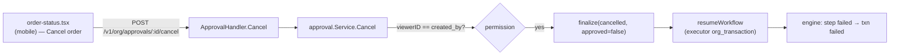
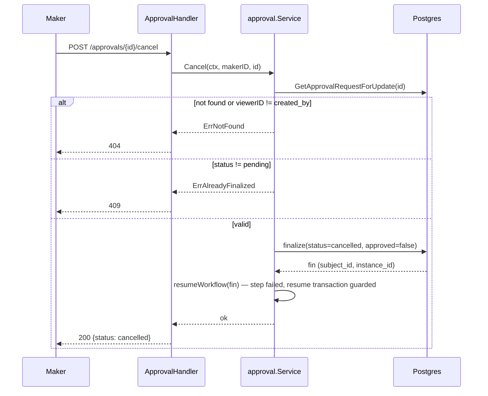
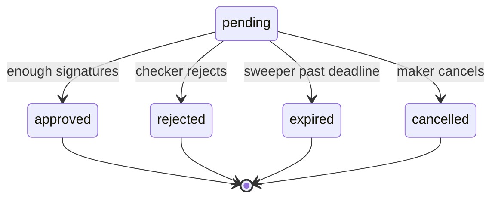

[← HPay Docs](../../../overview-v2.md) · repo hpay-backend · plan · solution architecture

# Solution Architecture — Maker Cancels a Pending Approval

> Companion to [implementation-plan.md](./implementation-plan.md). Cancel reuses exactly the finalize/executor mechanism of reject — only the entrypoint and the AuthZ predicate differ (maker instead of checker).

## 1. Context

## 2. Main flow

## 3. State

## 4. Data model delta

The enum `approval_status` gains the value `cancelled` — no new table/column.

## 5. Decisions & trade-offs

| Decision | Alternative | Why |
| --- | --- | --- |
| Add a separate status `cancelled` | Reuse `rejected` with a distinguishing `reason` | A maker cancelling themselves and a checker rejecting are 2 different business events (who is responsible, whether it counts toward the checker's reject rate) — a separate status means later reporting/audit does not have to infer it from the `reason` text |
| Reuse the existing `finalize()`/executor | Write a separate cancel path that bypasses the executor | `finalize()` already has FOR UPDATE + a race guard (E08/E10 pattern), and the `resumeWorkflow` executor already knows how to fail 1 step + resume the transaction guarded — rewriting it is duplication and increases the risk of diverging behavior |
| AuthZ: exactly `created_by`, not using `eligibility()` | Extend `eligibility()` to also accept the maker role | `eligibility()` carries the semantics "the checker is allowed to sign at this tier" — mixing a rule for the maker into the same function would make it harder to read, for a completely different rule (who owns the request, not who may sign) |

## 6. Invariants touched

| Invariant | How it is preserved |
| --- | --- |
| State machine discipline | Cancel does not do its own `UPDATE ... SET status` — it goes through `finalize()`, the only transition function, which already has the guard `WHERE status='pending'` |
| Ledger immutability | Creates no ledger entry — identical to the existing reject branch |
| 2-layer AuthZ | Compares `viewerID == created_by` in the service, not relying only on the JWT role in middleware |
| Existence not revealed | 404 for both "does not exist" and "not the request owner" |

---
HPay · plan generated by the gen-feature-plan skill · repo hpay-backend · 2026-07-24
