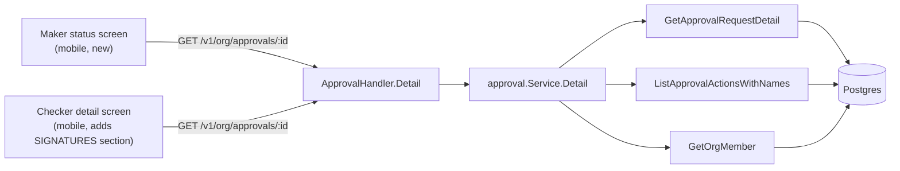
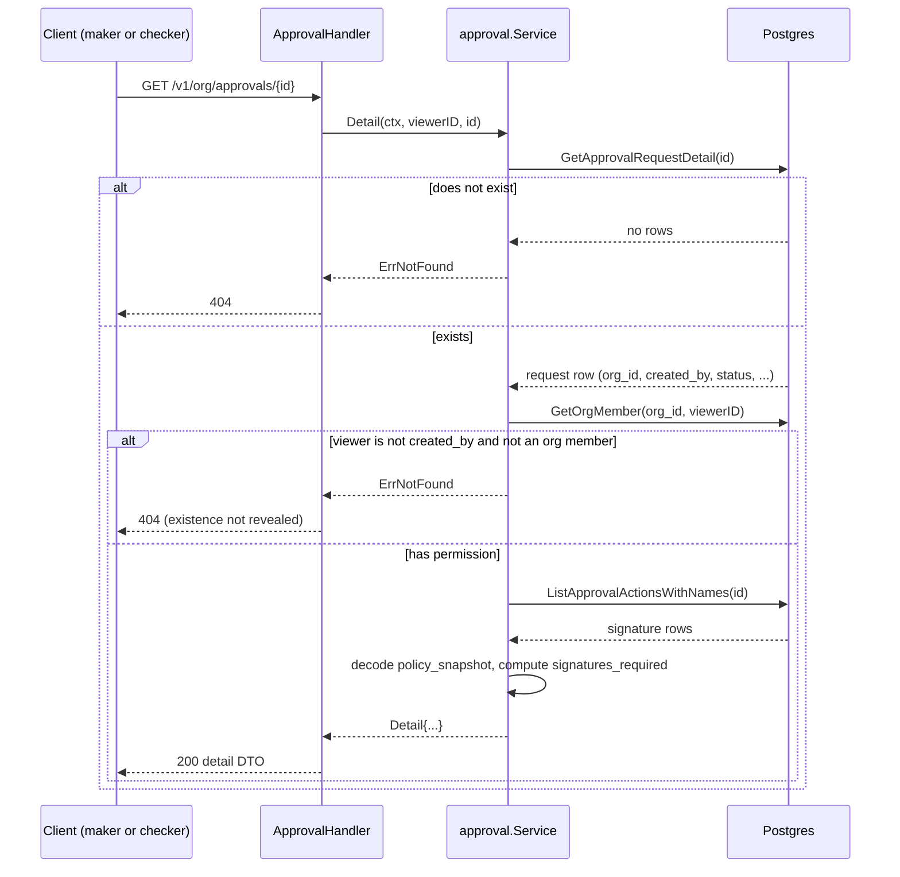
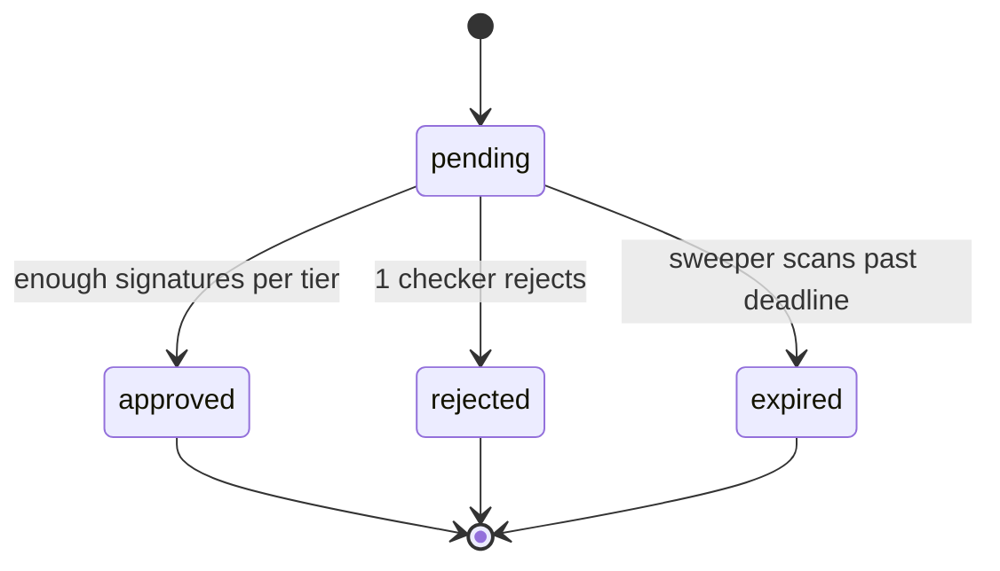
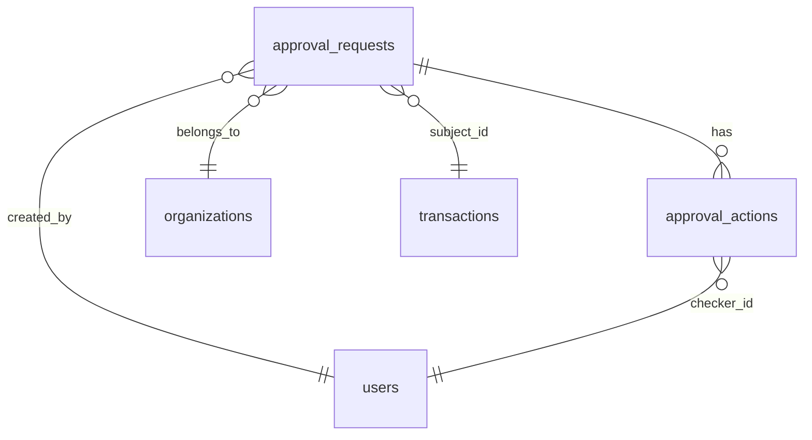

[← HPay Docs](../../../overview-v2.md) · repo hpay-backend · plan · solution architecture

# Solution Architecture — Approval Detail Endpoint

> Companion to [implementation-plan.md](./implementation-plan.md). Extends F6 (maker-checker): adds 1 read path for details + signature history, without changing the state machine or the existing decision path (`Decide`).

## 1. Context

## 2. Main flow

## 3. State — no new state machine

Only re-reads the existing state machine of `approval_requests.status`, no transition changes.

## 4. Data model delta

No new table/column. Response DTO:

| Field | Source |
| --- | --- |
| id, status, current_level, created_at, expires_at, finalized_at | `approval_requests` |
| org_id, org_name | `organizations` |
| ref_code, amount, fee | `transactions` (by subject_id) |
| maker_id, maker_name | `users` (by created_by) |
| policy_name, signatures_required | decoded from `policy_snapshot` (sum of required_approvals over all tiers) |
| signatures[]: checker_id, checker_name, level, action, acted_at | `approval_actions` joined with `users`, ordered by id |

## 5. Decisions & trade-offs

| Decision | Alternative | Why |
| --- | --- | --- |
| Only applies to `subject_type = org_transaction` | A general DTO for every subject (reversal, account_lock, policy_change) | Mobile only displays approvals of org_transaction; admin subjects already have their own path in the admin web. Avoids a polymorphic DTO for callers that have never existed. |
| View permission = the maker OR any org member | Only a checker at the exact current tier may view (like `eligibility()` of Decide) | Viewing history should not be blocked by "may I approve right now" — a level 2 checker still needs to see that level 1 has signed, and the maker is by definition not a checker. The `Decide` path keeps its strict check unchanged. |
| 404 (not 403) for someone without permission | 403 Forbidden | Keeps the principle already in `eligibility()`: outsiders must not learn whether a request exists. |
| A separate join query instead of combining multiple calls | Call `GetApprovalRequest` then look up org/maker/txn separately | Keeps 1 round-trip, the same way `ListPendingApprovalsForChecker` already joins for the Inbox. |

## 6. Invariants touched

| Invariant | How it is preserved |
| --- | --- |
| 2-layer AuthZ — the predicate lives in SQL/service, not only in middleware | The `GetOrgMember` check + the `created_by` comparison live in the service before returning data; the handler does not decide permission itself |
| No PII/money exposure beyond what already exists | The DTO only adds the checker name — maker/org/amount data is already exposed through the Inbox |
| E09 — evaluate always reads the frozen snapshot, not the live policy | `signatures_required` is computed from the `policy_snapshot` stored on the request, not from `approval_policies` |
| Existence not revealed to unrelated people | 404 for both cases "does not exist" and "no permission" |

---
HPay · plan generated by the gen-feature-plan skill · repo hpay-backend · 2026-07-24
