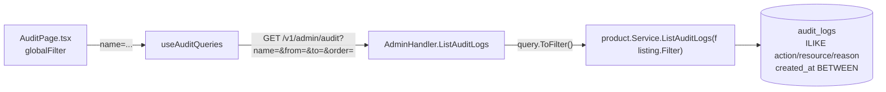
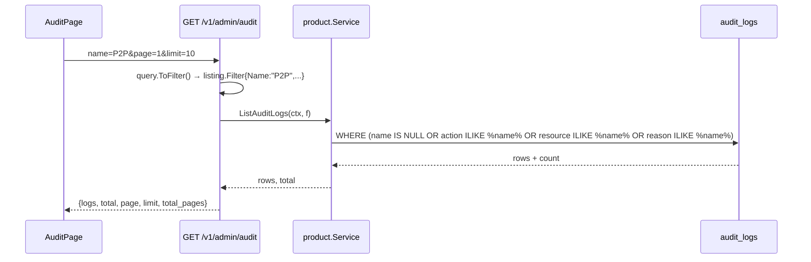
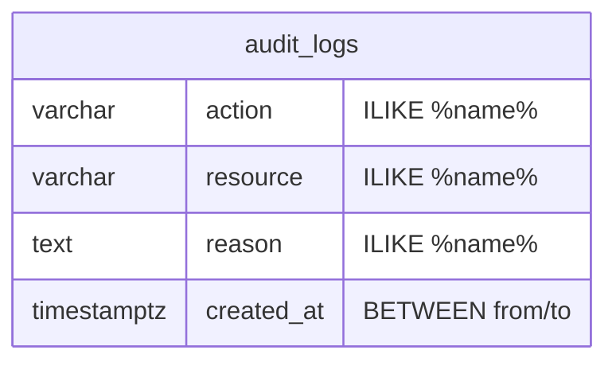

[← HPay Docs](../../../overview-v2.md) · repo hpay-backend + hpay-admin · plan · solution architecture

# Solution Architecture — Audit Log Server-Side Search

> Companion to [implementation-plan.md](./implementation-plan.md). No new concept — it just applies the exact `listing.Filter` pattern already used in fraud flags/workflow instances/offer factory to the remaining audit endpoint.

## 1. Context

## 2. Main flow

## 3. Data model delta

No new table/column — only the query on `audit_logs` (which has existed since migration 000001) changes.

## 4. Decisions & trade-offs

| Decision | Alternative | Why |
| --- | --- | --- |
| `name` matches OR across action/resource/reason | A separate param for each column | In the spirit of a single free-text search box like every other admin list already has (offer factory, service catalog) — does not turn the UI into multiple filter boxes |
| No join of the actor to a real name | Join `admin_users`/`users` depending on `actor_type` | `actor_type` can be user/admin/system — the conditional join is complex, and the current goal is to search event content rather than who caused it; left for later if needed |
| No new full-text index | A GIN trigram index for faster ILIKE | The current audit log volume is small (demo/dev); the 2 existing indexes are enough, adding an index early is an optimization with no evidence of need |

## 5. Invariants touched

No financial invariant is affected — this is a read-only path, posts no ledger entry, and changes no state machine. The principle "do not log PII/secrets at info level" still applies: the query only reads already-recorded fields and adds no new logging.

---
HPay · plan generated by the gen-feature-plan skill · repo hpay-backend + hpay-admin · 2026-07-24
