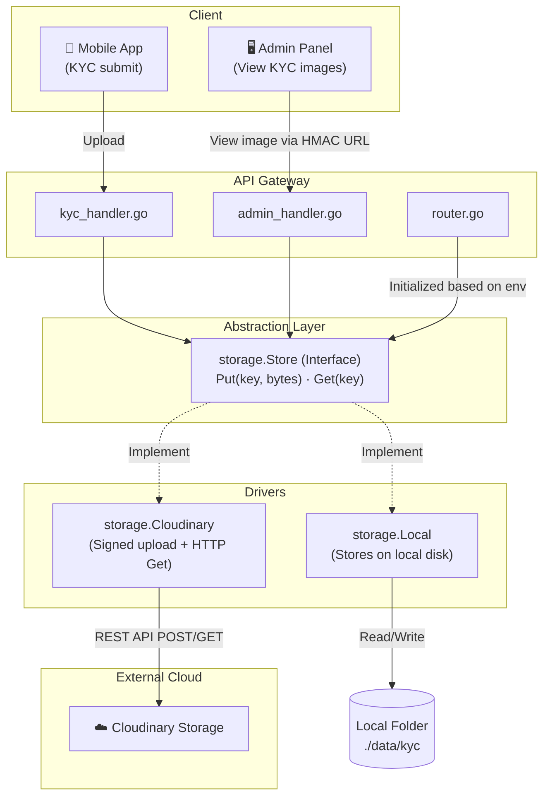
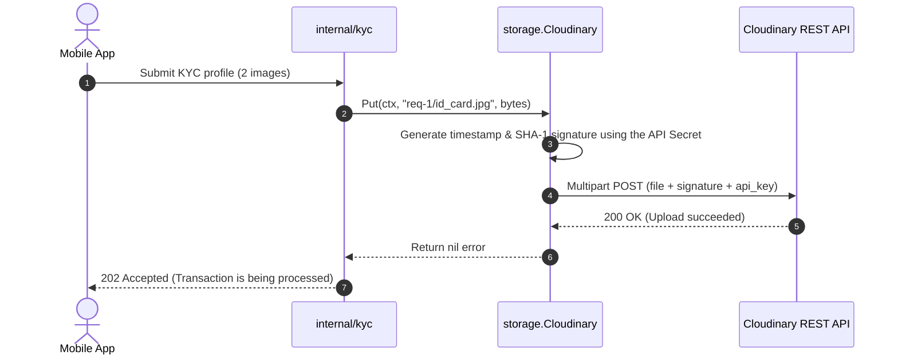
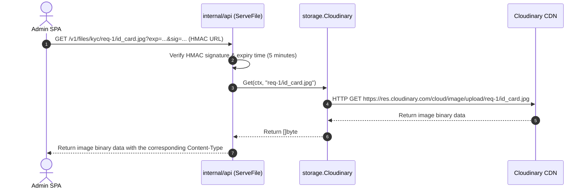

[← implementation-plan](implementation-plan.md) · cloudinary-storage

# Cloudinary Cloud Storage — Solution Architecture

## 1. Context — Position of the Cloudinary driver in the system

Cloudinary is integrated through the `storage.Store` interface, making the application fully independent of the physical storage infrastructure.

## 2. Main flow — Image submission & viewing flow

### A. KYC submission flow (Put)

### B. Admin image viewing flow (Get)

## 3. Decisions & trade-offs

| Decision | Alternative | Reason & Benefits |
| --- | --- | --- |
| **Proxy images through the backend** in the `Get()` function | Return the direct Cloudinary URL to the client for display. | - **Security and privacy:** KYC images contain sensitive user information (PII). If direct Cloudinary links were used, outsiders could guess the URL or share the link permanently. Proxying through the backend keeps the 5-minute HMAC Signed URL protection in place.  - **Independence:** The client does not need to know whether the image lives on Cloudinary or on a local disk, preserving the system's encapsulation. |
| Use the **plain Go HTTP client** instead of installing the official Cloudinary SDK | Run `go get github.com/cloudinary/cloudinary-go/v2` | - **Minimal dependencies:** Reduces the application build size and avoids security risks from transitive sub-packages.  - **High reliability:** The Cloudinary APIs are very stable; calling the REST API through a multipart form takes very few lines of code and is easy to debug/mock for testing. |

## 4. Invariants touched (Security & fintech standards)

- **PII protection (sensitive personal information):** Never expose the direct Cloudinary URL externally. All image viewing must pass a secure HMAC signature check within 5 minutes.

- **Infrastructure independence:** The storage key in the DB is always a relative key (for example: `req-123/selfie.jpg`) rather than an absolute URL, making future data migration between cloud providers extremely simple without running an SQL migration.
