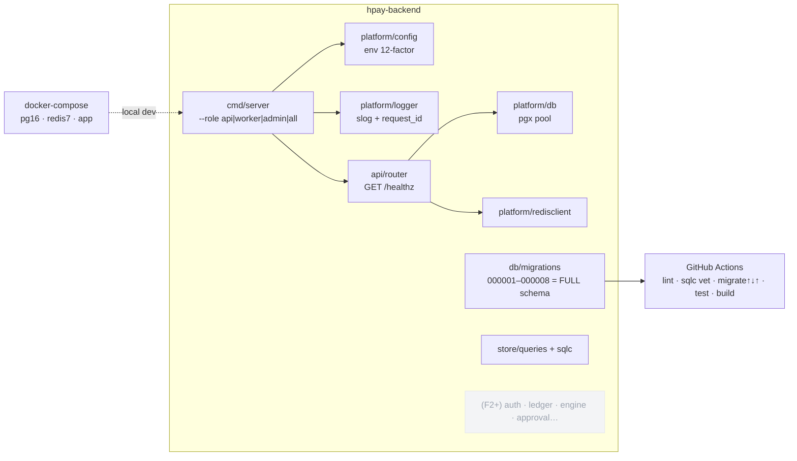
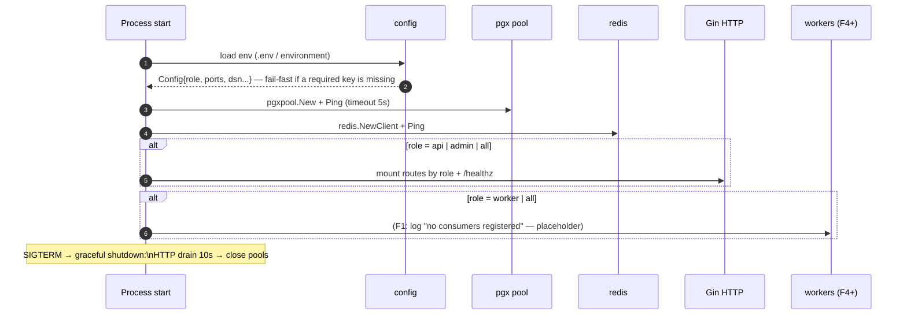
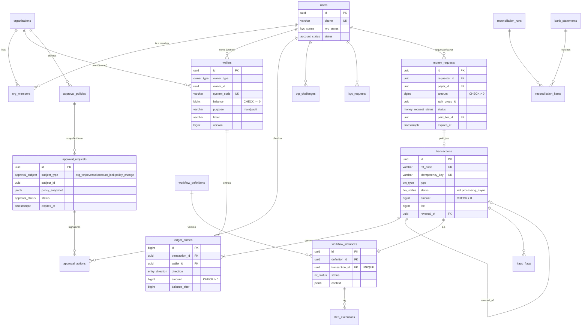

[← Implementation Plan](implementation-plan.md) · f1-foundation

# F1 Foundation — Solution Architecture

## 1. Context — F1 builds the foundation (bold); the dimmed parts are later phases

## 2. Main flow — boot by role

## 3. State — no new lifecycle in F1

F1 adds no state machine (the schema defines the enums but the transition logic belongs to F3–F6). The stateDiagram is skipped per the "if applicable" rule.

## 4. Data model — full F1 schema (ER)

## 5. Decisions & trade-offs

| Decision | Alternative | Why |
| --- | --- | --- |
| Merge the 04§2 delta into the original migrations (approval_requests generalized from the start) | Build transaction_approvals first and migrate afterwards | No environment is running yet — no reason to keep a schema that will be discarded; saves one round of churn |
| DB trigger blocks UPDATE/DELETE on ledger_entries | Rely only on review + app user permissions | The most important invariant should be enforced at the deepest layer; testable right away in CI |
| Auth tables (refresh_tokens, admin_users, audit_logs) deferred to F2 | Include them in F1 | Matches the phase boundary; F2 will use gen-migration through the proper process — also demonstrates the skill in action |
| go.sum generated on the dev machine/CI (sandbox has no Go) | Wait for a toolchain before scaffolding | Does not block progress; CI is the real compile gate |

## 6. Invariants touched

| Invariant (index.html §8) | F1 guarantees it by |
| --- | --- |
| Money is BIGINT | Every amount/balance/fee column in the 8 migrations is BIGINT + CHECK |
| Ledger is INSERT-only | Trigger `ledger_entries_append_only` + test in the CI migrate job |
| Retry does not create duplicate transactions | UNIQUE `idempotency_key` present from the first migration |
| Events are neither lost nor early | Outbox table + partial index ready for the relay (F4) |
