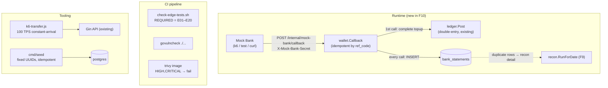
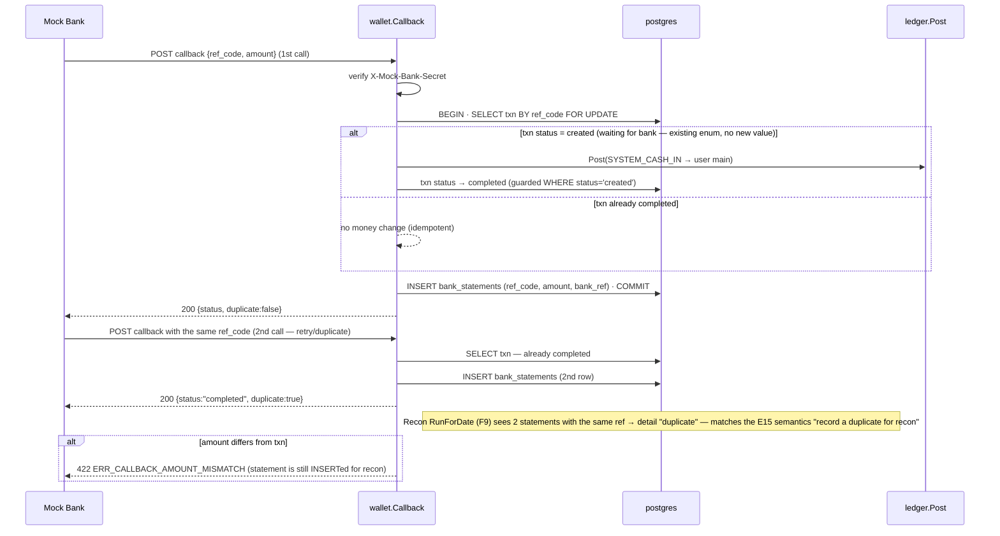
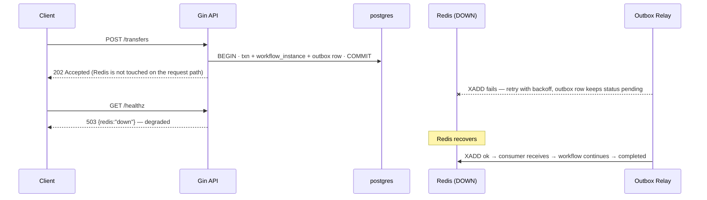

[← implementation-plan](implementation-plan.md) · f10-hardening

# F10 Hardening — Solution Architecture

## 1. Context

F10 touches 4 areas: the mock bank callback (the only new runtime part), the E15/E17 test harness, the CI pipeline, and tooling (k6, seed). The rest of the system stays unchanged.

## 2. Main flow — E15 duplicate bank callback

## 3. Main flow — E17 Redis down

There is no new state machine — `transactions`/`workflow_instances` keep their lifecycle; the callback only uses the guarded transition `created → completed` on the existing enum. No ERD delta (no new table/column — see implementation plan §3 for the condition under which UNIQUE on bank_statements may be relaxed if encountered).

## 4. Decisions & trade-offs

| Decision | Alternative | Why |
| --- | --- | --- |
| The callback is a mock endpoint under `/internal/`, guarded by a shared-secret header | HMAC signature like a real bank; or internal-only test without an endpoint | Enough for E15 to test the "callback arrives twice" semantics over real HTTP; HMAC is over-engineering for a mock — the README states clearly that this is the point to upgrade when integrating a real bank |
| Keep the existing synchronous topup; the callback is an additional path | Convert topup to async (add status pending_bank) → callback | Changing the topup flow would break the M3 mobile app that already follows the current openapi; additive = zero regression. Docs 00 describe topup as a mock — no design deviation |
| E17 test via a dead Redis addr + recovery by pointing back to the real addr | testcontainers pause/unpause container | No Docker API permission needed in the test; the existing helpers already accept TEST_REDIS_ADDR — simple, deterministic |
| k6 constant-arrival-rate (open model) | ramping-vus (closed model) | The NFR says 100 TPS — arrival rate is the only way to measure true TPS; a closed model self-throttles when the system is slow and produces misleadingly good numbers |
| trivy fails only on HIGH/CRITICAL | fail on every severity | MEDIUM and below on the base image is permanent noise that makes CI red pointlessly |
| Seeder asserts balance = SUM(ledger) before printing the summary | Seed balances directly into wallets | The hard rule "every balance change goes through ledger.Post" applies to the seed too — the seed is also a client of the ledger, there is no back door |

## 5. Invariants touched (index.html §8)

| Invariant | F10 upholds it by |
| --- | --- |
| Ledger balanced, INSERT-only | Callback completes via `ledger.Post`; the seeder does the same + a final SUM assert; the CI migrate job still proves the append-only trigger |
| Idempotency on every money-in path | Callback is idempotent via UNIQUE `ref_code` + FOR UPDATE + guarded transition — the E15 test proves it |
| No data loss when infrastructure goes down | The E17 test proves the outbox pattern: the DB is the source of truth, Redis is only the transport |
| State transitions guarded by WHERE status | `created → completed` guarded WHERE status='created'; no new enum value added |
| Edge coverage is a CI gate | check-edge-tests.sh REQUIRED = full E01–E20, a missing one turns the build red |

---

F10 Hardening · solution architecture v1 · 18/07/2026
