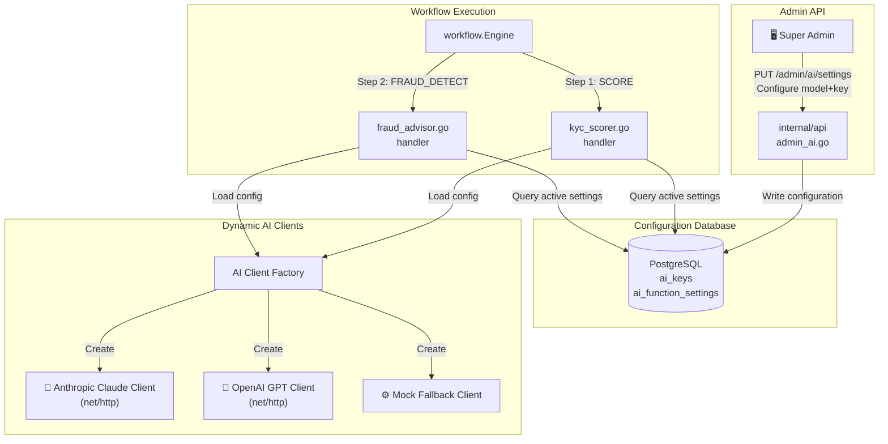
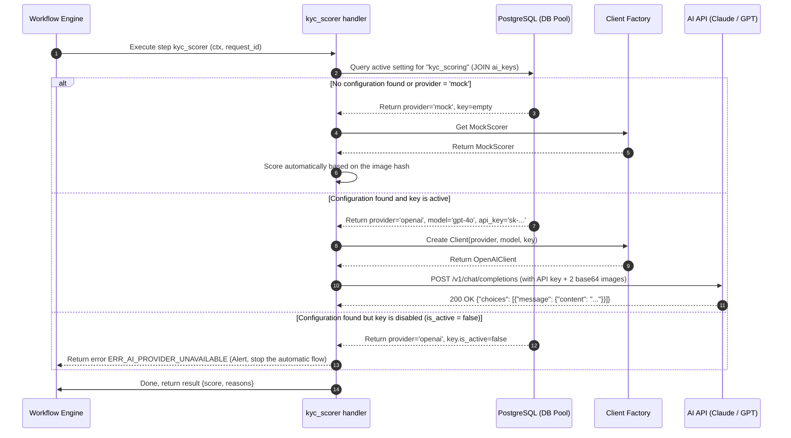
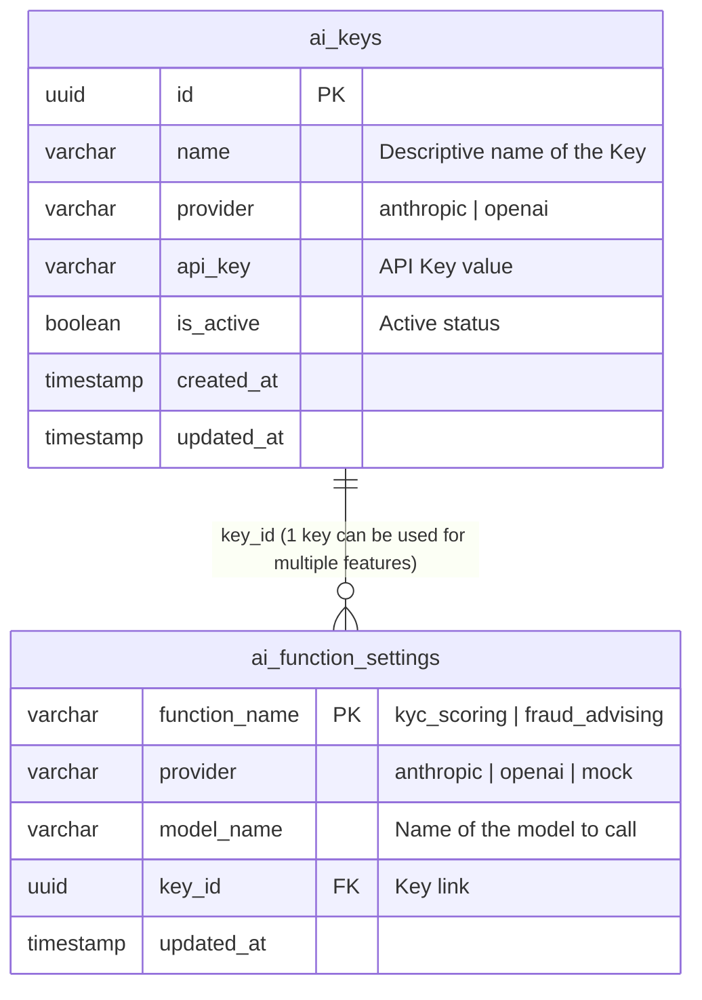

[← implementation-plan](implementation-plan.md) · f11-dynamic-ai-config

# F11 Dynamic AI Config — Solution Architecture

## 1. Context — Structure of dynamic AI configuration loading

The Workflow Engine loads configuration from the DB to route AI requests to the selected provider and model.

## 2. Main flow — Loading configuration & execution in the KYC Scorer step

## 3. Data model — New data tables

## 4. Decisions & trade-offs

| Decision | Alternative | Reason & Benefits |
| --- | --- | --- |
| Split into **ai_keys** and **ai_function_settings** tables | Store api_key directly in a column of the settings table. | - **Easy management and reuse:** Lets users declare a single API Key (for example the company's OpenAI Key) and map that key to be shared by both KYC and Fraud. When the key needs changing, only one record in the `ai_keys` table has to be edited. - **Security:** Makes it easy to hide/mask the secret field in management tables. |
| **Query the DB directly** on every workflow step run | Store the configuration in a cache (Redis or in-memory). | - **Immediacy:** When an admin discovers a faulty key and clicks "deactivate", the system immediately blocks subsequent AI calls without waiting for cache expiry or cluster sync.  - **Low frequency:** AI tasks such as KYC image submission or Fraud alerts occur at a modest rate (a few per second at medium scale), so querying PostgreSQL directly (with optimized indexes) does not affect system performance. |
