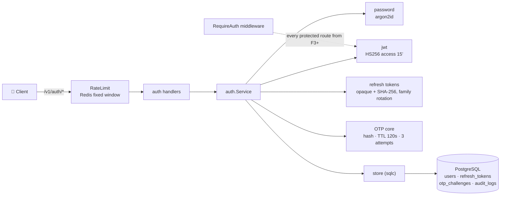
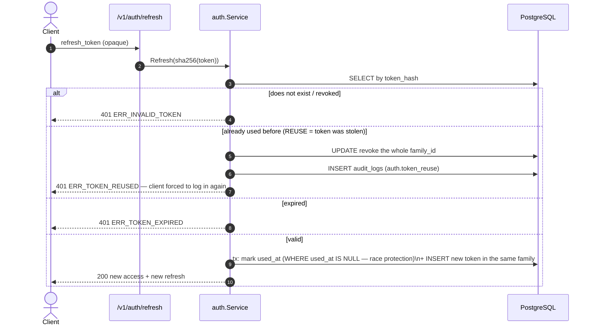
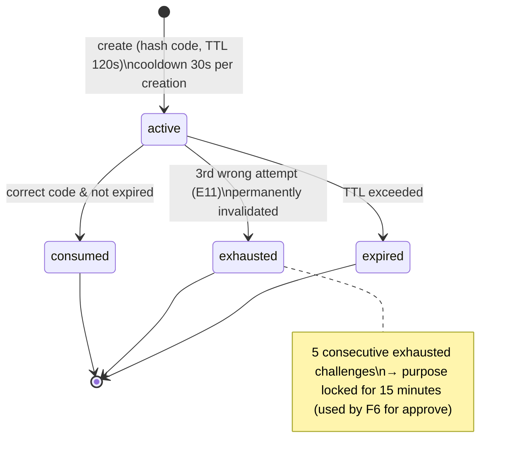
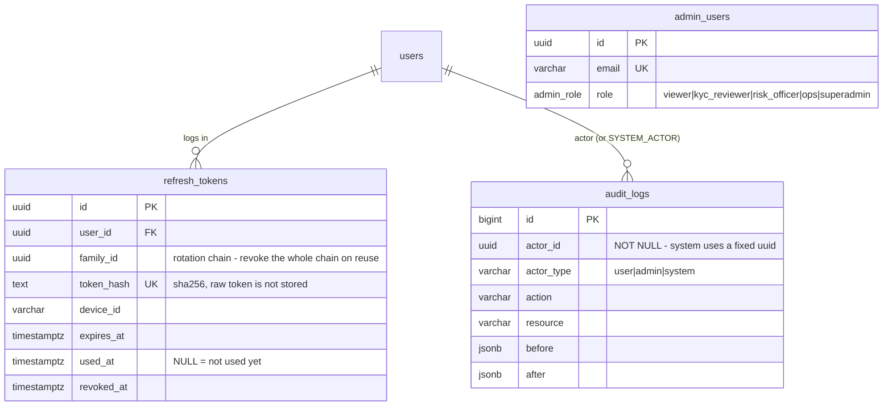

[← Implementation Plan](implementation-plan.md) · f2-auth

# F2 Auth & Users — Solution Architecture

## 1. Context

## 2. Main flow — Refresh rotation + theft detection

## 3. State — OTP challenge

## 4. Data model delta

## 5. Decisions & trade-offs

| Decision | Alternative | Why |
| --- | --- | --- |
| Opaque refresh token (random 256-bit) stored as SHA-256, not a JWT | Refresh token is also a JWT | Opaque tokens can be revoked individually/per family; a JWT refresh token cannot be revoked before expiry |
| Theft detection by family | Only reject the old token | If the thief uses the token before the victim, rejecting a single token does not help; revoking the family forces both sides to re-login — OWASP standard |
| Single HS256 secret | RS256 key pair | One service issues and verifies its own tokens — asymmetric keys are not needed; switch to RS256 when services are split (the interface already hides it) |
| Login failures return a generic ERR_INVALID_CREDENTIALS | Distinguish non-existent user | Prevents user enumeration |
| Fixed-window rate limit with Redis INCR+EXPIRE | Precise sliding window | Sufficient for the purpose; simple = fewer bugs; upgrade later if needed |

## 6. Invariants touched

| Invariant | How it is guaranteed |
| --- | --- |
| OTP/password/token never appear in logs | Only id/purpose are logged; OTP dev-mode prints the code through the single APP_ENV=dev branch; fintech-review #7 scans for it |
| OTP is stored hashed | SHA-256 of code + challenge-id salt; constant-time comparison |
| Every sensitive action is audited | token_reuse, login_failed (counted); account lock is not in F2 but the schema is ready |
