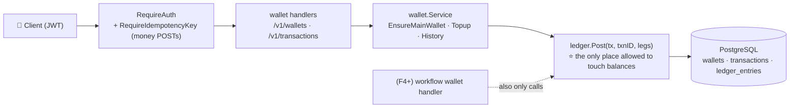
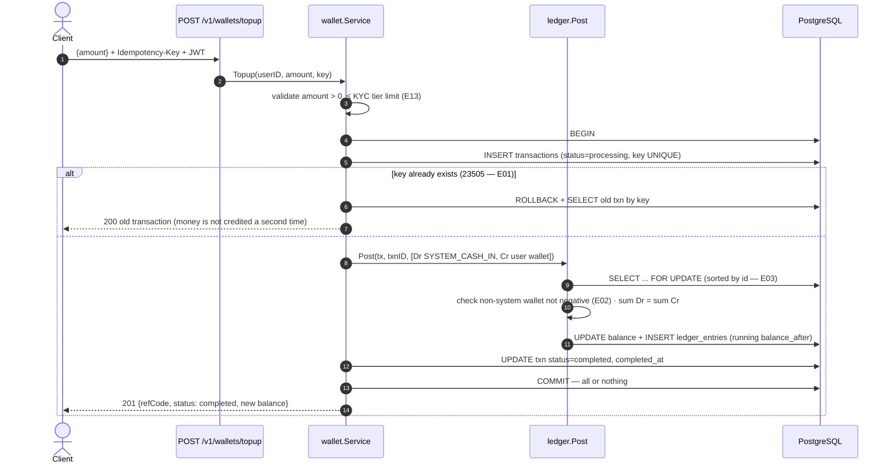
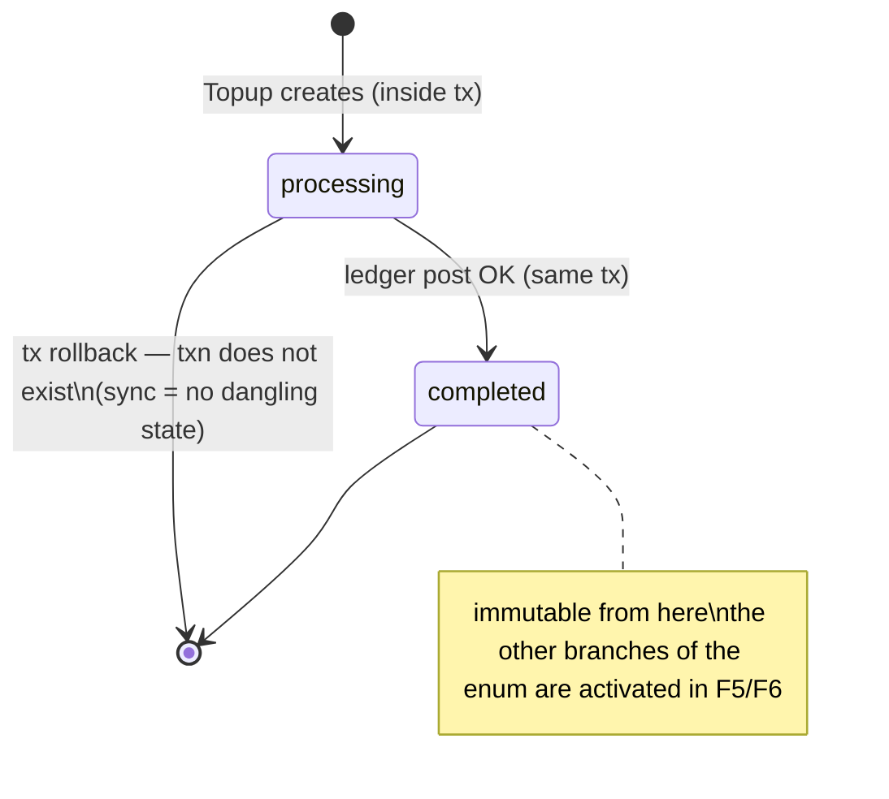
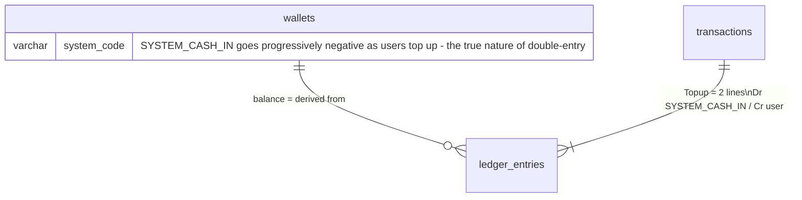

[← Implementation Plan](implementation-plan.md) · f3-ledger-wallets

# F3 Ledger & Wallets — Solution Architecture

## 1. Context

**Central principle:** `ledger.Post` is the ONLY door that changes a balance — every module (topup today, engine F5, reversal F9, vault move P2) goes through it. There is no UPDATE wallets anywhere else.

## 2. Main flow — Topup (sync) & Post

## 3. State — transaction (the part F3 activates)

## 4. Data model delta

No structural change — seed only. Relationships used:

## 5. Decisions & trade-offs

| Decision | Alternative | Why |
| --- | --- | --- |
| Sync topup in 1 DB tx, not through the engine | Route topup through a workflow like P2P | The bank mock answers instantly — adding 4 async hops just to look alike is over-engineering; the engine is for flows with risky steps (fraud check, approval). Trade-off: 2 code paths — accepted, both converge at ledger.Post |
| Idempotency via UNIQUE constraint + return the old txn on conflict | Full response-cache table | Simple, atomic, correct enough: the client gets back the transaction (the entity) rather than a byte-for-byte response; add a response cache when there is a real need |
| balance_after written as a running value in leg order within one Post | Write only the final balance | Audit can read each step; internal recon can match each line |
| Per-txn limits as constants in code | Limit policy table | F5 will have fee_policies — fold limits into it in one go, avoid doing it twice |

## 6. Invariants touched

| Invariant | Guaranteed at |
| --- | --- |
| Sum Dr = Sum Cr per transaction | `ledger.Post` validates before touching the DB + unit test |
| balance = SUM(ledger) per wallet | Post updates balance and entries in the same tx; the integration test re-asserts via SQL |
| No deadlock on cross transfers | Lock ordering sorted by wallet_id — E03 tests both directions concurrently |
| User wallet never negative | Check inside Post after locking + CHECK constraint as the last line — E02 |
| Retry does not double money | UNIQUE idempotency_key — E01 |
