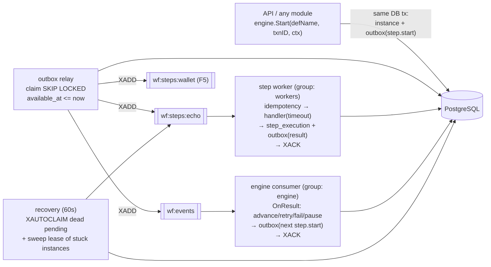
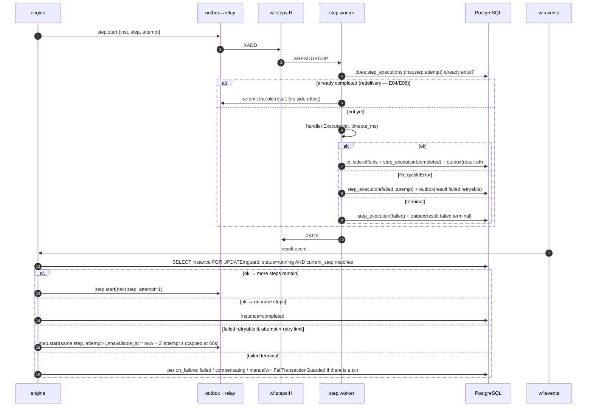
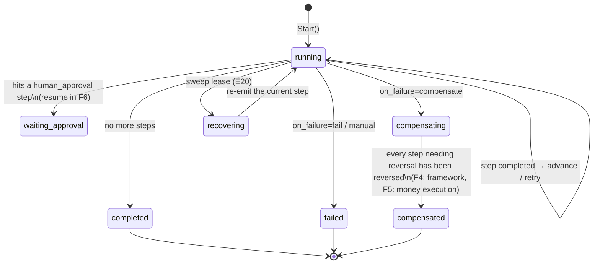
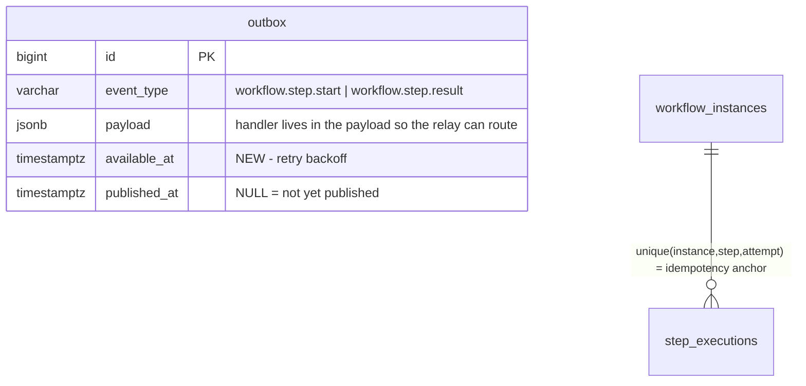

[← Implementation Plan](implementation-plan.md) · f4-workflow-engine

# F4 Workflow Engine — Solution Architecture

## 1. Context — components and event flow

## 2. Main flow — full lifecycle of one auto step (including failure branches)

## 3. State — workflow instance (F4 fully activates it except resume)

## 4. Data model delta

## 5. Decisions & trade-offs

| Decision | Alternative | Why |
| --- | --- | --- |
| Backoff via `outbox.available_at` | asynq delayed task / Redis ZSET | A retry is a decision already committed in the DB — keeping it in the DB preserves the invariant "an event is not lost after commit"; the relay only needs one more WHERE condition |
| The worker re-emits the result event on redelivery instead of staying silent | Ignore the duplicate message | If a crash happens AFTER step_execution is written but BEFORE the relay emits the result, staying silent = the engine waits forever; re-emitting is always safe because the engine is idempotent (E06) |
| Guard advance by (status, current_step) inside FOR UPDATE | Dedup by event id | No dedup table needed: the instance state ITSELF is the source of truth; stale events neutralize themselves |
| Lease recovery = UPDATE…WHERE updated_at < threshold RETURNING | Advisory lock / separate flag | Learned from TMDS (pending→attempt): 1 SQL statement, race-safe, 2 sweepers never claim the same instance — exactly E20 |
| Test handlers (echo/flaky/boom) instead of waiting for business handlers | Test the engine together with F5 | The engine is proven independently; F5 only has to deal with business logic |

## 6. Invariants touched

| Invariant | Guaranteed at |
| --- | --- |
| An event is not emitted before commit and not lost after commit | outbox is written in the same tx as the instance/step_execution; the relay only reads committed rows — E05 |
| Exactly-once effect on at-least-once delivery | unique(instance,step,attempt) + engine guard — E04/E06 |
| No dangling transaction is forgotten | XAUTOCLAIM + sweep lease — E20 |
| State changes go through guarded transitions | Every UPDATE of instance/transaction carries a WHERE on a valid status |
