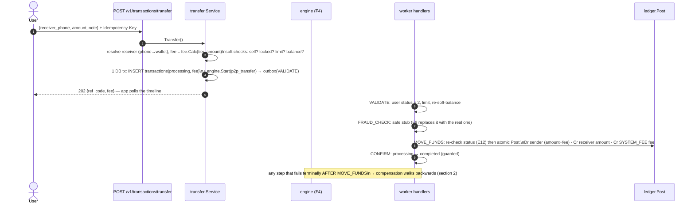
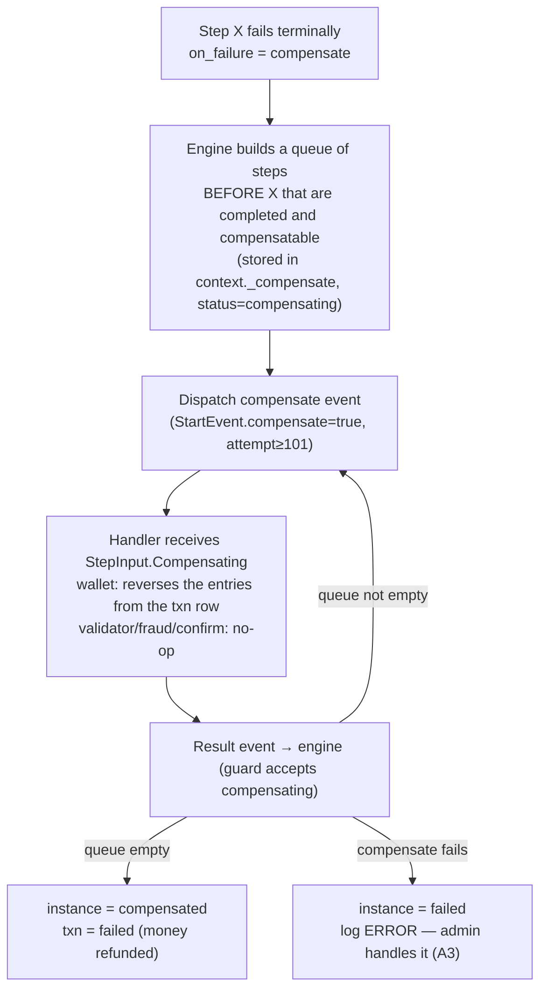
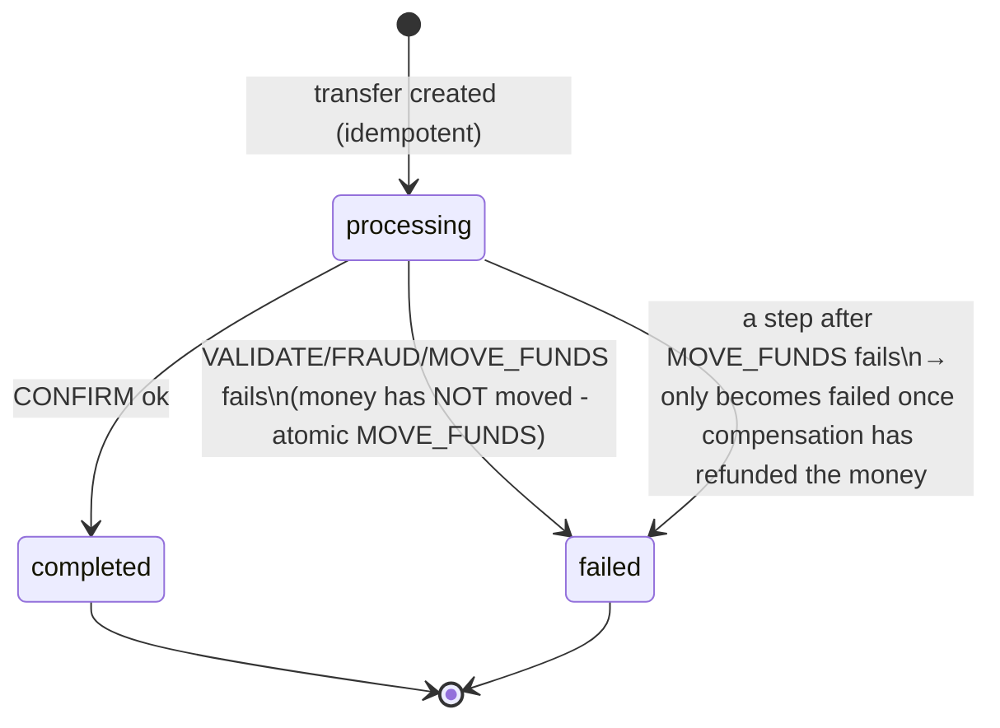

[← Implementation Plan](implementation-plan.md) · f5-p2p-fee

# F5 P2P Transfer & Fee — Solution Architecture

## 1. Main flow — P2P end-to-end

## 2. Compensation — backward walk with a queue

## 3. State — transaction with compensation

## 4. Data model delta

No schema change — seed only (definition + fee policies). Fee is selected by: matching `txn_type` + (`kyc_tier` = my tier PREFERRED over a NULL tier) + is_active, latest version.

## 5. Decisions & trade-offs

| Decision | Alternative | Why |
| --- | --- | --- |
| MOVE_FUNDS as 1 atomic step instead of DEBIT+CREDIT | Keep 2 steps as in docs 00 | Removes the dangling-money state by construction; compensation is only needed for non-money steps after it — far fewer failure paths |
| Compensate reverses from the txn row (deterministic) | Store legs in the step output and read them back | The txn row is the immutable source of truth (amount, fee, 2 wallets); does not depend on the output format |
| Fee computed BEFORE creating the txn, frozen into the fee column | Compute at MOVE_FUNDS | The user sees exactly the number that was previewed; changing a policy midway does not affect running transactions (like a policy snapshot) |
| Attempt ≥ 101 for compensation | Dedicated phase column | No migration needed; unique(instance,step,attempt) remains the idempotency anchor in both directions |

## 6. Invariants touched

| Invariant | Guarantee |
| --- | --- |
| Sum Dr = Sum Cr | 3 forward legs balance (amount+fee = amount + fee); the 3 reversing legs balance too — E07 asserts ledger net 0 |
| No negative wallet | MOVE_FUNDS goes through ledger.Post (check after lock) — inherits E02 |
| Retry does not duplicate | Idempotency-Key at the API + unique step attempt in the engine — inherits E01/E04/E06 |
| Ledger append-only | Compensation = INSERT reversing entries, no UPDATE/DELETE |
