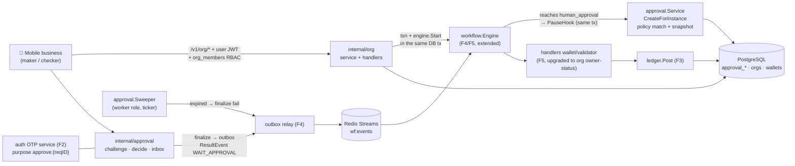
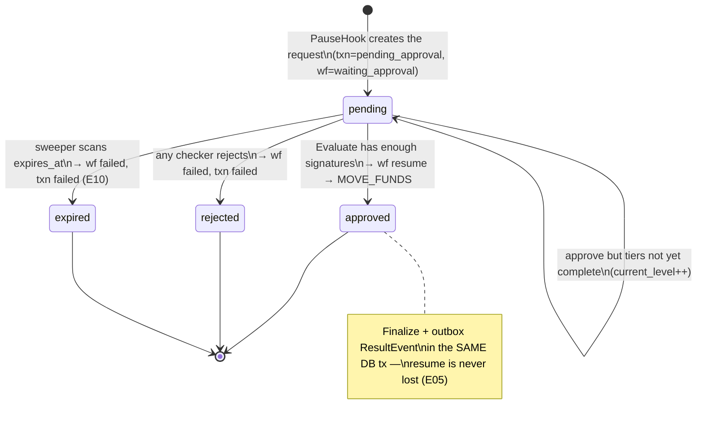
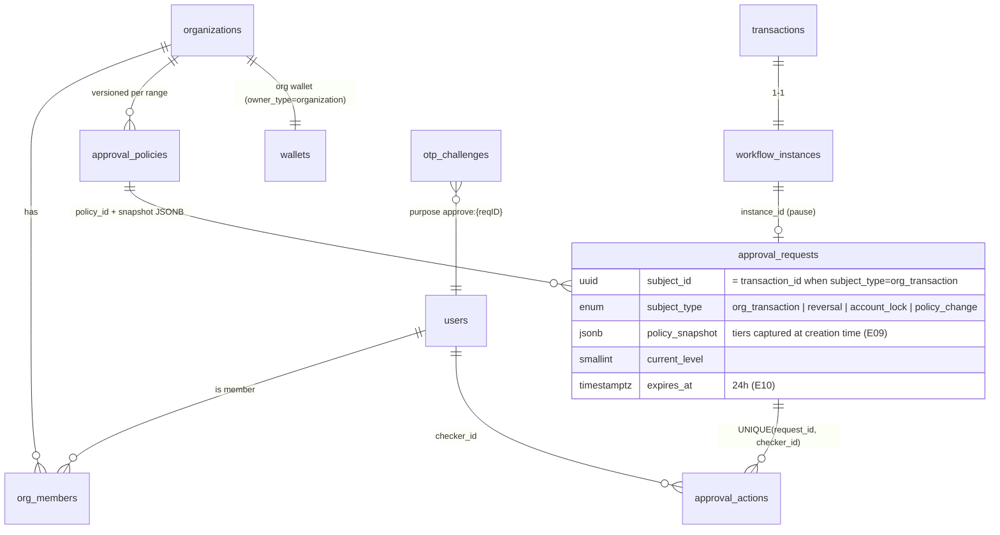

[← implementation-plan](implementation-plan.md) · f6-approval-engine

# F6 Approval Engine — Solution Architecture

## 1. Context — the parts of the system F6 touches



## 2. Main flow — 2-tier org disbursement end-to-end

```mermaid
sequenceDiagram
  autonumber
  actor MK as Maker
  actor C1 as Checker L1
  participant API as API /v1/org
  participant ENG as Engine
  participant APR as approval.Service
  participant DB as PostgreSQL
  participant OB as Outbox→Streams
  participant W as Worker handlers
  MK->>API: POST /org/{id}/transactions (Idempotency-Key)
  API->>DB: check maker role + policy match (fail-fast ERR_NO_POLICY)
  API->>DB: tx: INSERT transactions(org_disbursement) + engine.Start
  Note over ENG,DB: VALIDATE → FRAUD_CHECK run automatically (F5)
  ENG->>APR: advance reaches WAIT_APPROVAL → PauseHook (SAME DB tx)
  APR->>DB: match policy → INSERT approval_requests(snapshot tiers)\n+ txn → pending_approval (guarded)\n+ instance → waiting_approval
  C1->>API: GET /org/approvals?status=pending (My Tasks)
  C1->>API: POST /org/approvals/{id}/challenge
  API->>APR: eligibility (org? checker? level? not yet acted? pending?)
  APR-->>C1: OTP (dev: returns the code; prod: sent via external channel)
  C1->>API: POST /org/approvals/{id}/decide {approve, otp}
  API->>APR: verify OTP → tx: SELECT request FOR UPDATE
  APR->>DB: INSERT approval_actions (UNIQUE blocks double-act, E08)\nEvaluate(snapshot, actions)
  alt next tier remains (L2 not yet signed)
    APR->>DB: current_level = 2 — request stays pending
  else enough signatures
    APR->>DB: request → approved + finalized_at\n+ step_execution(WAIT_APPROVAL, completed)\n+ outbox ResultEvent{step: WAIT_APPROVAL, OK}\n+ audit_log — commit
    OB->>ENG: wf:events → OnResult (loosened guard: waiting_approval + human step)
    ENG->>W: advance → MOVE_FUNDS → CONFIRM
    W->>DB: ledger.Post from the org wallet → txn completed
  end
  alt reject
    APR->>DB: request → rejected + ResultEvent{OK:false}\n→ instance failed + txn failed (guarded), NO ledger entries
  else over 24h (sweeper)
    APR->>DB: claim-lease UPDATE…RETURNING → expired\n→ ResultEvent{OK:false} → clean failure (E10)
  end
```

## 3. State — approval_request and its link to workflow/txn



## 4. Data model delta — no new tables, only relationships that get activated



The schema is 100% in place from migration 000005 (F1). F6's migration 000013 only seeds: definition `org_disbursement` v1 + a 0 VND fee policy for `org_disbursement`.

## 5. Decisions & trade-offs

| Decision | Alternative | Why |
| --- | --- | --- |
| Resume via the **standard ResultEvent** for the WAIT_APPROVAL step (loosen the OnResult guard to accept `waiting_approval` when the step is human) | New event type `approval.finalized` + a dedicated consumer (docs 00 §4.3) | Reuses the entire F4 pipeline (outbox → wf:events → OnResult, idempotent E06 already in place); less code, no extra consumer group. A step_execution is recorded for WAIT_APPROVAL so the timeline is complete. Semantics equivalent to the docs — will be noted in docs 00 after merge |
| **PauseHook interface** in the workflow package, implemented by approval, injected in main | Engine imports approval directly | Avoids an import cycle (approval already imports workflow types); the engine still knows nothing of approval business logic — the correct module boundary |
| Hook + request creation run **in the same DB tx** as AdvanceInstance(waiting_approval) | Create the request asynchronously after suspending | There is never a moment of "instance suspended but no request yet" — the stuck sweeper cannot pick it up by mistake, and checkers never see it missing |
| Finalize + outbox event + audit in **1 FOR UPDATE tx**, UNIQUE(request_id, checker_id) blocks double-act | Optimistic + retry | Correct for E08 in the way DEH already proved (docs 00 §5.2); contention is rare so FOR UPDATE is cheap |
| Executor registry keyed by `subject_type`; F6 only registers `org_transaction` (= resume workflow) | Hard-coded switch-case | F9 adds reversal/account_lock/policy_change by registering executors — no change to the approval core |
| Generic `GetOwnerStatusByWalletID` (user ∪ org) | An if-branch on owner_type in each handler | Fix in one place at the query layer; handlers keep the "owner must be active" logic — an org suspended midway fails like E12 |
| OTP purpose = `approve:{requestID}` | Generic purpose `approve_txn` | Binds the challenge to exactly one request — an OTP requested for this order cannot be used for another; 30s cooldown per request |
| Policy versioning: INSERT a new version + deactivate the old one | UPDATE in place | Pending orders keep their snapshot (E09); policy history is auditable — same principle as the append-only ledger |

## 6. Invariants touched (index.html §8)

| Invariant | How F6 upholds it |
| --- | --- |
| Every balance change goes through `ledger.Post` | Org disbursement goes through the F5 MOVE_FUNDS handler; the approval module does NOT touch the ledger — it only emits the resume event |
| State transitions always have a WHERE status guard | `PendTransactionGuarded` (processing→pending_approval), finalize request WHERE status='pending', OnResult guarded by (status, current_step); no bare status UPDATE |
| Events are emitted only via the outbox | The finalize/expire ResultEvent is written to the outbox in the same tx as the decision — no direct XADD |
| Retries create no double effect | A duplicate finalize event is swallowed by the OnResult guard (E06); UNIQUE(request_id, checker_id) blocks double-act (E08); org topup + disbursement use Idempotency-Key (E01 pattern) |
| Permissions live in the state machine, no if-else bypass | MOVE_FUNDS can only run when the engine advances past a valid WAIT_APPROVAL; the resume event is only produced from the approval module's finalize tx — no bypass flag (fixes the DEH weakness, docs 00 §5.3) |
| OTP hashed, not plaintext; no secrets logged | Reuses the F2 OTP service as-is (hash bound to challenge id, TTL 120s, max 3 — E11 already tested); decide does not log the code |

> **Interview talking point of this phase:** the same engine runs both the automatic flow (P2P) and the human-in-the-loop flow (org) — they differ by exactly 1 line in the JSONB definition; and policy snapshot + FOR UPDATE + UNIQUE is the trio that defeats every maker-checker race (E08/E09) without needing a distributed lock.
